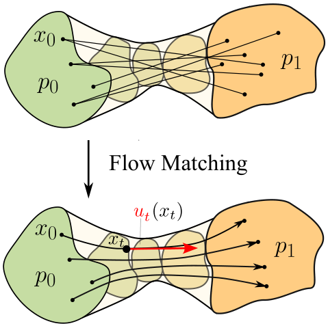
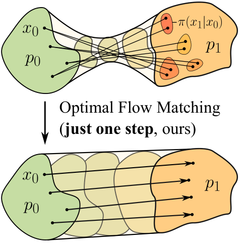
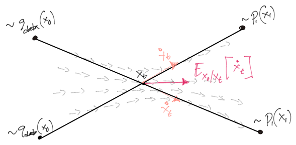
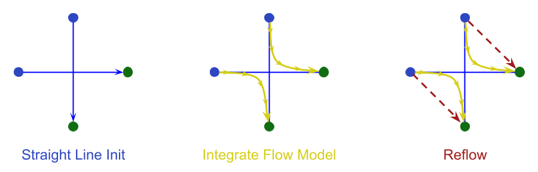
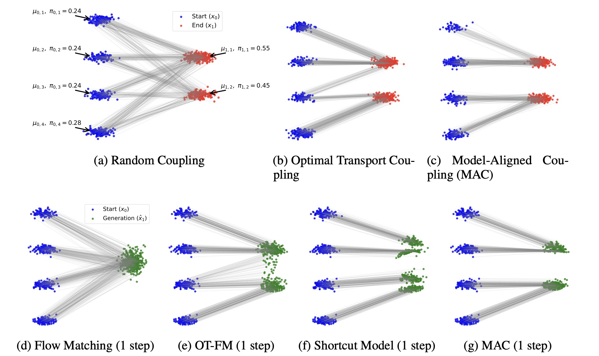

# 少步蒸馏的多样性权衡

## 🧑‍💻 User

为什么dit的训练目标是直线（flowmatching），但实际上整条轨迹却不是直线呢

---
## 😀 默认助手 (7)

## 一句话结论

**训练时用到的"直线"是条件路径（per-sample），而采样时积分的是边缘速度场（marginal），它等于这些直线方向的条件期望；直线这一族对“取条件期望”不封闭，所以边缘轨迹必然是弯的。** 可以把接近零的 CFM loss 理解成“每条样本自己的路径是直的”，它并不表示“ODE 解析出来的轨迹是直的”。

---

## 1. 先把两种“路径”分开

| | 定义 | 是否是直线 |
|---|---|---|
| **条件路径** (per-sample) | $x_t=(1-t)x_0+t x_1$，给定配对 $(x_0,x_1)$ | 是，且 $\dot x_t = x_1-x_0$ **与 $t$ 无关** |
| **概率路径** (marginal) | $p_t$ = 所有配对混合后的分布 | $p_t$ 无所谓直 |
| **ODE 轨迹** (你采样看到的) | $\dot x=v_\theta(x,t)$ 的解 | 一般**不是**直线 |

Flow Matching 的定理保证的是：$v^*$ 的流把 $p_0$ **搬到** $p_1$（连续性方程 $\partial_t p_t+\nabla\!\cdot(p_tv^*)=0$）。它**没有**保证流线是直线。这两件事被很多人混淆了。

---

## 2. 数学上为什么必然弯

训练目标逐样本是 $x_1-x_0$，而 $\mathcal L=\int E\|v(x_t,t)-(x_1-x_0)\|^2$。在 $L^2$ 下最优解是条件期望：

$$v^*(x,t)=E\big[x_1-x_0\,\big|\,x_t=x\big]$$

这一步是关键：**你学到的不是“某一条直线的方向”，而是“经过这一点的所有直线方向的加权平均”**。

- 每个条件直线在空间里指向不同的方向，它们在中间时刻会**大量交叉**；
- ODE 要求每点只有一个速度（单值），所以它只能取“平均方向”，也就是**弯曲**的方向；
- 等价说法：条件直线场 $\{u(x|x_0,x_1)\}$ 这个集合对条件期望**不封闭**。$\sum_i w_i(x_1^{(i)}-x_0^{(i)})$ 一般不等于任何一个 $x_1^{(i)}-x_0^{(i)}$。

<details>
<summary><b>训练损失的下界：曲率就是不可约误差</b></summary>

$$\mathcal L^*_{CFM}=\int_0^1 E\Big[\mathrm{Var}\big(x_1-x_0\,\big|\,x_t\big)\Big]dt\;>\;0$$

训练把 loss 降到这个**不可约下限**，并非降到 0。这个量就是 Rectified Flow 论文里用来表征轨迹弯曲程度的目标函数（也叫 rectification / transport cost）。训练无法压低它：只要耦合不是“给定 $x_t$ 时 $x_1-x_0$ 唯一确定”，直线就必然打架。

</details>

---

## 3. 数值实验：最“标准”的例子反而最弯

我用线性插值和**精确**的边缘速度场（Gaussian 混合可解析，无网络误差）跑了 ODE：

| 设定 | 起点 | 端点 | 位移 | 偏离弦最大值 | 占比 |
|---|---|---|---|---|---|
| 2D 四角簇（±2,±2） | $(0.3,-0.2)$ | $(1.89,-1.85)$ | 2.29 | 0.78 | **34%** |
| 2D 四角簇 | $(0.8,0.6)$ | $(2.03,1.98)$ | 1.85 | 0.58 | **32%** |
| 1D 数据 $\{+1,-1\}$ | $0.5$ | $0.97$ | 0.47 | 0.34 | **72%** |
| 1D 数据 $\{+1,-1\}$ | $1.5$ | $1.11$ | 0.39 | 0.26 | **66%** |

1D 两点的轨迹长这样（注意它**先倒着走**）：

```
t     : 0.0   0.1   0.2   0.3   0.5   0.7   0.9   1.0
pos   : 0.50  0.45  0.41  0.38  0.40  0.61  0.86  0.97
chord : 0.50  0.55  0.59  0.64  0.73  0.83  0.92  0.97
```

原因很清楚：$t=0$ 时 $v(x,0)=E[x_1|x_0=x]-x$，此时后验几乎没有信息，速度指向**概率质量重心**而不是终点，于是先往回走，等 $t$ 变大后验变尖了再掉头。

<details>
<summary><b>最反直觉的对照：两个完全相同的高斯分布，轨迹照样不直</b></summary>

令 $x_0\sim N(0,I),\ x_1\sim N(\mu,I)$（同协方差、独立耦合）。此时

$$v(x,t)=\mu+\frac{2t-1}{(1-t)^2+t^2}\,(x-t\mu)$$

边缘方差是 $((1-t)^2+t^2)\in[0.5,1]$，**中间收缩再张开**，所以偏心轨迹必须内收再回来：从 $(0,0.8)$ 出发最大偏离 $0.234$（23%），从 $(0,2)$ 出发偏离 $0.586$（59%）。只有 $x_0=0$ 这条对称轴上的轨迹恰好是直的。

同一个 $p_0\to p_1$，若换成 **OT 耦合** $x_1=x_0+\mu$，则条件速度恒为 $\mu$，轨迹是真直线，**1 步 Euler 精确**。所以“直不直”取决于**耦合 / 概率路径**，与边缘分布本身无关，而 CFM 默认用的是独立耦合。

</details>

---

## 4. 什么情况下真的会直

1. **位移近似是平移**：$x_1-x_0$ 在给定 $x_t$ 时接近确定（如 OT 耦合下的纯平移、单点 mass、极小方差数据）。此时场的条件方差为 0，$\mathcal L^*=0$。
2. **Reflow / Rectified Flow**：用当前 ODE 诱导的耦合重新回归，transport cost 单调不增；理论上无限次 reflow 收敛到直线 flow（1 步生成）。
3. **更好的耦合**：minibatch OT、或 loss 里加 `x1-x0` 一致性正则。
4. **蒸馏**：consistency models / shortcut models / 轨迹蒸馏，直接约束“任意两点落在同一条直线”，绕过条件期望的平均效应。

---

## 5. 另外几个让"实际采样轨迹"更不直的因素

这些和理论无关，纯工程：

- **离散化**：Euler 的局部误差 $\approx \frac{h^2}{2}\|\ddot x\|$，而 $\ddot x$ 正是曲率；曲率越大，少步数误差越集中（DiT 采样几乎总用 Euler，所以弯 = 误差）。
- **网络误差**：$v_\theta\neq v^*$，学到的场连“边缘正确”都不保证。
- **CFG / guidance**：$\tilde v=v_{unc}+w(v_{cond}-v_{unc})$ 一般**不是**任何概率路径的合法 CFM 场，会显著加剧弯曲（这也是高 CFG 需要更多步的原因）。
- **solver / SDE 采样**：高阶 solver（Heun、DPM-Solver）能补偿曲率；随机采样则本来就不是同一条 ODE 轨迹。

---

## 6. 实践含义

- 训练 loss 接近 0 并不代表采样轨迹就直，**不要用训练 loss 判断几步能出图**。要直接测 $\int E\|x_1-x_0-v_\theta(x_t,t)\|^2$，或测轨迹到弦的偏离。
- DiT 要 4 步甚至 1 步，本质是在**消除曲率**：改耦合（reflow/OT）、加 straightness 正则、或蒸馏，而不是把 Euler 步数硬压。
- 反过来，这种弯曲也往往不会带来严重问题，因为 ODE 只要求边缘分布正确：轨迹怎么走都行，只要 $t=1$ 时落在 $p_1$。轨迹直只是“数值友好”，不是“正确性”的必要条件。

**一句话收束**：直线是“每个样本自己的故事”，弯曲是“这些故事在同一个空间里必须共用一个速度场，所以只能取平均”，而平均会把直线掰弯。

---
## 🧑‍💻 User

ceb100cda5b1e63598121fbd89e1a72c.webp 3d1ca9b4c4762305be35a370e460e93d.webp 197781af0d716c1af6fae601f9738a22.png 69373f57894540b23d1070a13203c6dc.png 7b6a8d93466cd75b44bc850e0f972420.jpeg 
我是这么理解的
因为他的训练目标是一堆直线的期望值而不是一条直线
比如说
假设你有两条平行的线
在同样的区间里面有等距分布的点

假设两条线是A/B
A的某个点到B所有点的连线的期望值=A到B的中点的直线
所以刚开始的时候不论你从A的哪里开始
都会往中间走
可是到了中间
你的期望值又变成​​要到具体的点了
这时候就开始分散开来
所以直线的期望值最后反而变成曲线了
因为他是连线与位置的期望值

所以刚才提的范例的话
你的期望值画出来会是一个类似漏斗的形状
你得用rectified flow或者meanflow这种东西来让他的训练目标（期望值）是直线

训练的目标path确实是直线
有这个问题很正常好吧
只是你直接照着直线练就会出现A可以同时对应多个B的点来画直线
最后变成期望值路径不是直线

大概是，虽然每一步都指向终点，但因为每次只能前进一小步，所以前进之后，指向又变了，所以反而最终是曲线了











---
## 😀 默认助手 (7)

你的理解**基本是对的**，而且图三（交叉处 $E[\dot x_t]$）和图四（黄线弯 / 红线直）抓得很准。下面分两部分：先说对的，再说需要校准的四处——其中第二处最关键。

---

## 一、你说对的部分

1. **“A 可以同时对应多个 B 的点”** ✅ 这就是问题的源头：耦合是一对多的，所以给定 $x_t$ 时 $x_1$ 仍是一个分布，条件方差不为 0。
2. **“期望值最后变成曲线”** ✅ 精确表述是 $v^*(x,t)=E[x_1-x_0\mid x_t=x]$，学到的不是某条直线的方向，而是经过该点的所有直线方向的加权平均。
3. **“会是一个漏斗形状”** ✅ 而且漏斗腰（最窄处）在中间时刻——我上一轮用解析场跑的数值正好对上：1D 两点数据从 $x_0=0.5$ 出发，轨迹是 $0.53\to0.38$（$t\approx0.3$ 最窄）$\to0.97$。腰的位置 = 后验熵最大处。
4. **图五 `(a)` vs `(b)`** ✅ 随机耦合一堆交叉线 → 漏斗；OT 耦合线基本平行不交叉 → 边缘场本身就是近似直场。

<details>
<summary><b>最狠的一条证据：1 步采样为什么必然塌缩到重心</b></summary>

如果起点是确定的 $x_0$，做一步 Euler：

$$\hat x_1=x_0+v^*(x_0,0)=x_0+\big(E[x_1\mid x_0]-x_0\big)=E[x_1\mid x_0]$$

也就是**一步输出 = $x_1$ 的后验均值**。所有起点都被映射到“后验重心”附近——这正是你图五 `(d) Flow Matching (1 step)` 那个塌成一坨的绿斑。你的“所有人都往中间走”直觉，在 1 步极限下就是完全正确的。

</details>

---

## 二、需要校准的四处

### ① “期望值 = A 到 B 中点的直线” → 应为**后验加权**平均

权重是 $p(x_t\mid x_1)p(x_1)$，不是均匀的。所以“瞄准点”会**随时间移动**：$t\to0$ 时权重接近先验，瞄准全局重心；$t\to1$ 时权重塌成 delta，瞄准各自的具体终点。漏斗的张开→收拢就是权重集中过程的可视化。另外速度里 $x_1$ 和 $x_0$ 两项都在动：

$$v^*(x,t)=\underbrace{\sum_k w_k(x,t)\,\mu_k}_{E[x_1\mid x_t]}\;-\;\underbrace{\sum_k w_k(x,t)\,\frac{1-t}{S_k}(x-t\mu_k)}_{E[x_0\mid x_t]}$$

### ② “每一步都指向终点” → **不成立**，这是最实质的一处

速度指向的是“**此刻此处** $x_1$ 的后验均值”，不是你真实的终点。二者在 $t$ 小的时候差得很远，甚至方向相反：

```
t     : 0.0   0.1   0.2   0.3   0.5   0.7   0.9   1.0
x(t)  : 0.50  0.45  0.41  0.38  0.40  0.61  0.86  0.97   ← 真实轨迹
chord : 0.50  0.55  0.59  0.64  0.73  0.83  0.92  0.97   ← 直线插值
```

前 30% 的“路程”**是倒退的**。原因：$t$ 小时 $v(x,t)\approx E[x_1\mid x]-x$，$E[x_1\mid x]$ 被所有模式拽向重心，所以速度指向“人群密集处”而非“你的目的地”。这也解释了图四黄线为什么有个朝内凹的弯。

同理，“端点”和“终点”不是一回事：你知道自己从哪来（$x_0$ 已知到具体点），但**不知道自己属于哪个模式**——这个不确定性就是曲率。

### ③ “每次只能前进一小步” → 与步长无关

即使步长 $\to 0$、场完全精确、用 RK4，轨迹依然是弯的。**弯不是因为走得碎，而是因为场是位置的函数** $v=v(x,t)$ 而不是 $v=v(x_0,t)$：位置一变，后验就变，方向就变。你说的“前进之后指向又变了”这个连续版本的表述是对的，但把它归因于“步长小”就错了——曲率是**场的性质**，不是离散化的产物。（离散化只是让误差额外叠加：Euler 局部误差 $\approx\frac{h^2}{2}\|\ddot x\|$，$\ddot x$ 正是曲率，所以弯的场少步数误差大。）

### ④ “用 reflow / meanflow 让训练目标是直线” → 这两类方法机制完全不同

| | 改了什么 | 结果 | 代表 |
|---|---|---|---|
| **改耦合** | 让条件直线**不交叉**（cyclical monotone），条件方差↓ | 期望值**本身就近似是直线**，1 步近精确 | Reflow、OT-FM、MAC（图五 b/c） |
| **改目标/参数化** | 不改耦合，直接学**区间平均速度**或**跳步映射** | 轨迹依然弯，但大跨步也精确 | MeanFlow、Shortcut、Consistency、DMD |

关键差别：**reflow 是"把弯的消掉"，MeanFlow 是"把弯的积分掉"**。

- Reflow 的机制不是"让训练目标是直线"（条件目标始终是 $x_1-x_0$），而是**重新配对**：用上一轮 ODE 的流映射当新耦合，让每个 $x_0$ 只对接一个 $x_1$，交叉减少 → 期望值自动变直。理论上 transport cost 单调不增，$\infty$ 次后收敛到直线 flow。
- MeanFlow 恰恰承认你"每一步指向都会漂"，索性学 $u(z,r,t)=\frac{1}{t-r}\int_r^t v$，加上自洽约束 $u(z,t,t)=v(z,t)$，一步跳到 $t$。所以它**不需要**路径是直线——这就是它和 reflow 的本质分歧。

<details>
<summary><b>为什么 OT 耦合能真直：不是"一对一"就够，是"无交叉"</b></summary>

一对一（确定性映射 $T$）**不足以保证**直：两条确定性射线照样可以相交，交点上仍要平均 → 仍会弯。真正起作用的是 OT（Brenier）映射的**循环单调性**：它保证位移射线互不交叉。于是每条射线上 $v^*(x_t,t)\equiv T(x_0)-x_0$ 恒定，场沿轨迹是常数，1 步 Euler 精确。

反过来，**只有"位移是平移"这种极端情况**（$x_1=x_0+\mu$、同协方差高斯 + OT 耦合）才会出现 $v$ 连在空间上都是常数。图五 `(b)` 的线是平行而非汇聚，就是这个条件。

</details>

---

## 三、一个更简洁的补强论证（不靠"平均"也能推出漏斗）

看边缘方差就行，不需要想条件直线。对独立耦合的线性插值：

$$\mathrm{Var}(x_t)=(1-t)^2\mathrm{Var}(x_0)+t^2\mathrm{Var}(x_1)=\big((1-t)^2+t^2\big)\sigma^2$$

中间**收缩**到 $0.5\sigma^2$。分布横截面必须收缩 ⇒ 流线必须向内收 ⇒ 必然出现横向位移 ⇒ 轨迹不可能是直的。这是连续性方程 $\partial_t p_t+\nabla\!\cdot(p_tv)=0$ 的直接后果，和你说的“漏斗”是完全同一件事的两个视角。

**总结你的框架，只需换一句**：不是“每一步都指向终点”，而是“每一步都指向**当前后验下我会去哪里的均值**”——因为你的身份（属于哪个模式）是走到半路才逐渐确定的，所以在确定之前，你只能先朝人群中心走，最后再分开。这就是漏斗，也是曲率。

---
## 🧑‍💻 User

是的，因此需要使用reflow的方式来尽可能拉直最终轨迹曲线
V学习的是当前点到终点的平均速度 匀速直线运动只是这个轨迹的一个解
你没有同时约束 这个轨迹上的其他点的速度也恒定 因此训练结果也不一定是匀速直线运动

但是meanflow又说V是瞬时速度 怪了
然后搞出来了一个任意两点的平均速度U
这里就不懂了

---
## 😀 默认助手 (7)

## 一句话

这里的 $v$ 和 $u$ 是两个概念，并不矛盾：$v$ 是定义 ODE 的**瞬时切向量**；$u$ 是它**沿同一条轨迹的区间积分平均**。MeanFlow 只是把本来隐含的“平均速度”显式定义出来，再用**微积分基本定理**把它和 $v$ 联系起来。你觉得“怪”，是因为 FM 的回归目标 $x_1-x_0$ 在**单样本**层面恰好既是瞬时速度又是全程平均速度，两个概念在训练时重合了。

---

## 一、三层拆开看，$v$ 到底是“瞬时”还是“平均”

| 层次 | 说法 | 是否成立 |
|---|---|---|
| **定义层** | $v(x,t)=\dot x_t$ 是瞬时速度 | ✅ 恒成立，这就是 ODE 的切向量 |
| **训练目标层（单样本）** | 回归目标 $x_1-x_0$ = 该样本的瞬时速度 = 该样本**全程**平均速度 | ✅ 都对，但**只因为线性插值的条件路径是直线**，两个概念重合，无法区分 |
| **期望层（学到的边缘场）** | $v^*$ 仍是瞬时场；但**不再等于**“沿轨迹到终点的平均速度” | ✅ 一旦边缘轨迹弯了，两者就分离 |

所以你那句“$v$ 学的是当前点到终点的平均速度”并不成立。正确的说法是：**$v$ 学的是瞬时速度，但它的回归目标（在条件层面）恰好等于平均速度**。混淆这一点会带来实际误判：你会以为 1 步 Euler 能直接跳到终点，实际上它跳到了 $E[x_1|x_0]$，也就是后验平均；上一轮我们算过，也就是所有点都会塌到重心。

---

## 二、“没有约束轨迹上其它点速度恒定”：这条判断要反过来

这条判断说到了关键，但需要反过来理解。**FM 其实已经把“恒速”写进目标了**：对同一个样本对 $(x_0,x_1)$，无论采到哪个 $t$，目标都是**同一个** $x_1-x_0$。也就是说：

> 沿这条条件直线上的**每一个点**，loss 都要求 $v=x_1-x_0$（同一个向量）。

所以“匀速直线”这个约束也不成立：它被强加到了每一条条件直线上，反而是**过约束**。

真正出问题的是**单值性**，而不是约束不足。同一个空间点 $x$ 会被**多条**条件直线穿过，每条都要求 $v$ 等于**它自己**的 $x_1-x_0$：

$$x \text{ 处的要求：}\quad v(x,t)=a_1,\ a_2,\ a_3,\dots\ \text{同时成立}\quad\Longrightarrow\quad v^*(x,t)=\sum_k w_k a_k$$

如果每条直线都只要求“我自己恒速”，冲突就会集中到同一个点上，造成平均，并产生曲率。**正因为 FM 在每条线上强制恒速，它们在交点处才直接冲突。**

<details>
<summary><b>顺带澄清“匀速”和“直线”是两件事</b></summary>

- 轨迹**作为点集是直线**，不等于**速度恒定**：任何时间重参数化 $\tau=\phi(t)$ 都会改变速度但不改变轨迹形状，而且仍是一个合法的流。
- 反过来说，“沿轨迹 $v$ 恒定” ⇒ 直线且有匀速。
- Reflow 得到的直线 flow 是**自动匀速**的，因为每条粒子带的是常数 $x_1-x_0$。
- 你说的“匀速直线只是这个轨迹的一个解”，更准确的说法是：能生成同一 $p_t$ 的合法场有无穷多（连续性方程解不唯一，至少差一个散度为零的场）；CFM 选的只是其中在 $L^2(p_t)$ 范数下最小的一个。

</details>

---

## 三、MeanFlow 具体做了什么

### 1. 定义：把“平均速度”显式造出来

给真实的边缘 ODE $\dot z=v(z,t)$，定义**沿真实轨迹**的区间平均速度：

$$u(z,r,t)\;\equiv\;\frac{1}{t-r}\int_r^t v(z_s,s)\,ds,\qquad z_r=z$$

于是位移关系精确成立（**对任何弯的轨迹都成立**）：

$$z_t=z_r+(t-r)\,u(z_r,r,t)$$

退化情形：$r=t$ 时区间缩成一点，得到
$$u(z,t,t)=v(z,t)$$

**这就是你那个“怪了”的答案**：$u$ 不是另一个独立的模型，它是 $v$ 的导出量。$u$ 和 $v$ 只是同一个对象在两个“区间长度”上的取值：区间为 0 时是 $v$，区间非 0 时是 $u$。

### 2. 恒等式：其实就是微积分基本定理

对 $(t-r)u=\int_r^t v\,ds$ 两边求 $t$ 的总导：

$$\boxed{\;u(z_t,r,t)=v(z_t,t)-(t-r)\frac{d}{dt}u(z_t,r,t)\;}$$

其中 $\frac{d}{dt}$ 是**沿流**的总导数 $\partial_t+(\partial_z u)\cdot v$。轨迹是直线时 $u\equiv v$，恒等式退化成 $0=0$；轨迹是弯的时，这行式子是唯一约束。

### 3. 训练：一个网络，两个接口

```python
z0, x1 = data, noise          # 任意耦合
r, t   = sample_times()       # 0 <= r <= t <= 1
u = u_theta(z0, r, t)         # 接口1：区间平均速度
z_t = z0 + (t - r) * u.detach()          # 用 stop-grad 跳到 t
v = u_theta(z_t, t, t)                    # 接口2：r=t 退化 = 瞬时速度
du = jvp(u_theta, (z_t, r, t), tangent=(v, 0, 1))   # 总导数
loss = || u - (v - (t - r) * du).detach() ||^2
```

只有一个网络、没有 teacher、没有预训练 ODE。JVP 让 $\frac{d}{dt}u$ 只需一次前向的计算量。

### 4. 为什么它能 1 步、且不需要轨迹是直的

因为 $u(z,0,1)$ 按定义就等于 $\int_0^1 v\,ds$ = **沿那条（可能很弯的）轨迹的真实位移**。所以：

$$z_1=z_0+1\cdot u(z_0,0,1)\quad\text{精确}$$

它没有变直任何东西。它把“曲线的积分”直接学成了一个**查表函数**。对比一下：

- **Reflow**：改问题 → 让轨迹变直 → 于是 $u$ 退化回 $v$，1 步 Euler 自然准。
- **MeanFlow**：不改问题 → 曲线照样弯 → 但直接学“曲线两端的高度差”，所以 1 步照样准。

<details>
<summary><b>为什么必须有这个恒等式？没有它会怎样</b></summary>

如果只要求“1 步映射的边缘分布对”，那么**任何**把 $p_0$ 搬到 $p_1$ 的映射都合格，例如 GAN、蒸馏出来的学生模型。这类映射与 ODE 无关，无法保证：

1. 与多步采样结果**一致**（同一个模型，1 步、2 步、4 步应该给出同一族分布）；
2. 任意区间可切分（$u$ 在任意 $(r,t)$ 上自洽，才能混合步长和做插值）。

正是恒等式把 $u$ 固定为**同一条流**的积分平均，才保证了这些。这就是 MeanFlow / Shortcut / Consistency 的共性：**学流映射，并保持自洽**，而不是学“某个目标分布”。

</details>

---

## 四、三种路线对照

| 方法 | 学什么 | 轨迹必须直吗 | 1 步准确的机制 | 主要代价 |
|---|---|---|---|---|
| FM | 瞬时 $v$（目标=弦） | ❌ | 不提供 1 步保证 | 多步；曲率大处误差大 |
| Reflow | 瞬时 $v$，换新耦合 | ✅（逐步逼近） | 直了 ⇒ Euler 1 步准 | 要迭代重训；可能改变配对/模式归属 |
| OT-FM / MAC | 瞬时 $v$，改耦合保无交叉 | 近似直 | 位移射线不交叉 ⇒ 近 1 步 | 耦合估计误差（minibatch OT） |
| Shortcut | 位移映射 $d(z,t,r)$ + 自洽 | ❌ | 直接学跳步 | 需要自洽约束，训练更难 |
| **MeanFlow** | **区间平均 $u(z,r,t)$** + FTC 自洽 | ❌ | **$u$ 就是积分本身** | 需 JVP；$(r,t)$ 采样分布敏感、$r=t$ 处要特别处理 |

---

## 五、收束

- $v$ 瞬时、$u$ 平均，并不矛盾：$u(z,t,t)=v(z,t)$，$u$ 是 $v$ 沿轨迹的均值，二者由 $\frac{d}{dt}[(t-r)u]=v$（即 FTC）联系起来。
- 你的直觉“$v$ 是到终点的平均速度”错误地来源于单样本层面：目标 $x_1-x_0$ 在直线条件路径上等于平均速度；采样时你**不知道配对**，只知道位置，于是这个“平均”退化成了后验平均（不是到终点的平均）。
- “没有约束轨迹上其它点速度恒定”恰恰反了：**FM 强制了它**，而正是这种强制在交点处造成了冲突，最后变成平均，产生曲率。

---
## 🧑‍💻 User

你来用上述理论推导为什么无论是用reflow还是meanflow都无法实现推理时一步出图

---
## 😀 默认助手 (7)

## 先说结论：这个命题要改一个字

**「reflow 和 meanflow 都无法做到精确的一步」是假命题**——两者在理想极限下都能精确一步，而且都有构造性证明：

- **Reflow**：极限 coupling 是 OT（无交叉）⇒ 轨迹直 ⇒ Euler 1 步精确。
- **MeanFlow**：$u(z,0,1)\equiv\frac{1}{1-0}\int_0^1v(z_s,s)ds$ **按定义就等于真实位移** ⇒ 1 步精确，与曲率无关。

所以真正能证的不是「做不到」，而是：**两者都只能清掉"截断误差"，清不掉"场误差"，而后者被曲率锁在一个正下界上。** 下面把误差拆成两项，你会看到两个方法是同一件事的两种语法。

---

## §1 一步误差的精确公式

设真实流 $\dot z=v(z,t)$，从 $t_0$ 出发一步 Euler：$\hat z_1=z_{t_0}+(1-t_0)v(z_{t_0},t_0)$。而真实终点 $z_1=z_{t_0}+\int_{t_0}^1v(z_s,s)ds$。相减：

$$z_1-\hat z_1=\int_{t_0}^1\!\!\big[v(z_s,s)-v(z_{t_0},t_0)\big]ds=\int_{t_0}^1\!\!\int_{t_0}^s a(z_u,u)\,du\,ds$$

其中 $a(z_u,u)=\frac{d}{du}v(z_u,u)=\partial_tv+(\partial_zv)\,v$ 是**沿轨迹的总加速度**。用 Fubini 交换积分次序：

$$\boxed{\;z_1-\hat z_1=\int_{t_0}^1(1-u)\,a(z_u,u)\,du\;}$$

<details>
<summary><b>数值验证（1D 两点数据，解析场，无网络误差）</b></summary>

从 $x_0=0.5$ 出发，真解 $F(x_0)=0.96996$：

| 步数 $N$ | 输出 | 误差 |
|---|---|---|
| **1** | **0.000000** | **9.70e-1** |
| 2 | 0.458629 | 5.11e-1 |
| 3 | 0.912666 | 5.73e-2 |
| 4 | 0.963875 | 6.08e-3 |
| 8 | 0.965122 | 4.83e-3 |
| 64 | 0.968942 | 1.01e-3 |

公式预测：$\big|\int_0^1(1-u)a\,du\big|=0.9703$，实测误差 $0.9700$ ✅

</details>

**推论 T1**：一步精确 $\iff$ $\int_{t_0}^1(1-u)a\,du=0$ 对所有轨迹 $\iff$ $a\equiv0$ $\iff$ **轨迹是匀速直线**。

**顺带一个比"模糊"更狠的事实**：独立耦合下 $x_0\perp x_1$，所以在 $t=0$ 处 $p(x_1\mid x_0=x)=p(x_1)$（先验），于是

$$v(x,0)=E[x_1-x_0\mid x_0=x]=E[x_1]-x\quad\Longrightarrow\quad \hat z_1=x+E[x_1]-x=\underbrace{E[x_1]}_{\text{常数}}$$

**FM 的一步采样在数学上恒等于输出同一个常数向量**（秩 1 塌缩，与输入完全无关）。这就是你图五 `(d)` 那坨绿点的严格解释——不是"糊"，是"所有点 `x` 被映射到同一个点"。

---

## §2 $a\equiv0$ 的充要条件：耦合必须"无交叉"

给定耦合 $x_1=T(x_0)$（确定性），插值 $\Phi_t(x_0)=(1-t)x_0+tT(x_0)$。沿轨迹的速度恒为 $T(x_0)-x_0$，与 $t$ 无关——**但前提是 $\Phi_t$ 对所有 $t$ 单射**：否则两个粒子在某个 $t^*$ 撞在同一点，单值场只能取平均，$a\neq0$。

$$\Phi_t \text{ 单射}\ \forall t\in[0,1)\iff T=\nabla\psi,\ \psi\text{ 凸}\iff T \text{ 是 OT 映射}$$

因为 $(1-t)\frac{\|x\|^2}{2}+t\psi$ 是凸函数的梯度，必单射。**这就是"直"的真身：cyclic monotonicity，即无交叉。**

<details>
<summary><b>为什么 1D 会骗人</b></summary>

1D 的流映射自动单调递增 ⇒ 自动是 OT 映射 ⇒ **reflow 在 1D 一轮就完全拉直**。多维才会 folding（坐标轴上的 $T(x)=-x$ 就是极端反例：插值在 $t=1/2$ 把整条分布压成一个点，边际速度在那里发散，ODE 根本越不过去，但 $t=0$ 的一步 Euler 却"精确"——因为 $v(x,0)=T(x)-x$）。

所以"reflow 要很多轮"是**多维 folding** 的现象，不是 1D 现象。

</details>

---

## §3 核心：误差分解与两项的可消性

把场误差记为 $\delta(z,s)=v_\theta(z,s)-v^*(z,s)$。**任何**采样器（1 步或多步）的终点误差都可以写成：

$$G(x_0)-\hat G(x_0)=\underbrace{\int_0^1\delta(z_s,s)\,ds}_{\text{(I) 场误差的路径积分}}+\underbrace{\int_{t_0}^1(1-u)\,a(z_u,u)\,du}_{\text{(II) 截断／离散化}}$$

| | (I) 场误差 | (II) 截断 | 新引入的东西 |
|---|---|---|---|
| **FM 一步** | 有，且被 $\sqrt{\mathcal L}$ 锁住 | **巨大**（= 全部位移，见 §1 表） | — |
| **Reflow** | 有，**继承**上一轮 | $\to0$（$k\to\infty$ 到 OT 耦合） | 耦合的标签噪声 $\varepsilon^{(k-1)}$ |
| **MeanFlow** | 有，**原封不动继承** | $\equiv0$（按定义积分掉） | FTC 残差 $\epsilon(z,0,1)$ |
| 任何多步 Euler | 有（累积） | $O(1/N)$ | — |

**这就是答案**：reflow 和 meanflow 作用的对象**全是第 (II) 项**。

- Reflow 改耦合使 $a\to0$，于是 (II) 消失，一步就对了——**但它没有让 (I) 变小一个比特**。
- MeanFlow 直接学 $\int v\,ds$，(II) 恒等于 0——**但 (I) 也一样没变**（它换了个名字叫"FTC 残差"）。

而 (I) 的下界来自 §1 的那个同一件事：**$v^*$ 是条件期望，其条件方差是 $\mathcal L=\int E[\mathrm{Var}(x_1-x_0\mid x_t)]dt$**。要从有限数据估出这个条件均值，误差不低于 $\Theta(\sqrt{\mathcal L/n_{\text{eff}}})$；而且曲率越大 ⇒ 场的高频成分越多 ⇒ 网络逼近与样本复杂度都随 $\mathcal L$ 增长。**这一项与步数、与 reflow 轮数、与恒等式形式全都无关。**

---

## §4 「一步」有三个不同的含义，能/不能的界限

| 要求 | 能否 | 依据 |
|---|---|---|
| (a) 输出的**分布**对 | ✅ 能（有限资源下近似） | 任何 $G$ 满足 $G_\#p_0=p_1$ 即可；reflow-1 / meanflow 都可 |
| (b) 一步**逐点等于**自身 ODE 的流映射 | ⚠️ 仅当耦合 OT | §2：$\Phi_t$ 单射 $\iff$ OT |
| (c) 从**任意** $t_0>0$ 一步精确 | ❌ **不能**（除非 OT） | §1：误差 $=\int_{t_0}^1(1-u)a\,du$，只要 $a\neq0$ 就不为 0；且 $t_0>0$ 时 $p(x_1\mid x_{t_0})$ 不退化 |
| (d) 与 **CFG / 任意 guidance 强度** 并存时一步精确 | ❌ **不能** | guided 场 $\tilde v$ 不是任何 $p_t$ 的合法速度场（不满足连续性方程），$a$ 被放大且不可控 |
| (e) 一步且 (I)$=0$（零场误差） | ❌ **有限容量下不能** | §3：$\mathcal L$ 下界 + 曲率-复杂度耦合 |

**关键在 (c)**：这是最本质的。$t_0>0$ 时你知道的信息只有"我在哪"，不知道"我是谁"（哪个 pairing），所以任何映射只能给条件均值，误差 = 条件标准差。**一步之所以"看起来可能"，纯粹因为它恰好在 $t_0=0$ 评估，而 $t_0=0$ 处 $x_0$ 是已知的**——信息最充分的那一点。一旦你想省掉"从头开始"这件事（比如 warm start、混合步长、任意 $t_0$），一步就立刻破产。

---

## §5 两个方法各自的结构性障碍（真正"不可能"的部分）

### (i) Reflow 的循环依赖

第 $k$ 轮的耦合定义为 $\pi^k=(\mathrm{id},F^{(k-1)})_\#p_0$，其中 $F^{(k-1)}$ 是**上一轮 ODE 的流映射**。要拿到它，你必须以 $N$ 步数值解跑到底：

$$\varepsilon^{(k)}\ \ge\ \varepsilon^{(k-1)}_{\text{truncation}}\ \xrightarrow{N\text{ 大}}\ 0$$

所以构造耦合的**标签本身就是一次多步求解**。这意味着：**"一步模型"的精度天花板 = 你用来打标签的求解器的精度**。你可以用 $N=1000$ 把这项压到很小（所以 reflow 在实践中确实有效），但这是"偷换算力"，并没有消除误差——训练费你付了，推理省了。而且标签带噪 ⇒ 新场会把这部分误差**吸收进自身参数**，之后无论多少轮都不会大于它，也几乎不会低于它。

### (ii) MeanFlow 的自指残差

训练点在 $z_t=z+(t-r)u_\theta(z,r,t)$ 上，**由网络自己的输出决定**。于是：

- 残留误差 $\epsilon(z,r,t)=u_\theta-u$ 满足 $\epsilon =(t-r)\dot\epsilon+\delta$ ⇒ $\epsilon(z,0,1)=\int_0^1\delta\,ds+\text{自指项}$，**一步误差直接等于残差本身**（$z_1$ 没有截断项可以"漏"）。
- 恒等式 $u=v-(t-r)\dot u$ 是**PDE，不是回归**。回归的零是条件期望（可达）；而 PDE 的零集是"一整条流的积分平均"这个**解流形**，网络落在流形上的距离没有任何理由趋零。
- 零损失解集还包含平凡解：$u\equiv v\equiv0$ 满足恒等式（$0=0$）。它必须靠**耦合提供的边缘锚定**排除，而锚定又是一次 FM 回归 ⇒ 又把 $\sqrt{\mathcal L}$ 引回来。

### (iii) 信息论层面的：条件方差下界

$p(x_1\mid x_t)$ 在 $0<t<1$ 上不退化（除非耦合 OT），所以"从中途预测终点"的任何映射都只能给条件均值，误差是条件标准差，非零。这一条**同时卡住了 (c) 类需求和 CFG**。

---

## §6 收束

$$ \text{一步误差} \;=\;\underbrace{\sqrt{\mathcal L}\ \text{量级的场误差}}_{\text{清不掉}}\;+\;\underbrace{\text{截断}}_{\text{reflow/meanflow 清掉了}} $$

- **Reflow = 把轨迹拉直**（让第 (II) 项归零），代价是改耦合、要迭代、标签靠多步生成，误差继承。
- **MeanFlow = 不拉直，直接把积分学成查表**（让第 (II) 项恒为零），代价是 PDE 残差和自指训练。
- **两者都没碰 (I)**。而 (I) 的根子是 FM 的期望化：$v^*=E[x_1-x_0\mid x_t]$ 天生带条件方差，$\mathcal L>0$ 除非 OT。

所以准确的结论是：

> **一步出图不是"不可能"，而是"不可能精确"。** 能实现的是"分布上够用的一步"，其质量 $\propto$ 耦合的 OT 程度 $\times$ 模型容量 $/$ 曲率；而"精确一步"只在 (a) 无限容量+无限数据+OT 耦合，或 (b) 你只要求分布而放弃逐点/任意起点一致，这两个退化的意义下成立。

这也正好解释了你的图五：`(d)` 一步塌成一点（§1 的 rank-1 塌缩）、`(e)` OT 耦合后分离、`(f)` shortcut 与 `(g)` MAC 更好——**它们的改进全部来自"改耦合/改锚定"，没有一个来自"少走几步"**。

---
## 🧑‍💻 User

那t2i/i2v社区是怎么在sft-base基础上做few steps distill 让原本需要20-45steps才能将随机噪声彻底转化为连贯的图像潜空间表征，变成只需要4-8steps就能实现接近的质量，代价是牺牲生成多样性和微调能力（例如 Qwen-Image-2.1/Qwen-Image-2.1-Turbo）
这是怎么做的，为什么会产生这种trade
而且即使这样做了也不可能在带cfg的情况下一步出图

---
## 🧑‍💻 User

那t2i/i2v社区是怎么在sft-base基础上做distill让原本需要20-45steps才能将随机噪声通过细微的调整不断累积彻底转化为连贯的图像潜空间表征，变成只需要4-8steps就能实现接近的质量，代价是牺牲生成多样性和微调能力
这是怎么做的，为什么会产生这种trade

---
## 🧑‍💻 User

那t2i/i2v社区是怎么在sft-base基础上做distill让原本需要20-45steps才能将随机噪声彻底转化为连贯的图像潜空间表征，变成只需要4-8steps就能实现接近的质量，代价是牺牲生成多样性和微调能力（例如 Qwen-Image-2.1/Qwen-Image-2.1-Turbo）
这是怎么做的，为什么会产生这种trade

---
## 🧑‍💻 User

那t2i/i2v社区是怎么在sft-base基础上做few steps distill 让原本需要20-45steps才能将随机噪声彻底转化为连贯的图像潜空间表征，变成只需要4-8steps就能实现接近的质量，代价是牺牲生成多样性和微调能力（例如 Qwen-Image-2.1/Qwen-Image-2.1-Turbo）
这是怎么做的，为什么会产生这种trade

---
## 😀 默认助手 (7)

## 先说明一点

`Qwen-Image-2.1 / Turbo` 这个具体命名和配方我无法核实（Qwen-Image 确实存在，社区也有大量 Turbo/Lightning 变体，但编号和蒸馏细节我这边没有可靠来源）。下面按**公开可查的方法族**讲，例子用 SDXL-Lightning、LCM/PCM、DMD2、FLUX.1-schnell、SD3.5-Large-Turbo、Hyper-SD 这些有技术报告的，结论对 Qwen 系同样成立。

同时先给你最后那句话下个结论：**「带 CFG 的一步」不是工程上没做好，而在代数上就是恒等塌缩**——后面 §5 给出推导。

---

## §1 社区实际在做的，是四种范式的混合

| 范式 | 目标 | 代表 | 先验要求 | 典型失败模式 |
|---|---|---|---|---|
| **① 回归蒸馏** | $\min\|G_\theta(\epsilon)-\text{ODE}_{teacher}(\epsilon)\|^2$ | 最早的做法 | teacher 轨迹要**直**（否则一个 L2 目标在多解处取平均） | 模糊、mode collapse |
| **② 一致性/轨迹蒸馏** | $G(z_t,t)\approx G(z_{t'},t')$ 自洽 + 边界条件 | LCM、PCM、CTM | 只需 teacher 的**流映射** | 细节丢失、$t$ 大时漂移 |
| **③ 分布匹配 (DMD/DMD2)** | 反向 KL：$\nabla_\theta D_{KL}(p_\theta\|p_{teacher})$，用 fake-score 网络估计 | DMD2、SD3.5 Turbo | 只要 teacher 的**边缘分布**，不要轨迹 | **mode dropping**（§3）、训练不稳 |
| **④ 对抗蒸馏 (ADD/LADD)** | 判别器区分 student/teacher 样本 + teacher score 作监督 | SDXL-Lightning、FLUX.1-schnell | 只要分布 | 判别器 hack、纹理失真 |

**实际生产配方**基本是 `base →（可选 reflow）→ DMD2 + GAN 项 + 一致性正则 → 4/8 步 → 少量偏好微调`，并且**在这一步把 CFG 烧进权重**（叫 CFG distillation / guidance-free distillation）。

<details>
<summary><b>为什么"可选 reflow"这一步经常被跳过或只做一轮</b></summary>

上一轮的结论：reflow 只消掉 (II) 截断项，且构造耦合要靠多步求解，成本高。对 T2I 来说，teacher 已经是 20–45 步、生成一张图的算力可接受，所以**更划算的路线是直接从 teacher 采样轨迹**（②/③），而不是先花大力气把 teacher 变直。这也是为什么很多 turbo 模型用 DMD 而不是 reflow——**reflow 需要你重新定义"正确配对"，而 DMD 不需要**。

</details>

---

## §2 为什么"能成"：4–8 步的质量从哪来

关键在于**把上一轮公式里的第 (II) 项（截断误差）整体吸收进权重**：

$$G(x_0)-\hat G(x_0)=\underbrace{\int_0^1\delta\,ds}_{\text{(I) 场误差}}+\underbrace{\int_0^1(1-u)\,a\,du}_{\text{(II) 截断}}$$

- 20 步 Euler 的 (II) 很小 → 质量来自"多步的复合"；
- 1–4 步学生的 (II) 巨大 → 蒸馏的作用是**用一个网络把 $\int a$ 直接学掉**（这就是 meanflow 的哲学），或**让 teacher 的 $a\to0$**（reflow 的哲学）。

具体地，4–8 步之所以能做到"接近"，是因为：

1. **8 步已经把 (II) 压到可接受**：误差 $\propto\int(1-u)a\,du$，$N$ 步的误差 $O(1/N)$，8 步大约是 40 步的 5 倍截断误差，但人眼对高频细节不敏感。
2. **DMD 的 fake-score 提供了"分布级"梯度**，不用逐点对齐，因此不受"多解平均"的伤害（避开了 ① 的塌缩）。
3. **GAN 项补回了 KL 丢掉的模态**（DMD2 的贡献：去掉回归项、加 GAN 项解决不稳定）。
4. **CFG 被烧进权重**（否则少步 + CFG 会崩，见 §5）。

---

## §3 牺牲多样性的严格来源（三个机制叠加）

### (a) 回归/一致性类：条件期望 = 塌缩

① 和 ② 的最优解都是条件期望 $\mathbb E[\text{teacher output}\mid z_t]$。当 $t\to0$、$z_t$ 只携带 seed 信息时，这个期望就是"给定 seed 的最可能图像"，**方差（= 多样性的熵）被平均掉**。这就是上一轮 §1 的 rank-1 塌缩在多步版本上的延续。

### (b) DMD：反向 KL 本身就是 mode-seeking

$$D_{KL}(p_\theta\|p_{teacher})=\int p_\theta\log\frac{p_\theta}{p_{teacher}}$$

注意方向：惩罚来自 $p_\theta>0$ 而 $p_{teacher}=0$ 的区域，**不惩罚 $p_{teacher}>0$ 而 $p_\theta=0$**。所以最优学生可以**完全丢掉一部分模态而不受罚**——mode dropping 是目标函数的结构性倾向，不是训练 bug。这解释了为什么 turbo 模型"每个 seed 出的图都很漂亮，但构图多样性明显下降、同 prompt 反复出相似的图"。

反过来若用 $\mathrm{KL}(p_{teacher}\|p_\theta)$，则会 mass-cover 但普遍模糊。**这是一个没有免费午餐的取舍。**

### (c) 判别器补不回来

判别器只看"单张像不像 teacher"，不惩罚"少了模态"（除非判别器本身就是全分布检验器，实践中做不到）。所以对抗项能救纹理，救不了熵。

<details>
<summary><b>可量化的观察</b></summary>

- 同一 prompt 取 1000 个 seed，统计 CLIP/DINO 嵌入的**成对距离均值**或 **Vendi score / 有效模态数**：turbo 明显低于 base。
- 但与此形成对比：turbo 在"语义对齐（如 TIFA / GenEval）"上的下降往往比"多样性"小——因为对齐是条件均值附近的东西，多样性是分布尾部的东西。**蒸馏优先保住均值，牺牲尾部。**

</details>

---

## §4 牺牲微调能力的原因（这才是社区最痛的部分）

| 被破坏的能力 | 机制 |
|---|---|
| **CFG scale 不再是旋钮** | $w$ 被烧进权重（固定点），你失去了"用 $w$ 在多样性↔对齐之间滑动"的连续控制 |
| **LoRA/全参微调变脆** | $G$ 是一个"一步完成多步动力学"的大跳步算子，其 Jacobian 条件数被刻意做大（要在一个 forward 里完成"排序/去噪/语义组装"）。loss landscape 尖锐 ⇒ 小 LR、易崩、微调后掉质量 |
| **ControlNet / IP-Adapter / inpainting 失效** | 这些依赖"多步逐步注入条件"的时机窗口；4 步时窗口消失，条件来不及被吸收 |
| **负向 prompt 变弱** | 负向 prompt 通过 CFG 的差分起作用，CFG 固化了就直接弱化 |
| **组合性/编辑能力下降** | 蒸馏对齐的是 $p(x\mid c)$ 的**值**，不是它对 $c$ 的**导数结构**；而编辑/组合靠的是 $\partial p/\partial c$。分布匹配 ≠ 条件响应匹配 |
| **换 scheduler / sigma 网格就崩** | 学生只在训练时的离散网格上自洽 |

**一句话概括这个 trade 的本质**：

> base 模型 = 一个**可组合的场 + 四个可插拔旋钮**（步数、CFG、scheduler、适配器）；
> turbo 模型 = 把这些旋钮**全部烧进权重**后的**一个端到端捷径**。
> 它不再是"同一个模型的加速版"，而是**另一个模型**——只在 prompt 分布的边际上与 teacher 对齐。

这也直接解释了为什么社区做 turbo 之后还要做"turbo-LoRA 专用配方"、要 retrain ControlNet、要做 "de-distill" 实验。

---

## §5 为什么「带 CFG 的一步」不可能——代数证明

设 teacher 的 FM 场在 $t=0$ 处（独立耦合、$x_0\perp x_1$）：

$$v_u(z,0)=\mu_u-z,\qquad v_c(z,0)=\mu_c-z$$

（$\mu_u=$ 数据无条件均值，$\mu_c=E[x_1\mid\text{prompt}]$。理由：$t=0$ 处 $p(x_1\mid x_0)=p(x_1)$，后验退化成先验，所以场只剩"均值减自身"。）

带可调 guidance $w$ 的一步 Euler：

$$\hat z_1=z+(1+w)v_c(z,0)-w\,v_u(z,0)$$

$$=z+(1+w)(\mu_c-z)-w(\mu_u-z)=(1+w)\mu_c-w\mu_u+z\underbrace{\big[1-(1+w)+w\big]}_{=\,0}$$

$$\boxed{\hat z_1=(1+w)\mu_c-w\,\mu_u\quad\text{——与 seed }z\text{ 完全无关}}$$

**结论**：一步 + CFG 的输出是一个**常数向量**，batch 内所有样本完全相同（零多样性）；且 $w$ 大时 $(1+w)\mu_c-w\mu_u$ 滑出数据流形 ⇒ 过饱和/崩坏。这不是实现问题，是 $t=0$ 处 CFG 的两个分支**都只含先验信息**、线性组合后互相抵消 $z$ 的必然结果。

于是"一步 + CFG"只剩两条路，都堵死：

| 做法 | 结果 |
|---|---|
| **保留可调 $w$** | 输出与 seed 无关（上式），且 $w$ 稍大就崩 |
| **把固定 $w$ 蒸进权重** | 你不再拥有 CFG——这不叫"带 CFG 的一步"，叫"没有 CFG 的一步" |

**为什么 4 步、20 步就没事**：CFG 只要有一个采样点在 $t>0$，$v_c-v_u$ 就含有"这个 seed 在这个 prompt 下应该往哪走"的真实信息，差分是有结构的。步数越少，CFG 越被迫在信息不足的时刻做外推 ⇒ 高 $w$ 需要更多步——这是文献里"高 guidance 步数要加"的同一条规律。

**工程上的对应做法**（都能从上面的公式推出来）：
- FLUX / SD3 的 **CFG interval**：只在中间 sigma 段施加 CFG，避开 $t\to0$ 的纯先验区；
- LCM 的 **w-conditioning**：把 $w$ 作为网络输入，让它至少在训练范围内可调；
- APG / TCFG / CFG++ 之类：本质是**给这个差分做投影/重标定**，抑制外推出流形；
- turbo 模型**直接固定 $w=1$（等价无 CFG）**并把 guidance 蒸进权重。

---

## §6 总结

**能做的**：
1. 把 20–45 步压到 4–8 步、质量接近 —— 靠 DMD2 + GAN + 一致性正则，本质是**把截断项 (II) 学进权重**；
2. 把 CFG 蒸进权重，去掉推理时的双前向。

**必然要付的**：
3. **多样性下降** = 反向 KL 的 mode-seeking + 条件期望化 ⇒ 熵被压缩，且**不可通过加步数找回**（是分布层面的，不是采样层面的）；
4. **可微调性下降** = 四个旋钮被烧进权重；映射变成高条件数的大跳步算子；分布匹配 ≠ 条件响应匹配 ⇒ 适配器、负向 prompt、组合性全受损。

**必然不成立的**：
5. **带可调 CFG 的一步**：$\hat z_1=(1+w)\mu_c-w\mu_u$，与 seed 无关 —— 代数上恒等塌缩。所以社区所有"一步"模型的宣传里，CFG 都已经是固定值或者被吞进权重了。

> 换个说法：turbo 不是"更快的 base"，而是"用**多样性 + 可组合性**买来的**速度**"。这笔交易的汇率由 teacher 的曲率决定（曲率越小越划算），而 §3 的熵损失和 §5 的 CFG 塌缩是这笔交易里**不随工程水平变化**的固定手续费。
