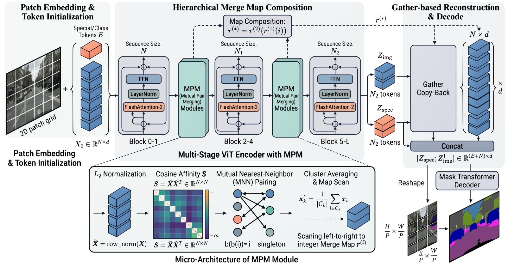

# Token合并ViT语义分割框架详细解析

## 🧑‍💻 User

 8729db3e063780dbf90bb238de559989.png 解释一下这张图

---
## 😀 默认助手 (7)

## 一句话总结

这张图是一个**基于 token 合并（token merging）的高效 ViT 语义分割框架**：它先用 FlashAttention-2 的 ViT 主干逐层提取特征，并在中间插入两个 **MPM（Mutual Pair Merging，互近邻配对合并）** 模块，把 token 数量按 $N \to N_1 \to N_2$ 逐级压缩以减少计算量；最后再用 **Gather Copy-Back** 把压缩后的 token 还原到原始空间位置，拼接上特殊/类别 token 后交给 Mask Transformer 解码器输出分割图。

---

## 整体数据流（从左到右）

### 1️⃣ Patch Embedding & Token Initialization（最左）

- 输入图像被切成 $P\times P$ 的 **2D patch grid**（图中 $H/P \times W/P$ 的网格）。
- 每个 patch 线性投影成一个 $d$ 维 token（蓝色块），另外加上 **Special/Class Tokens $E$**（橙色块，用于分类/分割的全局 token）。
- 得到初始序列 $X_0 \in \mathbb{R}^{N\times d}$，其中 $N$ 为图像 token 数（不含 $E$）。

### 2️⃣ Multi-Stage ViT Encoder with MPM（中间大块）

编码器被 MPM 切成 **三个阶段**，每个 Transformer block 都是标准结构：`LayerNorm → FlashAttention-2 → 残差 → LayerNorm → FFN → 残差`。

| 阶段 | Block 范围 | 序列长度 |
|---|---|---|
| Stage 1 | Block 0–1 | $N$ |
| Stage 2 | Block 2–4 | $N_1$ |
| Stage 3 | Block 5–L | $N_2$ |

每次 MPM 之后 token 数减少（$N_2 < N_1 < N$），因此**越深的层计算量越小**——这是整个方法省算力的核心。

**Hierarchical Merge Map Composition（上方虚线框）**：
每一级合并只知道自己这一级的下标映射 $r^{(1)}$、$r^{(2)}$，要追溯到原始 token，就把映射**复合**起来：

$$r^{(*)}=r^{(2)}\bigl(r^{(1)}(i)\bigr)$$

即“原始第 $i$ 个 token 最终落到了哪个簇”。这个复合映射是后面还原（Copy-Back）的关键索引表。

为什么需要“复合”而不是保留一张全局表？

因为合并是逐级进行的，后一级的输入下标空间已经被前一级重排过。分级维护局部映射，显存和实现都更简单，需要时再复合出全局映射。

### 3️⃣ MPM 模块的微观结构（下方大框）

这是方法的技术核心，四个步骤：

**① $L_2$ Normalization**
$$\tilde{X}=\text{row\_norm}(X)$$
每个 token 归一化到单位球面，使内积等价于余弦相似度。

**② Cosine Affinity $S$**
$$S=\tilde{X}\tilde{X}^{\top}\in\mathbb{R}^{N\times N}$$
得到 token 两两的余弦相似度矩阵。图中对角线及部分位置被置为 $-\infty$（屏蔽自身匹配），其余按相似度高低着色。

**③ Mutual Nearest-Neighbor (MNN) Pairing**
令 $b(i)=\arg\max_j S_{ij}$（$i$ 最相似的邻居）。只有当

$$b\bigl(b(i)\bigr)=i$$

即“我选你、你也选我”时，才把 $i$ 和 $b(i)$ **配成一对**。不满足互为最近邻的 token 标为 **singleton（单例）**，自己单独成簇。

> 注意图中画成**一对一的配对图**：MNN 保证不会出现“多个 token 抢同一个中心”的塌缩，也不会出现“链式贪婪合并”。

**④ Cluster Averaging & Map Scan**
对每个簇 $C_k$（一对或者一个单例）做平均池化得到合并后的 token：

$$x'_k=\frac{1}{|C_k|}\sum_{i\in C_k}x_i$$

然后**从左到右扫描**原序列，把这些簇编号写成整数 **Merge Map $r^{(l)}$**（${}t\mapsto$ 簇 id），供下一级和最终还原使用。图中显示 $N$ 个 token 合并后只剩约一半（蓝色块从 4 个变成 2 个），符合“配对合并一次约减少 50%”的直觉。

和 ToMe / 普通 bipartite merging 的区别

常见的 token merging（如 ToMe）用二分图匹配或按相似度取 top-k，可能产生非对称的、单向的合并关系；MNN 强制**双向一致**，簇结构天然是“成对 + 单例”，语义上更稳定，簇内方差更小，减少特征污染。这是图中特意把 `b(b(i)) = i` 与 `singleton` 标注出来的原因。

### 4️⃣ Gather-based Reconstruction & Decode（最右）

压缩后的 token 分成两支：

- **$Z_{img}$**：$N_2$ 个图像 token
- **$Z_{spec}$**：$N_2$ 个特殊/类别 token（同样被合并过）

**Gather Copy-Back**：利用复合映射 $r^{(*)}$ 的**逆向**（gather），把每个簇中心的值**复制回**该簇内所有原始成员位置，恢复出 $N\times d$ 的全分辨率 token 序列。这一步是“插值/上采样”的替代方案——不是学出来的，而是**无损索引复制**，所以不引入额外参数，也不会模糊位置信息。

随后：
$$\text{Concat}:\ [Z_{spec};\ Z_{img}^{\uparrow}]\in\mathbb{R}^{(E+N)\times d}$$

这一步把特殊 token 和（还原后的）图像 token 拼在一起。再 **Reshape** 回 $\frac{H}{P}\times\frac{W}{P}$ 的 2D 特征图，送入 **Mask Transformer Decoder**（Mask2Former / MaskFormer 风格：mask queries + 交叉注意力），输出最终的分割掩码（图中右侧的绿色/紫色/粉色区域）。

---

## 关键设计逻辑

1. **编码器重、解码器轻**：86% 的计算在 ViT 主干，所以在主干里合并 token 收益最大。
2. **深层才合并**：Stage 1 保留全分辨率，保证细节；越深语义越抽象、空间精度要求越低，越适合合并。
3. **解码前必须还原**：分割是稠密预测，解码器需要 $H/P\times W/P$ 的网格结构，所以用复制式 Copy-Back 而不是直接对稀疏 token 做注意力。
4. **类别 token 单独走**：$Z_{spec}$ 不被空间网格约束，单独合并、单独拼接，避免被图像 token 的合并图打乱。

## 符号速查

| 符号 | 含义 |
|---|---|
| $N,\ N_1,\ N_2$ | 三个阶段的 token 数，$N_2<N_1<N$ |
| $d$ | 通道维度 |
| $E$ | 特殊/类别 token 数量 |
| $X_0$ | 初始 token 序列 |
| $\tilde X$ | 行 L2 归一化后的 token |
| $S$ | 余弦相似度矩阵 |
| $b(\cdot)$ | 最近邻查找函数 |
| $C_k$ | 第 $k$ 个簇 |
| $r^{(l)}$ | 第 $l$ 级的合并映射（整数） |
| $r^{(*)}$ | 复合后的全局合并映射 |
| $Z_{img}, Z_{spec}$ | 合并后的图像 token / 特殊 token |
| $Z_{img}^{\uparrow}$ | 还原到全分辨率后的图像 token |

---

**说明**：以上解读完全基于图像本身的结构与标注。图中没有给出方法名称以外的引用信息（如具体论文标题、数据集或精度数字），因此关于“具体是哪个工作、在 ADE20K/Cityscapes 上多少 mIoU”这类问题，我无法从图中确认，需要论文正文才能回答。
