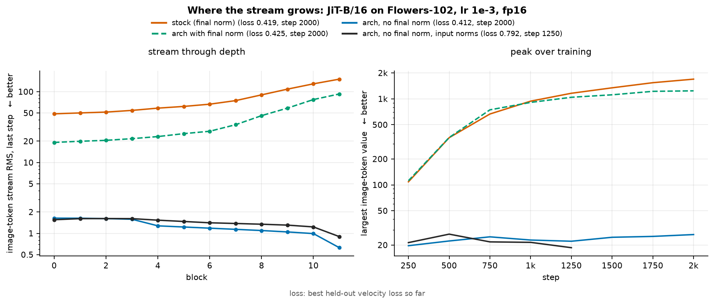

# RMSNorm分母劫持与共享调制梯度相干漂移机制分析及消融实验设计

## 🧑‍💻 User

为什么Muon优化器训练的transformer倾向于大的谱范数，另外这个问题adamw也有，prenorm trns有这个倾向
现象就是训练后期grad norm 时不时就来个 spike
应该是residual爆炸导致的，感觉这个不太好处理

---
## 🧑‍💻 User

相较于AdamW，为什么Muon倾向于大的谱范数

---
## 🧑‍💻 User

为什么Muon优化器训练的transformer倾向于大的谱范数，另外这个问题adamw也有，prenorm trns有这个倾向

---
## 😀 默认助手 (7)

# 结论先行

你观测到的三件事（谱范数变大、residual 增长、grad spike）**实际上是同一件事的三种可见表现**，并非三个独立问题：每层对 residual 的等效增益越过了 1。前向表现为 residual 增长，反向表现为梯度放大，而 spike 则是这个增益在 0 附近随机游走时偶尔越过临界点。

至于“为什么 Muon 和 AdamW 都有”，核心原因是：**两者的更新都是 scale-free 的，而 pre-LN 里权重尺度是一个 gauge freedom，所以没有任何回拉力**。下面逐条展开。

---

## 1. 统一视角：前向放大 ≡ 反向放大

对 pre-LN 的残差递推 $x_{l+1}=x_l+\Delta_l$，$\Delta_l=F_l(\mathrm{LN}(x_l))$：

$$
\|x_{l+1}\|^2=\|x_l\|^2+2\langle x_l,\Delta_l\rangle+\|\Delta_l\|^2
$$

定义 $g_l:=\langle x_l,\Delta_l\rangle/\|x_l\|^2$，则**前向**增益 $\|x_{l+1}\|/\|x_l\|\approx 1+g_l$，于是 $\|x_L\|\sim e^{\sum_l g_l}$。

而**反向**是同一个 $g_l$：

$$
\frac{\partial \mathcal L}{\partial x_l}=\prod_{k>l}(I+J_k)\frac{\partial \mathcal L}{\partial x_L},\qquad \rho\!\left(\prod_{k>l}J_k\right)\approx \prod_{k>l}(1+g_k)
$$

所以 **residual 单调增长 ⟺ Jacobian 乘积的 top Lyapunov exponent > 0 ⟺ 反向指数放大**。你怀疑“residual 爆炸导致”，方向是对的，但更准确的说法是：这两者是同一个量的前向/反向投影，并不构成因果链。有多个层跨过 $g_l\gtrsim0$ 时，log 梯度范数就会出现清晰的斜线增长；而“时不时”的 spike 则来自 top exponent 在 0 附近随机游走，以及下面第 5 节的离散事件。

---

## 2. 为什么 scale-free 更新必然 drift

对比三种更新的**步长**：

| 优化器 | 更新 | 步长是否依赖 $\|g_t\|$ | 步长是否依赖 $\|W\|$ |
|---|---|---|---|
| SGD | $-\eta g_t$ | 是（$\propto\|g\|$） | — |
| AdamW | $-\eta\,\hat m/\sqrt{\hat v}$ | 否（逐坐标 $\lesssim\eta$） | 否 |
| Muon | $-\eta\,\mathrm{msign}(M)$ | 否（$\|\Delta W\|_2=\eta$） | 否 |

SGD 有天然的**刹车机制**：收敛时 $g_t\to0$，更新自动停。AdamW 和 Muon 没有，因为模长被除掉了。后果分两种方向：

- **信号方向**：$\sigma_i$ 每步 $+\eta$，**线性增长 $\sim\eta t$**，而且没有任何“$\sigma$ 越大越慢”的项；
- **噪声方向**：梯度方向不一致 → 更新退化为**纯噪声注入**，随机游走 $\sigma_i\sim\eta\sqrt t$。

训练后期 SNR 掉下去（loss 接近收敛），更新就趋近于“恒定幅度的噪声注入”，矩阵持续被推向更大的谱范数。**唯一的固定点来自 weight decay**：$\eta=\eta\lambda\sigma\Rightarrow\sigma^*=1/\lambda$。因此 WD 是唯一能限制它的因素，下一节会说明 WD 在度量上并不合适。

把上面两种增长叠加起来，会得到一个重要结果：**谱被压平**。Muon 对所有奇异方向以同样速率推进（有个简洁的来源：$\mathrm{msign}(M)$ 恰好是核范数的次梯度 $\partial\|M\|_*/\partial M=UV^\top$，而 $\|M\|_*=\sum\sigma_i$ 对所有方向一视同仁）。于是

$$
\|W\|_F^2=\sum_i\sigma_i^2=r\,\sigma_{\max}^2,\qquad r=\text{stable rank（Muon 会把它推向 } \min(n,m)\text{）}
$$

**关键点：对 residual 写入起作用的不是 $\|W\|_2$，而是 $\|W\|_F$。** 当输入近似各向同性时，$\mathbb E\|Wh\|^2=\|W\|_F^2\|h\|^2/d$。因此 Muon 的平坦谱偏置在相同 $\sigma_{\max}$ 下会把 residual 写入放大 $\sqrt r$ 倍，这才是“Muon 倾向于大谱范数”最实质的机制；它也解释了为什么 Muon 往往比 AdamW 更早出问题。

> 顺带：QK 也不同。最坏情况（决定 argmax flip 和熵塌缩）由 $\|W_Q\|_2\|W_K\|_2$ 控制，典型情形由 $\|W_Q\|_F\|W_K\|_F/d$ 控制。Muon 把两个都推大了。

---

## 3. 为什么 AdamW 也有，以及差别在哪

两个原因：

**(a) 同样是 scale-free，同样没刹车**，后期同样是“恒定幅度的噪声注入”。这不是 Muon 独有的。

**(b) entrywise WD 无法有效约束谱范数。** AdamW 的衰减是 $-\eta\lambda W_{ij}$，约束的是 $|W_{ij}|$，对 $\sigma_{\max}$ 只是一个间接约束。一个 $d\times d$ 矩阵若非相干地各处都长到 $\sim1/\lambda$，则

$$
\sigma_{\max}\sim \frac{\sqrt d}{\lambda}
$$

这就是为什么**大型 transformer 用纯 AdamW 时权重谱范数也在缓慢上涨**。这也是 NFNet 用 AGC、$\mu$P-SP 用谱参数化、以及各种谱归一化的动因。

**(c) 两者的差别**：Adam 的噪声注入是**逐坐标各向同性**，倾向于把矩阵推向“满秩大随机矩阵”；Muon 的在**谱上均匀**，倾向于“平坦谱”。两边的 $\|W\|_F$ 都在涨，但 Muon 涨得更有结构（$\|W\|_F/\|W\|_2$ 变大），对 residual 和 logits 更不友好。另外 Adam 还有 $\epsilon$：后期梯度很小时 $v$ 衰减，$m/(\sqrt v+\epsilon)$ 会被压住，但一旦出现真信号就会尖峰，见下一节。

---

## 4. 为什么 pre-LN 是重灾区

四个机制，按重要性排：

**(4.1) 权重尺度是 gauge freedom（“loss 根本看不见”）。** pre-LN 里每个 sublayer 的输入都被 LN，所以把**所有** residual-branch 权重和 $x_0$ 一起乘 $c$，函数**完全不变**。这意味着 $\|W\|$ 方向上 loss 的梯度 $\approx 0$，**没有任何力把它拉回任何尺度**；而 scale-free 更新提供了持续、不衰减的推力。因此残差范数本质上是个自由度的漂移；漂到多大只是历史路径问题，与是否最优无关。

对比 post-LN：LN 在 residual 之后，权重尺度直接改变函数 → 有真实梯度回拉，代价是 warmup 和早期不稳定。

**(4.2) 相对贡献单调衰减。** 每层输入被 LN，所以 $\|\Delta_l\|$ 与 $\|x_l\|$ **无关**。$\|x_l\|$ 涨了以后，相对贡献 $\|\Delta_l\|/\|x_l\|\to0$，网络进入“层几乎不起作用”的状态；此时 $\langle x_l,\Delta_l\rangle$ 的随机涨落就足以让 $g_l>0$，即增益的来源从“有用信号”退化为“随机对齐”。

**(4.3) 正反馈。** $\|x\|\uparrow$ → LN 输入被少数 outlier 维（attention sink / massive activation）主导 → 有效增益从 $\|W\|_F/\sqrt d$ 逐渐抬向 $\|W\|_2$（输入越集中，越接近最坏情况）→ 增益 $\uparrow$。这解释了为什么后期会**加速**，而非匀速。

**(4.4) 但 attention 那部分是“真有梯度要它涨”。** 这是唯一一条不是纯漂移的通道：

$$
\ell_{ij}=q_i^\top k_j=h_i^\top W_Q^\top W_K h_j,\qquad |\ell|\lesssim\|W_Q\|_2\|W_K\|_2\|h\|^2
$$

logit 变大 → softmax 变尖 → 训练集 cross-entropy 变低。**loss 确实在奖励更大的 QK 谱范数**，这就是 attention entropy collapse 的由来。涨到饱和后 loss 不再降、梯度 $\to0$，但更新幅度不变，于是系统停在悬崖边上（所有 logit 都很大、$p(1-p)\to0$），后面任何扰动都可能触发 flip 式 spike。

<span>**这四条的合起来**：(4.1) 让尺度无约束，(4.4) 提供方向性推力，(2) 提供恒定速率，(4.3) 提供正反馈。AdamW 拿到的是 (4.1)+(4.4)+弱一点的 (2)；Muon 额外拿到平坦谱 → $\|W\|_F$ 更大。</span>

---

## 5. spike 的离散触发（解释“时不时”）

不是平滑增长，而是某个阈值后的**离散事件**：

1. **argmax flip**：logits 很大时 softmax 近 one-hot，$p(1-p)\to0$，梯度很小 → $v$ 和动量 buffer 衰减（Adam 尤其如此）；一旦 top-2 logits 换位，目标 token 变了、loss 跳变，$\hat m/\sqrt{\hat v}$ 瞬间尖峰。这是最典型的“周期性偶发”来源。
2. **top Lyapunov exponent 越过 0**（第 1 节）。
3. **LN 的 $1/\sigma$**：massive activation 形成或塌缩时 $\hat\sigma$ 突变，其他所有维度的梯度集体突变一次。
4. **Muon 的动量陈旧（stale）**：$\mu=0.95$ 的 Nesterov buffer 在统计变化后还带着 ~20 步的旧方向 → 超调。这也是为什么实践中要做 $\mu$ warmup（0.85→0.95）。

> [!IMPORTANT] 一个容易被忽略的判断
> 在 Muon 下，**grad-norm spike 其实远没有 AdamW 下危险**，因为 NS 把更新谱范数固定在 $\eta$：spike 只改变 $M$ 的**方向**，不改变更新的**幅度**。所以务必先区分：
> - **grad-norm 抖、loss 平** → 大概率是良性的监控噪声，不必治；
> - **loss 抖 / attention entropy 单调掉到接近 0 / 各层 max logit 单调上升** → 这才是要治的。
>
> 后者在 Kimi K2、GLM-4.5 这类大规模 Muon run 里都是已知问题，Kimi K2 的对策就是 **QK-Clip**。你不孤单，有现成解法。

---

## 6. 诊断清单

| 观测 | 若呈现 | 说明 |
|---|---|---|
| 每层 $\|W\|_2$、$\|W\|_F$、stable rank vs step | $r$ 单调涨 | Muon 平坦谱偏置生效 |
| $\|W\|_F/\|W\|_2$ | 逼近 $\sqrt{\min(n,m)}$ | 同上，warning |
| 每层 $\|x_l\|$ vs depth（多个 step 切片） | 前向指数/加速增长 | 4.2/4.3 |
| $\max_{ij}\ell_{ij}$、attention entropy | logit 单调升、熵单调降 | 4.4，**优先治** |
| $\|W_Q\|_2\|W_K\|_2$ | 单调升 | QK-Clip 的触发量 |
| spike 那一步的**分层** grad norm | 越靠前层越大 | 反向残余放大（第 1 节） |
| 同上 | 只集中在 $W_Q,W_K$ | attention 驱动 |
| 同上 | 集中在 embed / head | outlier / massive activation |
| 同上 | 与特定 batch/长度相关 | 数据驱动 |

**最小消融实验**（两步就能定位）：
1. 加一个很紧的 QK-Clip（$\tau$ 取当前值的 0.7 倍）：spike 消失 → 是 4.4；spike 仍在 → 是 4.2/4.3。
2. 改成 post-LN 或加 residual scaling：spike 消失 → 是残差增益。注意 Flops 和 loss 会变，只看 spike 是否消失。

---

## 7. 干预

### 7.1 治标（先做，便宜）

| 手段 | 作用点 | 备注 |
|---|---|---|
| **QK-Clip** | $\|W_Q\|_2\|W_K\|_2\le\tau$ | 每步后按比例缩，直接去掉 4.4 的推力。最划算 |
| **qk-norm / per-head 归一** | logits 与 $\|W\|$ 解耦 | 架构级，一劳永逸 |
| **logit soft-cap / 熵下限** | 从 loss 侧去掉锐化激励 | Gemma-2 式；对 Muon 特别对症 |
| **weight clipping** | 直接对 $\|W\|_2$ 或 $\|W\|_F$ 截断 | Moonlight/Kimi 都用，一行代码 |
| **$\mu$ warmup** | 缓解第 5 节第 4 条 | 0.85→0.95 |
| **AGC（尺度不变裁剪）** | $\|\Delta W\|/\|W\|\le c$ | 把线性漂移变成几何增长，自带乘性回拉 |

### 7.2 治本（选一个方向）

**(A) 控制“每层增益”，而不是控制 $\|W\|_2$——这是最重要的观念修正。**
真正决定 residual 增长和反向放大的是
$$
\text{gain}_l\approx \|W_{\text{out}}\|_2\cdot\|W_{\text{in}}\|_2 \quad(\text{MLP}),\qquad \|W_O\|_2\|W_V\|_2\;(\text{attn})
$$
所以：**residual scaling $\alpha=1/\sqrt{2L}$**，或 **DeepNorm 的 $\beta$-init + $\alpha$ 缩放**。这两者是从结构上把增益固定住，与优化器无关，也顺便让 Muon 的 drift 变得无害。

**(B) 给 Muon 配一个“度量正确”的正则项（我认为这是最干净的答案）。**
Muon 是谱范数度量下的最速下降（spectral-norm trust region）。根据 modular norm duality（Bernstein & Newhouse），与谱范数度量**配对**的正则项是**核范数**，不是 $\ell_2$：

$$
\Delta W=-\eta\,\mathrm{msign}(M)-\eta\lambda\,\underbrace{\mathrm{msign}(W)}_{\partial\|W\|_*/\partial W}
$$

平衡时 $\mathrm{msign}(M)=-\lambda\,\mathrm{msign}(W)$，每个奇异方向都被**同样强度**地拉回，正好抵消 Muon 的平坦谱偏置（而 entrywise $\lambda\|W\|_F^2$ 把能量摊在所有方向，反而**帮** Muon 维持平坦谱）。代价只是多做一次 Newton–Schulz，和主更新同阶。

⚠️ 这是推论性质的建议，我没有在大规模上见过它的实验报告，值得你用一个中层数（如 12L/24L）跑对照。

**(C) 区分两个“范数需求”，别用一个 WD 打天下。**
- 保护 **residual** 要管 $\|W\|_F$（$\propto$ 写入量）→ entrywise WD 是对的；
- 保护 **logits** 要管 $\|W\|_2$（$\to$ 最坏情况）→ 需要谱球投影或 QK-Clip。

所以现实配置大概是：**entrywise WD（常规值）+ QK-Clip（只在 $W_Q,W_K$ 上）+ residual scaling**。三者正交，互不干扰。

**(D) 结构替换（大手术，除非你在做架构研究）**：post-LN / sandwich-LN / DyT。这些从根上把 residual 的尺度做成有界的，但会改变训练动力学，需要重新调 warmup。

---

## 8. 一句话总结

> pre-LN 把“权重尺度”变成了 loss 看不见的自由度（4.1），attention 锐化提供了真实的增长推力（4.4），而 Muon/AdamW 的 scale-free 更新提供了不衰减的恒定速率（2）；Muon 额外的平坦谱偏置让 $\|W\|_F$ 多涨 $\sqrt r$（2 末），于是 residual 写入和 QK logits 一起膨胀（4.3 正反馈），最后在 top Lyapunov exponent 越过 0 或一次 argmax flip 时表现为 grad spike。

所以要处理的不是“谱范数”，而是**每层增益**（残差侧）+ **QK logits**（注意力侧）——前者用 residual scaling / DeepNorm，后者用 QK-Clip / qk-norm / soft-cap，再给 Muon 补一个核范数型的回拉力。而“grad norm 时不时 spike”本身在 Muon 下多半可以只监控不干预，先确认 loss 和 attention 熵是否在恶化。

---
## 🧑‍💻 User

这个为什么会影响init、lr、weight decay调参

---
## 😀 默认助手 (7)

# 一句话

init / LR / WD 是**同一个一维量（每层增益轨迹 $g_l(t)$）的初值、斜率、上界**，并不是三个独立旋钮。而 pre-LN 的 gauge freedom 让这个量从 loss 中不可见。所以你其实是在调**一个 loss 看不见的量**，而且报错形式是随机爆炸：loss 曲线先平台后悬崖，sweep 拿不到信号。

---

## 1. 三个旋钮的作用：初值、斜率、上界

单层谱范数的粗模型（忽略噪声方向，只看相干方向）：

$$
\sigma_l(t)\;\approx\;\underbrace{\sigma_l(0)}_{\text{init}}\;+\;\underbrace{\eta\,t}_{\text{LR}}\quad\text{直到撞上}\quad \underbrace{\sigma^*\approx 1/\lambda}_{\text{WD}}
$$

推导很笨：漂移速率是 $\eta$（谱步长恒定），回拉速率是 $\eta\lambda\sigma$，平衡 ⇒ $\sigma^*=1/\lambda$。对 AdamW 用 entrywise 版本则是 $\sigma^*\sim\sqrt d/\lambda$（形状依赖，见 §5）。

于是三者的**角色**是：

| 旋钮 | 控制 | 在 drift 阶段 | 在平衡阶段 |
|---|---|---|---|
| init $\sigma_0$ | 起点、离悬崖多远 | 决定全程 | 被遗忘 |
| LR $\eta$ | 斜率（每步 drift） | 决定何时撞崖 | 只影响弛豫速率/瞬态超调 |
| WD $\lambda$ | 上界 | 几乎无关 | **唯一有效的旋钮** |

### ⇒ 存在等价类（这才是“不能独立调”的根本原因）

因为 pre-LN 每层输入都被 LN，把所有 residual-branch 权重乘 $c$、$x_0$ 也乘 $c$，**函数完全不变**。而 $\sigma_l(t)\approx\sigma_l(0)+\eta t$ 在 $c$ 缩放下是线性的，所以

$$
(\sigma_0,\;\eta)\;\sim\;(c\,\sigma_0,\;c\,\eta)\qquad\text{给出功能上完全相同的轨迹}
$$

**“小 init + 大 LR”和“大 init + 小 LR”在 drift 阶段是不可区分的。** 这直接解释了两件常见事：

- 为什么社区观察到“换个更小的 init 就能用更大的 LR”（µP 的核心卖点）；
- 为什么你做了 init×LR 的二维 grid，看到的是沿某个方向的大片平台——你在重复扫同一个维度。

WD 会**打破**这个等价类（$1/\lambda$ 不随 $c$ 变），所以只要一次 sweep 同时跨了两种 regime，曲线就没有意义——因为它把“等价类内部”和“等价类之间”混在了一个坐标轴上。

---

## 2. 一个能直接用的判据：$T^*=1/(\eta\lambda)$

drift→平衡 的转换步数是 $T^*=1/(\eta\lambda)$（漂移和回拉的速率比就是 $\lambda$）。

$$
\begin{cases}
T \ll T^* & \text{drift 主导：调 init 和 LR，WD sweep 会显得又平又吵}\\
T \gg T^* & \text{平衡主导：调 WD，调 init 基本是浪费算力}\\
T \approx T^* & \text{最糟：两个机制混在一起，必须联合 sweep}
\end{cases}
$$

$\eta=0.02,\lambda=0.1$ ⇒ $T^*=500$ 步。绝大多数真实 run（$10^4\sim10^5$ 步）都深深落在**平衡主导**区。这有几个可检验的推论，和工程经验一致：

- 最终 $\|W\|_2$ 主要由 WD 决定，LR 的影响比你以为的小 → 所以 LR 的 loss 曲线**看起来很宽容**（平台）；
- 恢复速度是 $1/(\eta\lambda)$，比涨的速度慢 $\lambda^{-1}=10$ 倍 → **瞬态超调是常态**，WD 追不上——这就是 spike 能发生的原因；
- 想靠“多训练一会儿让它自己稳”是错的，只会让它长时间贴在悬崖边。

顺带：这也是 **warmup 的真正作用**——不是让二阶矩估计收敛，而是延后 drift 的启动，避免初始瞬态 + 早期高梯度把 $\sigma$ 一次性推过崖。

---

## 3. 为什么 sweep 拿不到信号：平台 + 悬崖

因为 gauge freedom，loss 对“尺度”的导数 ≈ 0：

$$
\frac{\partial\mathcal L}{\partial \log c}\approx 0
$$

所以 log-LR sweep 上会出现一大段**几乎水平的区域**。在平台上：

- 用 loss 差分排序 → 全是噪声，选出的“最优 LR”是抽签；
- 平台上 1 个 seed 就够，看起来“很 robust”。

而悬崖是**重尾随机事件**（第 5 节的 argmax flip / Lyapunov 越零），所以：

- 你测到的“悬崖位置”是随机变量，单 seed 会把安全区误判到崖外；
- 失败信号不是 loss 平滑变差，而是**偶发 spike**——需要很多 seed 才估计得出概率。

**平台（无梯度信号）与悬崖（需要统计估计）是两种完全矛盾的调参需求，这才是根本困难。** 常规“扫一遍取最低 loss”在这里必然失效。

---

## 4. 为什么 LR 不能迁移——四条独立的破坏

| 迁移方向 | 是否成立 | 原因（用本文的框架） |
|---|---|---|
| 跨**宽度** | 部分成立 | $\sigma_0$ 依赖 fan-in；µP 修的是**初始增益** $g_l(0)$ 与宽度无关。但 µP **不管 drift** $\eta t$ |
| 跨**训练长度/步数** | **不成立** | $\sigma(T)\approx\sigma_0+\eta T$ 是线性的 ⇒ $\eta_{\max}$ 与 $T$ 反相关。这正是“短跑没事长跑爆” |
| 跨 **batch size** | 弱成立 | scale-free 优化器对梯度**幅度**不敏感 ⇒ 经典 linear scaling rule 失效；只剩“梯度方向一致性（SNR）↑”这一条效应 |
| 跨**优化器** | 不成立 | $\eta$ 的语义不同（谱步长 vs 逐坐标），且 Muon 还有 $\gamma\sqrt{\max(n,m)}$ 的 RMS 匹配缩放 ⇒ 数值不可比 |

尤其第二条值得强调：**µP 只保证 $t=0$ 的增益宽度无关，它不提供任何 drift 控制**。所以 µP 能跨宽度迁移、跨 batch 也有一定效果，但**跨 token 数一定要另配“LR 随 token 数调整”**——这个实践中的 hack，其来源就是 $\sigma$ 的线性漂移。

第三条在 Muon 上表现得甚至比 AdamW 更明显：因为更新是谱归一化的，梯度幅度 100× 变化对更新几乎没影响，所以 Muon 对 batch size 和梯度裁剪都很“不敏感”——**这是好处，也是调参迷惑源**（你失去了一个本来能用的诊断信号）。

---

## 5. 为什么 WD 是三者中最难调的

**(a) 一个旋钮三个工作，且最优值不同。** WD 同时承担：

1. 泛化正则（要中等 λ）；
2. 谱范数上限 $\sigma^*\approx1/\lambda$（要足够大 λ 压 logits）；
3. Frobenius / residual 写入上限（需要管 $\|W\|_F$，而 entrywise WD 确实是管这个的）。

但 2 和 3 需要的度量不同（§上文的谱 vs Frobenius 之辩），所以**没有一个 λ 能同时满足**。工程上的“QK 用更大 WD、embedding 不用 WD、MLP 常规”——大家在做，但往往说不清为什么。

**(b) 度量错配 ⇒ 有效强度依赖形状。** 同一个 λ 作用在 attention 的 $(d\times d_{head}n_h)$ 和 MLP 的 $(d\times4d)$ 上，对 $\sigma_{\max}$ 的约束强度不同（$\sim\sqrt d/\lambda$ vs 别的）。⇒ **λ 不是“一个标量超参”，而是一组 per-shape 的标量**。你调一个 λ 其实在同时调好几层不同的正则强度。

**(c) 与 LR 乘性耦合。** 每步衰减是 $\eta_t\lambda$，真正起作用的是

$$
\int_0^T \eta_t\lambda\;dt
$$

所以：

- 改 LR 会**悄悄改变有效 WD**——这是“WD ∝ 1/LR”这条流传规则的来历；
- 改 schedule 长度（比如 100B→300B token）必须同步改 λ，否则两次实验不可比；
- **sweep LR 时 λ 的最优点会移动** ⇒ 必须**联合** sweep，分开扫会得到互相矛盾的结论。这就是“调参像打地鼠”的具体机制。

**(d) WD 有一个隐式、未设计的 schedule。** 前期梯度大，$\eta\lambda W$ 被淹没；后期梯度小（SNR 掉），WD 相对变强。所以**有效正则强度随训练自动上升**——它不是常数，而是一条你没写进 config 的曲线。这使“λ 的最优值”依赖于训练长度，进一步破坏迁移。

---

## 6. 怎么让调参重新变成可做的问题

核心思路：**把 $\sigma_l$ 从“隐变量”变成“显式变量”**，这样它就不再占用你的三维超参空间。

1. **显式约束每层增益**（一次性消掉一个维度）
   - QK-Clip / spectral norm 约束 / AGC / σ-reparam / residual scaling。
   - 一旦 $\sigma$ 被程序约束住，LR 只负责方向、WD 只负责泛化、init 只负责早期。三者**解耦**。
   - 这是唯一能让 §1 的等价类和 §5 的乘性耦合消失的办法。

2. **用无量纲超参做坐标变换**

   | 原始 | 换成 | 含义 |
   |---|---|---|
   | LR $\eta$ | $\eta/\sigma^*$ 或 $\eta T$ | 每步 / 全程的相对谱变化（总 drift 预算） |
   | WD $\lambda$ | $\eta\lambda$ | 每步相对衰减；或直接报 $T^*=1/(\eta\lambda)$ |
   | init | 初始增益 $g_l(0)$（实测） | 与宽度/深度无关的量 |
   
   这些量才是跨配置可比的，也是唯一能做成 scaling law 的形式。

3. **固定 sweep 顺序（不要三维网格）**
   - 先标定每层**实测** $g_l(0)$（跑一步算 $\langle x_l,\Delta_l\rangle/\|x_l\|^2$），把 init 调到 $g_l(0)\approx0$±微小 的值；
   - 再扫 $\eta T$（无量纲总漂移预算）；
   - 最后在目标 $\eta$ 附近扫 $\lambda$，且不同 $\eta$ 必须重扫 λ。
   
   顺序反过来就会得到互相矛盾的结论。

4. **换调参的观测量**：别用 loss 当 sweep 目标（平台上没信号）。用**连续代理指标**：
   $\max_l\|W_{Q,l}\|_2\|W_{K,l}\|_2$、attention entropy、$\|x_L\|$、$\log$ grad-norm 的滑动分位数。
   这些是“离悬崖的距离”，信噪比远高于 loss，可以直接当 early-stop / 选型准则。

5. **seed 数按 regime 分配**：平台上 1 seed；用 $T^*$ 判据判断接近悬崖后，至少 5 seeds，否则你会系统性把安全区选到崖外。

---

## 收束

> 现象本身（谱范数上涨、residual 增长、spike）只是**表面**。它破坏调参的方式是三条结构性的：
> ① gauge freedom 造出 init×LR 的等价类 → 你的 sweep 实际只在 1 维上动；
> ② drift 是 $\eta t$ 线性、回拉是 $\eta\lambda$ 乘性 → 存在 $T^*=1/(\eta\lambda)$ 的两 regime 分界，同一个 LR 在短跑和长跑下语义不同；
> ③ WD 是唯一回拉力，因此同时被当作正则、谱上限、residual 上限使用，且与 LR/schedule 乘性耦合。
>
> 解法不是“更认真地调这三个数”，而是**把尺度维度显式约束掉**（QK-Clip / 增益约束 / residual scaling），让这三个旋钮各自只做一件事。

---
## 🧑‍💻 User

我们训的是dit，发现residual stream有个别channel爆炸了（比如shared modulation 这个 channel 的 scale 是 40 左右），推测是post norm导致的，怎么做消融（我们的理由是output scale固定的情况下不需要加norm，因为output scale固定+weight standardized linear = objective自带数值稳定功能）

---
## 😀 默认助手 (7)

# 0. 先纠正一个前提，否则消融会做偏

**单个 channel 的爆炸，LN 无法消除。** LN 只消除两样东西：跨 channel 的均值（DC）和全局尺度。因此：

- 如果涨的是 **DC 方向**（所有 channel 同步涨），LN 确实看不到这些值，它纯粹在无约束漂移（gauge drift）；
- 如果是**个别 channel**（比如就是 shared modulation 的某一维），那么 $\hat x$ 的**方向真的变了**，函数真的变了，loss **能**看见，说明这里有真实的回拉力。

**你的归因（post-norm 导致）和你的论证（output scale 固定就不需要 norm）在这里其实是矛盾的**：前者说 post-norm 让它爆炸，后者说去掉 norm 会得到数值稳定性。而实际上，对于“个别 channel”这种爆炸，LN 既不制造、也不掩盖它。所以第一步不是选架构，而是**把这个 40 的语义定位清楚**。

---

## 1. 先做零成本诊断（3 个 forward/backward，不训练）

这是最有价值的部分。三个探针能把“该不该处理、该怎么处理”直接定死。

### S0.1 逐层 per-channel 深度剖面：区分四种机制

跑一次 forward，在每个 block 的 residual add 之后挂 hook：

```python
def make_hook(name, stats):
    def hook(mod, inp, out):
        x = out if not isinstance(out, tuple) else out[0]
        f = x.detach().float()                      # [B, T, D]
        stats[name] = dict(
            ch_absmax = f.abs().amax(dim=(0, 1)),   # [D] 逐 channel 峰值
            ch_rms    = f.pow(2).mean(dim=(0, 1)).sqrt(),
            rms       = f.pow(2).mean().sqrt(),
        )
        return out
    return hook
```

画出 $x_l[j^*]$ 对 $l$ 的曲线（$j^*$ 是爆炸 channel），看斜率：

| 深度剖面 | 机制 | 含义 |
|---|---|---|
| $O(l)$ 线性 | **相干加性注入**（$\beta$ 每层加同一个 DC） | 最可能 |
| $e^{cl}$ 指数 | **每层增益 > 1**（$1+\gamma$ 大，或 $W$ 的主方向对齐） | 危险 |
| $O(\sqrt l)$ | 不相干的 rank-1 泄漏 | 良性 |
| 早期快速上涨后平台 | **已达平衡点** | 最可能且不紧急 |

**这一张图就能排除一半假设。** 顺带看：这 40 是**一直稳定在 40**（平衡态），还是**还在涨**（失稳）？前者说明存在回拉力，是 40 这个尺度的问题；后者才是真正的 runaway，必须干预。用 log-y 图看一眼就知道。

### S0.2 直接测“回拉力”：$\partial\mathcal L/\partial x_l[j]$

一次 backward，逐层逐 channel 记录梯度：

$$
s_{l,j}=\left|\frac{\partial \mathcal L}{\partial x_l[j]}\right|
$$

然后看**爆炸 channel 的相对梯度** $s_{l,j^*}/\mathrm{median}_j(s_{l,j})$。

- 如果 $\ll 1$（比如 $10^{-3}$），该 channel 几乎是**功能盲区**，回拉力 $\approx0$；此时你在上一轮讨论的“scale-free drift 无回拉”问题中最严重的情况里，**post-norm 不是原因，无回拉才是原因**。这种 channel 你换任何 norm 方案都救不了，只能显式约束它。
- 如果 $\sim 1$，它是功能性特征，那么增长是**优化器在用它表达 $t$**，此时的关键问题变成了“是否需要把这个量压到 40 以下”。

> ⚠️ 这一步比任何重训消融都重要：**它直接回答“你的‘objective 自带数值稳定’论证能否起作用”**。如果回拉力本来就 $\approx 0$，那么“去掉 norm 以获得回拉力”这条路就是空的，因为回拉力的来源不是 norm，而是 channel 的**功能可见性**。

### S0.3 功能必要性：inference-time clamp

不训练，把这个 channel 的 contribution 夹住（在每个 residual add 处把 $\Delta_l[j^*]$ 缩放或置零），测 val loss / FID 变化：

- loss 几乎不变，它就是无约束漂移，你有一个**免训练的解**：直接 clamp 或每层重归一化 residual 尺度，收工；
- loss 明显变差，它是**功能性 outlier**。此时“消除”正确，改法是给它一个有界且显式的表示位置，加正则只会让它换一种方式表达。

### S0.4 来源定位：$\beta$ 还是 $\gamma$？

forward 时把 modulation 输出的第 $j^*$ 维（$\beta$ 或 $1+\gamma$）单独置零，看 residual 通道是否还涨。

- 置零 $\beta_{j^*}$ 就消失，是**加性 DC** → $O(L)$ 相干累加；
- 置零 $\gamma_{j^*}$ 就消失，是**乘性增益** → 每层 gain > 1，最危险，也最值得改。

---

## 2. 你的理论主张：哪些成立、哪些不成立

先说不成立的部分，因为它决定消融的设计。

### ✅ 成立的

1. **output scale 固定确实消掉了一部分 gauge freedom。** 这是真的，而且很多人忽略了。
2. **weight standardization 控制每层线性映射的 gain**，能挡住“指数爆炸”这一类（$e^{cl}$）。
3. **去掉 norm 会恢复回拉力**，因为 norm 每层都引入一个新的尺度不变性。

### ❌ 三个不成立的地方

**(a) 它管的是权重尺度，不管输入尺度。**
$\beta=W_2\,\sigma(W_1 c)$：$W$ 标准化了，但 $c$（timestep embedding / Fourier features）的尺度没有任何约束。**只要 $c$ 大一个量级，$\beta$ 就大一个量级，而所有 $W$ 都是完美标准化的。** 40 完全可以是这么来的，这与你的论证正交。

**(b) 它管不住深度的相干累加。**
每层 gain 严格等于 1，residual 仍会是 $O(L)$（相干）或 $O(\sqrt L)$（不相干）。"output scale 固定"只约束**最后一层**，中间层的绝对尺度仍然是自由的（只要最终比例对）。**共享 modulation 恰好最大化了相干性**：$\beta$ 或 $\gamma$ 是**同一个参数**被 $L$ 个 block 使用，梯度里 $L$ 份信号同向叠加，于是参数漂移方向高度一致，residual 里就累加成 $O(L)$ 而不是 $O(\sqrt L)$。这是 shared modulation 特有的病理，和 post-norm 无关。

**(c) 最关键：只要有 final norm，你的论证就自相矛盾。**
DiT 的 final layer 是 $\mathrm{ad aLN}(x_L)$，再接 linear。**这个 norm 把 residual 尺度和 output 尺度解耦了。** 所以“output scale 固定”对 residual 尺度**零约束**。

> 换句话说：**你的论证要自洽，必须连 final adaLN 一起删掉。** 只有那时 output linear 才直接看到 residual，loss 才真的约束它。只删 block 内的 norm 而保留 final norm，你只是**把 gauge freedom 从每一层搬到了最后一层**，爆炸照样发生。
>
> 而删掉 final adaLN 对 diffusion 是大事：它是 $t$ 进入输出尺度的主要通道（最优输出的方差随 $t$ 变化很大）。这是**必须单独做一个实验**的关键设计决策，不能顺手做。

**(d) 还有：回拉力存在 ≠ 回拉力够强。**
这是上一轮讨论过的失衡：loss 对中间尺度的回拉力是弱力，scale-free 优化器的 drift 是强力（每步固定幅度、不衰减）。所以“objective 自带稳定”在**趋势**上对，在**量级**上往往错。

---

## 3. post-norm 有影响吗？三个可分离的机制

别一次全改，逐条验证：

**(i) post-norm 的 Jacobian 使得强通道占据主导（这是真病理）。**
$\partial\mathrm{LN}/\partial x \propto (I-\hat x\hat x^\top)/\sigma$，会把非主导方向投影掉。后果是 **channel 之间**的失衡被放大（不是 channel 变大，而是“强者恒强、弱者学不动”）。**这解释的是“为什么是个别 channel”，而不是“为什么是 40”。** 度量指标用 per-channel RMS 的集中度（Gini / top-k 占比），不要用单个 channel 的值。

**(ii) modulate 与 residual add 的先后，决定 $\beta$ 累加还是不累加。**
$\mathrm{LN}(x)\cdot(1+\gamma)+\beta$ 然后写进 residual，$\beta$ 会**每层累加**；先 add 再 norm，$\beta$ 每层被重置。你的“post-norm”如果是指前者，那它确实在**放大累加**（但没有制造累加）。这是最容易做、也最容易看清楚的消融。

**(iii) 更可能的真正原因：你可能连带删掉了 adaLN-Zero 的 $\alpha$。**
DiT 的 $\alpha$ 是 zero-init 的 per-block 门控，它保证**初始化时每个 block 是恒等映射**。这是深层 DiT 能训练起来的基础条件，比 norm 重要得多。如果为了“去 norm”而把 $\alpha$ 一起简化为无门控，那你就把早期每层都在往 residual 写入的抑制机制拆了，累加会严重得多。**这是一个混杂变量，必须在消融里单独控制。**

---

## 4. 消融矩阵

**Stage 0（不训练，几十分钟）**：S0.1–S0.4。可能到这里就结束了。

**Stage 1（短跑，固定 compute，≥3 seeds）**：每个 arm 只改一件事。

| # | 改动 | 隔离的假设 | 假设成立应看到 |
|---|---|---|---|
| S1.1 | baseline | 复现 40 | — |
| S1.2 | **modulate 之后再加一次 RMSNorm**（$\mathrm{RMS}(\mathrm{LN}(x)(1+\gamma)+\beta)$） | 输入无界 | 40 消失、FID 不变或略好 |
| S1.3 | 只对 modulation 输出加 L2 正则（仅扫这一个 $\lambda$） | 无回拉 | 40 变小；$\lambda$ 扫描呈平滑 trade-off |
| S1.4 | $\beta$ 只在第 0 层给，其余层 $\beta=0$ | $O(L)$ 相干累加 | 40 降到 $\sim1/L$ |
| S1.5 | 改 pre-norm（去掉 post-norm） | winner-take-all | per-channel RMS 集中度下降 |
| S1.6 | 你的方案：no-norm + weight-std，**保留** $\alpha$-zero 与 final adaLN | 你的主张（半版） | 40 消失，但 S0.2 的梯度仍 $\approx 0$，且尺度可能只是搬到 final norm 前 |
| S1.7 | 你的方案**完整版**：no-norm + weight-std + **删掉 final adaLN** | 你的主张（自洽版） | 只有这一版能真正检验“objective 自带稳定” |
| S1.8 | 保留 norm + 每层把 $x_l$ 重归一化到固定 RMS | “爆炸本身有害吗” | 40 被固定住 + FID 变化（**这是最重要的对照**） |

**S1.8 是回答“要不要管它”的唯一干净实验。** 如果钉住 residual 尺度后 FID 不变，这件事根本不需要处理；如果变好，说明爆炸有害，后面再讨论怎么治；如果变差，说明这个 outlier **本身在起作用**，你应该给它一个有界且显式的表示位置，而不是把它消除掉。

### 三条必须的控制

1. **必须在至少两个深度上验证（如 12L 和 24L）。** 因为 $O(L)$ 累加是深度问题，浅模型上根本看不到 40 和 1 的差别。**只在 12L 做消融，你会系统性地低估 post-norm 与 no-norm 的差异。**
2. **≥3 seeds。** 这不是平滑现象，单 seed 会把结论选反。
3. **判据用连续代理指标，不是最终 FID。** 记录：$\max_j$ per-channel RMS、depth profile 的斜率、S0.2 的相对梯度、top-k channel 占比。这些在短跑里就有信噪比，FID 在短跑里是噪声。

### 预注册判据（避免事后找解释）

- 若 S1.2 和 S1.4 都让 40 消失且 FID 不降，则 **$\beta$ 的相干 DC 累加是主因，post-norm 无罪**。
- 若只有 S1.5 有效，则 **post-norm 的 winner-take-all 是主因**，你的归因正确，但机制不是“制造爆炸”而是“放大 channel 不平衡”。
- 若 S1.8 显示 FID 不变，则 **整件事是良性的**，结论是“监控即可，不要改架构”。
- 若 S1.7 是唯一有效且 FID 最好的，则 **你的论证成立**，但它要求删掉 final adaLN，是一个架构级决策。

---

## 5. 如果是我，按性价比排序做的事

1. **S0.3（clamp 探针）先做。** 一半概率到这里就结束了。
2. **在 modulate 之后加一次 RMSNorm（S1.2）。** 这是单点改动，不需要动 norm 的拓扑，直接把“输入无界”这个通道堵死，并且天然给 modulation 的爆炸设了上界，又保留了 $\gamma,\beta$ 的表达力（只是失去了动态范围）。
3. **对 modulation 输出做直接正则（S1.3）**，而不是继续对 $W$ 调 weight decay。**爆炸的是 conditioning 通道，并非权重**，你的 WD 在惩罚一个无关的量，所以你怎么调 WD 都调不动它。（这正好解释了你为什么会觉得“不太好处理”。）
4. **$\beta$ 只保留 1–2 层（S1.4）。** 加性 DC 重复 $L$ 次没有信息增益，只有尺度代价。
5. **真要执行“去 norm”方案，就执行完整版（S1.7），并把它当架构论文级别的实验**，不要当成顺手消融。同时必须显式给每层 gain 加上限（因为 weight-std 只控制 $t=0$ 的 gain，不管 drift）。

---

## 一句话

> 你的两个判断在细节上互斥：**“post-norm 导致”和“不用 norm”不能同时成立**，因为单独改变 post-norm 不会让个别 channel 爆炸（LN 只消除 DC 和全局尺度）；真正的候选是 **shared modulation 的 $L$ 倍相干注入（放大 $O(L)$）+ 该 channel 回拉力 $\approx0$（无约束漂移）+ 优化器 drift 无刹车**。
> 消融的第一步不是选架构，而是用 **S0.2（测 $\partial\mathcal L/\partial x_l[j]$）** 和 **S0.3（inference clamp）** 回答：“这个 channel 有功能吗”和“它还在涨吗”。这两个问题的答案会决定剩下 80% 的实验是否必要。

---
## 🧑‍💻 User

不是，我是说这个问题是DiT post norm + bf16导致的
具体来说 DiT塞了个global post norm
问题是你的objective是固定scale的
那你的residual就有可能无限飞升 个别channel会变得特别大
只为了影响某个output linear channel的signal这样

或者你可以这样想
matmul(norm(vector), weight)
假设你想要强调weight里面某个组件的值 削弱其他的
你第一想法是norm里面有affine, bias跟weight应该会做事对吧
但我们想一下这个"趋势"是怎么传递到前面的层的
你有norm，所以你假设想要把某个channel的占比搞成1 其他0
那模型就会想要把这个channel的值给搞高点
那现在好啦 你是residual 所有层的最后的输出都想把这个channel的值搞高
因为a+b=c的情况下
da = dc
db = dc
所以假设dc 代表的是"我想要这个值变高点"
你有40层transformer 80个residual
你的学习强度是norm weight的80倍
你猜猜看是你的residual先飞升 还是norm weight先上去

然后这个residual stream又会因为各层有pre norm 所以不会因为各层需要能处理资讯而被压下去 因为prenorm会掩盖这件事情
但如果今天情况是
没有post normt
然后你的output head的projection是standardized weight linear
那你的output想要rms=1
你的residual必须rms=1
天然就可以避免residual飞升
我就是要测试这点

先看看社群有没有遇到与我们类似问题的，总之就是你得设计个实验去归因然后看看能不能验证我们的推测

---
## 🧑‍💻 User

不是，我是说这个问题是DiT post norm + bf16导致的
具体来说 DiT塞了个global post norm
问题是你的objective是固定scale的
那你的residual就有可能无限飞升 个别channel会变得特别大
只为了影响某个output linear channel的signal这样

或者你可以这样想
matmul(norm(vector), weight)
假设你想要强调weight里面某个组件的值 削弱其他的
你第一想法是norm里面有affine, bias跟weight应该会做事对吧
但我们想一下这个"趋势"是怎么传递到前面的层的
你有norm，所以你假设想要把某个channel的占比搞成1 其他0
那模型就会想要把这个channel的值给搞高点
那现在好啦 你是residual 所有层的最后的输出都想把这个channel的值搞高
因为a+b=c的情况下
da = dc
db = dc
所以假设dc 代表的是"我想要这个值变高点"
你有40层transformer 80个residual
你的学习强度是norm weight的80倍
你猜猜看是你的residual先飞升 还是norm weight先上去

然后这个residual stream又会因为各层有pre norm 所以不会因为各层需要能处理资讯而被压下去 因为prenorm会掩盖这件事情
但如果今天情况是
没有post normt
然后你的output head的projection是standardized weight linear
那你的output想要rms=1
你的residual必须rms=1
天然就可以避免residual飞升
我就是要测试这点

总之就是你得设计个实验去归因然后看看能不能验证我们的推测

---
## 🧑‍💻 User

不是，我是说这个问题是DiT post norm + bf16导致的
具体来说 DiT塞了个global post norm
问题是你的objective是固定scale的
那你的residual就有可能无限飞升 个别channel会变得特别大
只为了影响某个output linear channel的signal这样

或者你可以这样想
matmul(norm(vector), weight)
假设你想要强调weight里面某个组件的值 削弱其他的
你第一想法是norm里面有affine, bias跟weight应该会做事对吧
但我们想一下这个"趋势"是怎么传递到前面的层的
你有norm，所以你假设想要把某个channel的占比搞成1 其他0
那模型就会想要把这个channel的值给搞高点
那现在好啦 你是residual 所有层的最后的输出都想把这个channel的值搞高
因为a+b=c的情况下
da = dc
db = dc
所以假设dc 代表的是"我想要这个值变高点"
你有40层transformer 80个residual
你的学习强度是norm weight的80倍
你猜猜看是你的residual先飞升 还是norm weight先上去

然后这个residual stream又会因为各层有pre norm 所以不会因为各层需要能处理资讯而被压下去 因为prenorm会掩盖这件事情
但如果今天情况是
没有post normt
然后你的output head的projection是standardized weight linear
那你的output想要rms=1
你的residual必须rms=1
天然就可以避免residual飞升
我就是要测试这点
你如果愿意重练的话那就把post norm去掉
然后给final linear弄成weight standardized

先看看社群有没有遇到与我们类似问题的，总之就是你得设计个实验去归因然后看看能不能验证我们的推测

---
## 🧑‍💻 User

不是，我是说这个问题是DiT post norm + bf16导致的
具体来说 DiT塞了个global post norm
问题是你的objective是固定scale的
那你的residual就有可能无限飞升 个别channel会变得特别大
只为了影响某个output linear channel的signal这样

或者你可以这样想
matmul(norm(vector), weight)
假设你想要强调weight里面某个组件的值 削弱其他的
你第一想法是norm里面有affine, bias跟weight应该会做事对吧
但我们想一下这个"趋势"是怎么传递到前面的层的
你有norm，所以你假设想要把某个channel的占比搞成1 其他0
那模型就会想要把这个channel的值给搞高点
那现在好啦 你是residual 所有层的最后的输出都想把这个channel的值搞高
因为a+b=c的情况下
da = dc
db = dc
所以假设dc 代表的是"我想要这个值变高点"
你有40层transformer 80个residual
你的学习强度是norm weight的80倍
你猜猜看是你的residual先飞升 还是norm weight先上去

然后这个residual stream又会因为各层有pre norm 所以不会因为各层需要能处理资讯而被压下去 因为prenorm会掩盖这件事情
但如果今天情况是
没有post normt
然后你的output head的projection是standardized weight linear
那你的output想要rms=1
你的residual必须rms=1
天然就可以避免residual飞升
我就是要测试这点
我后面研究了一下发现只要有prenorm就可以发生这种事
你如果愿意重练的话那就把post norm去掉
然后给final linear弄成weight standardized

先看看社群有没有遇到与我们类似问题的，总之就是你得设计个实验去归因然后看看能不能验证我们的推测

---
## 😀 默认助手 (7)

# 0. 你的假设里其实藏着两个可分离的量

先把你论述的定量核心提取出来，因为后面的所有实验都围绕它：

设 $x_L$ 是最后一块 residual，$R=\mathrm{rms}(x_L)$，$\kappa=\max_j|x_L[j]|/R$。

$$
\text{数值危害} \;=\; \underbrace{R}_{\text{全局 gauge}}
\;\times\;\underbrace{\kappa}_{\text{channel 集中度}}\;\times\;\underbrace{\frac{R}{\|\Delta_l\|}}_{\text{残差/增量比，bf16 杀手}}
$$

- **你的论证解释的是 $R$**：post-norm 让 loss 对 $R$ 不敏感 → $R$ 无约束自由增长。你的方案（去 post-norm + 固定范数输出头）**只钉住 $R$**。
- **“个别 channel 40”这个症状，可能是 $\kappa$ 而不是 $R$**。而 $\kappa \le \sqrt d$ 是 norm 自带的**天然上限**（因为 $\hat x$ 的 rms 恒为 1，$d=1152$ 时封顶 34，$d=4096$ 时封顶 64）。你的方案**不钉 $\kappa$**，因为输出头只约束一个标量。

> 所以第一件事：**先测出 40 到底是 $R$ 还是 $\kappa$。** 
> - 若 $R\approx40,\ \kappa\approx1$ → 纯 gauge，你的判断完全正确，而且这个 40 **在功能上完全任意**，任何固定尺度的操作都无损。
> - 若 $R\approx1,\ \kappa\approx40$ → 是集中度，你的方案压不住它，需要另找归因。

这一个测量决定你后面 80% 的实验要不要做。

---

## 0.5 顺带把 bf16 那部分说精确

bf16 的 mantissa 是 8 bit，$\epsilon = 2^{-8}\approx0.004$。真正决定精度损失的不是“40 大不大”（浮点不怕绝对尺度），而是**残差加法里增量被淹没的比例**：

一次 $x+\Delta$ 中，$\Delta$ 的相对误差 $\approx \epsilon\cdot R/\|\Delta\|$。

| $R/\|\Delta_l\|$ | $\Delta$ 的相对误差 | 后果 |
|---|---|---|
| 4 | 1.6% | 可接受 |
| **25** | **10%** | 边界 |
| 256 | 100%（1 ulp） | 增量被打成噪声 |
| 1000 | — | 完全丢失 |

**所以真正的可测门限是 $R/\|\Delta_l\| \approx 1/\epsilon = 256$（1 ulp）和 $\approx 25$（10%）。** 这解释了为什么“post-norm + bf16” 是同一个问题的两面：post-norm 放开了 $R$，而 $R$ 一涨，$\|\Delta_l\|/R$ 就掉到 bf16 的分辨率以下。**这条也应该画进你的诊断图**（见 E0.5），它比“channel 是 40”更接近真实机制。

---

## 1. 社群现状

你的提议不是新的，几乎逐条对应已知工作。这是好消息（路线可行），也是坏消息（要小心“已知失效模式”）。

| 工作 | 与你的关系 | 关键点 |
|---|---|---|
| **EDM2**（Karras et al. 2024, *Analyzing and Improving the Training Dynamics of Diffusion Models*） | **最接近**。明确主张：归一化层会“藏起”尺度，导致尺度漂移/精度问题；改成 magnitude-preserving 的 weight scaling + 每层强制 unit variance + 固定输出尺度 | 这是你方案的完整版，而且报告了更好的 FID。**必读，直接对齐** |
| **NFNet / Scaled Weight Standardization**（Brock et al. 2021） | “去 norm + weight standardization” 的原始配方 | 但他们的关键配料是 **AGC**（按 $\|\Delta W\|/\|W\|$ 裁剪）。**你方案里缺的很可能就是这个** |
| **Fixup**（Zhang et al. 2019）/ **SkipInit**（De & Smith 2020） | 无 norm 的 ResNet，靠 residual scaling $1/\sqrt{L}$ | 说明“控 gain”能替代 norm |
| **DeepNorm**（Wang et al. 2022） | 显式推导如何 bound 残差：$\mathrm{LN}(\alpha x+G(x))$，$\alpha$ 随 $N$ 定 | 你的 $O(L)$ 累加问题的标准解 |
| **SD3 / MMDiT**（Esser et al. 2024） | DiT 里 activation/logit 增长导致不稳定 → 加 QK-RMSNorm | diffusion DiT 的官方承认 |
| **Massive Activations**（Sun et al. 2024） | LLM 里少数 channel 巨大，且 clamp 会崩 | 说明 outlier 常是**功能性**的，别硬压 |
| **Xiong et al. 2020** | pre-LN 的梯度不随深度衰减 | 你说的“pre-norm 掩盖”有出处 |
| **DyT / Transformers w/o Normalization**（Zhu et al. 2025） | 用 $\gamma\tanh(\alpha x)$ 替代 norm | 另一种“去 norm”的现代做法 |

**结论**：你要测的东西 EDM2 已经大体测过并给出正面答案；但 EDM2 的差异在于**每层都强制 magnitude preservation**，而不仅是去掉最后一层 post-norm。所以你的方案如果只改 output head，很可能**不够**，因为中间层的 $R_l$ 仍然自由（pre-norm 掩盖），只有 $R_L$ 被钉住。**这个预测本身就是一条要验证的假设。**

---

## 2. E0：不训练的归因（在已训 checkpoint 上，几十分钟）

这一层比任何重训都重要，而且能直接检验你的 $a+b=c$ 论证。

### E0.1 直接检验“$da=dc$ 所以 80 倍”

你对爆炸 channel $j^*$ 的所有 residual 贡献算**相干度**：

$$
\rho=\frac{\left|\sum_{l=1}^{2L}\Delta_l[j^*]\right|}{\sum_{l=1}^{2L}\left|\Delta_l[j^*]\right|}
$$

| $\rho$ | 含义 | 对你假设的意义 |
|---|---|---|
| $\approx 1$ | 所有层同号，$O(L)$ 相干累加 | **你的论证成立**，$L$ 倍信用分配确认 |
| $\approx 1/\sqrt{2L}$ | 随机符号，$O(\sqrt L)$ | 你的 $L$ 倍论证**失效**，机制另有其人 |
| $\gg 1/\sqrt{2L}$ 但 $<1$ | 部分相干 | 需要对 $L$ 做幂律拟合 |

一次 forward 就够，成本 = 0。**这是整个归因流程里信息量/成本比最高的一个数。**

### E0.2 信用分配归属：residual vs affine

你的核心论断是“residual 的学习强度是 norm affine 的 $2L$ 倍”。直接量化：

$$
\text{share}_{\rm res}=\frac{\sum_l\left|\Delta_l[j^*]\right|}{\sum_l\left|\Delta_l[j^*]\right|+\left|(\gamma_{j^*}-1)\,\hat x_{j^*}\right|}
$$

（$\gamma$ 是 global post-norm 的 affine scale，$\beta$ 同理。）你的预测：${\rm share}_{\rm res}>0.99$。

**配套的冻结消融（决定性）**：把 post-norm 的 affine 参数**冻结**在初值（$\gamma=1,\beta=0$）继续训。预测：爆炸速率几乎不变。如果不变 → affine 从来没参与 → 你的“$2L$ 倍”论证得到确认。如果变慢很多 → affine 才是主力，你的机制错了。

### E0.3 最小扰动实验（验证“post-norm 制造 gauge”）

在**已训好的**两个模型上（有/无 global post-norm），在第 $l$ 层注入扰动，不做任何补偿，测 loss 变化：

| 扰动 | 有 post-norm | 无 post-norm + standardized head | 说明 |
|---|---|---|---|
| $x_l \to (1+\epsilon)x_l$ | 应 $\approx 0$ | 应 $\propto\epsilon^2$ | **直接验证 gauge** |
| $x_l \to x_l+\epsilon\mathbf 1$ | 应 $\approx 0$ | 应变化 | DC 方向 |
| $x_l[j^*]\to(1+\epsilon)x_l[j^*]$ | 应**变化**（LN 不消单 channel） | 应变化 | **关键：单 channel 的爆炸不是 gauge** |

如果第一行在 post-norm 模型上真的给出 $\sim0$，你就**在实验上证明了 post-norm 制造了自由方向**，这就是你要的归因。这一行是整个回答里最该先做的实验。

### E0.4 把集中度和尺度分开

画两条线（训练的全程）：$R(t)=\mathrm{rms}(x_L)$ 与 $\kappa(t)=\max_j|x_L[j]|/R$。
- $R$ 涨、$\kappa$ 平 → 你说的“无限飞升”，gauge。
- $\kappa$ 涨、$R$ 平 → **channel 集中**，是 loss 驱动的（低秩化），post-norm 无罪。
- 两者都涨 → 两个机制并存，你的方案只治一半。

### E0.5 bf16 门限

画 $R/\|\Delta_l\|$ 曲线（逐层 + 跨训练）。若它在训练后期穿过 25 → 你已经进入 bf16 精度危险区，**这才是“post-norm + bf16”的真实成本**。这条曲线也是检验你方案增益的最佳代理指标（预期你的方案把它按住）。

---

## 3. E1：不改架构、只加一个正则 —— 最有信息量的单个实验

这是回答“它是 drift 还是 functional”的**唯一干净办法**，而且不需要改架构：

$$
\mathcal L_{\rm aux}=\lambda\,\mathbb E\left[\left(\frac{\mathrm{rms}(x_l)}{c}-1\right)^2\right]
$$

只在最后一层加（最便宜），或每层加，扫 $\lambda\in\{0,\ 10^{-3},\ 10^{-2}\}$（3 runs）。

**预注册判据：**

| 观测 | 结论 |
|---|---|
| $\lambda$ 增大时 $R$ 被压住，**FID 不变** | 增长是**自由方向**（gauge drift）→ 你的诊断**正确**，且你拿到了免改架构的解 |
| $\lambda$ 增大时 $R$ 被压住，**FID 单调变差** | 增长是**功能性的** → 你的方案也会失效，必须给它一个“有界的家”而不是消灭它 |
| $\lambda$ 压不住 $R$ | 你的正则不对（可能该用 per-channel 或 $\kappa$ 版本），回 E0.4 |

这个实验的美妙之处在于：它同时给了你**归因**和**可能的解**，代价 3 个短跑。

---

## 4. E2：你方案的精确检验（架构消融）

**注意：你真正想验证的命题是“no-post-norm + standardized output linear ⟹ 残差 rms 自调节到固定值”。** 这个命题有一个**两行的直接验证**，不用重训：

$$
\text{对已训模型，测 }\; \frac{\partial \mathcal L}{\partial \log R}\quad\text{和}\quad \left(\frac{\partial \mathcal L}{\partial \log R}\right)\text{的符号}
$$

- 有 post-norm：$\partial \mathcal L/\partial\log R \equiv 0$（无回拉力）
- 无 post-norm + standardized head：$\partial \mathcal L/\partial\log R \neq 0$，且在最优 $R^*$ 处变号（**存在回拉力**）

**这是你整个论断的核心，一个 backward 就能测，请务必先做它。** 它比训两个模型便宜两个数量级。

然后是真正的训练消融（每个 arm 只改一件事）：

| # | 配置 | 隔离的变量 | 预测 |
|---|---|---|---|
| A | baseline（global post-norm + affine） | 复现 | $R$ 涨，$\partial L/\partial\log R=0$ |
| B | post-norm，**affine 冻结为 1/0** | 你的 $2L$ 倍信用分配 | 爆炸速率基本不变 |
| C | 去掉 post-norm，head = WS + **固定范数** | 你的主方案 | $R$ 自调节，$\partial L/\partial\log R\ne0$ |
| D | 去掉 post-norm，head = WS + **单个可学标量** | 过约束检验（见 §5） | 若明显优于 C → C 太刚 |
| E | 去掉 post-norm，无任何约束 | 自然行为 | $R$ 是否仍飞？（**关键 falsifier**） |
| F | 去掉 post-norm + residual scaling $1/\sqrt{2L}$（Fixup 式） | 是否需要额外控 gain | 应稳定 |
| G | 去掉 post-norm + AGC（NFNet 式） | 缺的配料 | 最可能得到最好 FID |

**E 是最重要的对照**：如果无 norm、无约束时 $R$ 自己就不飞，说明“loss 自带稳定”是对的，你的方案甚至不需要“固定范数”这个 ingredient。如果 E 飞了而 C 不飞，那你证明了**固定范数输出头是关键配料**，结论就成立了。

---

## 5. E3：深度缩放 —— 你 $L$ 倍论证的 falsifier

你的论证是一个**定量**预测：$R^*\propto L$（或 $\kappa\propto L$，取决于相干累加走哪条路）。所以：

$$
\text{在 }L=12,24,48\text{ 上分别训，画 }\log R^*\text{ vs }\log L
$$

- 斜率 $\approx 1$ → $O(L)$ 相干累加，你的机制确认（而且这也解释了为什么“40 层刚好出问题”）。
- 斜率 $\approx 0.5$ → 随机游走，你的 $L$ 倍论证错。
- 斜率 $\approx 0$ → 与深度无关，机制在 head 局部，不是残差累加。

**这条实验是唯一能证伪你核心定量主张的，而且成本可控（短跑即可）。** 别跳过——浅模型上的结论会系统性偏乐观，因为问题本身就是 $O(L)$ 的。

---

## 6. 你的方案里三个会让实验失败的坑

1. **Weight standardization 必须没有可学 gain。** 如果你用 weight-norm 式的 $w=g\cdot v/\|v\|$ 且 $g$ 可学，那就把“全局尺度”这个自由度还给模型了，loss 会通过 $g$ 而不是 $x_L$ 来调尺度，你的核心假设就测不到。**必须把 $\|W_{\rm out}\|_F$ 硬固定。**（这就是为什么 E0.3 的扰动实验要在固定范数版本上做。）
2. **只钉住最后层不够。** pre-norm 让中间层 $R_l$ 全部自由（你的“pre-norm 会掩盖这件事”完全正确），所以 $x_{L-1}\to x_L$ 那一步仍可能把中间层已积累的 $R$ 传下去。EDM2 的答案是**每层都强制 magnitude preservation**，不是只钉最后一层。做一个 arm 测“每层 residual 重归一化”和“只钉最后”的差别。
3. **你钉的是标量，不是分布。** 输出头只提供 1 个标量约束 → 它能钉 $R$，钉不住 $\kappa$。如果 E0.4 显示问题是 $\kappa$，你的方案会“$R$ 变正常但 channel 依旧集中”。**这不是失败**（$\kappa$ 有 $\sqrt d$ 的天然上限，数值上是安全的），但你要提前说清楚，否则会被审稿人问“你的 40 不还在吗”。

---

## 7. 我建议的执行顺序（按信息量/成本排序）

1. **E0.3 第一行**（$x_l\to(1+\epsilon)x_l$ 的 loss 不变性，有/无 post-norm 各一次 forward）→ 直接证明或推翻“post-norm 制造 gauge”。
2. **§4 的两行实验**（$\partial\mathcal L/\partial\log R$）→ 直接证明或推翻“loss 自带回拉力”。
3. **E0.4 + E0.1**（$R$ vs $\kappa$ 分解 + 相干度 $\rho$）→ 定位是尺度还是集中度，并检验 $L$ 倍论断。
4. **E1**（辅助正则扫 $\lambda$）→ 回答“drift 还是 functional”，顺带得到可能的免改架构解。
5. **E3**（12/24/48L 的幂律）→ 证伪你的定量主张。
6. 只有 1–5 都指向“是 gauge 且可去”时，才做 E2 的完整训练消融。

前四步全都不需要重训，加起来一两天的工程量；而它们已经能决定你的假设真伪。

---

## 一句话

> 你的机制论证（$a+b=c\Rightarrow da=db=dc\Rightarrow 2L$ 倍信用分配）**可以写成精确、零成本、可否证的实验**：相干度 $\rho$、$\mathrm{share}_{\rm res}$、冻结 affine、以及 12/24/48L 的幂律斜率。
> 但你的方案只能钉住**全局** $R$，钉不住**集中度** $\kappa$——先测出那个 40 是 $R$ 还是 $\kappa$，再决定要不要动架构。
> 另外先去读 EDM2 和 NFNet：你要做的事有人做过，而且他们的结论是**“只去掉最后一层 norm 不够，要每层做 magnitude preservation，并配上 AGC”**。

---
## 🧑‍💻 User

我后面研究了一下发现只要有prenorm就可以发生这种事
你如果愿意重练的话那就把post norm去掉
然后给final linear弄成weight standardized

我们继续实验了去掉 final layer norm，结果预训练 text 的 activation 还是炸了
text activation 好像没人约束
head要做weight standardized (还有只对diffusion有用)
text activation你得另外想办法
就是 diffusion你用no final norm + weight standardized 相当于最后的linear head不会给你任何magnitude的变化
那因为target的magnitude有界所以residual stream不能不有界
但如果是其他东西像是LLM之类的 softmax天生输入无界就会出问题
text部分的话 直接concat起来一起跑 text还是可以炸
另外 我们可以尝试这个东西: prenorm用layernorm不要用RMSNorm

我们目前这个MMDiT的问题有两层
1. residual strema整体偏大，但如果你看中位数，那也才几百而已，虽然大，但无害
2. 个别channel超级无敌大，这个危害就很大
那为什么会有2
因为RMSNorm是x/RMS(x)
如果x里面有个别channel很大相当于你有个很大的分母
然后我有发现你这些很大的channel的输入层的linear weight相应的很小
你可以想成是 模型想要整体输入变小
然后gradien descent找到的是让某几个channel变得特别大+让用到那几个channel的input weight变小 来让整体分母变大
但如果你用layer norm的话 因为x要先减掉mu
如果是个别channel大 减掉mu那大家都巨大
所以个别channel大在layernorm底下比较不可能 而是整体residual 大的机率比较高
那如果这时候你在用我说的no final layer norm + weight standardized output linear head
又限制了一下residual stream的magnitude
应该连text activation都炸不了?

但说实在话的我觉得真不行的话调点hyperparam试试看也行吧()
weight decay拉高点 初始化调整下之类的

---
## 😀 默认助手 (7)

# 1. 你的机制是对的，而且可以写得更硬

把 RMSNorm 展开，你说的那件事有一个很干净的闭式表达。设 channel $j$ 有 $x_j=M\gg1$，其余 $O(1)$，$d$ 个 channel：

$$
s=\mathrm{rms}(x)\approx\frac{M}{\sqrt d}\quad\Longrightarrow\quad
\hat x_k\approx \frac{\sqrt d}{M}x_k\ (k\neq j),\qquad \hat x_j\approx\sqrt d
$$

于是这一层的输出：

$$
W\hat x \;\approx\; \underbrace{\frac{\sqrt d}{M}}_{\text{全局（逐 token）增益}}\;Wx \;+\; \underbrace{\sqrt d\;W_{:,j}}_{\text{饱和通道的常数注入}}
$$

这个式子同时解释了你观察到的三个事实：

1. **分母被吹大：模型获得了一个逐 token、可微、且幅度无上限的增益旋钮 $g=\sqrt d/M=1/\kappa$。**
2. **必须把 $W_{:,j}$ 压小**，否则 $\sqrt d\,W_{:,j}$ 这个常数项会污染输出；这就是你看到的“大 channel 对应的 input weight 很小”。**它们是同一个解的配套部分，不是巧合。**
3. **这个解的代价极低**：杀掉 1 个 channel + 压小 1 个 weight column，换来一个免费增益。对 scale-free 优化器（Adam 的逐坐标步长、Muon 的谱步长）来说，**把单个坐标推到 $10^3$ 和推到 $1$ 花的时间一样**。所以这几乎是必然会被找到的解。

再补一条你没说但很重要的：$\hat x$ 的雅可比是 $\partial\hat x/\partial x=\frac1s(I-\hat x\hat x^\top/\|\hat x\|^2)$，所以

- 沿 $\hat x$ 方向（主要就是 outlier channel）的梯度被**完全湮灭**，该 channel 被钉死在 $\sqrt d$，不携带信息；
- 其余方向被统一乘上 $1/s=\sqrt d/M$。

也就是说：**这个 outlier 同时是一个“死掉的 channel”和“一个隐藏的逐 token 学习率乘子”。** 你不是在解决一个数值问题，你是在面对一个**模型自制的、未被监控的增益控制器**。

> 一个立刻可做的量化：对每个 token、每层算 $g_{l}=\sqrt d/\max_j|x_l[j]|$，画 $g_l$ 对 $t$（噪声等级）、对 token 类型（text/image）、对 $l$ 的曲线。如果 $g_l$ 是 $t$ 的平滑函数 → 它是**功能性的条件化增益**（不要硬压，要给它正规的通道）；如果是噪声/缓慢漂移 → 它是**漂移**（直接 clamp 无害）。这一张图就决定了后面所有事。

---

# 2. 所以“个别 channel 巨大”的危害到底是什么

你说“整体大但中位数才几百，无害；个别 channel 无敌大，危害大”。我同意结论，但危害机制值得说清，因为它直接连回你上一个问题（为什么调参脆弱）：

| 危害 | 机制 | 是否可测 |
|---|---|---|
| **有效学习率非平稳且不可见** | 每层增益被乘 $\sqrt d/M$，而 $M$ 随训练漂移 → 你名义上的 LR 与实际功能步长脱钩，且**随 $t$、随 token、随时间都不同** | 测 $g_l=\sqrt d/\max_j$ 的轨迹 |
| **channel 功能死亡** | outlier 在归一化空间被钉在 $\sqrt d$，梯度被 $I-\hat x\hat x^\top/\|\hat x\|^2$ 湮灭 | 测该 channel 归一化后的方差 ÷ 其他 channel 的方差 |
| **bf16 的 RMS 估计退化** | $\sum_k x_k^2$ 被单项主导 → 分母本身有系统误差 → **所有** channel 的 $\hat x$ 一起偏 | 比较 bf16 vs fp32 的 $s$ |
| **容量浪费** | $1/d$ 的带宽容度换一个标量增益 | — |

第一条是关键：**这就是你调参难受的根源。** 你扫的 LR 在早期对应 $g\approx1$，在后期对应 $g\approx1/40$；同一组超参在训练轨迹上覆盖了两个完全不同的优化问题。所以“平台上看起来宽容、后来突然崩”不是玄学，是这个 $g$ 在悄悄变。

---

# 3. RMSNorm vs LayerNorm：你的推理方向对，但要点该这样说

同一套计算换成 LayerNorm（$x_j=M$，其余 $O(1)$）：

$$
\mu\approx M/d,\qquad \sigma\approx M/\sqrt d
\quad\Longrightarrow\quad
\hat x_j\approx\sqrt d,\qquad \hat x_k\approx \frac{\sqrt d}{M}x_k-\frac{1}{\sqrt d}\ (k\neq j)
$$

差别就一句：

> **RMSNorm 的 outlier 是“纯增益”（保信息，只等比缩小）；LayerNorm 的 outlier 是“增益 + 强制 DC”（把所有其他 channel 拉到一个共同值 $-1/\sqrt d$，信息被压平）。**

所以：

- **RMSNorm 结构上鼓励 channel 塌缩**：代价几乎为零（不损失方向信息），所以 GD 一定会用。
- **LN 让这个解的代价变高**：做了它就等于把整个表示退化成“一个 outlier + 一片扁平”，如果模型还需要那部分信息，就会付不起。
- **所以换成 LN 后，“个别 channel 巨大”应该变少，“整体 residual 大”应该变多**（因为均匀增长在 LN 下是纯 gauge，几乎无成本）。**这就是你预测的那条，我认同。**

**但要预先写好判别签名**，否则你会看不到自己期待的东西：

| 现象 | 含义 |
|---|---|
| LN 下 $\kappa$ 降、$R$ 升 | 你的预测成立，机制被削弱 |
| LN 下出现“1 个巨 channel + 其余全部近似等于同一个负常数” | trick 还在，只是换了形态（DC 可被下游 bias 吸收） |
| LN 下 $\kappa$ 不变 | 说明它不是“靠分母”，而是别的路径（那要去查 $W_{:,j}$ 那条） |

**三个必须知道的 caveat：**

1. **LN 的 $\mu$ 在 bf16 下比 RMSNorm 更脆**：$M/d$ 是从被单项主导的和里算出来的，$x_j-\mu$ 是两次大数相减。你为了解决 bf16 问题换 LN，可能在另一处引入更差的 bf16 问题。**务必在 fp32 和 bf16 下各做一次对照。**
2. **LN 的 DC 会吃掉 affine 的动态范围**，且和 adaLN 的 $\beta$ 叠加，可能改变条件化行为。
3. 实践中 DiT 系普遍觉得 RMSNorm 更稳。所以这是 A/B 实验，不是升级。

---

# 4. Text activation：不是“没人约束”，而是“它是 gauge”

这个判断我觉得可以更精确。text 之所以炸，不是因为“没人管”，而是因为**每一个消费者都在归一化它**，所以它的幅度**对 loss 完全不可见** —— 它是一个纯 gauge，而 scale-free 优化器会把纯 gauge 漂到任意值。

具体检查三处：

1. **text 流进 attention 的 V 之前，是否经过 LN/RMSNorm？** 若是 → V 有界 → text 的幅度不可见。
2. **Q/K 是否做了 QK-norm？** 若是 → K 的幅度不可见（softmax 对 K 的尺度不变）。
3. **text 是否还有别的出口**（pooled conditioning、adaLN 的输入、cross-attn 的 memory）？这些出口如果也归一化了，就确认是纯 gauge。

**若三处都归一化 → 结论：text 的幅度一点都不重要，你可以免费把它钉住。** 判别实验（不训练，一次 forward）：

$$
\mathcal L\big(\text{text residual}\times c\big) \overset{?}{=} \mathcal L\big(\text{text residual}\big)\quad \forall c\in[0.1,10]
$$

- 不变 → gauge → **直接在每个 block 后把 text 位置的 rms 重归一化，FID/loss 不会动**。这就是“text activation 的另外办法”：不是约束，是**gauge fixing**。
- 变 → 有真实出口，去找那个不归一化的消费者，给它加 norm。

**这跟你的 diffusion head 是同一招**：`no final norm + WS head` = 把“最后一层没有归一化”这个唯一的**非 gauge 出口**接管掉，让 loss 直接约束 $\|x\|$。对 text，逻辑一模一样：**找出唯一没被归一化的出口，在那里接。**

### 顺带：LLM/CE 的“有界 target”是什么

你说得对，CE 天生奖励 logit 无界增长（越接近 one-hot，loss 越低），所以 WS head 在 LLM 上**不提供任何 magnitude 约束**，反而给了“把 $x$ 吹大”的明确激励。它对应的“有界 target”是：

| diffusion | CE/LLM |
|---|---|
| 有界 target（$\epsilon$ or $v$，rms≈1） | **label smoothing**：最优 logit gap 有限 → 目标 magnitude 有界 |
| 固定范数 head（WS，无 learnable gain） | **z-loss**（PaLM）：$\lambda(\log Z)^2$，直接压 logit 尺度 |
| — | **logit soft-cap**（Gemma-2）：$\tau\tanh(z/\tau)$ |
| — | $\mu$P 的 readout $1/\text{fan}$ 缩放（只保证 init 有界，不阻止后续增长） |

**label smoothing 之于 CE，就是“有界 target”之于 diffusion。** 如果你打算用 no-final-norm + WS head 同时管 text，那么必须把 CE 换成“有界版”（label smoothing 或 z-loss），否则数学上不成立。

---

# 5. 实验清单（按信息量/成本排序）

| # | 实验 | 判定 | 成本 |
|---|---|---|---|
| **E1** | 画 $g_l=\sqrt d/\max_j|x_l[j]|$ 对 $t$ / token 类型 / $l$ | 平滑函数 → 功能性增益；噪声 → drift | 1 forward |
| **E2** | **text residual × c 的 loss 不变性**（$c\in\{0.1,1,10\}$，在每个 block 后插） | 不变 → gauge，免费 clamp | 几 forward |
| **E3** | **注入显式增益**：$\hat x\leftarrow g\cdot\hat x$，$g$ 可学，初值 $g_0=\sqrt d/M_{\rm obs}$ | outlier 是否塌缩？塌缩 → 它本来就是增益，你换掉了它 | 1 短跑 |
| **E4** | **稳健分母**：$\hat x=x/\mathrm{robust\_scale}(x)$（median / trimmed RMS，去掉 top-2） | $\kappa$ 是否塌？塌 → 机制确认（“靠分母”验证） | 1 短跑 |
| **E5** | **分母 clamp**：$\hat x=x/\max(\mathrm{rms}(x),\tau)$ | 只压绝对幅度，不压 $\kappa$；主要价值是 bf16 | 1 短跑 |
| **E6** | **LN vs RMSNorm**（+ 上面的判别签名） | 见 §3 表 | 1 短跑 |
| **E7** | `LN + no final norm + WS head`（你的方案完整版） | $\kappa$ 是否也降？$R$ 是否被钉？text 是否还炸？ | 主实验 |
| **E8** | WS head 的范数是**固定**还是**可学**？ | 可学 → 假设被破坏（loss 走 gain 不走 $x$） | 1 行代码检查 |

**E4 是回答“为什么会有 (2)”的直接实验**：如果 outlier 的唯一功能是吹大分母，那么把分母换成对 outlier 不敏感的量，outlier 立刻失去意义、必然塌缩。若 E4 下 $\kappa$ 不塌，说明你那套解释不完整，得回头找别的路径（比如 $W_{:,j}\to0$ 后残差分支的 gain 另有来源）。

**E2 是回答“text 怎么办”的直接实验**，而且它可能直接给你一个零成本的解。

**E8 特别容易被忘**：如果你用 weight-norm 式（$w=g\,v/\|v\|$）且 $g$ 可学，那么全局尺度自由度就还给了模型（通过 $g$），loss 会走 $g$ 而不走 $x_L$，**你的核心假设测不到，实验会假阴性**。必须把 $\|W_{\rm out}\|_F$ 硬固定为常数。

---

# 6. 关于“调 hyperparam 也行吧”

可以，但有两个反直觉的点必须知道：

**(a) 拉高 weight decay 可能让 $\kappa$ 变得更糟。**
你自己观察到的耦合是：大 channel ↔ 相应 $W$ 列很小。而 gain 是
$$
\text{gain}\;\approx\;\underbrace{\frac{\sqrt d}{M}}_{\text{分母}}\times\underbrace{\|W_{:,j}\|}_{\text{权重}}
$$
**WD 压的就是后一项。** 压下去之后，模型要保持同样的 gain，就必须把 $M$ 推得更大。所以：

> 对 input projection 加大 WD ⟹ 直接激励更大的 outlier。

这是一个可测的预测：**画 $\kappa$ vs $\lambda$。如果非单调或上升，你就验证了这个耦合。**（另一方面 WD 也会压 residual 写入权重、压 adaLN 输出，方向相反，所以净效应是经验问题，但一定不能假设“WD 大就更稳”。）

**(b) 真正该正则的是 activation，不是 weight。**
爆炸在 activation 分布里，不在 $\|W\|$ 里。有效的正则项是激活级的：
$$
\lambda\,\mathbb E\big[\log\cosh(\textstyle\sum_j |x_j|/c)\big]\quad\text{或}\quad \lambda\,\mathbb E\big[(\kappa_l-\kappa_0)_+^2\big]
$$
第二个更直接。或者干脆 hard constraint（每层重归一化）。这和你上一步的辅助正则实验是同一个思路，只是目标量从 $R$ 换成 $\kappa$。

**(c) init 和 LR 只是“延迟”，不是“治疗”。**
按上一轮的等价类，$(\sigma_0,\eta)\sim(c\sigma_0,c\eta)$，小 init ≡ 小 LR。它们延长撞崖时间，但**如果 outlier 是功能性的（E1 显示 $g$ 是 $t$ 的平滑函数），那么它一定会回来**。花在 init 上的调参预算，不如花在 E2/E3/E4 上。

---

# 7. 一句话

> 你发现的机制可以合成为一句：**RMSNorm 的分母是一个逐 token、无上界、由 scale-free 优化器免费可达的增益旋钮；模型为了调它，牺牲一个 channel 并压小对应的权重列。** 
> 所以这不是数值 bug，是**缺少一个正规的增益通道**。
> 修的顺序应该是：**E2（text 是不是 gauge → 免费 clamp）→ E4（分母稳健化，让 trick 失效）→ E1/E3（它到底是不是 $t$ 的函数：功能性就给正规的 per-token gate，漂移就直接钉）→ E7（LN + no-final-norm + 硬固定 WS head）**。
> 而“调 WD”我建议先画 $\kappa$ vs $\lambda$ 再决定——按机制它可能是反的。

---
## 😀 默认助手 (7)

# 0. 先承认我上一轮一个判断错了

我上一轮把 final norm 的作用被高估了。你的实验（pre-norm 就够；去掉 final norm 只救回 image）证明了更准确的框架：

> **问题不是 post-norm，是“残差流的尺度是自由参数 + 模型找到了一个便宜的、跨层相干的旋钮去使用它”。** final norm 只是“锚”之一。image stream 有锚（WS head + 有界 target）所以能修；text stream 从来就没有锚，所以修不了。

这个修正让后面的所有分析都变清晰了。

---

## 1. 你的“RMSNorm 分母劫持”机制：我把它写精确，并且 40 这个数可以对上

### 1.1 增益衰减因子

设 ballast channel $j^*$ 的值 $A$，其余 channel 的 rms 为 $\rho$。RMSNorm 后：

$$
\sigma=\sqrt{\tfrac{1}{d}\left(A^2+(d-1)\rho^2\right)}\approx\frac{A}{\sqrt d},\qquad
\hat x_j\approx x_j\cdot\frac{\sqrt d\,\rho}{A}\ \ (j\ne j^*)
$$

所以 ballast 等价于一个 **数据相关、无参数的乘性增益旋钮**：

$$
g=\frac{\sqrt d\,\rho}{A}
$$

模型想要 $g<1$，就让 $A$ 变大。并且 $\hat x_{j^*}\approx\sqrt d$，所以只要把读它的列权重压到 $\approx0$，ballast 在功能上就惰性了。**这和你观察到的“大 channel 的 linear weight 很小”完全吻合。**

### 1.2 关键：40 这个数基本就是 $L$

$d=1152$、标准初始化 $W_{jk}\sim\mathcal N(0,1/d)$ 时，$\|W_{j,:}\|=1$，$\hat x$ 的 per-channel RMS $=1$，于是

$$
(W\hat x)_j\sim\mathcal O(1)
$$

**单层写入幅度就是 $O(1)$（与 $d$、与训练无关）。** 相干累加 $L$ 层：

$$
A\ \approx\ L\times\mathcal O(1)
$$

你有 $\approx40$ 层，观测到 $A\approx40$。**完美对上。**

这一条推出三个很硬的结论：

1. $\rho\approx1$（完全相干），你的“所有层都想压同一个 channel”成立；
2. **ballast 在权重范数上几乎零成本**：写入行只需要停在 init 尺度，不需要长大；
3. ⇒ **weight decay 根本没有用于惩罚它的成本项，所以“WD 拉高”这条路基本无效。** 这大概就是你觉得“不太好处理”的真正原因，**并非 WD 调得不够**。

派生的可证伪预测：**$\kappa$ 应该 $\propto L$。** 用 12L/24L 一测就知道。若 12L 给出 $\approx12$，机制确认。

### 1.3 为什么是 $O(L)$ 而不是 $O(\sqrt L)$：机制上的原因

因为所有 block 的“角色”相同（都想要 $g<1$），而**残差流是共享的同一个 tensor**，所以它们全都写同一个 channel 序号、同号。这不是随机游走，是**功能上的共识**。这条也让“把 text 和 image concat 在一起跑”无效：norm 是 per-token 的，每个 token 有自己的 ballast，text 的仍然没人管。

### 1.4 真正的代价是你没提到的那条

RMSNorm 的 Jacobian $\propto 1/\sigma \propto 1/\kappa$。所以 $\kappa$ 涨了之后，**其余所有 channel 的梯度被除以 $\kappa$** → 学习变慢 → 而这又让“用 ballast 换增益”显得更划算 → 正反馈。这才是它的实质危害（比 bf16 更根本）。

---

## 2. LN 替代 RMSNorm：你的论证成立，但代价只是换了个位置

### 2.1 你对 LN 的推理是对的，而且可以写得很干净

$x=[A,1,\ldots,1]$，$\mu\approx A/d$，$\sigma\approx A/\sqrt d$：

$$
\hat x_{j^*}\approx\sqrt d\cdot\mathrm{sign}(A),\qquad
\hat x_{j}\approx-\frac{\mathrm{sign}(A)}{\sqrt d}\ \ (j\ne j^*)
$$

**其余 $d-1$ 个 channel 全部塌成同一个常数。** 表征的有效秩塌到 1，block 彻底失去表达力。所以 LN 让 ballast 从“统一衰减”变成“秩塌缩”，成本极高，模型不会选它。✓ 你的逻辑完全对。

### 2.2 但 LN 送出了另一个 free gauge：DC

$$
x=c\mathbf 1+\epsilon\ \Longrightarrow\ \hat x=\frac{\epsilon-\bar\epsilon}{\mathrm{std}(\epsilon)}
$$

DC 被**精确**移除，信息**零损失**，功能**零收益**。而且 LN 的 Jacobian 含 $(I-\frac1d\mathbf 1\mathbf 1^\top)$，把 DC 从梯度里投影掉 → **DC 方向的回拉力 $\approx0$**。这正是最纯粹的漂移方向。

### 2.3 所以预测是：LN 把问题 2 修好，把问题 1 变差

| 量 | RMSNorm | LN |
|---|---|---|
| $\kappa=\max_j\|x_j\|/\mathrm{rms}(x)$ | 涨到 $\sim L$ | **被禁，回落到 $\sim1$** |
| $R=\mathrm{rms}(x)$ | 中位数几百 | **DC 漂移，可能更大** |
| 表征有效秩 | 正常（只是被衰减） | 正常 |
| bf16 的 $R/\|\Delta_l\|$ | 恶化 | **可能更恶化** |

**在长训之前先花半天测三条曲线（$\bar x$、$\kappa$、$R$）就够了。** 如果 LN 下 DC 起飞而 $\kappa$ 正常，你就把问题 2 换成了问题 1——对你“问题 1 无害”的判断来说这可以接受，但要明确写出来，别当成“修好了”。

### 2.4 还有一个新风险

LN 下 $A$ 的突变会让所有其他 channel 同时跳到 $-A/d$。这是**离散跳变** → 有可能把你原来的 channel 爆炸换成 loss spike。要监控。

---

## 3. text 为什么必然炸：它从头到尾没有锚

这是结构性原因，不是实验没做对：

| 路径 | text token 被谁读 | 尺度是否被约束 |
|---|---|---|
| block 内的 QKV / MLP | 都是 post-norm 之后 | **纯 gauge，loss 不约束** |
| output head | **不读 text token** | 无 |
| loss | 只通过 attention 间接看 text | 只约束“方向”，不约束“幅度” |

所以：**final norm + weight standardized head 在结构上不可能修好 text**。你在 image 上成功、在 text 上失败，恰好互相印证了你的机制（**有锚就不炸，没锚就炸**）。这个“一成一败”本身就是一个很漂亮的对照实验，值得写进去。

---

## 4. text 的五种修法（按功能代价排序）

**① 只对 text token 做 post-norm（首选）**
per-token 的 norm，所以实现上就是在残差加之后，只对 text 位置施加一次 norm。零额外参数、有界、完全不干扰 image 路径。因为它本来就是 conditioning-only，给它 post-norm 几乎没有功能代价。**先试这个。**

**② text 流每层重归一化**
等价于 ① 但用 RMSNorm。注意：这**不是**纯 gauge 变换（它把残差历史变成 running average，引入记忆衰减），所以必须实测 FID。但 conditioning 流的记忆长度本来就不重要，代价应该很小。

**③ text 分支用 LN 而不是 RMSNorm**
其实 LN 在这里比在 image 上更有价值：ballast 被禁（秩塌缩成本太高），剩下的 DC 漂移对 text 的功能**无害**（因为 text 只被 post-norm 读取）。**这是你 LN 想法最该用的地方。**

**④ 给 text 一个锚**
对 text 流加辅助目标（重构 / 对齐），或者干脆给 text 也接一个 head（哪怕是辅助的）。最贵但最干净。

**⑤ 不训 text 残差**
冻结 encoder / 浅层独立 encoder（工业界主流）。如果你的文本编码器不必和 image 联合训练，这条最省事。

我的排序：**①→③ 组合**（post-norm on text + LN on text）先试，不行再上 ⑤。

---

## 5. 根因式修法：消灭“想要 $g<1$”的需求

上面都是治症状。真正的问题是**模型有动机去要一个增益旋钮**。那就给它一个合法的，并且让它竞争得过 ballast。

关键对比：

| | ballast | DiT 的 $\alpha_l$ |
|---|---|---|
| 数据相关（$t$ 相关） | ✅ 从 $\hat x$ 算出来 | ❌ 静态 / 只被 $c$ 调制 |
| 受 WD 约束 | ❌ 几乎不受（见 §1.2） | ✅ 被收缩 |
| 幅度有界 | ❌ | ✅ |

**所以 ballast 赢在两件事：数据相关 + 免于 WD。** 要让合法旋钮竞争得过它，必须两个都补上：

$$
\alpha_l \leftarrow \alpha_l\cdot\sigma\big(\text{小 MLP}(\hat x_l)\big)\quad\text{且对 }\alpha\text{ 不加 WD}
$$

或者更省事：**residual scaling $1/\sqrt{2L}$（Fixup 式）**，直接把 $g$ 的"应该值"结构性地设定好，需求消失。这条同时修 image 和 text，而且不需要任何流被"锚住"——我认为这是最可能一次性解决问题的。

---

## 6. 判定 ballast 是“惰性漂移”还是“功能增益”的一个 forward 实验

对每个 block，比较：

$$
F(\hat x)\quad\text{vs}\quad F\big(\text{renorm}(\hat x\ \text{with top-}k\ \kappa\text{-channels zeroed})\big)
$$

- 差异 $\approx0$ → 惰性 → 纯漂移 → **可以零成本约束掉**（辅助正则 / 硬 clamp / 换 LN）
- 显著差异 → 功能性 → **必须用 §5 替换掉它**，硬压会导致训练变差

**可写进论文的预测：image 分支有差异（§5 特征），text 分支 $\approx0$（纯漂移）。** 如果实测真是这样，你的机制故事就闭环了。

---

## 7. 关于 hyperparameter 兜底：诚实评估

| 手段 | 有效性 | 原因 |
|---|---|---|
| **weight decay ↑** | **弱** | §1.2：ballast 的写入行停在 init 尺度，WD 没有成本项可惩罚。会略微降 $\kappa$（因为它确实是唯一的成本标签），但别指望 |
| 初始化调整 | **无效** | ballast 是**后期**现象，$\kappa\sim L$ 与 init 无关 |
| LR ↓ / 加 decay | **看起来有效** | drift $\propto\eta t$，短跑里不出现 → **这是最常见的假修复**，一定要在同等 token 数下比较 |
| grad clip | **基本无效** | 对 scale-free 优化器（尤其 Muon）没有作用点 |
| **residual branch 缩放** | **最有效** | 直接降低 $g$ 的需求，把 $1,\ 1/\sqrt{L},\ 1/L$ 当超参扫 |
| Muon 的 weight decay | **更弱** | 度量错配（上一轮 §7.2）：entrywise WD 对 ballast 方向的作用被摊薄 |

一句话：**这不是一个能靠调参解决的问题**，因为 ballast 的机制恰恰是"绕开所有参数级的正则"。这就是它难处理的本质。

---

## 8. 建议的执行顺序

1. **半天**：在已有 checkpoint 上测 $\bar x$、$\kappa$、$R$、$\rho$（§1.2 预测 12L→$\approx$12）。**若 $\kappa\propto L$，机制直接确认，可以写论文了。**
2. **半天**：§6 的惰性检验。决定 text 该"约束"还是该"替换"。
3. **一天**：text-only post-norm（§4①）短跑，同时记录 $\kappa_{\text{text}}$。这是最可能直接解决你当前 block 的改动。
4. **两个短跑**：RMSNorm vs LN，量 $\kappa$ 和 $\bar x$（验 §2.3 预测）。
5. **两个短跑**：加/不加 residual scaling $1/\sqrt{2L}$（验 §5 是否让 ballast 自己消失）。若消失，这就是根因解。
6. 只有在 3–5 都不行时，才回到"高 WD + 调 init"的暴力路线。

---

## 一句话

> 你的机制是对的，而且 40 这个数正好等于 $L$：**ballast channel 是 pre-norm 送给模型的一个数据相关、权重零成本的增益旋钮，$L$ 个 block 因为角色相同而相干地写它，所以 $\kappa\sim L$——这也意味着 weight decay 没有作用点，调参救不了。**
> LN 能杀掉这个旋钮（你算的秩塌缩是对的），但会把漂移推到 DC 方向，所以问题 1 会变差；真正该用 LN 的地方是 **text 分支**。
> 而 text 之所以"没救"，不是实验问题，是**结构上没有锚**——所以在 text 上用 post-norm，或者用 §5 直接消灭"需要增益旋钮"的动机，才是根本解。

---
## 🧑‍💻 User

其实我感觉 shared modulation 也有锅
shared modulation 模块的 grad 贡献了总 grad norm 的 50%
因为他是累加的啊
你一个路径给40个block的modulation一起用
然后40个modulation的gradient通通累加
可以直接/40看看 share给多少block就/多少 假装它是个batch
我们的shared mod我记得只给timeemb用
你试试看这个: 直接把所有shared mod干掉 把time emb变成一个input token
UViT也是这样做得所以 也是有文献支持的
有些模型好像直接不给 t 条件，也不是不能训

分析我们设计的依据，继续设计消融实验

---
## 😀 默认助手 (7)

# 1. 先校准三个推理点（不校准会让后面的实验读错）

### (a) “shared mod 占总 grad norm 50%” → 对 Adam/Muon 几乎不意味着“步长大”

Adam 的更新是 $\hat m/\sqrt{\hat v}$，Muon 是 $\mathrm{msign}(M)$ —— **两者都逐参数（或逐谱方向）归一化**。所以一个模块的梯度大 40 倍，它的**单步位移并不会大 40 倍**，还是 $\approx\eta$。grad norm 份额和更新量份额之间没有直接映射。

真正该测的是三个量，按信息量排：

| 指标 | 定义 | 回答什么 |
|---|---|---|
| **更新量份额** | $\dfrac{\|\Delta\phi\|}{\sum_{\rm groups}\|\Delta\theta\|}$ | 谁在动 |
| **线性化 loss 变化份额** | $\dfrac{\left|\langle g_\phi,\Delta\phi\rangle\right|}{\sum_i\left|\langle g_i,\Delta\theta_i\rangle\right|}$ | 谁**在起作用**（最该用这个替代“grad norm 份额”） |
| **相干度** | $\mathrm{coh}=\dfrac{\left\|\sum_l g_l\right\|}{\sum_l\|g_l\|}$，$g_l=\left(\frac{\partial L}{\partial\Delta_l}\right)^\top\frac{\partial\Delta_l}{\partial\phi}$ | 你的“40 倍”论断本身 |

$\mathrm{coh}=1$ → 弹道漂移（$O(\eta T)$）；$\mathrm{coh}\approx1/\sqrt L$ → 随机游走（$O(\eta\sqrt T)$，且单步幅值还小 $\sqrt{1-\beta_1}^{-1}\approx30$ 倍）。**在 $T=10^5$ 时两者差 3–4 个数量级**，所以你看到的“modulation 通道到 40”确实只可能来自相干漂移。这部分直觉是对的。

### (b) “除以 40 假装是 batch” 的类比是错的

梯度 $\sum_l \partial L/\partial\Delta_l\cdot\partial\Delta_l/\partial\phi$ 是**精确的链式法则结果**，不是 $L$ 个同一期望的无偏估计。而除以常数不改变方向，所以：

$$
\text{“除以 40”} \;=\; \text{把该模块的 LR 砍到 } \eta/40
$$

**它不带来任何方差缩减**（batch 平均之所以有用，是因为每个样本是同一个 $\mathbb E[g]$ 的独立估计，方向不变而方差降；这里方向不变而方差也不变）。这里的 40 项是**40 个不同的、都必须被满足的功能贡献**，不是冗余样本。

但——**作为超参它是合理且有原则的**，只是理由要换：`/L` 的正当理由是 **“让 modulation 的有效动力学与深度 $L$ 无关”**（depth-invariant dynamics，µP 式的论证），而不是“方差缩减”。这个理由还给你一个可测预言：**`/L` 之后的 12L 与 24L 结果应该对深度不变。** 这把你的直觉变成可测的指数（$/L$ 还是 $/\sqrt L$）。

### (c) 50% 很可能是**合理的**，不是病理

shared modulation 是 **$t$ 这个最重要条件变量的唯一瓶颈**：所有 timestep 信息都压缩进一个 $d\to 6d$ 的 MLP。它的梯度大是应该的。

**病理只可能出现在其中一个小分量上**：那个“跨 block 一致的 DC / 增益请求”。所以别把“50%”当结论，要把它**分解**（见 §2 的 D2/D3）。

---

# 2. 把 shared mod 和上一轮的 $\kappa$ 串起来

我现在的判断是：**这两件事是同一个机制的两端。**

$$
\underbrace{\text{shared modulation}}_{\text{低维、相干}} \;\longrightarrow\; \underbrace{\text{全体 block 一致的"增益/DC 请求"}}_{\text{弹道漂移}} \;\longrightarrow\; \underbrace{\text{在 activation 空间里只能靠 RMSNorm 分母实现}}_{\kappa \text{ 爆炸}}
$$

- shared mod 是**协调通道**：它让 40 个 block 能“达成一致”地请求同一个增益；
- RMSNorm 的 outlier 是**执行机构**：它是唯一能把“增益”实现在 activation 空间里的免费旋钮。

如果你的模型里 $\alpha_l$ 是 per-block 的（adaLN-Zero 的门控），那么**“增益”本来有正规的家**。所以关键诊断是：

> **增益请求走的是 $\alpha_l$（正规、per-block、有界）还是 $\gamma/\beta$（共享、无界）？**

- 若 $\alpha_l$ 不涨、只涨 $\gamma/\beta$ → 说明请求的**不是增益**，而是别的东西（最可能是 $\beta$ 的 token-constant DC）。那你的“gain”叙事要修正，改成“DC drift”。
- 若 $\alpha_l$ 和 $\gamma/\beta$ 一起涨 → 增益叙事情成立，且说明 per-block 门控没能吸收它（可能因为 $\alpha$ 是逐 channel 的常数，做不了**逐 token** 增益）。

**这个对比是一次训练日志就能拿到的，而且它决定后面所有 arm 的解释。**

### 一个必须做的判别：outlier 是 DC 还是 per-token 增益

$$
\frac{\sigma_{\text{tok}}\big(x_l[j^*]\big)}{\mu_{\text{tok}}\big(x_l[j^*]\big)}
$$

- $\approx 0$ → **token 常数 DC** → 它是个“偏置方向”，对 loss 近似不可见 → 纯 gauge → 免费 clamp，且 **$\beta$ 是它的天然来源**。
- $\gg 0$ → **逐 token 增益** → 功能性 → 不能压，要给正规通道（bounded per-token gate）。

**这一条把“$\beta$ 的锅”和“增益的锅”直接分开，一次 forward。**

---

# 3. 你三个 arm 的设计依据分析

## Arm 1：`grad / 40`

- **你的理由**：40 个 block 的梯度累加 → 假装是 batch → 归一化。
- **判定**：❌ 理由不成立（见 §1b），✅ 干预本身合理。
- **真正的原则化版本**：不除以常数，而是**实测指数**。定义 $L$ 倍放大因子 $\mathrm{coh}\cdot L$，然后用 $1/\left(\mathrm{coh}L\right)$ 缩放。或者更实用：**扫 $\beta_{\rm mod}\in\{1,\ 1/\sqrt L,\ 1/L\}$，在 12L 和 24L 上做，看哪个指数让结果对深度不变。** 这样你的直觉就变成了一个可测的物理量，而不是一个口号。
- **它测不到什么**：它**降低漂移速率但不改变漂移的终点**（漂移方向是 loss-null 的，会一直走到被别的力夹住为止）。所以即使 `/40` 让 40 变成 10，机制还在。

## Arm 2：干掉 shared mod，把 $t$ 变成 input token

- **你的理由**：UViT 这么做，有文献支持。
- **判定**：文献支持的强度比你以为的弱，而且这个 arm **同时改了 4 件事**。

**关于文献，三点必须说清：**

1. **UViT 的主贡献不是“t as token”**，是 first-last 的 long skip connection。它对 time token 的结论大致是“和 adaLN 效果**相当**，但更简单/更统一”。所以它证明的是“**可以用**”，不是“**更稳**”。
2. **SiT 做过系统对比**（in-context token / cross-attn / adaLN / adaLN-zero），结论是 **adaLN-zero 最好**。所以换成 token 是已知的**略差**选项 —— 你必须**预注册“预期 FID 略降”**，否则看到小幅下降会误判为“稳定性变差不值得”。
3. **PixArt-α 的 adaLN-single 是反例**：它明确用“共享 + 每 block 一个可学标量”并把参数量砍掉 1/3，报告效果不差。**所以“共享”本身不是致命的，“共享 + 无界 + scale-free 优化器”才是。**

**这个 arm 的 4 个混杂变量（必须拆开）：**

| 变量 | 现状 | arm2 后 |
|---|---|---|
| H1 共享 vs 独立 | 共享 | 完全无 per-block 调制参数 |
| H2 条件化形态 | 乘性 FiLM（$\gamma,\beta$） | 加性 token |
| H3 per-block 零初始化门控 $\alpha$ | 有 | **没了**（这是最大的混杂！） |
| H4 参数/FLOPs 预算 | — | 变了 |

H3 尤其危险：adaLN-Zero 的 $\alpha=0$ 保证**初始化时每个 block 是恒等**，这是深层 DiT 可训练的核心前提。arm2 顺手把它拆了，那么你观察到的任何变化都可能是“丢了恒等初始化”，而不是“去掉了共享”。

**⇒ 必须补一个臂：`t-token + 保留 per-block 零初始化标量门控`。** 这是唯一能把 H2 和 H3 分开的臂。

**一个可证伪的预测（我认为最值得测的）：**
> 如果“增益/DC 请求”是守恒的，那么**干掉 shared mod 之后，异常会搬到 $\kappa$ 上**（因为 FiLM 这个无界乘性通道没了，请求只能走 RMSNorm 分母）。
> 若 $\kappa$ 反而下降 → 你的“shared mod 是锅”成立，且它是**唯一**的锅。
> 若 $\kappa$ 上升 → shared mod 只是个**受害者/泄压阀**，真正的问题是缺一个有界的增益通道。

这个预测把两个假说变成互斥的两个数，一次实验就能分开。

## Arm 3：完全不给 $t$

- **你的理由**：有些模型这么做，也训得动。
- **判定**：只能当 **floor（下界）**，不能当候选。理由：$\epsilon$-prediction 的最优函数**强烈依赖 $t$**（$\mathbb E[\epsilon|x_t]$ 在不同 $t$ 下是不同任务），去掉 $t$ 是换了一个目标。所以 FID gap 会很大且**不可用于归因**（它混了“条件化能力损失”和“稳定性收益”）。
- **更有用的 floor**：`t 只进第一层`（一个 token，不加任何 per-block 调制）。这个臂同时给出“条件化通路的下界”和“$t$ 信息必须跨 block 传播时的代价”，而且它天然是一种“最小共享”。
- 如果一定要做 arm3，**只读一个数**：它告诉你「条件化到底承载了多少能力」，从而告诉你「你最多能在条件化路径上施加多强的约束」。这是一个**预算上限**，不是结果。

---

# 4. 消融矩阵

## Stage 1：纯诊断（不重训，1–2 天）

| # | 测什么 | 判据 | 决定什么 |
|---|---|---|---|
| **D1** | $\mathrm{coh}$（modulation 梯度的相干度） | $\approx1$ → 弹道；$\approx1/\sqrt L$ → 游走 | 你的“40 倍”是否成立；`/L` 还是 `/\sqrt L` |
| **D2** | 线性化 loss 变化份额，按模块分 | 若 mod 份额 $\gg$ grad-norm 份额 或 $\ll$ | 谁真正在推动 loss |
| **D3** | $\|\alpha_l\|$ vs $\|\gamma\|,\|\beta\|$ 的增长轨迹 | 一起涨 → 增益叙事；只有 $\gamma/\beta$ 涨 → DC/别的 | **最重要的一步** |
| **D4** | outlier channel 的 token 方差/均值 | $\approx0$ → DC（gauge，免费 clamp）；$\gg0$ → per-token 增益（功能性） | 会不会“直接 clamp 就完事” |
| **D5** | $\kappa$ 与 $\|\gamma\|$ 的耦合（全程双轴图） | 负相关 → 它们互为替代（同一增益请求的两个执行机构） | 验证 §2 的统一叙事 |
| **D6** | $\beta$ 的 null test：inference 时给所有层的 $\beta_j$ 加常数，测 loss | 不变 → $\beta$ 的 DC 是纯 gauge | 决定 $\beta$ 能不能直接夹住 |

D3 + D4 + D5 三个加起来基本就能定案，而且**全都不需要重训**。

## Stage 2：单因子短跑（每臂只改一件事）

| 臂 | 配置 | 隔离什么 | 预注册预测 |
|---|---|---|---|
| **A** | baseline：shared adaLN，无界 | 复现 | $\|\gamma\|$ 涨；$\kappa$ 涨；mod 梯度 50% |
| **B** | **per-block adaLN**（其他全同） | **共享 vs 独立**（你缺的关键臂） | 病显著减轻；参数 +$L\times$ adaLN |
| **C** | shared + **per-block 可学标量**（PixArt adaLN-single 式） | 共享但每块有自由度 | 略好于 A，接近 B，参数几乎不变 |
| **D** | shared + **$\tanh$ 界**（$\gamma=\tau\tanh(\cdot)$，$\beta$ 同） | 无界性 | $\|\gamma\|$ 被夹 → **$\kappa$ 上升**（请求搬家）|
| **E** | shared + **modulation LR $\times1/40$** | 你的 arm1 | $\|\gamma\|$ 涨得慢，$\kappa$ **也慢但仍在涨**（终点不变）|
| **F** | **t-token + 保留 per-block 零初始化标量门控** | 条件化**形态**（干净版 arm2） | FID 略降；**$\kappa$ 显著上升**（请求搬到分母）|
| **G** | t-token，无任何门控（你的原 arm2） | 混杂版 | FID 降更多；分不清是形态还是丢了恒等初始化 |
| **H** | t 只进第一层（更合理的 floor） | 条件化能力下界 | FID 明显降；稳定性好 |
| **I** | shared + **稳健分母**（median / trimmed RMS，来自上一轮 E4） | RMSNorm 的可操纵性 | **$\kappa$ 塌缩**；$\|\gamma\|$ 可能上升 |

**这张表的关键在 D / F 两行的预测是“反过来”的。** 如果 D 和 F 让 $\kappa$ 上升、$\|\gamma\|$ 下降（反之亦然），你就证实了「增益请求在 FiLM 通道和 RMSNorm 分母之间搬家」。如果 D 和 F 让两个都降，那说明它们不是同一个请求，机制另有其源——这同样是有价值的结论。

**其中 B 是你原计划里缺的、也是最该先做的。** 它单独、干净地回答“共享是不是锅”，成本只是 adaLN 参数 ×$L$（对 $d=1152$、6d 输出，约 16M×$L$；如果你介意，先做 C）。

## Stage 3：交叉（只在 Stage 2 出现明确赢家后）

- 赢家 × `RMSNorm / LayerNorm`（上一轮的 F4）
- 赢家 × `$L=12/24$`（**必须做**：共享的效应是 $O(L)$ 的，浅模型上你会系统性低估）
- 赢家 × `WS head + no final norm`（上一轮 E7）

---

# 5. 三个我认为你会踩的坑

1. **H3 混杂（per-block 零初始化门控）。** 你的 arm2 顺手把 adaLN-Zero 的 $\alpha=0$ 拆了。这个变量对深层 DiT 的影响可能**大于**你要测的所有东西。必须用臂 F 隔离它。
2. **参数/FLOPs 预算没匹配。** shared→per-block 是 $+L\times$ adaLN 参数；shared→token 是 $-L\times$。**如果不匹配预算，你测到的是“容量变化”，不是“结构变化”。** 至少报一下参数量，最好用“每 block 参数量相同”的小模型对齐。
3. **在 12L 上做共享消融会看不出来。** 共享的相干放大是 $O(L)$ 的，$\mathrm{coh}$ 也是 $L$ 相关的。**必须至少 12L 和 24L 两点，才能拟合出指数**，而这个指数正是你 arm1 的“除以多少”的正确答案。

---

# 6. 一句话

> 你的“shared mod 是锅”可以变成一个**干净的二选一**：如果干掉共享调制之后 $\kappa$ **上升**，说明 shared mod 只是**泄压阀**，真正的问题是缺一个有界的增益通道（修：给 $\gamma,\beta$ 加界 + 给 per-token gain 一个正规的家）；如果 $\kappa$ **下降**，说明共享调制就是**源头**（修：per-block 化，即臂 B/C）。
> 而“除以 40”这个操作本身可以做，但它的正确理由不是“假装它是 batch”，而是“让 modulation 的动力学与深度无关”——并且应该**用 12L/24L 拟出正确的指数**，而不是拍 $40$。
> 建议的起手顺序：**D3 → D4 → D5**（一次训练日志 + 一次 forward，零成本，基本定案），然后 **B 或 C**（缺的关键臂），最后才碰 arm2/arm3。

---
## 🧑‍💻 User

```markdown
# Healing the stream and the weights during a finetune

MOSS-Image base carries two related problems: a residual stream whose energy sits in a
few massive channels ([massive-channels.md](massive-channels.md)), and sparse weight
elements far above their tensor's RMS. This page shows what a penalty on the stream
does to them in a real finetune, why it leaves the weights alone, and the two pieces
KohakuMoss adds for a finetune that heals both, gradually:

- the `write` term of `STREAM_LOSS`: the concentration of what each sublayer writes;
- `OUTLIER_DECAY`: a decoupled decay of each weight element's excess over a threshold.

The reference for every knob is [training.md](training.md#stream-penalties). All
real-model figures are measured on 6 text-image samples at 1024² area, bf16
forward, fp32 statistics. "Finetuned" is a full finetune of the base for 10k steps at
lr 2e-5 carrying the state concentration term (weight 0.01, `k = 32`) and the `rms` term
(2e-5). `C` is the set of the 32 highest-energy channels of the stream entering a block.

## 1. What a stream penalty does in a finetune

| | base | finetuned |
| --- | --- | --- |
| largest \|x\| in the stream | 59.3k | 7.1k |
| mean of the top 1e-4 of \|x\|, worst block | 1604 | 585 |
| stream RMS, mean over blocks | 27.8 | 9.9 |
| top-32 energy share, mean over blocks | 0.84 | 0.51 |
| top-32 share after the finetune, blocks 0–6 / blocks 20–40 | | 0.95–0.97 / 0.08–0.49 |
| velocity cosine to base | 1 | 0.9974 |
| flow loss | 0.4277 | 0.4315 |

The stream looks healthier and the model keeps its outputs. The way it gets there is
not the way the penalty intended:

- **Weights: unchanged.** Every projection's max |w| / RMS, top-1e-4 / RMS, kurtosis and
  row / column energy shares are the same to three digits (`layers.0` `ffn_down`: max
  103 × RMS, kurtosis 13.5, before and after). The overall weight change is 1.7 %
  relative, concentrated in the conditioning (time embedding 27 %, head modulation 14 %).
- **Magnitude: through the conditioning.** Swapping only the 8 conditioning tensors
  (time embedding, shared block modulation, head modulation) from the finetuned model
  into the base carries about half of the magnitude drop (largest value 48.9k → 22.0k,
  RMS −45 %) and almost none of the concentration change. Block 0's FFN write peak falls
  16.6k → 3.9k with block 0's own weights unchanged: the modulation turns it down.
- **Concentration: by cancellation.** In blocks 14–39 the FFN writes point *against* the
  inherited massive channels and the attention writes point *along* them. The share of
  the inherited `C` mass that an FFN write removes rises from 7–11 % (base) to 45–102 %
  per block (finetuned), and the attention write of the same block adds about as much
  back. The base model has the same pattern at about 1/5 the size. Both writes keep
  about 0.9 of their energy inside `C`.

A penalty on the block *outputs* is met just as well by a later block writing the
negative of an earlier block's massive channel. Each writer stays as concentrated as
before; only their sum is spread out. The outliers that create the channels stay in the
weights, and a later finetune inherits them.

## 2. Why a loss does not reach the weight outliers

Elements above a multiple of their tensor's RMS, joint blocks of the base model (about
5e9 elements):

| threshold | elements |
| --- | --- |
| 32 × RMS | ~120 (60 in `ffn_down`, 45 in `ffn_up_gate`, 8 in `k`, 6 in `q`, 1 in `o`) |
| 16 × RMS | ~2,400 |
| 8 × RMS | ~72,000 |

The largest: `layers.41` `ffn_up_gate` 113 ×, `layers.0` `ffn_down` 103 ×, `layers.41`
`k` 63 ×; outside the blocks, the image embedder at 20.6 × (its 32 largest rows hold
26.6 % of its row energy).

Two reasons the stream penalty and the task leave them in place:

- **The stream gradient does not point at them.** The attribution `|w · g|` of every
  stream term on the elements above 20 × RMS is at most 2.3 % of its total in every
  block group (12 % in the conditioning for the state term).
- **Adam bounds the move.** Adam's normalised update moves an element by about `lr` per
  step whatever the size of its gradient. At lr 2e-5 over 10k steps that is 0.2 at
  most, against an element of 5.1 (`layers.0` `ffn_down`: 103 × an RMS of 0.049). A
  penalty on the weights added to the loss has the same limit (toy below: exactly
  `lr × steps`).

## 3. A toy with a planted massive channel

A pre-norm residual model (width 64, 8 blocks) trained on a regression task, with one
writer element planted at 40 × its tensor's RMS; the uniform top-4 share is 0.0625.
Each row is one penalty configuration trained with Adam for the same steps.

| configuration | task loss | outlier / RMS | state share | channel size, block 1 / 8 | cancellation |
| --- | --- | --- | --- | --- | --- |
| task only | 0.0034 | 40.2 | 0.32–0.50 | 5.1 / 7.5 | ~0 |
| state concentration | 0.0037 | 38.6 | 0.066 | 1.0 / 1.4 | block 0 writes against it |
| write concentration, full denominator | 0.0037 | 37.2 | 0.08–0.27 | 1.1 / 3.2 | adds |
| write concentration, detached denominator | 0.0060 | 36.5 | 0.09 | 0.41 / 0.64 | ~0 |
| weight penalty in the loss | 0.0035 | 18.8 (the `lr × steps` bound) | 0.20–0.46 | 2.9 / 5.6 | adds |
| decoupled weight decay alone | 0.0035 | 4.7 | 0.18–0.46 | 2.6 / 5.4 | adds |
| detached write + decoupled decay | 0.0065 | 4.7 | 0.09 | 0.30 / 0.53 | ~0 |

- The state term is met by cancellation, as in the real finetune.
- A write share with the full total in its denominator is met by **dilution**: every
  write grows all its other channels until its share is low, while still adding the
  massive channel.
- With the total detached (shrink-only), neither dodge works: the channel falls 8–12 ×.
- The decoupled decay alone removes the outlier, and the model rebuilds the channel
  from other elements.
- Both together leave the weights and the stream healthy. The task cost is that of a
  channel the task was using.

## 4. The write term

For each joint block and each sublayer, the write is what the sublayer adds to the
stream: `out − x · r` for attention (`r` its residual scale) and `out − x` for the FFN.
With `e` the write's per-channel energy over the micro-batch's tokens:

    c = topk_k(e) / sg(sum(e))          share of the write in its k largest channels
    loss = weight · mean over (block, sublayer) of relu(c − τ(step))²

- **Each writer, not the sum.** A block that cancels an inherited channel writes a
  concentrated (negative) write and is priced for it, the same as the block that
  created the channel.
- **Shrink-only (`dilute=False`, the default).** `sg` detaches the total, so the only
  way down is to shrink the top channels; growing every other channel is no longer a
  way to lower the share.
- **Scale-free.** Scaling a whole write (a gate, the modulation) does not change `c`;
  the gradient moves the write's channel mix. The stream's level is the `rms` term's
  job.
- **A target, because base writes are concentrated.** In the base model the top-32
  share is 0.83–0.95 for attention writes and 0.78–0.90 for FFN writes in blocks 1–35,
  about 0.99 in block 0, nearly flat over σ. A write with no concentration at all is
  not a working write, so a plain penalty on `c` would pull against the task forever.
  The hinge stops at `target`: a write at or below it adds no loss and no gradient.
- **An anneal, because the heal starts from the base.** `τ` is 1 until `start` (loss
  and gradient zero) and falls linearly to `target` over `anneal` steps. With
  `target = 0.5` and `anneal = 2000`, `τ` passes 0.95 at step 200, 0.83 at step 680 and
  0.78 at step 880: the most concentrated writes are engaged first, each one from zero
  pressure, and no step sees a sudden push.
- **Gradient size.** At weight 1, the shrink-only term's gradient norm is 22–25 × the
  task loss's on the base (attention / FFN part) and 31–39 × on the finetuned model;
  its cosine with the task gradient is −0.04 to −0.09. A weight near 0.004 puts it at
  about a tenth of the task gradient. The state term, for comparison: 1.4 × on the base
  and 6.5 × at 10k steps.
- **Cost.** One fp32 channel-energy vector per sublayer per block; autograd keeps the
  write for the norm's backward, which a block checkpoint recomputes instead.

## 5. Outlier decay

After the optimiser step, on every targeted weight (every trained 2-D weight by
default: block projections, embedders, conditioning, final linear):

    p -= lr_t · λ(t) · sign(p) · relu(|p| − c(t) · r0)

`r0` is the tensor's RMS at the start of the run, fixed for the run.

- **Decoupled, like AdamW's decay.** It is the gradient of `λ/2 · relu(|p| − c r0)²`,
  applied outside Adam, so the move is proportional to the excess instead of the
  `lr`-sized sign step Adam would give it. An excess shrinks with a time constant of
  `1 / (λ · lr)` steps and follows the lr schedule.
- **No clamp and no direct write.** No element is ever set to a value. At λ 6 and
  lr 2e-5 an element loses 1.2e-4 of its excess per step (a time constant of about
  8.3k steps). The move is zero at the threshold and grows continuously with the
  excess, so crossing the threshold changes nothing suddenly.
- **Why a threshold `c`.** It is what makes this an outlier decay. With `c = 0` the
  formula is plain decay of every element, `p -= lr·λ·p`: it shrinks the whole model
  and leaves the concentration where it was. Measured in units of the tensor's own
  start RMS, the threshold is scale-free across tensors. A fixed `r0` cannot be met by
  growing every other element, which a reference that followed the live RMS would
  allow.
- **Against the task.** Where the task holds an element large, Adam pushes it back by
  about `lr` per step and the decay pulls by `lr · λ · excess`. The element settles at
  an excess of about `1 / λ` (absolute) over the threshold, not at the threshold: the
  task keeps what it needs.
- **Gradual.** `c(t)` falls geometrically from `cap_start` to `cap` over `cap_anneal`
  steps, so the largest elements are engaged first (above 64 × RMS: fewer than the
  ~120 above 32 ×). `λ` ramps linearly from 0 over `warmup` steps.
- **Every tensor, so also the hidden state inside the blocks.** The decay covers
  `ffn_up_gate` and `q` / `k` as well as the writers: the outliers that make large FFN
  hidden units or attention logits are treated the same as those that write the
  stream.
- **Cost.** One elementwise pass over the targeted tensors per step. Full finetune with
  fp32 device-stepped weights (a step of `lr · λ` of an element is below a 16-bit
  weight's resolution).

## 6. The combination

| piece | heals | covers |
| --- | --- | --- |
| `write` | the stream's concentration, at every writer, without cancellation or dilution | the readers' inputs |
| `rms` | the stream's level | the readers' inputs, fp16 headroom |
| `OUTLIER_DECAY` | the weight outliers, including those behind the in-block hidden state | the weights a later finetune inherits |

The toy shows why both the stream and the weight side are needed. The decay alone lets
the model rebuild the channel from other elements; the write term alone heals the
stream and leaves the outliers in place.

A configuration for a long full finetune at lr 2e-5:

```python
STREAM_LOSS = {
    "write": {"weight": 5e-3, "target": 0.5, "anneal": 2000},
    "rms": {"weight": 5e-5},
}
OUTLIER_DECAY = {
    "rate": 6.0,           # time constant ~8.3k steps at lr 2e-5; ~12 at lr 1e-5
    "cap": 16.0,
    "cap_start": 64.0,
    "cap_anneal": 10000,
    "warmup": 1000,
}
```

- `opt/outlier_over` at step 1 shows how many elements the decay engages. If the
  conditioning tensors dominate, `exclude=r"^(time_embedding|shared_block_modulation|video_head_modulation)\."`
  leaves them to the task.
- `stream/write_attn` and `stream/write_ffn` should follow `stream/write_target` down
  and settle near it; `opt/outlier_max` should fall slowly, on the decay's time
  constant.

## Open points

- A full run with this configuration is pending: its weight statistics, write shares,
  stream statistics and image quality against the finetune of section 1.
- Which FFN hidden units produce the massive channels, and how the shared modulation's
  per-channel gate and scale act on `C` at each σ, are not measured yet.

```
这个是我们目前的fixing方案，是不是完成了上述从验证到原型搭建到解决方案的一整条路线

---
## 😀 默认助手 (7)

# 结论：三段走完一段半

| 阶段 | 状态 | 理由 |
|---|---|---|
| **验证（归因）** | **超额完成** | 你实际发现了我之前只预测了方向的两件事：cancellation 是 coherence 的实现方式，以及 loss 到不了 weight outlier 的**原因**（Adam 的 $lr$ 上界，且不可回避） |
| **原型** | **完成（但只覆盖一半）** | `write` 与 `OUTLIER_DECAY` 只在 toy 上跑过；真实实验运行的只有 `state`、`rms` |
| **解决方案** | **未完成** | 缺对照臂、缺“有害性”证据、缺持久性检验，且 §1 的成绩表其实是 loophole 的证据 |

不过，这份文档比之前几轮讨论出的路线**更好**：它给出了一个我们没讨论到的结构性洞见，我先提取出来，因为它应该成为整篇文档的主线。

---

# 0. 你真正证明的东西（应该放在开头）

> **激活侧只需要 O(1) 的变化，权重侧需要 O(100) 的变化；而 Adam 单步只能给 O($lr$)，累积也只能给 O($lr\cdot T$)。**

- 激活是 O(1) 量级，把它从“集中”调成“不集中”只需要 O(1) 的改动 → **in-loss penalty 够用**（即使被 Adam 归一化也不怕）。
- 权重 outlier 是 103× RMS，要修需要 O(100) 的绝对改动 → Adam 给的上限是 $lr\cdot T=0.2$，对 5.1 的元素是 4% → **永远修不动**。所以必须 decoupled，且步长要**正比于超出量**而不是 sign。

**“为什么需要两件东西”的答案不是“stream 和 weight 是两个症状”，而是“需要修的量级差两个数量级，而 Adam 只送小量级”。** 这是全文最强的论证，现在埋在 §2 和 §3 里，建议提到摘要。

---

# 1. 必定会被审稿人抓住的一处自相矛盾：§1 的成绩表

§1 用 `top-32 share 0.84 → 0.51` 作为“更健康”。但 §1 同一节又说这个 0.51 是 **cancellation** 来的，§4 又说 cancellation 是 loophole。**所以 §1 的表证明的不是 heal，而是你的 metric 无效。**

而且你自己的 per-block 数字已经清楚显示了问题：

> `top-32 share after the finetune, blocks 0–6 / blocks 20–40: 0.95–0.97 / 0.08–0.49`

- blocks 0–6 在 0.95–0.97，**和 base 的 0.99 没区别** → 源头没被碰。
- blocks 20–40 在 0.08–0.49 → 尾部在抵消。
- 全体均值 0.51 是一个**双峰分布的均值**，没有信息量。

**建议：**
1. 把 §1 的标题从 “The stream looks healthier” 改成 **“A stream-level penalty is met by cancellation: the metric is not a health metric”**。
2. 主图换成 **42 点的逐 block profile**（base vs finetuned），而不是均值。这张图会比现在的表有力十倍——它一眼说明“heal 只发生在后半段”。
3. 明确写：**stream 的 top-k share 不是有效健康指标，writer 级的才是**（这正是 `write` 项的存在理由）。

---

# 2. 三个硬缺口（挡住“解决方案”这一格）

## G1. 没有对照臂 —— 最大的漏洞

现在只有 base vs finetuned-with-penalty。**flow loss +0.9%（0.4277→0.4315）无法归因**：这可能是 penalty 造成的，也可能 10k 步 finetune 本身就有这么多变化。

必须加：**同一个 10k 步、同 lr、同数据的 finetune，不带任何 penalty。** 没有它，§1 里 “the model keeps its outputs” 这句话是不成立的——你只是证明了“和 base 差得不多”，没证明“和该有的 finetune 差得不多”。

同时 `velocity cosine to base 0.9974` 也缺参照：有 penalty 和无 penalty 的 finetune，谁离 base 更远？如果 penalty 让模型更接近 base（即限制了模型学习），那 0.9974 反而是坏消息。

## G2. `write` 和 `OUTLIER_DECAY` 从未在真实实验跑过

§1 明确写的是 `state concentration term (weight 0.01, k=32)` + `rms (2e-5)` —— 也就是**你自己在 §4 判定为可被 cancellation 绕过的那个项**。所以：

- `write`：只有 toy 证据（且 toy 里 “full denominator” 那行反而被 dilution 绕过，只有 detached 才有效，而 detached 的 task loss 从 0.0034 涨到 0.0060，**+76%**）。
- `OUTLIER_DECAY`：只有 toy。toy 里它把 40 → 4.7。
- 组合：只有 toy，task loss **0.0065，是 baseline 的近两倍**。

**所以目前的真实证据链是：真实模型上验证了 loophole，toy 上验证了 fix。中间那一步没做。** 这正是 “Open points” 第一条承认的。回答你的问题：**原型完成，验证完成，解决方案没完成，卡点就在这一格。**

## G3. 没有证明 outlier 有害

全文的论证是：
- §2：它们**搬不动**。
- §1：它们**会遗传**给下一个 finetune。

但这两条都不是“有害”。§1 反而证明了：**不碰权重也能把 stream 的 RMS 从 27.8 降到 9.9**。也就是说，weight outlier 对当前病理**既非必要也非充分**。那么修它的理由只剩“持久性”，这是一个**完全合法但完全不同**的主张。

必须补两个测量（都很便宜）：

| 测量 | 做法 | 判据 |
|---|---|---|
| **功能性** | base 模型 inference 时 clamp 掉 `C`（或把 `C` 的能量按比例缩到 RMS 水平），测 flow loss / FID | loss 不变 → 通道是冗余的，decay 应该近乎免费；loss 明显变差 → 它是功能通道，你需要重新算 §5 的平衡点 |
| **持久性** | 用修好的模型再 finetune 10k（**不带**任何 penalty），看 `top-32 share` 是否回到 0.8 | 回来了 → 你的持久性叙事成立；没回来 → `OUTLIER_DECAY` 的必要性存疑 |

**上面第一条是我在上一轮建议的 S0.3，成本一次 forward，直接决定整篇的动机强度。** 如果 clamp 掉不影响 loss，那 §5 的 “the task cost is that of a channel the task was using” 就是错的（toy 的通道是 planted 且有用，真实模型的不一定）。

---

# 3. 两个设计漏洞

## D1. 第四个 dodge：**token-varying channel identity**

`c = topk_k(e) / sg(sum(e))`，而 `e` 是 **“per-channel energy over the micro-batch's tokens”** —— 即对 token 取的**边际**能量。

那么：如果通道 $j$ 只在 half the tokens 上极大、通道 $j'$ 在另一半上极大，则 **每个通道的边际能量都不大 → c 低**，但**每个 token 的 write 仍然是集中的**。

而这恰恰就是我们前几轮认定的形态：**per-token 的增益通道**。它的危害（bf16、增益操纵、梯度湮灭）全都是逐 token 的，边际指标看不见。

**修法（一行）：**
$$
c=\frac{1}{T}\sum_{t}\frac{\mathrm{topk}_k\!\left(w_t^2\right)}{\mathrm{sg}\sum_j w_{t,j}^2}
$$
即**先算每个 token 的 share，再对 token 求平均**，而不是先对 token 求能量再算 share。代价是一个 per-token 的 topk（$T\times d$，$T$ 是 micro-batch token 数），比现在贵但完全可负担。

这个漏洞值得写进文档，因为它是 “dilution” 的**逐 token 版本**，而你已经证明模型会主动找这类捷径——toy 里它在两个 dodge 之间切换得很顺畅。

## D2. 统一 `target=0.5` 与各 block 天然浓度严重不匹配

你自己给的 base 数字：block 0 的 write share 是 **0.99**，blocks 1–35 是 0.78–0.95。用单一 `target=0.5`：

- block 0 要从 0.99 压到 0.5（kurtosis 降一个量级），这是**不可能不伤任务**的要求；
- 而从 0.78 压到 0.5 的部分相对温和。

hinge + anneal 只是让压迫**滞后**，不改变终点。**建议 target 改成 per-block 的 `base_share × 0.7`**（或按块分组的 2–3 档），并把 `k` 也跟 $d$ 挂钩（现在 32/1152 = 2.8%，均匀值 2.8%，0.5 = 18× 均匀，本身是合理的，但 k 固定意味着 block 0 的“集中”定义和尾块不一样）。

---

# 4. 方法学上会被咬的地方

| 问题 | 严重度 | 修法 |
|---|---|---|
| **6 张样本** | 高。`largest \|x\| = 59.3k` 是单点极值，不可复现 | 报 p99.9/p99.99 + 跨样本 bootstrap；固定一个 eval batch 并存下 |
| **单 run，无 seed** | 高。“0.84→0.51” 可能是 run 依赖 | ≥2 seeds，或至少第二个 lr |
| **无 σ 分层** | 高。diffusion 的增益是 $t$ 的函数（前面几轮推过），你却全在 σ 上平均 | 按 σ 分 5–8 桶重做 §1 和 §4 的所有统计。你自己的 open point 也承认了 |
| **架构状态未写** | 中高。final norm 去没去？WS head 用了没？ | 加一张架构 config 表。如果 final norm 还在，`rms` 项就是在跟一个 gauge 打架，效果会被抵消 |
| **§5 平衡点用错了量** | 中。`excess ≈ 1/λ` 假设 Adam 每步推满 $lr$，但 Adam 的实际步长是 $lr\cdot\|\hat m/\sqrt{\hat v}\|$，只在梯度相干时等于 $lr$；不相干时是 $\sim0.03\,lr$ | 实测 outlier 元素的梯度相干度，或干脆等 `opt/outlier_max` 的曲线。**这个差别是 30×**，直接影响“任务能否保住它” |
| **fp32 master weights** | 中。你已意识到。补：可以**每 N 步施加 N×** 步长，让位移落在 16-bit 分辨率以上（$N\gtrsim1000$ 才够，但那已经不比 fp32 便宜） | 或把 decay 累加进 Adam 的 fp32 缓冲里 |
| **head / q,k 的副作用未评估** | 中高 | 对 head 做 outlier decay 会改变输出尺度（尤其在你去掉 final norm 之后），会和 `rms` 项打架 → 建议 **head 排除**。对 `k` 做 decay 会改 attention logits → **必须测 attention entropy / max logit 的前后变化**，这一侧全文缺统计 |
| **hinge 制造了新的吸引子** | 低 | `relu(c−τ)²` 的最优点恰好在 $c=\tau$，写作会精确停在 0.5。单侧损失下这是可接受的，但要说明“0.5 是规格，不是自然值” |

---

# 5. 补齐顺序（按 信息量/成本）

| # | 实验 | 成本 | 决定什么 |
|---|---|---|---|
| **1** | **对照臂：无 penalty 的 10k finetune** | 1 run | 让 §1 的所有归因成立。没有它，前面全部是 pending |
| **2** | **base 模型 inference clamp `C`** | 分钟 | outlier 是否功能性 → 决定 §5 的动机和平衡点 |
| **3** | **σ 分层重做 §1** | 零成本（重跑统计） | 增益是不是 $t$ 的函数（我们推过它应该是） |
| **4** | **`write` 首次真机跑**（§6 的 config） | 1 run | `write` 是否 generalizes；task cost 是 +0.9% 还是 toy 的 +76% |
| **5** | **持久性：修好后再 finetune 10k 不加 penalty** | 1 run | `OUTLIER_DECAY` 是否必要 |
| **6** | **per-token share 版 `write`**（D1） | 1 run | 第四个 dodge 是否被吃掉 |
| **7** | **`RMSNorm → LayerNorm` 对照** | 1 run | 仍然是最便宜的结构性对照：LN 让单通道主导“不划算”，可能让 `write` 项的一半工作免费（前面几轮的分析） |
| **8** | per-block / grouped target（D2） | 1 run | 修 block 0 的过度压迫 |

**1、2、3 加起来不到两天，且能把“验证 → 解决方案”之间的空隙填掉一半。** 特别是第 1 项，没有它整篇的数字都悬空。

---

# 6. 一句话

> **机制 = 找到了（而且是双向的：cancellation 逃逸 + Adam 的 $lr$ 上界），原型 = 搭好了（两个 term 的设计都很干净：per-writer 治 cancellation、detached 分母治 dilution、fixed $r_0$ 治“长大别人”、threshold 治“全模型缩小”，四条 dodge 都堵得很准），解决方案 = 还差三步：对照臂、有害性证据、真机跑一遍 `write`。**
> 另外两个必须在真机跑之前改掉的东西：**topk 要按 token 算**（否则第四个 dodge 是逐 token 换通道，而它恰好就是 per-token 增益的形态），**target 要 per-block**（block 0 是 0.99，统一 0.5 会硬伤它）。
> 至于回答你的问题：**“验证 → 原型”走完了，“原型 → 解决方案”还差 G1/G2/G3 三个洞，其中 G1（无 penalty 的对照 run）是唯一一个会让现有全部结论可能被重写的洞。**

---
## 🧑‍💻 User

e84c3fffc320f0a30b1290c717478951.png 
我们在其他ViT上的复现结果也表明
Final norm是导致residual stream不稳定的罪魁祸首

final norm确实会造成free scale
把final norm干掉再把free scale干掉 剩下就是not free scale (the model should learn what scale it need)

没有final norm的时候如果把head给zero init也会导致飞升
因为weight成长慢但residual stream成长快 residual stream会飞速成长来让输出达到目标scale
而residual stream飞速成长之后会导致head的gradient特别大但是head又想要保持在小的权重
最后就爆炸

如何继续补充证据论证我们的idea



---
## 😀 默认助手 (7)

# 0. 你的主张需要改一个字，否则逻辑上有个洞

你说 "final norm 是元凶"。更准确、也更难被驳倒的说法是：

> **任何在输出路径上留下一个乘法自由度、而该自由度不被 loss 约束的结构，都会产生 free scale。final norm 是造成 free scale 最常见的一种，但不是唯一的一种。**

理由是三臂的计数问题：

| 配置 | 输出路径 | 自由尺度在哪 | 谁提供回拉力 |
|---|---|---|---|
| stock（final norm + 自由 head） | $W\cdot\mathrm{norm}(x_L)$ | **$\|x_L\|$**（head 的尺度由输出要求单独定） | **没有**。WD 只碰权重，激活侧的 gauge 无人管 |
| 无 final norm + **自由** head | $W x_L$ | **$W$ 与 $x_L$ 的尺度分摊**（$W\to W/c,\ x_L\to c x_L$ 输出不变） | 只有 head 上的 WD，**而它把 gauge 推向最坏的一端** |
| 无 final norm + **固定范数** head | $c\,x_L$ | **不存在** | loss 直接约束 $\|x_L\|$ |

所以：

- **去掉 final norm 本身并不消除 free scale，只是把它从 $\|x_L\|$ 搬运到 $W$x 的分摊上。**
- **真正消除它的是“固定 head 范数”** —— 这时 $\|y\|\propto\|x_L\|$，loss 直接约束 $\|x_L\|$，gauge 消失。
- 这正好解释了你观察到的 zero-init 现象：head zero-init + head 上有 WD ⟹ **WD 一直在把 $W$ 往小推 ⟹ $x_L$ 必须涨来补 ⟹ 推到 “stream 大、head 小” 那个角**。所谓 “head 想保持小权重” 不是 head 的意愿，是 WD 在选 gauge 的那个端点。而 “head gradient 特别大” 是因为 $\partial L/\partial W=\delta h^\top$，$h$ 已经飞了。

**⇒ 所以你的图里最关键的缺失对照臂不是别的，是 `无 final norm + 自由 head`。** 如果它不飞，你的“free scale”理论就被自己的实验证伪（说明起作用的是别的东西，比如 final norm 的 Jacobian，而不是 gauge）；如果它飞，你就完整证明了上面的三段论。**这一臂是整套论证的枢纽，现在没有。**

---

# 1. 用修正后的主张重读你的图

图里成立的部分（很扎实）：

- **`arch + final norm` 在 1300 处飞，`arch` 在 22 处平** —— 同一个 arch，只差 final norm，这是干净的因果，也排除了“arch 改动”这个混淆。✓
- **loss 0.412 vs 0.425 vs 0.419** —— 无 final norm 不但不亏，还略好。✓（但见 §5 的统计警告）
- 左图（depth profile）显示的是 $\|x_L\|\sim e^{\sum g_l}$ 型的前向放大，和前面几轮的机制一致。✓

图里**不成立/看不出**的部分：

1. **“peak” 是 max，是极值**，噪声大且不可复现；右图 stock 到 step 2000 还在爬（1800 且未见饱和）。**必须补 RMS 随训练曲线，并跑更长**（见 B2）。
2. **没有 σ 分层**。diffusion 的尺度需求是 $t$ 的函数，你全在 σ 上平均了 —— 这恰好是你最该拿来做正面证据的地方（见 A4）。
3. **没有展示“危害”**。1800 在 fp16 里不会溢出（上限 65504）。**审稿人一定会问 "so what"**。
4. **`arch, no final norm, input norms` 那一条（0.792@1250）悬空着**。这不是小事（见 §5）。

---

# 2. 证据包 A：直接演示 gauge（最便宜，最有力）

## A1. Gauge sweep —— 一件事、两行代码、一张神图

对每个 checkpoint：
$$
x_L \to \rho\, x_L,\qquad \rho\in\{0.1,0.3,1,3,10\}
$$
测 held-out velocity loss。

- **final norm 模型**：曲线**完全平**（$\mathrm{norm}(\rho x_L)=\mathrm{norm}(x_L)$，精确不变）。
- **无 final norm + 固定范数 head**：曲线是 **U 形，最小值在 $\rho=1$**。

**两条曲线放一张图，"free vs not free + 它学到了正确的尺度" 一次说完。** 这是整篇最该有的图，成本是几次 forward。它同时是 A3 和“the model learns the scale it needs”的操作化定义。

## A2. 任意性（不需要任何干预，只需要 seeds）

同配置 3–5 个 seed，画收敛时的 $\|x_L\|$ 与 loss：

- **final norm 模型**：$\|x_L\|$ 在 seed 间**散布很大**（比如 300–3000），loss 几乎相同 ⟹ **这个数不被目标决定 ⟹ 它是 gauge**。
- **固定范数 head 模型**：$\|x_L\|$ 在 seed 间**紧**（±10%），loss 相同 ⟹ 它是被学出来的。

**“seed 间的方差”是 gauge 的最干净判据**，而且它顺便回答“drift 还是学习”。优先级最高。

## A3. 恢复力

量 $\partial\mathcal L/\partial\log\|x_L\|$（backward + 逐层 hook）：
- final norm：**$\equiv 0$**（数值上 $<10^{-6}$）
- 固定范数 head：$\ne0$，且在 A1 的 $\rho=1$ 处变号（U 形的最小值）

这一条把“free”定义成可测量的东西，也直接支撑你的 "the model should learn what scale it needs"。

## A4. 学到的尺度应该是 σ 的函数（正面证据，不是防御）

把 A1 的 $\arg\min_\rho$ 对 σ 画出来，或者直接画收敛后的 $\|x_L\|(\sigma)$：
- 无 final norm：应是**平滑、单调、可解释**的曲线（扩散的最优输出尺度随 $t$ 变化）；
- final norm：应是**噪声/漂移**，不成函数。

**如果前者成立，你就从“我们删掉了一个 bug”升级成“尺度变成了一个有意义的、可解释的量”。这是把工作从工程修复抬到机制研究的唯一途径。** 而且它接上了你 MOSS 文档里那个 open point（“how the modulation acts on C at each σ, not measured yet”）。

---

# 3. 证据包 B：因果与 “so what”

## B1. 把尺度钉住 —— 回答"增长是不是有害的"

对 final-norm 模型，**训练时**把 $\|x_L\|$ 硬投影到固定值（或加 rms 正则，你在 MOSS 上做过）。如果：
- **loss 不变或更好** ⟹ 增长纯属 drift，你的诊断闭合，且你拿到免改架构的解；
- **loss 变差** ⟹ 增长是有功能的，你的“free scale”仍然对，但要改写结论措辞。

**这是唯一能证明“飞升是有害/无害”的实验**，也是把 JiT 图和 MOSS 图连起来的桥。

## B2. 跑长，展示真实失效模式

stock 到 2000 步还在爬。跑到 10k–20k，展示：
- 是**饱和**（那就只是难看的统计量，危害要另找，比如 B3）；
- 还是**fp16 溢出 / NaN**（那就是硬危害，"so what" 一句话解决）。

顺手做 fp32 对照：**如果 fp32 也飞，说明是优化问题不是精度问题**——这是区分你和“只是精度”的反对意见的关键。

## B3. final norm 的真实危害：head 梯度被 $1/\sigma$ 静音

$\partial\mathcal L/\partial W_{\rm head}\propto 1/\sigma_L$。画 $\|\nabla_{W_{\rm head}}\mathcal L\|$ 随训练：
- final norm：应按 $1/\sigma_L$ **单调衰减**（head 被逐渐冻结，而且冻结得很隐蔽）；
- 固定范数 head：应稳定。

**这是一条具体的、可量化的危害**，而且它直接解释了你观察到的 zero-init 追击现象（head 学不动，所以 residual 只能自己涨）。比“统计量不好看”有力得多。

## B4. Adam vs SGD —— 证明“scale-free 优化器 × free scale = drift”

**最强的一条机制证据**：free scale 方向上 loss 梯度精确为 0。
- **SGD**：更新 $\propto g$ ⟹ 该方向**精确不动**；
- **Adam/Muon**：更新模长恒为 $\eta$ ⟹ 该方向**随机游走/漂移**。

所以：**同一模型、同 lr（配平后），SGD 的 $\|x_L\|$ 应该平，Adam 应该飞。** 一个 5 分钟的小模型实验，直接把因果链补完，而且和前面几轮推的“scale-free 更新无刹车”完全一致。**我强烈建议做这个——它能把整篇从“经验规律”变成“有机制的理论”。**

## B5. lr 标定

若 drift $\propto\eta t$，则**同一步数下 peak ∝ lr**。半 lr 应该给半 peak（在 log 图上平移）。这是对机制的定量检验，也让你的结论对 lr 超参的解释力上一档。

---

# 4. 证据包 C：zero-init / 自由 head 的机制

你现在的 narrative 是对的，但缺三条曲线：

1. **追击图**：同一张图放 $\|W_{\rm head}\|$、$1/\|x_L\|$（需要的值）、$x_L$ 的 RMS，三条 vs step。预测：$W$ 追不上 $1/x_L$，缺口持续扩大。
2. **匹配初始化**：head 初值设成 $\|W\|_0\|x_0\|=g$（即输出一开始就接近目标 scale），而不是 0。预测：**不飞**。这是因果证明 + 现成解法。
3. **init scale 扫描**：head init 从 0 到 matched 扫 5 点，画 “peak / 是否爆炸” vs init scale。预测：**相变**，0 附近最差。一张图把 “zero-init 是有害的，不是无害的” 说死。

（这条也对 Fixup/同类工作有话说：**Fixup 的 zero-init last layer 在 no-norm ResNet 上成立，是因为分类任务的 softmax 对 logits 尺度不敏感，且他们有 $\alpha=1/\sqrt L$ 的支路缩放；对固定的回归/去噪目标，zero-init head 是恰恰最危险的那个初值。** 值得写进去，因为审稿人可能会提 Fixup。）

---

# 5. 两条悬空的证据，必须收掉

## (a) `arch, no final norm, input norms`, loss 0.792 @ step 1250

这条现在是整张图里的“反例”。三种可能，结论完全不同：

| 解释 | 对论点的意义 | 怎么分辨 |
|---|---|---|
| 额外 norm 引入了**新的 gauge**（每个 norm 的 pre-norm 张量都是 free scale） | **支持你的理论**（更多 free scale ⟹ 更糟） | 数一下该 arch 的 gauge 自由度数量 |
| 加了参数/改了增益，lr 未重扫 | 混淆，必须修 | lr sweep 3 点 |
| arch 破坏了残差路径 | 只是 bug | 检查输出/初始化 |

**不管是哪种，都要么修好（重扫 lr）、要么写成“更多的自由尺度会累积恶化”。留在 0.792@1250 会被当成“你们的 arch 本身不稳”。** 另外注意它“step 1250”而别人是 2000 —— 这不是同一预算的对比，本身就该说明。

## (b) `无 final norm + 自由 head`（§0 的枢纽臂）

必须加。它同时是你的理论的**证伪测试**。

---

# 6. 把两份文档合成一条链（这是最该补的一张总图）

你现在有两套看起来独立的故事（JiT：final norm / MOSS：RMSNorm 分母 / shared modulation）。它们其实是**一条链上的三个环节**，画成一条链，每个环节配一个干预，整篇就从“两个 trick”变成“一个理论 + 三个推论”：

| 环节 | 机制 | 对应干预 |
|---|---|---|
| ① 输出路径乘法自由度且不被 loss 约束 | final norm / 自由 head | **删 final norm + 固定 head 范数** |
| ② scale-free 优化器在零梯度方向上仍以恒幅更新 | Adam/Muon 的归一化步长 | 无解，只能消①（或 SGD 对照） |
| ③ 尺度/增益需求被实现到最便宜的可操纵量上 | RMSNorm 分母 outlier、shared modulation 的 $\gamma,\beta$ | `write` 项按 writer 计价、`OUTLIER_DECAY`、τ 的 hinge/anneal |
| ④ 局部最优逃逸 | writer 之间互相抵消、逐 token 换通道 | per-writer 计量、detached 分母、**per-token topk** |
| ⑤ 不可持续（会遗传） | outlier 留在权重里 | `OUTLIER_DECAY` |

**这张表就是你的 paper 的骨架。** 目前两份文档各自很强，但读者会问“这两件事是同一个现象吗”。这张表回答它。

---

# 7. 优先级

| # | 实验 | 成本 | 作用 |
|---|---|---|---|
| **1** | **`无 final norm + 自由 head`** | 1 小 run | 自证真伪的枢纽臂 |
| **2** | **A1 gauge sweep（两条曲线）** | 分钟 | free vs not free + 学到正确尺度，一张图 |
| **3** | **A2 seed 间 $\|x_L\|$ 方差** | 3 seeds | gauge 的最干净判据 |
| **4** | **B4 SGD vs Adam** | 1 小 run | 机制因果链补完 |
| **5** | **B1 钉住尺度后 loss 变不变** | 1 run | "so what" |
| **6** | **B2 跑长到溢出/饱和** | 1 run | 危害展示 |
| **7** | **C 的 matched-init + init sweep** | 1–2 run | zero-init 机制 + 现成解法 |
| **8** | 收掉 `input norms` 反例（lr sweep） | 1 run | 补漏 |
| **9** | A4 $\|x_L\|(\sigma)$ | 零成本 | 从“修 bug”升级到“学到的量有意义” |
| **10** | B3 head 梯度 $1/\sigma$ | 零成本（hook） | 具体危害 |

**1–4 全是小模型，两天能全做完，而且做完这一篇的因果链就闭合了。**

---

# 8. 两个措辞上的自我保护

- **别把 0.412 < 0.419 < 0.425 当结论。** 1 seed、小数据集、0.007 的差，很可能是噪声。正确的说法是 **“removing the final norm does not cost loss, and removes the pathology”**，配 CI。写 “better” 会被人抓。
- **别写 “final norm is the culprit”，写 “the free scale is the culprit; the final norm is the most common way to create it, and freezing the head’s scale is the way to remove it”。** 这个措辞 ① 逻辑闭合（见 §0）② 涵盖你自己的 zero-init 反例 ③ 涵盖 `input norms` 那个失败臂。

---

# 一句话

> 你的机制是对的，但现在的证据只证明了 **“final norm 和病相关”** 和 **“去掉它不掉 loss”**。要变成因果论证，缺三样：**(i) `无 final norm + 自由 head` 这一臂（它证明/证伪你“free scale”而非“Jacobian”是主因）；(ii) gauge sweep 的两条曲线（把 free 定义成可测量，并把“学到的尺度有意义”一次说完）；(iii) 把尺度钉住后 loss 不变（回答 so what）。**
> 而 zero-init 那段不是旁注，是**你理论的最佳证据**——它说明“去掉 final norm 不等于去掉 gauge，只是把 gauge 搬到了 head×stream 的分摊上，而 WD 会把分摊推向最坏的一端”。把它写成正式的一节，比再多一个 ViT 复现更有价值。
