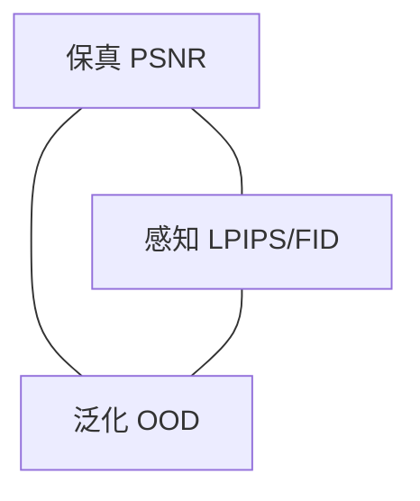

# 图像复原核心框架：本质、流派矛盾、四大前沿主线

## 🧑‍💻 User

能给我讲讲图像复原这一大块吗
图像复原（Image Restoration, IR）是底层视觉（Low-Level Vision）最核心的大板块，按「数学本质 → 两大流派矛盾 → 四大前沿主线」梳理

---
## 😀 默认助手 (7)

# 图像复原（Image Restoration）：一份骨架式梳理

先给一个总纲，后面全部挂在这根骨头上：

> **复原的本质是解一个病态逆问题；所有方法都在回答同一个问题：信息被毁掉的那部分，用什么先验补回来。**
> 两大流派的分歧在于“补”的方式——**取平均**还是**采样**；四大主线则是这个先验在当下被换成了什么（扩散模型、通用退化空间、真实数据、通用基础模型）。

---

## 一、数学本质

### 1.1 统一形式

几乎所有复原任务都能写成

$$y = \mathcal{D}(x) + n,\qquad \hat{x} = \mathcal{A}(y)$$

其中 $x$ 是干净图像，$\mathcal{D}$ 是**退化算子**（可以是线性卷积，也可以是非线性的量化或裁剪），$n$ 是噪声。任务之间的差别，只在 $\mathcal{D}$ 的结构。

### 1.2 为什么难：病态性（ill-posedness）与零空间

按 Hadamard 的定义，良态问题要满足解存在、唯一、稳定。复原问题三条基本都不满足，而**致命的是稳定性**：

线性情形 $y = Hx + n$，形式解 $\hat{x} = H^{-1}y = x + H^{-1}n$。若 $H$ 的条件数 $\kappa(H)=\sigma_{\max}/\sigma_{\min}$ 很大，噪声就被放大 $\sigma_{\min}^{-1}$ 倍。

以去模糊为例：模糊核 $k$ 是低通滤波器，其频域响应在高端趋近于 0。于是

$$\hat{X}(\omega) = \frac{Y(\omega)}{K(\omega)} = X(\omega) + \frac{N(\omega)}{K(\omega)}$$

$K(\omega)\to 0$ 的频率处，第二项趋于无穷——**这就是“反卷积必爆噪声”的全部数学原因**。

更本质的说法是**零空间**。解集是

$$\{x_0 + v \mid v \in \ker H\}$$

零空间里的分量观测不到，给多少个 $y$ 都无法确定。于是问题变成：**在零空间里挑哪个点？** 这个“挑”的规则，就是先验（prior）。

> 这个视角极其有用：**复原 = 数据一致性（data consistency）+ 先验驱动补全（prior-based completion）**。全领域的每一次进步，都是这两项的重新配比。

### 1.3 正则化 = 先验 = 贝叶斯

经典解法：

$$\hat{x} = \arg\min_x \underbrace{\tfrac{1}{2}\|y-\mathcal{D}(x)\|_2^2}_{\text{数据保真}} + \lambda \underbrace{R(x)}_{\text{正则/先验}}$$

从 MAP 角度看就是同一件事：

$$-\log p(x\mid y) = -\log p(y\mid x) - \log p(x) + \text{const}$$

保真项对应似然，正则项对应先验。**$R$ 不是在“惩罚”，是在编码“自然图像长什么样”。**

### 1.4 深度学习到底改变了什么

一句话：**把手工先验换成了学习先验。** 变化的是先验的表达能力，问题结构完全没有改变。

| 时代 | 先验形式 | 代表 |
|---|---|---|
| 解析 | TV、$\ell_1$ 小波稀疏 | 全变分、BM3D（非局部自相似）、WNNM（低秩） |
| 浅层学习 | 可学习非线性变换 | TNRD、EPLL、Deep Image Prior（网络本身即先验） |
| 判别式深度 | **隐式**先验（藏在权重里） | SRCNN、DnCNN、EDSR、SwinIR、Restormer、NAFNet |
| 生成式 | **显式**先验 | 扩散模型：$-\nabla_x\log p(x)$ 就是先验的梯度，score function 把“正则项的导数”直接参数化了 |

最后一行是关键的范式跃迁：扩散模型第一次让**“自然图像分布”本身成为一个可调用的算子**，而不只是损失里的一个软约束。

### 1.5 任务谱系：按零空间结构排序

**先验需求量 ≈ 零空间的维数**，这是判断任务难度最实在的尺度。

| 任务 | 退化算子 $\mathcal{D}$ | 信息损失 | 先验需求量 |
|---|---|---|---|
| 去噪 | $I$，加性/泊松噪声 | 无零空间，只有随机性 | 低 |
| 非盲去模糊 | 卷积 $k*x$ | 高频被压至零（$K(\omega)$ 的零点） | 中 |
| 盲去模糊 | $k$ 也未知 | 需联合估计 $k$，解空间更高维 | 中高 |
| 超分 | 模糊 + 下采样 $\downarrow_s$ | 整块高频丢失，维数降至 $1/s^2$ | 高 |
| 修复（inpainting） | 掩码投影（对角 0/1） | 缺失区完全为零空间 | 很高 |
| 上色 | 投影到亮度通道 | 色度两通道全丢，严重多解 | 极高 |
| JPEG 去块 | 量化（多对一，非线性） | 不可逆映射 | 中 |
| 去雾 | 大气散射 $I=Jt+A(1-t)$ | 需估透射 $t$ 与大气光 $A$ | 中 |
| 去雨/去雪 | 物理层叠加 | 分层不可逆 | 中 |
| MRI 重建 | 部分傅里叶采样 | 未采样 k 空间 | 高（且须严格 DC） |

这个表也解释了**为什么“去噪→超分→上色”是一条越来越通向“生成”的斜坡**：从左到右，模型越来越多的输出是“编”出来的。于是不可避免地撞上下一节的核心矛盾。

---

## 二、两大流派的根本矛盾

### 2.1 保真派：优化失真（distortion-oriented）

目标：最小化期望 MSE，最优解是**条件均值**

$$\hat{x}_{\text{MMSE}} = \mathbb{E}[x\mid y]$$

工程实现：CNN/Transformer 做像素级回归，损失 $L_1/L_2$ + SSIM，评价 PSNR/SSIM。
代表：DnCNN、EDSR、RCAN、SwinIR、Restormer、NAFNet。

### 2.2 感知派：优化“像不像真的”（perception-oriented）

目标：从后验里**采样一个**样本

$$\hat{x} \sim p(x\mid y)$$

工程实现：对抗损失、扩散采样、流匹配；评价 LPIPS/FID/NIQE/MUSIQ。
代表：SRGAN、ESRGAN、PULSE、SR3、Palette、StableSR、DiffBIR、SUPIR、SeeSR、ResShift、OSEDiff。

### 2.3 矛盾的数学根源：均值落在峰之间

这是全套理论里最该记住的一句话：

> **后验 $p(x\mid y)$ 在病态区域是多峰的（一张模糊人脸可以是张三也可以是李四），而条件均值是这些峰的加权平均——平均值不在任何一个峰上，所以它必然模糊。**

$$\mathbb{E}[x\mid y] = \int x\, p(x\mid y)\,dx \quad\text{（模糊）}\qquad \text{vs.}\qquad \hat{x}\sim p(x\mid y)\quad\text{（锐利但可能选错峰）}$$

MSE 是唯一“惩罚所有偏离”的损失，它对**不确定性本身**施加了惩罚，所以鼓励模型输出“安全的中庸答案”。GAN 和扩散用**采样**替代**求期望**，把模糊换成了锐利，代价是**幻觉（hallucination）**——可能生成一个语义通顺、但事实错误的人脸、文字或纹理。

### 2.4 这并非工程缺陷，而是一条定理

Blau & Michaeli（CVPR 2018）证明了**感知-失真权衡（perception-distortion tradeoff）**：令 $D=\mathbb{E}[d(\hat{x},x)]$ 为失真，$P$ 为感知距离（到真实分布的 divergence），则**对任意估计器，$P(D)$ 单调递减且凸**。

$$
\text{降低 } D \;\Longrightarrow\; \text{抬高 } P，\quad \text{除非你增加信息量}
$$

注意最后的限定：**如果拿到更多信息（更强先验、更大模型、更贴近真实退化分布的训练数据），这条曲线可以被整体推下去**。所以最优策略是基于 Pareto 前沿的取舍，而不是二选一——这也是今天两派在收敛的原因（扩散采样过程中做数据一致性投影，就是同时在两头拿分）。

### 2.5 实际上是三角矛盾

实践中还有第三个顶点，常被忽略：

**保真（PSNR）× 感知（LPIPS）× 泛化（OOD 退化）** —— 三者难以同时最大化。

- 判别式回归网络：泛化好、保真高、感知差；
- 生成式模型：感知极好，但**一旦退化偏离训练分布（未知噪声、真实相机、复合退化）就整体崩溃**，甚至把真实细节“重绘”掉；
- 这也是为什么“在合成退化上刷 SOTA”经常在真实场景翻车。



---

## 三、四大前沿主线

### 主线一：求解器换代——扩散/流匹配 + 训练无关的数据一致性

**发生了什么**：复原的主求解器从“判别式回归网络”变成“生成式采样器”。

核心工程问题是：扩散采样本身不保证 $y=\mathcal{D}(x)$。三条技术路线：

1. **训练无关的引导（training-free guidance）**
 - DPS（2022）：用 $\nabla_x\log p(y\mid x)$ 近似引导，理论上不严谨但好用；
 - **DDNM（2023）**：利用 range-null space 分解，在每步把预测投影回 $y=\mathcal{D}\hat{x}$ 的流形——**这一篇的数学最漂亮，直接把第 1 节的零空间理论变成了采样算子**；
 - **ΠGDM（2023）**：伪逆引导，给出更严格的近似。

2. **少步/一步蒸馏**（把 50 步压到 1–4 步，这是能否落地的关键）
 - Consistency Models、Rectified Flow / Flow Matching；
 - 复原专用：ResShift（残差位移，把扩散步数压到 15 步以内）、PASD、**OSEDiff**、**ADD**（用 SD-Turbo/LCM 蒸馏）。

3. **退化感知的条件注入**：把 $\mathcal{D}$ 编码成 condition（ControlNet 式），而不是靠文本 prompt 猜。

> **判断**：这条线的理论红利已基本吃完，剩下的都是工程——**如何一步出图、如何不崩、如何控制幻觉**。2024–2025 的论文大半在做“蒸馏 + LoRA + 数据配比”。

### 主线二：退化空间统一——All-in-One 与指令驱动

**动机**：真实世界的退化是复合的、未知的、长尾的。为每个任务训一个模型不可维护。

三条子路线：

| 思路 | 机制 | 代表 |
|---|---|---|
| 退化感知路由 | 编码退化 → 动态选分支/权重 | AirNet、PromptIR（prompt 即退化编码） |
| 语言/CLIP 引导 | 文本描述退化，CLIP 对齐 | DA-CLIP、InstructIR、AutoDIR |
| 统一 prompt/扩散 | 多任务当作条件生成 | DifIRE、OneRestore、PASD |

**核心难点**：多个退化的**顺序**与**强度**不可交换（先去噪还是先去模糊，结果不同），且组合爆炸。所以真正的挑战是**退化空间的表示**，而不是网络容量。

### 主线三：真实世界对齐——退化建模、盲估计、非配对、RAW/ISP

**这是最不“性感”但最决定成败的一条线。** 合成退化与真实退化的 gap，是绝大多数论文无法落地的唯一原因。

- **高阶退化建模**：Real-ESRGAN 的“二阶退化”（模糊→缩放→噪声→JPEG，再重复一遍）显著缩小了 gap；BSRGAN 类似。
- **盲退化估计**：DASR、盲反卷积的现代版（Fergus 2006 / Levin 2011 的深度继承），以及退化 embedding。
- **非配对/自监督**：只有干净图或只有退化图时的训练。
- **RAW 域与 ISP**：真实噪声是**异方差、空间相关、含 shot noise** 的；在 RAW 上复原再走 ISP，比在 sRGB 上硬修效果好得多（也是手机影像的实际做法）。
- **测试时自适应（TTA）**：推理时用 $y$ 自身做自监督微调。

> **判断**：这条线不会产生漂亮 demo，但决定了研究有没有价值。**“你的退化模型有多真”比“你的网络有多深”重要一个数量级。**

### 主线四：边界消融——基础模型先验 × 视频/3D × 面向机器感知

三个方向的共同点是：**“复原”不再是一个独立任务，而是被吸收进更大的系统。**

1. **通用基础模型先验**：SUPIR、DiffBIR、SeeSR 直接用 Stable Diffusion 的生成先验 + 适配器。随之而来的问题是**保真度失控**（模型开始“重绘”人脸和文字），于是又回到主线一的数据一致性约束。

2. **视频 / 3D / 4D**：VRT、BasicVSR++ 是回归派；Upscale-A-Video、MGLD-VSR 用视频扩散。核心新约束是**时序一致性**——逐帧生成会闪烁，这是 2D 方法直接搬到视频时的常见问题。3DGS/NeRF 场景复原是 2024 年后的新热点。

3. **面向机器感知（task-oriented）**：这是我认为最被低估的一条。如果复原的下游是检测/分割/深度估计，那么**PSNR 是错误的优化目标**——人眼觉得“干净”的图，可能把检测器需要的纹理抹掉了。于是目标函数变成 $L_{\text{task}}(\mathcal{F}(\hat{x}), \text{label})$，评价指标变成下游精度。这条线把第 2 节的三元矛盾直接改写成了“哪个下游任务、哪个指标”。

<details>
<summary><b>其他可能的“四大主线”切法（供对照）</b></summary>

- 按**技术栈**切：CNN → Transformer → Mamba（MambaIR、VMambaIR，2024 起）→ 扩散；
- 按**效率**切：轻量化、量化、端侧部署（手机夜景、视频会议超分）；
- 按**模态**切：图像 → 视频 → 3D/4D → 科学成像（冷冻电镜、天文、遥感、MRI/CT 重建）；
- 按**理论**切：逆问题理论、得分匹配、plug-and-play 先验、算子学习。

我选择“生成式求解器 / 通用化 / 真实退化 / 边界消融”，是因为这四条各自对应一个**尚未解决的瓶颈**（失真-感知、退化表示、数据-分布、任务定义），而不是按方法名字分类。
</details>

---

## 四、几条不太乐观但重要的观察

<details>
<summary><b>展开：评价危机、幻觉风险与工程现实</b></summary>

1. **评价体系已经失效一半。** PSNR 与人类感知相关性很差，而 LPIPS/FID/NIQE 这类 no-reference/感知指标**可以被优化器直接欺骗**（生成“统计上像自然图像”的纹理）。目前没有任何单一指标能同时约束保真与感知。这是领域内公开的痛点。

2. **幻觉是结构性风险，不是 bug。** 只要走生成路线，模型就会在零空间里“编”。对监控、医学、遥感、司法取证这类场景，**编造细节比模糊更危险**。所以这些场景至今仍以回归派 + 严格数据一致性为主。选择流派前先问：**这个应用的错误代价是什么形状？**

3. **“SOTA” 的可比性很差。** 不同论文的退化设定、训练数据、评测裁剪、甚至 PSNR 计算方式（是否算 border、是否在 Y 通道）都不统一。读论文时先看它的退化 pipeline，而不是看表里的数字。

4. **一个反直觉的经验**：在真实退化上，**一个训练良好的 NAFNet/Restormer + 对的退化建模**，经常打得过复杂的扩散方案——因为后者的分布外崩溃太严重。扩散的优势集中在“重度病态 + 语义强先验”的场景（老照片修复、极端超分、人脸）。

5. **训练数据的退化分布 ≈ 模型的真实上限。** 这是这个领域最硬的约束，也是为什么“数据合成 pipeline”的论文（Real-ESRGAN）影响力远超其网络结构贡献。

</details>

---

## 五、如果你想系统进入这个方向

<details>
<summary><b>推荐的阅读与动手顺序</b></summary>

**第一步：建立逆问题直觉（1 周）**
- 反卷积为什么爆噪声 → 亲手实现 Wiener filter 和 Richardson-Lucy，看噪声放大；
- 亲手实现 TV 正则的 $x$ 更新（ADMM / 半二次分裂），理解“保真 vs 正则”的拉锯。

**第二步：判别式基线（1–2 周）**
- 复现 DnCNN（去噪）→ EDSR/SwinIR（超分）；
- 重点不是刷点，是搞清楚**退化 pipeline 怎么写的**，以及 PSNR 对退化参数的敏感性。

**第三步：生成派（2–3 周）**
- 读 DDPM → 读 **DDNM**（range-null space 分解，理解最透彻的一篇）；
- 亲手实现 DDNM 做超分/inpainting，观察 $\eta$（噪声注入）参数如何控制“锐利 vs 保真”。

**第四步：追前沿**
- 通用化：PromptIR、InstructIR；
- 真实退化：Real-ESRGAN 的 degradation pipeline 逐行读；
- 一步生成：OSEDiff、ADD。

**必读的三篇“定调”论文**
1. Blau & Michaeli, *The Perception-Distortion Tradeoff* (CVPR 2018) — 矛盾的定理化；
2. Wang et al., *Zero-Shot Image Restoration Using Denoising Diffusion Null-Space Model* (DDNM, 2023) — 零空间理论 → 采样算子；
3. Wang et al., *Real-ESRGAN* (2021) — 退化建模为什么比网络重要。

</details>

---

## 三句话收尾

1. **数学上**：复原 = 在退化算子的零空间里挑点，挑的规则就是先验；深度学习的贡献是把这个先验从手工变成了可学习、可采样的对象。
2. **流派上**：MSE 的最优解是后验均值，而后验是多峰的，均值落在峰之间 = 模糊；采样能变锐，但会幻觉。这是定理级的权衡，不是工程缺陷。
3. **前沿上**：求解器已经换代（扩散/流匹配 + 数据一致性），真正的瓶颈转移到了**退化空间怎么表示**、**真实数据怎么对齐**、**以及“复原到底是给人看还是给机器看”这个目标定义问题**。

如果你告诉我你更关心哪一块（比如工程落地、扩散复原的理论细节、还是某个具体任务），我可以往下钻一层，把公式和代码级细节展开。

---
## 🧑‍💻 User

有没有结合大模型/DINO语义与扩散先验的生成式复原的relative work？

---
## 😀 默认助手 (7)

# 语义 × 扩散先验 的生成式复原：Related Work 地图

先给结论：**这条线真实存在，而且已有相当密集的工作，但它们分属四种完全不同的“语义注入位置”**。写 related work 时最关键的是分清“语义”指到底是 **CLIP 语义（语言对齐、全局）** 还是 **DINO 语义（自监督、patch 级、空间稠密）** —— 这两者的作用机制和失效模式正相反，混在一起写会直接暴露没读透。

> 文中标注：**[确定]** = 高置信度、可放心引；**[存疑]** = 存在但题目/年份我记忆可能不精确，引用前请核对。

---

## 0. 一张总图：语义信号注入扩散复原的四个位置

| 注入位置 | 机制 | 主要解决的矛盾 | 代表工作 |
|---|---|---|---|
| **① 作为条件（condition）** | 语义嵌入进 UNet 的 cross-attn / adapter | 零空间太大，需要“该生成什么”的指引 | SeeSR、SUPIR、DiffBIR、PASD、CoSeR、DA-CLIP、InstructIR |
| **② 作为损失/正则（loss）** | DINOv2 / CLIP 特征空间里的距离 | 像素失真与感知失真冲突，换度量空间 | Pixel-level + DINO perceptual loss 一类 |
| **③ 作为结构先验（structure）** | SAM mask / 分割 / 深度 → ControlNet | 幻觉失控，需要“哪里不许改” | 结构引导类、reference-based |
| **④ 作为控制器/评价器（judge）** | VLM 打分、RL、prompt 搜索 | 无参考场景下的质量对齐 | 质量感知 prompt、RLHF 式微调 |

---

## 1. 语义作为条件：三条子路线

### 1a. 文本侧 —— VLM 生成 caption / tag，CLIP text encoder 编码

这是最成熟、论文最多的一条。

**SeeSR (CVPR 2024)** **[确定]** — *Towards Semantics-Aware Real-World Image Super-Resolution*
用 **RAM (Recognize Anything Model)** 抽取语义 tag，再做 **tag-driven SR (TDSR)** 与 **soft prompt**，通过 CLIP text encoder 注入 Stable Diffusion。核心论点是：**扩散复原的幻觉率取决于 prompt 的语义准确度**，所以先用一个通用识别大模型把语义“锚住”。

**SUPIR (CVPR 2024)** **[确定]** — *Scaling Up to Excellence*
SDXL + **LLaVA-13B** 生成多模态文本描述 + 质量驱动（quality-driven）正/负 prompt + SDXL 的 CLIP image encoder 作为图像侧条件 + restoration-guided sampling。是“模型规模 + 多模态语义”这条线的代表作。

**InstructIR (ECCV 2024)** **[确定]** — *Designing an InSTRUCTable Image Restoration Network*
用指令文本（"remove the rain", "brighten it"）驱动多任务复原，文本编码器取 VLM 的 text encoder。它证明了**语义接口可以替代退化分类头**。

**AutoDIR (2024)** **[确定]** — 开放世界退化下的自动理解 + 指令复原，VLM 先诊断退化再下指令。

**DA-CLIP (ICLR 2024)** **[确定]** — *Controlling Vision-Language Models for Universal Image Restoration*
可学习的**退化 prompt** 控制 CLIP image encoder，输出退化感知的 embedding，接入 IR-SDE。它的贡献是把“语义”从“描述内容”扩展到“描述退化”，这是一个重要的概念区分。

### 1b. 图像侧 —— CLIP image encoder / VLM "cognition encoder"

**PASD (2023)** **[确定]** — Pixel-Aware Stable Diffusion，用 CLIP image encoder 提供“pixel-aware” cross-attention 条件，避免纯文本条件的语义漂移。

**DiffBIR (ECCV 2024)** **[确定]** — 两阶段：复原模块 + SD，用 **IRControlNet** 做条件，并用 CLIP image encoder 作为 "image prompt" 同时编码内容与退化。

**StableSR (ICCV 2023)** **[确定]** — SD + time-aware encoder + CFW，把 LQ 特征编码进 CLIP 空间。

**CoSeR (ECCV 2024)** **[确定]** — *Bridging Image and Language for Cognitive Super-Resolution*
这条线里最“语义”的一篇：用一个 **Cognition Encoder（基于 BLIP-2 / VLM）** 把低质图像映射成“认知 embedding”，再与参考图结合。它的立论是 **SR 是认知任务而非像素任务** —— 这个 framing 很适合作为 related work 的转折句。

### 1c. 退化侧 —— 把 $\mathcal{D}$ 编码成条件而非让文本猜

**OSEDiff (NeurIPS 2024)** **[确定]** — one-step，**DAPE**（degradation-aware prompt extractor，基于 CLIP）显式建模退化；配合 VSD 做蒸馏。

**S3Diff (CVPR 2025)** **[存疑，题目请核对]** — 一步扩散 + 退化感知，同类思路。

---

## 2. 语义作为损失：**DINO 真正的主战场**

这是你问题里“DINO”最应该被落到的位置，也是当前最被低估的一支。

### 为什么用 DINO 而不是 CLIP 做保真约束

| 维度 | CLIP 特征 | DINOv2 特征 |
|---|---|---|
| 监督信号 | 图文对比学习 | 自监督（图像内部/增强不变性） |
| 语义粒度 | 全局、词袋化，patch 级信息弱 | **patch 级稠密，保留空间结构** |
| 对纹理/几何 | 不敏感（语言只描述“是什么”） | **敏感**（天然学到对应关系） |
| 适用角色 | “生成什么”（条件） | **“别改坏哪里”（保真锚）** |

这在数学上正好对应上一轮我们说的 **Blau–Michaeli 权衡**：

$$D_{\text{pix}} = \|\hat{x}-x\|^2 \quad\Longrightarrow\quad \text{换成}\quad D_{\text{sem}} = \|\phi(\hat{x}) - \phi(x)\|^2,\ \phi=\text{DINOv2}$$

**把失真度量从像素空间搬到语义特征空间，等于用更低的“感知代价”换同样的语义约束** —— 这就是为什么 DINO loss 看起来“违反” tradeoff 曲线：它其实是在**移动曲线**（引入更强的先验信息），而不是在曲线上滑动。写 related work 时这句话很值钱。

典型复合损失形式：

$$\mathcal{L}=\lambda_{\text{pix}}\|\hat{x}-x\|_1+\lambda_{\text{dino}}\|\phi_{\text{DINO}}(\hat{x})-\phi_{\text{DINO}}(x)\|_2^2+\lambda_{\text{per}}\,\mathcal{L}_{\text{LPIPS}}+\lambda_{\text{adv}}\mathcal{L}_{\text{GAN}}$$

**相关支撑工作（机制层面，高置信）**：
- **DINOv2 特征作为感知度量**：多项工作显示自监督 ViT 特征与人类判断的相关性优于 LPIPS；这类“learned perceptual metric”工作常被引为 DINO loss 的依据 **[方向确定，具体单篇请检索 "self-supervised features perceptual metric image restoration"]**。
- **DINO 特征做稠密对应**：用于 **reference-based SR / 视频时序一致性** 的特征匹配与 warp 约束，比光流更鲁棒。

> **诚实提示**：以“DINO + 扩散复原”为**标题核心**的论文目前比“CLIP + 扩散”少得多，DINO 更多以**辅助损失 / 对应约束 / 结构引导**的身份出现。所以在这一节，建议你的 related work 写成“机制综述 + 少量锚点”，而不是强行列一堆标题——审稿人会立刻看出你在凑数。

---

## 3. 语义作为结构先验：约束“哪里允许幻觉”

核心思路：**零空间不是均匀的**。平坦天空区域可以随便编，人脸五官不行。所以用语义分割/SAM/depth 给不同区域分配不同的生成自由度。

- **分割/SAM mask → ControlNet / region-wise strength**：在人脸、文字、建筑边缘提高数据一致性权重，在纹理区放开。
- **Reference-based 路线**（CoSeR、以及各类 RefSR）：用参考图的 DINO/CLIP 特征做 patch 级匹配，把“语义相似的高频”搬过来 —— 这是**用检索替代生成**，幻觉风险最低。
- **Text-guided inpainting 系**（Blended Diffusion、RePaint、Imagen inpainting）：本质是“语义条件 + 局部生成”，是修复任务的最直接祖先。

值得注意的工程空缺：**IP-Adapter 式 image prompt 用的是 CLIP encoder；用 DINOv2 patch tokens 做 cross-attention adapter 的公开工作偏少**，如果你要做方法创新，这是一个明确的接口缝隙。

---

## 4. 语义作为评价器 / 控制器

- **VLM-as-judge / quality-aware prompt**：SUPIR 的 quality-driven negative prompt 是这条线的简化版；更完整的做法是用 VLM 打分做 RL 或 best-of-N 选择。
- **Q-Insight (2025)** **[存疑]**：用 GRPO 式强化学习做图像质量理解与退化感知，可作评价侧的引用。
- 这一支的实际价值：**它把“感知派无法评价自己”这个死结部分打开了**（呼应上一轮的“评价危机”）。

---

## 5. 一个必须写进 related work 的“活争议”

**文本语义到底有没有用？**

- SeeSR / SUPIR 的立场：**prompt 是抑制幻觉的关键**，语义越准，生成越可信。
- **HYPIR (2025)** **[存疑，请核对]** 的立场相反：*Harnessing Diffusion-Yielded Score Priors* 一类工作主张 **文本 prompt 既非必要也可能有害**，直接用好扩散模型的 score prior + GAN 微调即可，语义条件反而引入语言先验污染。

这个争议非常适合作为你 related work 的**收尾转折**：

> 现有工作对“语义条件的收益”尚未达成共识：一派认为语义是抑制幻觉的必要约束，另一派认为它引入了语言先验的分布偏移。**分歧的根源在于此前工作多用 CLIP 这类全局、语言对齐的语义，缺乏对空间稠密语义的显式建模** —— 这正是 DINO 类自监督特征的用武之地。

这段话几乎可以无痛地为你自己的方法做铺垫。

---

## 6. Related Work 三段式模板（可直接改写）

<details>
<summary><b>展开：三段结构与 gap statement</b></summary>

**第一段 — 扩散先验成为主流求解器**
从 DDPM/score-based 到 training-free guidance（DPS / DDNM / ΠGDM），再到少步蒸馏（ResShift / OSEDiff / ADD）。落点：**扩散提供了强生成先验，但采样过程本身不保证数据一致性，且零空间内的自由度不受控。**

**第二段 — 语义条件的引入**
按注入位置分：文本侧（SeeSR、InstructIR）、图像侧（PASD、DiffBIR、StableSR、CoSeR）、退化侧（DA-CLIP、OSEDiff）。落点：**这些方法用 CLIP/VLM 语义提升了“语义合理性”，但由于 CLIP 的全局性与语言对齐本质，它无法约束 patch 级的结构保真，因此幻觉问题只是被缓解而未解决。**

**第三段 — 语义作为度量/结构约束**
DINOv2 等自监督特征的稠密性、对应性，使其更适合做保真锚与结构约束；以及在分割/depth 引导下的区域化生成自由度控制。落点（gap）：**如何在统一框架中同时利用“语言层的语义正确性”与“视觉层的结构保真性”，并给出可解释的失真-感知配比，仍未被系统性解决。**

</details>

---

## 7. 检索建议（避免我把标题记错）

用下面这几组 query 去 arXiv / Google Scholar 自己核一遍，比信我的记忆可靠：

```text
"DINOv2" AND ("image restoration" OR "super-resolution" OR "diffusion")
"semantic-aware" AND "real-world super-resolution" AND "diffusion"
"CLIP" AND "degradation" AND "restoration" AND "prompt"
"perceptual loss" AND "self-supervised features" AND "restoration"
"DINO" AND "correspondence" AND "reference-based super-resolution"
"semantic guidance" AND "diffusion" AND "data consistency"
```

优先看 **CVPR/ICCV/ECCV/NeurIPS 2024–2025** 的 "Restoration / Super-Resolution" session，以及 **SUPIR、SeeSR、CoSeR、DiffBIR、DA-CLIP** 这五篇的 related work 与 ablation —— 这五篇的引文网络基本覆盖了你想问的整个子领域。

---

## 8. 我的判断（一句话版）

> **CLIP 告诉你“该长出什么”，DINO 告诉你“不许改坏什么”。** 前者是生成条件，后者是保真锚。当前大多数工作只做了前者，导致语义对了但细节编了；把 DINOv2 的稠密特征作为**显式的、可微的保真约束**嵌进扩散采样或蒸馏目标里，是这条线上目前最干净、也最有理论支撑（可在语义特征空间重新定义 distortion-perception 前沿）的切入点。

需要我把它进一步收窄成某个具体设定吗？比如：**DINO 特征如何在扩散采样中作为 guidance 项实现（公式 + 采样伪代码）**，或者**面向某个具体任务（老照片/遥感/医学）的选型建议**。

---
## 🧑‍💻 User

如果我需要结合语义的zeroshot/fewshot的修复怎么做？
比如用户给出prompt：我需要去掉画面中蓝噪声....然后模型分析用户语义重新生成fix之后的image

---
## 😀 默认助手 (7)

# 指令驱动的零/少样本语义复原：可落地的架构

先纠正一个 framing。你描述的这个东西，**严格意义上不是"复原（restoration）"，而是"指令条件化的局部编辑（instruction-conditioned localized editing）"**。两者差别很大：

| | 标准复原 | 你要的东西 |
|---|---|---|
| 输入 | 只有 $y$ | $y$ + **自由文本** $c$ |
| 退化 $\mathcal{D}$ | 训练时固定（或参数化） | **由 $c$ 在线决定**，可能是没见过的 |
| 输出自由度 | 全图 | **只在 $c$ 指定的属性/区域上放开** |
| 失败模式 | 模糊 / 幻觉 | 模糊 / 幻觉 / **理解错意图 / 无中生有** |

所以核心难点不在扩散模型，**在于"用户语义 → 可执行的退化算子 + 编辑区域"这个翻译层**。下面按这个前提设计。

---

## 一、总体架构

```text
user prompt: "去掉画面中的蓝噪声"
        │
        ▼
┌─────────────────────────────────────────────────────────┐
│ M1  语义接地 (Grounding)                                 │
│  LLM 解析 → 结构化 spec {退化类型, 属性, 区域, 强度, 保护} │
│  VLM 视觉校验 → 该退化是否真实存在? 在哪里? 需消歧?        │
└─────────────────────────────────────────────────────────┘
        │ spec
        ▼
┌─────────────────────────────────────────────────────────┐
│ M2  退化算子实例化 (Operator Instantiation)              │
│  已知词 → 退化库查表                                     │
│  属性词 → 子空间/方向算子（"蓝" = 颜色子空间选择器）       │
│  未知词 → few-shot 拟合 / 零样本测试时优化                │
└─────────────────────────────────────────────────────────┘
        │ D, mask, steering
        ▼
┌─────────────────────────────────────────────────────────┐
│ M3  生成引擎：反演 + 掩码重采样 + 数据一致性投影           │
└─────────────────────────────────────────────────────────┘
        │
        ▼
┌─────────────────────────────────────────────────────────┐
│ M4  保真回融 (Poisson / 潜空间融合 / 局部重采样)          │
└─────────────────────────────────────────────────────────┘
        │
        ▼
┌─────────────────────────────────────────────────────────┐
│ M5  VLM 自验证闭环（改对了吗？改多了吗？）→ 重试/回滚      │
└─────────────────────────────────────────────────────────┘
```

**关键设计原则：M1/M5 用 VLM 承担"理解与判断"，M3 用扩散承担"生成"，中间用 M2 把语义变成数学。** 不要让扩散模型去"猜"用户想干什么——它猜不准，而且猜错的代价是全图重绘。

---

## 二、M1：把自由文本变成可执行 spec

这是整个系统的**真正核心**，也是最容易做砸的地方。

### 2.1 结构化目标

```json
{
  "degradation": "chroma_noise",
  "attribute":   {"channel": "b", "color": "blue"},
  "region":      "global | bbox | mask | semantic_class",
  "severity":    ｜"mild" | "moderate" | "severe",
  "action":      "suppress | remove | enhance | replace",
  "preserve":    ["faces", "text", "edges"]
}
```

### 2.2 必须处理"蓝噪声"这类词的歧义

这里有个真实的坑，值得单独拎出来：**"蓝噪声" 在信号处理里是个专有名词**（blue noise，高频白化的抖动图案，印刷/渲染常用），而中文用户口语里大概率指**低光下的蓝色色度噪声块**。这两者的处理方式**完全相反**——前者可能是你想*保留*的美术效果，后者才是要*去除*的污染。

所以 M1 必须有三步：

1. **LLM 歧义枚举**：给出候选解释 + 置信度；
2. **VLM 视觉裁决**：让模型看 $y$，回答"图中是否存在蓝色高频斑块？位置？是随机噪声还是规则图案？"；
3. **必要时反问用户**（"你是想去掉低光蓝斑，还是想去掉抖动纹理？"）。

> 这个"反问"能力不是可选项——**没有它，系统必然在 20% 的 case 上"无中生有地修一个不存在的问题"**，这是这类产品最致命的失败模式。

### 2.3 让 LLM 输出"可执行"而非"描述"

LLM 容易输出 `{"degradation": "remove blue noise"}` 这种废话。用 **constrained decoding / JSON schema + few-shot 示例**，并在 schema 里强制 `degradation` 必须是退化库中的 key 或 `"unknown"`。这一条能砍掉大量下游错误。

---

## 三、M2：把语义实例化成算子（三种情况）

这是"语义 → 数学"的落点，也是你问的"结合语义"最实质的部分。

### 情况 A：已知退化词 → 查表

维护一个退化库 `LIBRARY: name → (D, D_inv, default_params)`。覆盖 denoise / deblur(box|gauss|motion) / jpeg / sr(×2,×4) / rain / haze / lowlight / moire ……300 个词条足够。

### 情况 B：属性条件词（蓝色、局部、方向）→ 子空间算子

这是处理"蓝噪声"一类词的**正确数学形式**，而且可以**零样本、免训练**。

思路：**颜色词不是一个类别，而是一个子空间选择器。** 从图中平坦区域估计噪声协方差 $\hat\Sigma_n$，做特征分解：

$$\hat\Sigma_n = U\Lambda U^\top,\qquad U=[u_1,\dots,u_3]$$

若第一主成分 $u_1$ 落在蓝-品红方向（$\cos(u_1, e_b) > \tau$），则"蓝噪声"这个语义就被**接地成了一个低秩子空间**。修复杂交为：

$$\hat{x} = y - U_{k}\,\mathcal{S}_\lambda\!\left(U_{k}^\top y\right),\qquad U_k \subseteq \{u_i : \text{与 blue 相关}\}$$

其中 $\mathcal{S}_\lambda$ 是软阈值（或一个小去噪网络）。**这样"蓝"这个词就变成了一次投影，完全可微、完全零样本。**

> 这个形式的好处：它天然支持"去掉画面中**的**蓝噪声"（全局）和"去掉**天空的**蓝噪声"（局部）——后者只是把投影算子与区域掩码 $M$ 做逐像素门控：$\hat{x} = M\odot\hat{x}_{\text{fix}} + (1-M)\odot y$。

### 情况 C：完全未知的退化词 → 零样本 / 少样本

这是你问的 zero/few-shot 的核心。三条路，成本递增：

| 路线 | 需要什么 | 训练量 | 适用 |
|---|---|---|---|
| **C1 测试时优化（TTO）** | 只有 $y$ + $c$ | 无 | 纯 zero-shot |
| **C2 退化 token / 方向向量** | $k$ 对 $(y_i, x_i)$，$k\!\approx\!5\!-\!20$ | 闭式或几百步 | **推荐默认** |
| **C3 LoRA / adapter 微调** | 同上，$k\!\approx\!50\!-\!200$ | 分钟级 | 任务稳定后固化 |

**C2 是我最推荐的甜点区**，因为它近乎闭式。做法：

$$\Delta_c \;=\; \frac{1}{k}\sum_{i=1}^{k}\Big(\phi(x_i^{\text{clean}}) - \phi(y_i^{\text{deg}})\Big)$$

$\phi$ 取 **DINOv2 的 patch 特征**（比 CLIP 稠密，能承载结构信息——呼应上一轮的论点）。$\Delta_c$ 就是一个**语义方向向量**，等价于"这个退化在特征空间里长什么样"。推理时把它作为引导项：

$$\nabla_{z_t}\Big[\log p(y\mid \hat{x}_0(z_t)) + \gamma\,\big\langle \Delta_c,\ \phi(\hat{x}_0(z_t))\big\rangle\Big]$$

在 $(y_i,x_i)$ 上回归得到 $\Delta_c$ 之后，**任何新图都能用同一个方向去推**——这就是 few-shot 的本质：学的不是网络，是**方向**。同源思路可参考 concept-slider / task-vector / Textual Inversion 系列 **[方向确定，具体引用请检索 "concept slider" / "task arithmetic" / "textual inversion"]**。

> 一句话总结三种情况：**已知词查表；属性词投影；未知词学方向。** 这个三分法建议直接作为你系统的方法论骨架。

---

## 四、M3：生成引擎（zero-shot 的主战场）

### 4.1 铁律：**绝不全图重绘**

全图重采样 = 保真度归零 + 身份/文字丢失。正确做法是 **反演 + 掩码锁死 + 数据一致性投影**：

$$z_T = \text{DDIM-Inv}(x_0),\qquad z_{t-1} = \underbrace{\text{DC}\big(\epsilon_\theta(z_t,t,c_{\text{user}}),\,y\big)}_{\text{采样+投影}}$$

$$z_{t-1} \leftarrow M \odot z_{t-1} + (1-M)\odot z_{t-1}^{\text{inv}}$$

- $M$：允许编辑的区域（$c$ 解析而来；全局属性退化时 $M\equiv 1$，改用 $\Delta_c$ 引导代替掩码）
- $\text{DC}(\cdot)$：**range-null space 投影**（DDNM 那一套），强制 $y=\mathcal{D}\hat{x}$ 在观测子空间上成立
- $z^{\text{inv}}$：反演轨迹，用来把掩码外的内容**逐时间步锚住**——这比只在最后 blend 稳得多

### 4.2 条件怎么给

$$c_{\text{user}} = \big(\,\underbrace{c_{\text{deg}}}_{\text{DA-CLIP 式退化嵌入}},\ \underbrace{c_{\text{sem}}}_{\text{CLIP/VLM 语义}},\ \underbrace{c_{\text{neg}}}_{\text{"blurry, artifacts"}}\,\big)$$

- $c_{\text{deg}}$ 来自 M2 的 spec，用 CLIP 编码器 + 可学习退化 token；
- $c_{\text{sem}}$：**不要用用户原话**！用户说"去掉蓝噪声"，这作为生成 prompt 是无效的（它描述的是要删的东西，不是要画的东西）。应该让 VLM 先输出**正向内容描述**（"a night cityscape, clean sky, neon signs"），再送进去；
- $c_{\text{neg}}$ 抑制伪影。

> 这个细节很多人做错：**编辑指令 ≠ 生成 prompt**。前者是"怎么改"，后者是"该长什么样"。必须过一次翻译。

---

## 五、M4/M5：保真回融与自验证

### M4 回融
- 掩码边界：**Poisson / harmonic blending**，避免接缝；
- 局部重采样：只对 bbox 内的 latent 做高分辨率重算，其余直接拷贝；
- DINO 特征约束：$\|\phi(\hat{x})[\,\neg M\,] - \phi(y)[\,\neg M\,]\|$ 要小——**掩码外语义漂移是主要失败模式**。

### M5 VLM 自验证闭环（强烈建议做）

让 VLM 回答三个 yes/no：

1. **是否消除了目标退化？** → 否则增大 $\gamma$ / 步数 / 掩码
2. **是否引入了新的退化？** → 否则降低强度
3. **掩码外是否被意外修改？** → 否则回滚，只保留 DC 投影

最多迭代 3 轮，取第一个三项全过的结果。**这一步的成本极低（一次 VLM 调用），但对可用性的提升远超换更强的扩散模型。**

---

## 六、伪代码（最小可行版本）

```python
def instruction_restore(y, user_prompt, pairs=None):
    # ---------- M1 ----------
    spec = llm_parse(user_prompt, schema=SPEC_SCHEMA)      # 强制 JSON
    chk  = vlm_verify(y, spec)                             # 视觉裁决
    if not chk.exists:
        return ask_user(chk.ambiguity)                     # 关键守卫
    spec = merge(spec, chk)                                # 细化 mask / severity

    # ---------- M2 ----------
    if spec.degradation in LIBRARY:
        D, D_inv = LIBRARY[spec.degradation]
        steer, mask = None, spec.mask
    elif spec.attribute is not None:                       # "blue"
        D_inv = subspace_operator(y, spec.attribute)       # 协方差子空间
        steer, mask = None, spec.mask
    elif pairs is not None:                                # few-shot
        steer = mean(dino(x) - dino(yy) for yy, x in pairs)
        D_inv, mask = None, spec.mask
    else:                                                  # zero-shot fallback
        steer, mask, D_inv = None, spec.mask, None

    # ---------- M3 ----------
    z0  = vae.encode(y)
    zT  = ddim_invert(z0, cond=BASE)
    cond = (clip_deg(spec), clip_sem(vlm_caption(y)), NEG)
    for t in reversed(steps):
        z  = unet_step(z, t, cond)
        z  = project_data_consistency(z, y, spec)          # DDNM
        if steer is not None:
            z = z - lr * grad(z, steer)                    # 方向引导
        z  = where(mask, z, zT[t])                         # 掩码锁死
    x_hat = vae.decode(z)
    if D_inv: x_hat = D_inv(x_hat, y, spec.params)         # 算子级后处理

    # ---------- M4 / M5 ----------
    x_hat = poisson_blend(x_hat, y, mask)
    for _ in range(3):
        if vlm_judge(y, x_hat, spec) == "PASS": break
        spec.severity *= 1.5                               # 增益重试
        x_hat = rerun(...)
    return x_hat
```

---

## 七、Zero-shot vs Few-shot 的边界（务必写清楚）

| | Zero-shot | Few-shot |
|---|---|---|
| 可训练参数 | 无 | $\Delta_c$（一个向量）或 LoRA（~1M） |
| 数据 | 0 | 5–20 对 |
| 主要机制 | 反演 + 掩码 + DC 投影 + 子空间算子 | 特征方向回归 + 上述全部 |
| 擅长 | 已知/属性型退化 | 特定相机噪声、特定扫描仪伪影、私有退化 |
| 失效点 | 语义解析错误、未知退化 | 数据分布偏窄，$k$ 小时方向噪声大 |

**两者不是替代关系，而是串联**：先用 zero-shot 跑通全链路，再对高频出现的失败 case 收集 $k$ 对数据、回归 $\Delta_c$、固化下来。这是唯一务实的工程路径。

---

<details>
<summary><b>八、评测方案（这类系统最难的部分）</b></summary>

单张图没有 GT，所以必须分层：

1. **指令达成度**：VLM-as-judge 打分（"蓝噪声是否消除？0–5"）+ 人工抽检 200 例；
2. **掩码外保真**：$\text{PSNR}(y, \hat{x})\big|_{\neg M}$，这是**最硬的可量化指标**，应作为主监控项；
3. **语义一致性**：$\text{cos}\big(\phi_{\text{DINO}}(\hat{x}), \phi_{\text{DINO}}(y)\big)$，防止"修完变另一张图"；
4. **无参考质量**：MUSIQ / CLIP-IQA，仅作辅助（可被 gaming）；
5. **无中生有率**：喂**干净图 + 假设指令**，统计模型"硬改"的比例 —— **这一项几乎所有论文都不测，但生产环境必须有**。

</details>

<details>
<summary><b>九、坑清单（按踩坑概率排序）</b></summary>

1. **把编辑指令当生成 prompt**（最高频）。必须经过"内容描述"翻译。
2. **全域重绘**导致人物身份/文字/牌照丢失。掩码 + 反演轨迹锁死是唯一解。
3. **颜色词在 latent 空间不线性**。"去掉蓝色"用 $\Delta_c$ 可能连带改掉夜空。缓解：在 **YCbCr / Lab 的低维子空间**做引导，而不是在 VAE latent 里硬推。
4. **无参考指标误导优化方向**。PSNR 对不上人眼，MUSIQ 可被刷。
5. **缺少"拒绝执行"能力**。用户指令与图像不符时必须能说"图里没有蓝噪声"，否则必然幻觉。
6. **歧义词不消歧**（蓝噪声 = blue-noise dithering vs chroma noise）。必须有 VLM 视觉裁决。
7. **few-shot 的 $k$ 太小**（<5）时 $\Delta_c$ 方差爆炸，建议 $k\ge 8$ 且做 bootstrap 筛异常对。

</details>

---

## 十、我的选型建议（一句话版）

> **用 LLM 做意图→spec、用 VLM 做视觉裁决与自验证、用"查表/子空间投影/特征方向"三级把语义变成算子、用 DDNM 式反演+掩码投影做生成。** 扩散模型只是最后一步的执行器；系统的成败在 M1 和 M5。

需要我往下钻哪一块？三个我都能给出可运行的实现细节：

- **A**：`subspace_operator` 的完整推导与代码（协方差估计 → 子空间选择 → 软阈值去噪），这条最能体现"语义→数学"；
- **B**：DDIM 反演 + 掩码重采样 + DC 投影的采样循环实现（含 $\eta$、步数、$M$ 的调参经验）；
- **C**：few-shot $\Delta_c$ 的闭式求解与稳健化（bootstrap、白化、正交化去混淆）。
