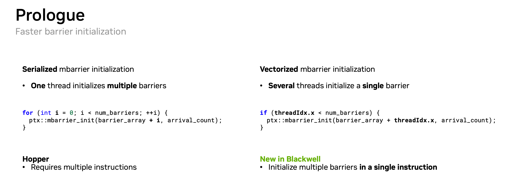

# 黑曜同步向量化

## 🧑‍💻 User

https://www.nvidia.com/en-us/on-demand/session/gtc26-s81518
5826afd8e03a125722189ebd2755acc1.png 
对于mbar进行初始化的时候，一个warp同时进行初始化和warp内的一个线程进行初始化
我这边指令集看的一个一个代码是一个warp同时进行初始化
不知道对不对
这是nvidia blackwell才有的吗？



---
## 🧑‍💻 User

https://www.nvidia.com/en-us/on-demand/session/gtc26-s81518
对于mbar进行初始化的时候，一个warp同时进行初始化和warp内的一个线程进行初始化
我这边指令集看的一个一个代码是一个warp同时进行初始化
这是nvidia blackwellgpu才有的吗？

---
## 😀 默认助手 (7)

I'll look into this. Let me pull the session page and check the PTX/ISA details.

The GTC page is login-gated. Let me search for the underlying hardware/PTX details.

Let me dig into the actual PTX/CUTLASS details.

Found a transcript reference. Let me pull the session page and the surrounding text.

Let me get the rest of that transcript segment and the PTX-level detail.

我查了这场的官方页面（`gtc26-s81518` = *Optimize Mixture-Of-Experts for Low-Latency Inference Decode on Blackwell*，Allard Hendriksen / Petrick Liu），文字稿正好录到了这段（约 **45:40–46:30**）。先给结论，再拆细节。

## 结论先说

1. **你的理解方向基本对，但有个措辞陷阱**：Blackwell 那条路径确实是"**一个 warp（甚至整个 block）一次性发起初始化**"，但它初始化的是 **32 个不同的 barrier**，不是 32 个线程去写**同一个** barrier。
2. **同一个 mbarrier 永远只能由一个线程 `init` 一次**。slide 右边那句 "Several threads initialize a single barrier" 是英文写得含糊，应该读成 "several threads **each** initialize **their own** single barrier"。
3. **是不是 Blackwell 独有**：按这场 talk 的说法，是——"vectorized mbarrier initialization" 被明确标为 **New in Blackwell**，Hopper 只能"选一个线程循环 N 次 → N 条指令"。

## 两段代码到底在做什么

左边（Hopper, *serialized*）——**一个线程初始化多个 barrier**：

```cuda
// elect_one / (threadIdx.x == 0) 里执行
for (int i = 0; i < num_barriers; ++i) {
    ptx::mbarrier_init(barrier_array + i, arrival_count);
}
```

播客原话：*"So you would select one thread, and that thread would loop over all the barriers and initialize them... To initialize 10 barriers, you need 10 instructions."*

右边（Blackwell, *vectorized*）——**多个线程各初始化一个 barrier**：

```cuda
if (threadIdx.x < num_barriers) {
    ptx::mbarrier_init(barrier_array + threadIdx.x, arrival_count);
}
```

注意 `barrier_array + threadIdx.x`：每个 lane 的**目标地址不同**。播客原话：

> *"...in Blackwell, we can use the whole warp, or actually all threads in the block, and just issue stores to shared memory, initializing the shared memory barriers... a block of 256 threads can initialize 256 shared memory barriers in one instruction. This speeds up the mbarrier initialization phase."*

所以"one instruction"的含义是：**一条 warp 级指令里，每个活跃 lane 各自完成自己那个 barrier 的 init**，最多覆盖 32 个 barrier；256 线程的 block = 256 个 barrier。

## 关键：不是"多个线程写同一个 barrier"

这是你困惑的核心点，务必分清：

| 说法 | 是否正确 |
|---|---|
| "一个 warp 同时初始化 **32 个不同的** barrier" | ✅ Blackwell vectorized 就是干这个 |
| "一个 warp / 多个线程同时初始化**同一个** barrier" | ❌ 非法，也**不是** slide 的意思 |
| "一个线程负责初始化一个 barrier（= vectorized 里每个 lane 的行为）" | ✅ |

同一个 mbarrier 对象必须**恰好被一个线程**写成有效的 barrier（`arrival_count` 等状态），多个线程去写同一个 barrier 属于同地址竞争写，行为未定义。所以"一个线程初始化一个 barrier"这件事本身在**任何架构上都成立**；Blackwell 新的是**"这条 init 指令可以让整个 warp 一起发，硬件把它当作一次并行的 shared-memory 写来收"**，而不是排成 N 条串行指令。

（顺带：`if (threadIdx.x < num_barriers)` 这种写法在同一条指令里各 lane 地址不同，属于 warp 内并发而不是发散，代价很低——这也正是它能"一条指令搞定一批"的原因。）

## 是不是 Blackwell 独有？

按这场 talk 的定位：

- **Hopper / SM90**：惯例是 `elect_one_sync()`（或 `threadIdx.x == 0`）里单线程 `unroll` 循环，**N 个 barrier = N 条指令**。直到今天 CUTLASS 的 `cutlass/arch/barrier.h` 里仍是这套（`initialize_barrier_array`，放在 elect_one 区域里 `CUTLASS_PRAGMA_UNROLL` 循环）。
- **Blackwell / SM100 起**：vectorized 初始化，"multiple barriers in a single instruction"。

一个要点：**PTX 助记符本身没变**——slide 两侧都是同一个 `ptx::mbarrier_init(...)`（底层就是 `mbarrier.init.shared::cta.b64 [addr], count;`）。变的是**硬件能否在一条 warp 指令内把多个 lane 的 init 并行处理完**（播客里把它描述成"就是往 shared memory 发 store"），而不是引入了一条新的 PTX 指令。

> ⚠️ 校准一下：以上"Hopper 只能串行 / Blackwell 单指令"的对比，是**这场 GTC talk 自己的表述**（我抓到的官方文字稿片段）。我这次没能从公开的 PTX ISA 文档里独立找到"Hopper 硬件禁止 warp-wide `mbarrier.init`"的明文条文，所以微架构层面的确切限制建议你自己再用 `ptxas` 反汇编（`sm_90` vs `sm_100`）对比一次 SASS 来实锤。

<details>
<summary>写代码时的几个正确性要点（展开）</summary>

1. **一个 barrier 只 init 一次**，由单一线程完成；`arrival_count` 必须是参与该 barrier 的预期到达数。
2. **init 后要可见性 fence + 同步**：`fence.mbarrier_init.release.cluster;`（CUTLASS 的 `fence_barrier_init()`）之后，再用 `__syncthreads()`（或 cluster barrier）保证别的线程在**第一次使用**这个 barrier 之前能看到它。
3. Hopper 稳妥写法：

```cuda
// 一个 elected 线程
if (cute::elect_one_sync()) {
    for (int i = 0; i < Stages; ++i) barriers[i].init(cnt);
}
cutlass::arch::fence_barrier_init();
__syncthreads();
```

4. Blackwell 可改成"每个线程一个 barrier"（注意 `num_barriers` 通常 ≤ 线程数，且各地址互不相同），但**同样别忘了 init 后的 fence/同步**。
5. 另外 Blackwell 还新增了 `mbarrier.init` 之后相关的一些对齐/`elect_one` 约束，CUTLASS 里区分了 `initialize_barrier_array`（单线程）与 `initialize_barrier_array_aligned`（warp-wide + `elect_one`），可以对照官方代码看预期用法。

</details>

source: NVIDIA GTC26 session `gtc26-s81518`（页面需登录，文字稿片段来自搜索引擎索引）；CUTLASS `include/cutlass/arch/barrier.h`（`ClusterBarrier::init` / `initialize_barrier_array*` / `fence_barrier_init`）。

要不要我把 `sm_90` 与 `sm_100` 下这段 `mbarrier.init` 的 SASS 反汇编对比整理出来，实锤"一条指令 vs N 条指令"？

---
## 🧑‍💻 User

不过我不太懂啊，这边把寄存器分为标量寄存器和向量寄存器，标量寄存器一个warp持有一份，类似于warp_id这样的数据存在里面，这些进行warp初始化的都是在标量寄存器里面完成的，设定应该就是标量寄存器相关的指令一个warp只执行一次？

---
## 😀 默认助手 (7)

这个点很关键，而且我觉得你可能把**两个不同的"一个 warp 执行一次"**给合并了。先让我确认一下你说的"标量寄存器"到底指哪套东西。

你这个直觉很值得聊——里面有一个**真概念**和一个**把它用错地方**的推断。先把术语对齐。

## 1. 你说的"标量寄存器"= NVIDIA 的 uniform register (UR)

NVIDIA SASS 里确实是**两个物理寄存器堆**（这部分你记得没错）：

- **per-thread registers** `R0–R255`：每 thread 一份（一个 warp 里有 32 份），放"每个线程都不一样"的值。
- **uniform registers** `UR0–UR63`：**每 warp 一份**，独立的 SRAM + 独立的 uniform datapath，放"整个 warp 都相同"的值（`blockIdx`、kernel 参数、广播常量……）。

> 参考：SASS King Part 1 的原话 —— "Uniform registers (UR0 to UR63). **One copy per warp.** ... IMAD R11, R11, UR4, R0 reads UR4 **once via the uniform datapath and broadcasts to all 32 threads**, while R11 and R0 are read per thread."（UR 是 Turing/SM75 引入，SM100 从 64 个扩到 256 个。）

所以"标量寄存器一个 warp 持有一份、类似 warp_id 这种 warp 内共享的数据放里面"——**这一段完全正确**（NVIDIA 叫 uniform，AMD 才叫 SGPR/"标量"，教材里两种叫法都有人用）。

## 2. 但"一个 warp 只执行一次"有两种完全不同的含义

这是你推断出问题的地方。**所有 SASS 指令都是"一个 warp 发射一次"**——这是 SIMT 的定义。区别在"算几次"：

| | 操作数来源 | warp 内**实际计算**次数 | 结果 |
|---|---|---|---|
| 普通指令（per-thread / 你说的"向量"） | `R0–R255` | 32 次（每 lane 各算各的） | 32 个**不同**结果 |
| Uniform 指令（"标量" `UR`） | `UR0–UR63` | **1 次** | 1 个结果**广播**给 32 lane |

- 从**发射(issue)**角度：两者都是"一个 warp 一条指令"。
- 从**运算(compute)**角度：只有 `UR` 指令是真正"算一次"。

**你的原话"标量寄存器相关的指令一个 warp 只执行一次"——对，但只对第二行的 `UR` 指令成立。**

## 3. 那个 `mbarrier.init` 属于第一行，不是第二行

看 slide 的代码：

```cuda
if (threadIdx.x < num_barriers)
    ptx::mbarrier_init(barrier_array + threadIdx.x, arrival_count);
```

关键证据：**`threadIdx.x` 不是 uniform 值**。它在 SASS 里是 special register `SR33`，用 `S2R` 读进 **per-thread 的 R 寄存器**，不会进 UR。（能进 UR 的是 `blockIdx`/`blockDim` 这类 warp 内一致的量。）

所以 `barrier_array + threadIdx.x` 是 **per-lane 地址**——每个 lane 的目标地址**都不一样**。它是第一行那种普通 SIMT 指令：

> **一个 warp 发一条 shared-memory 存指令，32 个 lane 各自写各自的那个 barrier。**

这和标量/UR 寄存器**没有任何关系**。talk 里那段话也是这么描述的（约 46:05–46:26）：

> "...we can use the whole warp, or actually all threads in the block, and **just issue stores to shared memory**, initializing the shared memory barriers... a block of 256 threads can initialize 256 shared memory barriers in one instruction."

## 4. 那 Hopper 为什么是 N 条？

按 talk 的框架，差异不在寄存器类别，而在**这条 init 能不能让整 warp 的 lane 一起发**：

- **Hopper**：惯例是 `elect_one_sync()`（或 `threadIdx.x == 0`）里**单线程 `for` 循环** N 次 → N 条指令。（注意：循环变量 `i` 确实是 warp-uniform 的，会落在 UR 里 —— 但这只是**循环控制**是标量的，循环体本身还是执行了 N 次。若你是从这一点推出"所以是一条指令"，那正是那个误区的来源。CUTLASS 至今 `initialize_barrier_array` 还是这套写法。）
- **Blackwell**："vectorized"——让整个 warp / block 的每个线程各自 init 自己的 barrier，硬件把它当成一条 warp 级的 shared 写来完成。

## 小结

- ✅ 你描述的"标量寄存器 / 一个 warp 一份 / 该类指令算一次并广播" —— 概念正确（= NVIDIA UR / AMD SGPR）。
- ❌ "mbarrier 的 warp 级初始化是靠标量寄存器，所以一个 warp 只执行一次" —— **机制不对**。它是 **per-lane 地址的普通 SIMT 指令**，一条指令 = 32 个 lane 各写各的 barrier（一条 warp 指令覆盖最多 32 个 barrier，256 线程 block 覆盖 256 个）。
- "一个 warp 只执行一次"这句话要分清是 **issue 一次**（所有指令都如此）还是 **compute 一次**（只有 UR 指令如此）。mbarrier 属于前者。

> 一点保留：talk 是从**编程模型**角度说 Hopper 要 N 条、Blackwell 一条；我这次没在公开 PTX ISA 文档里找到"Hopper 硬件禁止 warp-wide `mbarrier.init`"的明文条文，所以底层确切限制（是 mbarrier 单元一次只收一个地址？还是 init 本质就是可并行的 STS 而 Hopper 没做？）建议你自己用 `ptxas -arch=sm_90` vs `sm_100` 反汇编同一段 PTX 对比 SASS 来实锤。

方便的话把你那段"指令集"的截图/片段贴上来——如果它给 `mbarrier.init` 的地址操作数标的真是 UR/标量寄存器，那就值得单独掰扯了。
