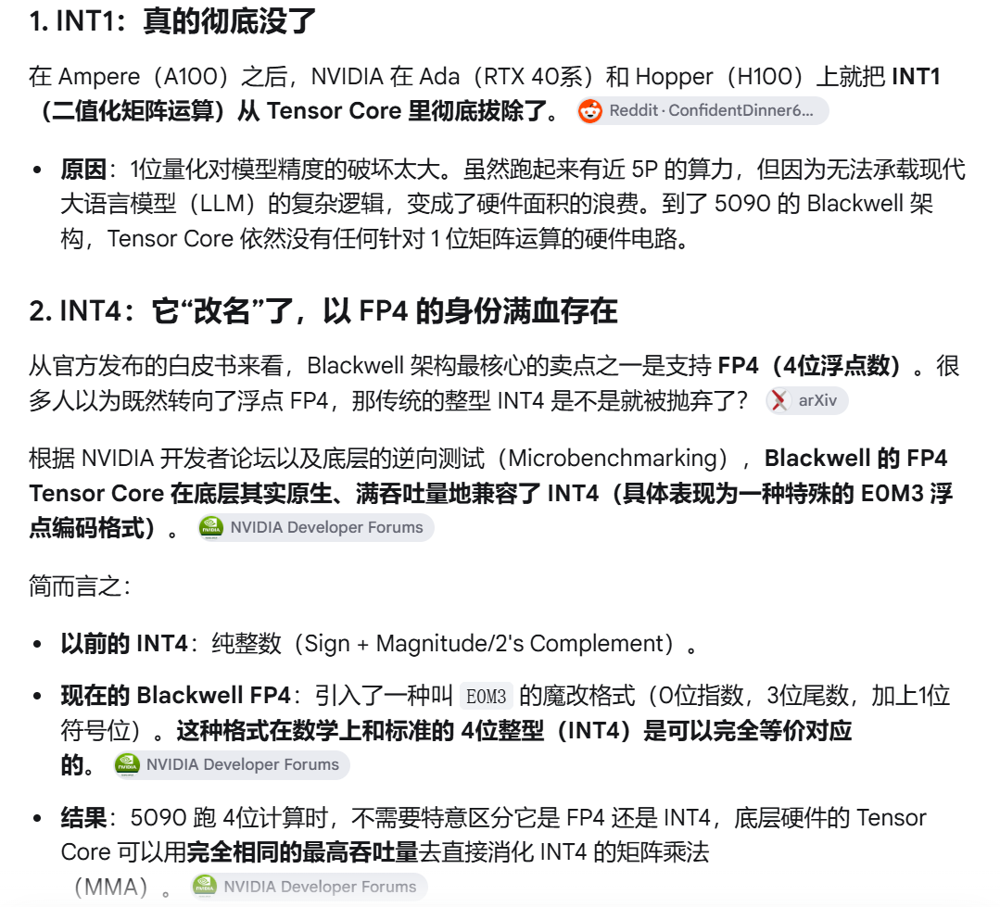

# NVIDIA INT4/INT1 硬件支持真实情况分析

## 🧑‍💻 User

4fe2614099eeb4fa308e659f15642839.png Is that true?

---
## 😀 默认助手 (7)

## 结论：两个论点都**不算真**：它们都对应同一个真实的源头，但被二次加工时把时间线、“官方”和“等价”这三件事都说错了。

截图里的说法其实**有真实出处**：NVIDIA 开发者论坛帖 [Does Blackwell support INT4 native?](https://forums.developer.nvidia.com/t/does-blackwell-support-int4-native/326513)（2025-03 开帖，2026-07 有第 14 楼更新），截图的很多细节（E0M3、“两行 CUTLASS”、SASS 位）都出自第 14 楼。但只要对照该帖里的 SASS 反汇编，就能发现截图把结论往前挪了两代，也把“个人逆向发现”包装成了“官方事实”。

---

### 1️⃣ 「INT1 在 Ampere 之后被彻底拔除」：这是错误的时间线。

论坛里的第一手证据（在 Compiler Explorer 上分别用 `-arch=sm_75/80/86/89/90/100` 编译同一条 `mma` 或 `wmma`，再查看生成的内联 SASS）显示：

| 架构 | sm | INT4（`mma.sync…s4.s4`） | INT1（`wmma.mma.xor/and.popc`） |
|---|---|---|---|
| Turing | 75 | 原生 `IMMA.8832.S4.S4` | 原生 `BMMA.88128.XOR/AND.POPC` |
| Ampere | 80 / 86 | 原生 `IMMA.8832.S4.S4` | 仍支持（PTX 8.x 之前未弃用） |
| **Ada** | **89** | **原生** `IMMA.8832.S4.S4.SAT` | **原生** `BMMA.88128.XOR.POPC` + `AND.POPC` |
| **Hopper** | **90** | **变成软件模拟**（`LOP3/SHF` 拆位 + `IMMA.16816.S8.S8`） | **AND 仍原生**，XOR 退化为两个 AND |
| Blackwell DC | 100 | 软件模拟 | 全部用长指令序列模拟 |

也就是说：

- 在 Ada（RTX 40 系）上，**INT1 的 `BMMA` 指令仍然是单条原生指令**，因此截图所说的「Ada 上就拔掉了」直接不成立。
- 在 Hopper 上，**二进制 AND-POPC 仍是硬件指令**，H100 仍有 1-bit 电路，只是 XOR 用两个 AND 拼出来；真正“连模拟都懒得做”的是 Blackwell 数据中心版（sm_100）。
- 更关键的是，**INT4（不是 INT1）** 才是在 Hopper 上就没有硬件支持、改成模拟的。

> “1 位精度对 LLM 破坏太大，所以被移除”：这是行业层面的合理叙事（BNN 最终没做起来），但**并非 NVIDIA 公布过的移除理由**。真实链路是：标记为实验性 → PTX 弃用警告 → 变成软件模拟（保证老 kernel 还能跑）。该帖的作者 Curefab 明确是这么说的。

另外，**“近 5P 算力”这个数字我查不到官方出处**（A100 官方规格只列 INT8/INT4，从未公布 INT1）；它很可能是按“INT4 的 2 倍再乘 2:4 稀疏”倒推出来的，属于未经验证的数字。

---

### 2️⃣ 「INT4 改名叫 FP4、满血兼容」：方向对，但三处很重要的话被省略了

<b>它的真实来源是什么（点击展开）</b>

- 白皮书确实主推 **FP4（E2M1）/ NVFP4**，官方 PTX 里对应 `tcgen05.mma.kind::mxf4nvf4`（SM100/103/110）和 `mma.sync…kind::mxf4nvf4.block_scale`（SM120/121）。**官方 ISA 里没有任何 int4 kind**，这一点截图没说错。
- “E0M3”以及“FP4 硬件原生支持 INT4 满吞吐”这个说法，**整个论坛 + 我的检索里只出现在这一条帖子**（作者 `im0qianqian` 自己在 X 和知乎上发布，NVIDIA 官方没有回应、也没有承认）。这是**单点、未独立复现**的逆向结论，不是“官方发布的”，也不是“已确认的事实”。
- 实现路径也不是“透明兼容”：SM100 上要改 CUTLASS 两行代码；**5090（SM120/121）则必须对生成的 CUBIN 做后处理**——SASS 的 `OMMA.SF.16864.F32.E2M1.E2M1.UE4M3.4X` 中，第 78/79 位决定 E2M1 还是 E0M3（0/1），需要直接改二进制位。

**三个被截图抹掉的关键点：**

1. **「不需要特意区分，硬件直接消化」：恰恰相反。** 你无法通过 CUDA、PTX 或 cuBLAS 打开展示这个能力，必须手动修改 CUTLASS，或直接修改 CUBIN 的 SASS 位。这不是编程模型，而是一种**未公开的硬件后门**；它没有 API、没有编译器支持、没有厂商保证，随时可能在新驱动或新芯片上消失。

2. **「数学上完全等价于 INT4」不严谨。** 按截图自己的定义，E0M3 = 1 位符号 + 0 位指数 + 3 位尾数，也就是**符号-幅值（sign-magnitude）**，能表示 ±0、±1…±7，共 15 个不同值（还包括一个冗余的 −0）。标准 INT4 是二补码，范围 **−8…7**。所以：
   - 当权重量化到 **−8** 时，它**表示不出来**（只能饱和成 −7，或映射成 −0）；
   - 如果你本来就用对称量化并裁剪到 ±7，或者配合 shared scale 使用，那么用起来几乎无损——这也是它“看起来能跑”的原因。但“完全等价”是夸大。

3. **「以前的 INT4 是纯整数」这个前置条件本身也站不住**：在 Hopper 和 Blackwell 数据中心版上，`s4/u4` 的 `mma` 早已是 INT8 拼出来的模拟序列（见上表），所以你真正能接近“原生 4-bit”的，其实是 Ada 及更早的架构。

---

### 一句话总结

| 截图论点 | 判定 |
|---|---|
| INT1 从 Ampere 起被彻底拔除 | ❌ 时间线错误：Ada 原生 BMMA，Hopper 仍原生 AND-POPC，Blackwell 才全模拟 |
| 移除原因是精度被破坏 | ⚠️ 合理推测，不是官方理由（实际是低使用率→弃用→模拟） |
| 5090/Blackwell 无 1-bit 电路 | ✅ 对 SM100 基本成立 |
| FP4 白皮书是核心卖点 | ✅ 成立 |
| FP4 硬件原生支持 INT4（E0M3）、满吞吐 | ⚠️ 有真实出处，但属**单人未公开的逆向发现**，需改 CUTLASS / patch CUBIN，非官方能力 |
| 「数学上完全等价 INT4」「不需要区分」 | ❌ 符号-幅值缺 −8；必须 patch 才能用 |

**实用建议**：如果你在选量化方案，就别把“Blackwell 原生 INT4 满速”当成可依赖的事实：官方路径是 FP4/NVFP4（配合 block scale）和 INT8；想靠 E0M3 提升性能，就得自己承担维护 CUBIN patch 的成本，并且驱动一升级，整条路径就可能失效。另外，这类“带 Reddit、arXiv 小标签的中文技术总结”很多是 AI 二次生成，标签常常对不上原文；看到“官方白皮书”这种措辞，最好回到原始文档核对。
