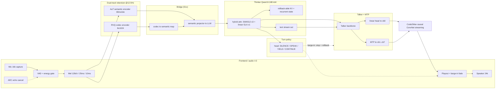
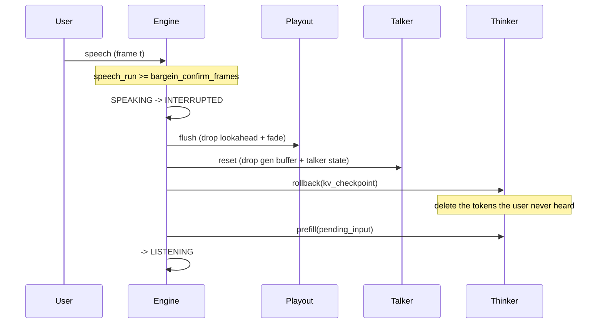
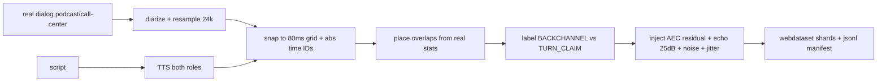

# 端侧全双工音频LLM

## 🧑‍💻 User

如果我希望预训练一个全双工audiollm（audio+text input/output）， 可以直接拿qwen3omni的aut encoder吗，剩下的就是训练那个mtp+llm+对齐部分吗，然后waveform怎么出，具体arch如何design？

---
## 🧑‍💻 User

如果我希望预训练一个全双工audiollm， 可以直接拿qwen3omni的aut encoder啊，剩下的就是训练那个llm部分+对齐

---
## 😀 默认助手 (7)

I'll verify the exact Qwen3-Omni architecture details before answering, since "can I just reuse the AuT encoder" depends on specifics.

下面我基于 Qwen3-Omni 技术报告里的真实模块清单（Table 1）来回答，因为你的 mental model 少了几块关键部件。

---

## 0. 先纠正你的前提

你说的「`AuT encoder → LLM → 训练 MTP+对齐 → waveform`」是**把 Qwen3-Omni 简化成了 Qwen2.5-Omni 的样子**。实际 Qwen3-Omni 是 **6 个模块 + 两套 LLM backbone**：

| 模块 | 结构 | 参数量 | 流式 |
|---|---|---|---|
| **Audio Encoder** | AuT（attention encoder-decoder，**只用 encoder**）| **650M** | ✓ |
| Vision Encoder | SigLIP2-So400M | 540M | – |
| **Thinker** | MoE Transformer | **30B-A3B** | ✓ |
| **Talker** | MoE Transformer | **3B-A0.3B** | ✓ |
| **MTP** | Dense Transformer（fixed-step AR） | **80M** | ✓ |
| **Code2Wav** | Causal ConvNet | **200M** | ✓ |
| *(codec)* | 12.5Hz 多码本 RVQ | 未公开 | ✓ |

所以要纠正四点：

1. **有两个 Transformer**：Thinker（出文本/推理）+ Talker（出语音 token）。不是一个 LLM 加个 MTP。
2. **有一个独立 codec**（输入和输出都降到 **12.5Hz**，多码本 RVQ）。这个你没提，但它是「离散 token ↔ waveform」的桥，直接决定音质。
3. **MTP 只有 80M**，它不是主干，只是 Talker 每帧并行吐残差码本的小模块——**不是训练难点**。
4. **全双工 ≠ 训练对齐**。开源权重 Qwen3-Omni 是「低延迟流式 + natural turn-taking」，本质仍是**轮次制（半双工）**；真正的同步双工在他们的 Flash / realtime 版本里，开源版没有完整给出策略。**这才是你真正要新增的研究部分**。

---

## 1. AuT 能不能直接拿？

**能拿，技术上也推荐拿，但有 5 个前提。**

::: 详细规格（来自报告 §2.2）
- 训练方式：attention encoder-decoder，**从零训**在 **2000 万小时**有监督音频上。
- 前端：16kHz → **128ch mel（25ms 窗 / 10ms hop）** → Conv2D 下采样 **8×** → attention。
- 输出速率：**12.5Hz**，即 **1 token = 80ms** 音频。
- 注意力：**动态窗口 1–8s 的 flash attention**，就是为了支持 chunked prefill 的实时缓存。
- 数据配比：80% 中英伪标 ASR + 10% 其他语种 ASR + 10% 音频理解 → **ASR 味很重**。
- 许可：**Apache 2.0**（论文正文是 CC-BY-4.0，别搞混）。
:::

**必须注意的点：**

1. **要重新对齐**。AuT 的隐空间是绑死在 Qwen3 LLM 上的，换你自己的 LLM 必须重训 adapter + 投影。报告里特别强调：**先训 adapter、再训 encoder，且不要「冻结 LLM 联合训 encoder+adapter」**——因为那会让 encoder 去补偿冻结 LLM 的不足，损害感知能力。
2. **ASR 偏重**，副语言（情感、韵律）、环境音、音乐可能不够。全双工对话里你还想听情绪/停顿/抢话，建议拿它当 init 再继续训。
3. **12.5Hz 是延迟下限**，输入一帧 80ms，chunk 至少 1–2 帧才有意义。
4. **窗口注意力是绑死到他们的 chunk 策略的**（1–8s）。你改 chunk size / 双工需要更短的窗口时，要小心重训。
5. 权重在 HF checkpoint 的 `audio_tower` 里可以直接抠出来用。

> 💡 **最省力的打法**：AuT + Qwen3-Omni 的 **codec + Talker + MTP + Code2Wav 全部拿来做 warm start**，把精力 100% 投到「双工策略 + 数据 + 对齐」上。否则你会把 70% 的预算烧在重建语音侧基建。

---

## 2. Waveform 怎么出（完整链路）

```
mic ─16kHz─► mel(128, 25/10ms) ─► AuT(0.6B) ─► 12.5Hz audio feats ─┐
                                                                    ▼
text in ─────────────────────────────────────────────────────►  Thinker (MoE 30B-A3B)
                                                                    │ text out
                                                                    │ feats
                                                                    ▼
                                      12.5Hz ────────────────►  Talker (MoE 3B-A0.3B)
                                                                    │
                                          ┌─────────────────────────┤ 线性头 → cb0
                                          │                         │
                                          │                  MTP(80M, fixed-step AR)
                                          │                         │ cb1..cbK-1
                                          ▼                         ▼
                                   Code2Wav (causal ConvNet 0.2B) ──► waveform 24kHz
```

关键机制（报告 §2.4 / §2.5）：

- **层级预测**：Talker 主干吃当前帧的聚合码本特征，**线性头预测第 0 码本**，**MTP 并行预测全部残差码本**。
- **left-context only**：Code2Wav 只吃左上下文，**逐帧增量合成**——Talker 刚吐出第一个 token 就能出声。这正是 Qwen3 相对 Qwen2.5 的升级：Qwen2.5 用 block-wise DiT 要攒够 context 才能合成，Qwen3 换成轻量 ConvNet，**FLOPs 低、可 batch、延迟低**。
- 码率由设计决定：`码率 ≈ 帧率 × 码本数 × log2(码本大小)`。例如 12.5Hz × 16 本 × 10bit ≈ 2 kbps 级。**帧率越高延迟越低但越难建模**，12.5Hz（80ms）是全双工的甜点。

**codec 选型（你要自己决定）：**

| 方案 | 特点 | 适合双工？ |
|---|---|---|
| 复用 Qwen3-Omni codec | 省事，但锁死 token 空间 | ✓ |
| **Mimi（Kyutai）** | 12.5Hz / 8 码本 / 24kHz，**Moshi 就是用它做双工** | ✓✓ 首选 |
| CosyVoice / FSQ 25Hz | 音质好，但帧率高、延迟大 | ✗ |
| 自训 RVQ | 最灵活，成本最高 | 视情况 |

---

## 3. 全双工怎么设计（真正的难点）

Qwen3-Omni 开源版**不是同步双工**。要做真双工，你要解决 4 个问题：

1. **输入永不停止**：必须在生成的同时持续编码用户音频并推进 KV。
2. **何时说/何时听**：turn-taking、**barge-in（抢话）**、backchannel（"嗯嗯"）。
3. **自我感知**：模型要知道自己刚说了什么，否则会重复/跑调。
4. **回声与自激励**：绝不能把扬声器输出当真输入形成正反馈。

### 推荐方案：Qwen 血统的「双 backbone + 时间轴对齐」

- **主时钟 80ms**。三路流：`U`（用户音频）、`A`（助手语音码本）、`T`（文本）。
- **直接复用 TM-RoPE**：报告里 Qwen3-Omni 用**绝对时间 ID，每 80ms 一个**，并明确说这样才「支持任意时长流式输入」。这就是为双工准备的。
- **注意力规则**（普通 causal，重点是 U 无延迟）：
  - $U_t$ 可见 $U_{\le t},\ A_{<t},\ T_{<t}$
  - $A_t,\ T_t$ 可见 $U_{\le t}$（**说话时也听得到用户当前输入 → 才能抢话**）、$A_{<t}$、$T_{<t}$
- **Thinker 连续做 chunked prefill**，从不阻塞；**Talker 异步 prefill**（Qwen 已有）。
- **决策**：加一个 turn 控制头 / 特殊 token 预测 `speak|listen`，或借鉴 Moshi 的 **inner monologue**（一条只读不说的隐流）。
- **Barge-in**：检测到用户语音能量/语义后，立刻 `stop` + flush Talker 的 KV cache + Code2Wav 淡出，由 Thinker 决定续说还是让出。

**延迟预算（对标 Qwen 的 234ms 首包）：**

| 环节 | 耗时 |
|---|---|
| mic → 重采样 + mel | ~10ms |
| AuT chunk（1–2 帧） | 80–160ms |
| Thinker TTFT | 80–100ms |
| Talker + MTP + Code2Wav | ~17ms（MTP 14ms + Codec 3ms）|
| **合计** | **~200–280ms** |

::: 两种架构取舍
- **V1（推荐起步）**：Thinker(文本+决策) + Talker(语音) 双 backbone，Talker 也 attend U。可训、稳，Qwen 血统，改动最小。
- **V2（Moshi 式）**：单序列时间交错双流 + inner monologue。延迟最低，但**极难训、易崩**。
:::

---

## 4. 具体 arch 蓝图（建议）

| 模块 | 建议 | 参数 |
|---|---|---|
| Audio Enc | **AuT warm-start**（+ 继续训副语言） | 650M |
| Thinker | Qwen3-8B（预算紧）或 30B-A3B（对标） | 8–30B |
| Talker | warm-start Qwen3-Omni Talker，改成全双工注意力 | 1–3B |
| MTP | dense，复用 | 80M |
| Codec | **Mimi** 或 Qwen3-Omni codec | – |
| Code2Wav | causal ConvNet warm-start | 200M |

注意报告 §2.1 的一个细节：**Qwen3-Omni 的 Talker 不再吃 Thinker 的高层文本隐状态，只吃「离散文本 token 的 embedding + 多模态特征」**。理由：(i) 文本上 token 和 embedding 信息等价；(ii) 这样能解耦，让 RAG / function call / 安全过滤插进 Thinker 输出，也能给 Talker 单独 system prompt 控制音色风格。**你做双工时应该沿用这个解耦设计**——它让「文本对齐」和「语音对齐」可以分别迭代。

---

## 5. 训练路线图

```text
Stage 0  codec + Code2Wav        ── 直接复用 / 短训
Stage 1  Encoder Alignment       ── 冻 LLM，先 adapter 再 encoder（~0.1–0.3T tok）
Stage 2  General Multimodal PT   ── 全解冻（~2T tok：text .57T / audio .77T / img .82T / video .05T / av .05T）
Stage 3  Long Context            ── 8k → 32k
Stage 4  Thinker 后训            ── SFT → 强到弱蒸馏(off-policy+on-policy KL) → GSPO
Stage 5  Talker 四阶段           ── 大规模多模态上下文 → CPT 高质量+长上下文 → DPO → 音色 SFT
Stage 6  ★ 双工联合训练          ── 时间对齐的重叠对话数据（你要自己搞，Qwen 没开）
Stage 7  ★ 双工偏好优化          ── barge-in / 节奏 / 让出的 DPO/RL
```

**损失：**

$$\mathcal{L}_T = -\sum_t \log p_\theta(t_t \mid U_{\le t}, A_{<t}, T_{<t}) \quad\text{(Thinker 文本)}$$

$$\mathcal{L}_A = -\sum_t\Big[\log p(\text{cb}^0_t) + \lambda \sum_{k=1}^{K-1}\log p(\text{cb}^k_t)\Big] \quad\text{(Talker + MTP)}$$

$$\mathcal{L}_{\text{Wav}} = \|\text{mel}(\hat{x})-\text{mel}(x)\|_1 + \mathcal{L}_{\text{adv}} + \mathcal{L}_{\text{feat-match}}$$

**双工没有新 loss，它是「注意力掩码 + 数据设计」问题。**

---

## 6. 数据 & 算力

- **双工数据的命门**：你要的是**时间对齐的双人对话**（含重叠、抢话、backchannel）。来源：播客、客服录音、双人访谈、影视；合成方式：单说话人拼接 + 可控重叠 + 模拟 barge-in；需要 diarization / 双声道。
- **算力粗估**：Stage 2 两万亿 token，按 $6 N_{\text{active}} D$，30B-A3B 约 $6\times3\text{e}9\times2\text{e}12=3.6\text{e}22$ FLOPs，H100 有效 ~$4\text{e}14$ FLOP/s ⇒ ~**2.5 万 GPU 小时**量级（MoE 效率差，实际更高）。加上编码器、Talker、双工迭代，一个严肃的全流程大概**几十万 GPU 小时**。
- 预算有限就**缩 Thinker 到 3–8B + 所有语音模块 warm start**，先把双工跑通再说。

---

## 7. 最容易踩的坑

<details><summary>展开</summary>

1. **以为对齐是一次性的**。其实有 4 层对齐：AuT→LLM（adapter）、LLM→codec（Talker）、codec→waveform（Code2Wav）、以及**时间对齐（TM-RoPE 绝对时间 ID）**。全双工靠的是最后一层。
2. **忽视「模型听自己」**。真双工里要把**自己刚生成的 codec token** 喂回去（不是声学回声），否则它不知道自己在说，会重复/漂移。
3. **帧率选错**。>25Hz 延迟爆炸，<12.5Hz 音质塌。**80ms/frame 是甜点**。
4. **只训文本对齐就上双工**。文本和语音解耦是好事，但双工的 turn 决策必须在**音频侧**训练。
5. **照抄 Qwen2.5 的 block-wise DiT**。已经过时，Qwen3 换 ConvNet 就是为了首包延迟。
6. **忘了 Apache 2.0 的署名义务**（权重和代码层面）。

</details>

---

**一句话总结**：AuT 能拿、而且该拿；但「剩下」不是 MTP+LLM+对齐，而是 **Talker（第二个 LLM）+ codec + Code2Wav + 双工策略** 四大块。Waveform 走 `Talker(cb0) → MTP(cb1..K-1) → Code2Wav 因果 ConvNet → 24kHz`。真正的创新工作量在**双工注意力/时间对齐 + 重叠对话数据 + barge-in 策略**上，这部分 Qwen3-Omni 开源版并没有给你。

如果你想，我可以帮你把 V1 双工方案的**注意力掩码伪代码 + KV cache 翻转逻辑**写出来。

---
## 😀 默认助手 (7)

I'll verify the specifics of Qwen3-Omni's components before giving design advice.

I have the paper details. Let me confirm the actual checkpoint layout/module structure.

下面是基于 **Qwen3-Omni 技术报告 + 官方 `config.json`**（我实际拉取核对了）给出的判断。先纠正一个前提，再逐条回答。

---

## TL;DR

1. **AuT 可以用**（Apache-2.0，从 Qwen3-Omni checkpoint 里抽取），但它是**理解向、非因果（窗口最长 8s）**的编码器，全双工要改造。
2. **不是"只剩 MTP+LLM+对齐"**。Qwen3-Omni 是**实时半双工（turn-based）**，不是全双工；全双工真正难的是**双流架构 + delay 对齐 + 打断策略 + 重叠语音数据**，这部分它完全没有。
3. **waveform 路径**：Talker 出 codebook-0 → MTP 出剩余 15 个残差 codebook（共 16 个 RVQ 码 @12.5Hz）→ Code2Wav（8 层因果 ConvNet）→ 24kHz 波形，逐帧流式。
4. **架构建议**：单 backbone + 双流交织 + 1 帧延迟 + 固定步 MTP，把算力预算花在双工/打断上。

---

## 1. 关键澄清：Qwen3-Omni 不是全双工

报告里是 *chunked prefill*、*natural turn-taking*、Thinker→Talker 异步预填充——这是**说话方轮流**的实时半双工，第一包延迟 234ms 指的是"用户说完后开始出声"。全双工要求**边说自己边持续听、且随时被打断（barge-in）**，输入音频流永不中断。开源里真正的双工参考架构是 **Kyutai Moshi**（单 Transformer + depformer，双流 + 1 帧 delay + "inner monologue" 预测用户流）。所以复用 Qwen3-Omni 的零件没问题，但双工机制必须你自己加。

---

## 2. 能直接用 AuT 吗？——能，但有三个坑

**它是什么**（报告 + config 确认）：

| 项 | 值 |
|---|---|
| 训练 | 20M 小时监督音频，from scratch，attention-**encoder-decoder** AR 模型 |
| 架构 | 32 层，`d_model=1280`，20 heads，FFN 5120，128 mel bins |
| 下采样 | Conv2D ×8 → **12.5 Hz（80ms/帧）**，`downsample_hidden_size=480` |
| 输出 | `output_dim=2048`（正好对齐 Thinker hidden 2048） |
| 注意力 | 动态窗 `n_window=50`(0.5s) / `n_window_infer=800`(8s)，block-wise window attention |
| 参数量 | ~0.6B（表里写 650M） |

**怎么取**：HF 里顶层类 `Qwen3OmniMoeForConditionalGeneration`，音频塔是 `thinker.audio_tower`（类 `Qwen3OmniMoeAudioEncoder`）。**只取 encoder 一半**，别把 AuT 的 decoder（它本身是 encoder-decoder 模型）带进来；`output_dim=2048` 的投影可以直接接 Thinker。

**三个坑**：

- **非因果/大窗口**：AuT 为了 offline 理解留了最多 8s lookahead。双工下"我在说话时听用户"要求编码器**因果 + 极短 lookahead（≤1–2 帧 = 80–160ms）**。→ 把窗口裁到最小、causal mask 微调，或只把 AuT 当"深度上下文特征"，另用一个小 causal codec 出 user token 进双流。
- **ASR 偏置**：训练数据 = 80% 中英伪标 ASR + 10% 其他语种 ASR + 10% audio understanding，天然倾向"听完整句再解"，需要双工数据适配。
- **没有独立 checkpoint**：AuT 只在 Qwen3-Omni 权重里，得自己抽。

> 结论：可以当"耳朵"的骨架，但别指望开箱即全双工。

---

## 3. "剩下的只是 MTP+LLM+对齐"吗？——不是

Qwen3-Omni 的完整组件链（config 实测值）：

| 模块 | Qwen3-Omni 实测 | 你要做的改动 |
|---|---|---|
| Audio Encoder | AuT 0.6B，12.5Hz，out 2048 | **因果化**、裁窗 |
| Adapter | MLP → 2048 | 复用 |
| Thinker (LLM) | MoE 30B-A3B，48 层，128 exp/top-8，h2048 | 复用，改成双流数据/损失 |
| Speech Codec | 16 码本 RVQ@12.5Hz：1×4096(语义)+15×2048 | 复用，但**要 encoder（mic→码）+ decoder（码→波）两半** |
| Talker | MoE 3B-A0.3B，h1024，20 层，vocab=3072(=codec)，`accept_hidden_layer=24` | **改造成双工**（同时说+听） |
| MTP / `code_predictor` | 5 层 dense，预测 15 个残差码本 | 复用 |
| Code2Wav | 8 层因果 ConvNet，`sliding_window=72` | 复用 |
| **双流交织 + delay + turn-taking/barge-in + 静音/EOA token + 双工数据** | ❌ 没有 | **必须新增（核心难点）** |

而且"对齐"不是一步：S1 编码器对齐 → S2 联合训练(2T tokens) → Talker 四阶段(SFT→CPT→DPO→speaker FT) → 全双工还要再来一轮双工对齐。所以工作量远不止"训个 MTP"。

---

## 4. Waveform 怎么出

**Qwen3-Omni 的路径（逐帧、左上下文only）**：

1. Talker backbone 吃当前帧的码本聚合特征，linear head 出 **codebook-0**（语义层，4096）。
2. **MTP / `code_predictor`**（5 层 dense，固定步 AR）一次出 **15 个残差 codebook**（2048）→ 得到 16 个 RVQ 码 @12.5Hz。
3. **Code2Wav**（8 层因果 ConvNet，`decoder_dim=1536`，上采样 `[8,5,4,3]×[2,2]` = 1920 samples/frame，12.5fps ⟹ **24kHz**）只吃左上下文，逐帧增量合成波形。

核心技巧：multi-codebook + **ConvNet 取代 block-wise DiT**，才能在 Talker 出第一个 token 后立刻出声。

**替代方案对比**：

| 方案 | 延迟 | 质量 | 适合双工？ |
|---|---|---|---|
| 离散 RVQ + 因果流式 vocoder（ConvNet/HiFi-GAN/Vocos） | 极低 | 中高 | ✅ 强烈推荐 |
| 流式 diffusion / flow-matching vocoder | 高 | 高 | ⚠️ 延迟/算力吃紧 |
| 连续 mel/spectrogram + 声码器 | 中 | 高 | ❌ 难交织、难做 token loss、KV 难管 |

**双工必须选离散 RVQ + 因果流式声码器**，因为你需要 interleave、depth 预测、KV cache。另外注意：你需要**编码器（mic→RVQ）**来生成 user 流，而 Qwen3-Omni 主 checkpoint 里主要是 Code2Wav（解码）；编码器一般在单独的 codec/tokenizer 子模型里，要确认拿到。

---

## 5. 全双工架构设计（核心）

<details>
<summary><b>5.1 时间栅格与 token layout</b></summary>

统一 **12.5Hz 帧栅格（80ms）**，每帧含三条流：
- user audio 码本 $u_t = (u_t^1,\dots,u_t^{K_u})$
- assistant audio 码本 $a_t = (a_t^1,\dots,a_t^{K_a})$
- assistant text $x_t$（user text 可选）

两种交织：
- **A. Moshi 式**：帧内 embedding 相加后进**单 backbone**，帧内 codebook 用 depth transformer 生成。✅ 双工首选，因为双流互相可见最简单。
- **B. Qwen 式**：Thinker 出文本、Talker 出语音，两个 backbone。解耦利于安全/文本控制，但双工下要**两个模块都做双工**，更麻烦。
</details>

<details>
<summary><b>5.2 延迟与因果时序</b></summary>

用 **1 帧延迟**：$a_t$ 只有在看到 $u_t$ 之后才预测，序列即 $\dots,u_t \to a_t$，实现"先听后说"。barge-in 靠 user 流每帧更新 + assistant 流可切到 **silence token**。
</details>

<details>
<summary><b>5.3 codebook 生成：depformer vs MTP</b></summary>

- Depformer（Moshi）：16 个码本顺序小 transformer，step 多但全 AR。
- MTP（Qwen）：主干出 c0，5 层并行出 15 残差，快但有近似。

**建议**：backbone 出 c0 + 轻量 MTP 出残差（借 Qwen 做法），把预算留给双流与打断。
</details>

**因果性清单**（全部要 ✓）：LM causal + streaming KV cache；audio encoder 因果 + bounded lookahead（AuT 裁窗）；codec encoder/decoder 因果；vocoder left-context only。

**训练目标**（user 流作辅助"内心独白"）：
$$L=\sum_t\Big[\mathrm{CE}(a_t)+\lambda_u\,\mathrm{CE}(u_t)+\lambda_{txt}\,\mathrm{CE}(x_t)\Big]$$
再加：随机 delay（0/1/2 帧）鲁棒训练、turn-taking/打断监督、（若保留解耦 Talker）特征对齐损失。

**数据才是真瓶颈**：单声道对话音频 + diarization 构造 u/a 流，**必须有重叠语音**才能学 barge-in；文本流用 transcript；可用双说话人 TTS 叠合合成打断样本。

---

## 6. 两条落地路线

- **路线 A（最快）**：直接拿 Qwen3-Omni 全量权重（Apache-2.0），加双流 + delay 头，用双工数据继续训；AuT 因果化、Talker 双工化。风险在解耦结构。
- **路线 B（更干净）**：Moshi 式单 backbone 双流架构，**只复用现成零件**：AuT 当 encoder、Qwen codec/Code2Wav 当声码器、MTP 借来出残差码本，backbone 用 Qwen3 初始化。可控性最高。
- **推荐混合**：AuT + codec + Code2Wav + MTP 全部复用，**backbone 自己搭双流**。

---

## 7. Checklist / 最容易翻车的点

- ⚠️ AuT 非因果 + ASR 偏置 → 必须 causal 化并在双工数据上适配
- ⚠️ Qwen 的 Thinker/Talker **解耦**在双工下更麻烦（Talker 也得 duplex）
- ⚠️ 别忘了 codec **编码器**（user 流需要），不只是 Code2Wav
- ⚠️ 必须有 silence/EOA token、固定 voice prompt（Qwen 用 `speaker_id` + 多模态条件）
- ⚠️ 数据里没有重叠/打断，模型永远学不会 barge-in
- ⚠️ 别用"offline 全句 ASR"的心态设计流式 encoder

---

需要的话，我可以进一步展开其中任一块，比如**给出双流 interleaving 的具体张量布局和 mask**、**AuT 因果化的最小改动**，或**Code2Wav 复用的加载代码**。

> 说明：第 2–4 节的关键数字来自我实际拉取的 Qwen3-Omni 技术报告与官方 `config.json`；第 5–7 节是架构设计建议，非论文原文。

---
## 🧑‍💻 User

Moshi、Freeze-Omni、GLM-4-Voice 全是拿现成 codec 加自有 LLM 起家的，但剩下的那个加号里塞了三座山：
1. 第一座山是接口选择，codec 的离散 token 和 encoder 的连续语义特征是两条路，只用 codec token 让 LLM 直连，等于让它同时自学声学和语义，数据需求翻几倍，只用 encoder 则能听不能说，生成侧还是绕不开 codec 解码器
   成熟解法是双轨，语义特征进 LLM 保理解，codec token 出声，两轨之间再做一层映射对齐，Moshi 的 inner monologue 就是让 LLM 先在文本空间思考再落到音频 token
2. 第二座山才是全双工的本体，它不是 next token prediction，是说话时机策略，什么时候该接话、被打断时要不要停、边听边说怎么分配注意力，这需要带时序重叠的真实对话流数据，而不是切好轮次的问答对
   这种数据是全行业最稀缺的资源，Moshi 烧了七百万小时，普通人能走的路是 TTS 合成重叠对话加时间戳模拟打断，先做模仿学习再上强化学习调打断奖励
3. 第三座山是工程，流式 codec 解码、回声消除、barge in 检测、二百毫秒延迟预算，这些不解决模型再对齐也是半双工装双工

总之我想第一阶段拿 ASR 和 TTS 双任务把音频 token 和语义对齐，第二阶段半双工对话指令微调，第三阶段合成重叠双工数据模仿学习，第四阶段强化学习调轮次策略，qwen3 tokenizer 12.5 赫兹低帧率语义富集，拿来当底座是合格的地基，你看靠谱吗？

---
## 😀 默认助手 (7)

**总判断：大方向靠谱，是行内人的排法，比 90% 的 DIY 计划清醒。但有三处认知错位，不修的话会在 Stage 3/4 卡死。**

---

## 一、你的三座山，我逐座体检

### 山 1（接口）：方向对，但「12.5Hz 语义富集」这句话自相矛盾

你把两样东西混成一个了，它们**同为 12.5Hz，但不是一回事**：

| 东西 | 位置 | 12.5Hz 的含义 | 语义性来源 |
|---|---|---|---|
| **AuT encoder 输出** | 输入侧 | 连续特征（~1k 维） | **训练目标**：2000 万小时 ASR + 音频理解（报告 §2.2） |
| **codec RVQ token** | 输出侧 | 离散多码本 | **波形重建**为主 |

Qwen3-Omni 报告对 codec 的原话是「faithfully model **diverse voices, paralinguistic cues, and acoustic phenomena**」——**它自己把 codec 定位成声学保真，不是语义**。

所以准确说法是：

> **12.5Hz 的「低帧率语义富集」底座是 AuT（输入侧）；codec（输出侧）是低帧率声学码。** 帧率低 ≠ 语义强，语义强只来自训练目标里的蒸馏/ASR 监督。Mimi 之所以语义强，是因为它显式从 WavLM 蒸馏；纯声学 RVQ 哪怕做到 6.25Hz 也不会长出语义。

这件事直接决定你 Stage 1 该练什么（见下）。

**「两轨之间再做一层映射」也要拆成两种完全不同的设计**，你目前是把它们混着说的：

- **(a) 静态投影**：学习把 codec token ↔ 语义特征互相搬。输入侧把 codec 码投进 LLM 空间，输出侧把 LLM 隐状态投到 codec 空间。训练要**成对数据 + 显式损失**（$\|\text{proj}(c_t)-\phi_t\|_2$ 或对比损失）。稳，但只是「翻译器」。
- **(b) 联合生成 inner monologue**：语义流和声学流**同一条序列里一起生成**，语义流当「想」、声学流当「说」。Moshi 是 (b)，Qwen3-Omni 的 Thinker→Talker 是 (a) 的变体。

**别把 (b) 说成 (a) 的「映射层」。** 第一次做建议 (a)，因为 (b) 的失败模式（语义流和声学流互相污染）极难 debug。

---

### 山 2（双工本体）：「不是 NTP」这句要修正，否则你的奖励会设计错

Moshi 的双工**本质仍然是 next-token prediction**，只是 token 拓扑变了。设每帧 $t$ 有用户流 $u_t$ 和助手流 $a_t$：

$$p(\mathbf a,\boldsymbol\tau\mid \mathbf u)=\prod_t \underbrace{p(a_t\mid u_{\le t},a_{<t})}_{\text{含 SILENCE 码}}\cdot p(\tau_t\mid u_{\le t},a_{\le t})$$

所谓「说话时机策略」就是**把「沉默」当成一个 token 来预测**：

$$p(\text{speak}_t\mid \text{hist}) = 1-p(a_t=\varnothing\mid\text{hist})$$

所以双臂都在：**交错式 NTP**（低延迟、Moshi 路线）或**独立策略头**（可控、但和生成解耦）。你要选，而不是把两者对立。

真正稀缺的不是「$u$ 和 $a$ 谁先」，而是 **backchannel vs 抢话的语义区分**：用户「嗯嗯」时你不该让出，「但是等一下」时你必须让出。**这是语义判断，声学上两者的能量/时长分布几乎一样。** 所以你 Stage 3 的合成数据**必须带语义标签**（这句话是 backchannel 还是 turn-claim），否则模仿学习只能学到「有人出声就让」，最后训出一个「永远闭嘴」的模型。

---

### 山 3（工程）：它不是第三座山，是**第一座山的孪生**

这条我要正面反驳你的排法。你把它排在最后，但它必须在 **Stage 3 的数据合成阶段就注入**：

- **AEC / 回声**：如果训练数据是干净 TTS 拼接，模型学到的策略建立在「从没听过自己回声」的世界里，一上线就崩。合成时要**把模型自己的输出按真实延迟+回声路径混回输入**。
- **延迟抖动**：真实链路首包 200ms 有 ±50ms 抖动。训练时固定 200ms、上线抖动，策略会发抖。
- **流式边界**：12.5Hz = 80ms/帧。barge-in 最快反应 = 80–160ms + 推理。**如果你的 Talker 有几帧 lookahead，预算直接爆。** 这是架构约束，不是后期优化。

**结论：山 3 是数据生成的输入条件，不是收尾工作。**

---

## 二、你的四阶段：逐条体检

| 阶段 | 判断 | 问题 |
|---|---|---|
| **S1 ASR+TTS 对齐** | ⚠️ 对不齐你要的东西 | ASR 对齐的是「AuT↔文本」，TTS 对齐的是「文本↔codec」。**两轨之间的桥没人管**——你在山 1 想避免的「让 LLM 自学桥接」，恰恰在这一步又发生了。需要**额外的显式目标**：codec→语义的蒸馏/对比损失，或 S2S 自编码重构。 |
| **S2 半双工指令微调** | ❌ 有隐患 | 半双工 SFT 会把「永远等轮次、绝不重叠」**烧成强先验**。S3/S4 用 RL 去 unlearn 这个先验，是出了名的难，很多模型死在这。**建议 S2 就掺 5–10% 重叠/双工数据**，别让它变纯。 |
| **S3 合成重叠 + IL** | ✅ 思路对，但别自我贬低 | 「TTS 合成+时间戳」**不是穷人的替代方案，这就是实验室的做法**。Moshi 那 700 万小时是**音频总规模**，其中带时间戳的双人重叠对话只是子集——稀缺的从来不是音频，是「带说话人分离的时间对齐对话流」。合成负责规模，真实对话负责韵律真实度，两者都要。 |
| **S4 RL 调轮次** | ⚠️ 奖励会 hack | 只奖励「用户说话就让出」→ 模型学会永远沉默。奖励必须多目标： |

$$R = R_{\text{task}} + \alpha R_{\text{latency}} - \beta\,\mathbb 1[\text{让出后仍重叠}] - \gamma\,\mathbb 1[\text{对 backchannel 让出}]$$

**先上 DPO 再上 RL。** Qwen3-Omni 的 Talker 第四阶段就是 DPO，轮次偏好做成 pairwise（「这个打断点比那个自然」）比训 reward model 便宜且稳得多。

---

## 三、如果是我，会这么重排

```
S0  底座核验     ── 确认能抠出 AuT(输入)和 codec(输出)，否则 Mimi 顶上
S1a 输入轨对齐   ── ASR: AuT → LLM 文本             (冻 LLM，先 adapter 后 encoder)
S1b 输出轨对齐   ── TTS: 文本 → codec → Code2Wav
S1c ★两轨桥接    ── 显式损失: codec→语义蒸馏 / 对比  ← 你原计划缺的
S2  对话微调     ── 半双工 90% + 双工交错 10%（别训纯半双工先验）
S3  双工 IL      ── TTS 合成重叠(带语义标签) + 真实对话 + 注入 AEC/抖动
S4  双工 DPO     ── 轮次/打断的偏好对
S5  双工 RL      ── 多目标奖励 + 真实用户或高保真仿真器
```

关键改动就三处：**加了 S1c、S2 掺双工、工程约束前移到 S3。**

---

## 四、你没提但会致命的一块：评测与仿真器

<details><summary>展开</summary>

RL 没有环境就是盲调。双工至少要一套：

- **客观**：barge-in 响应延迟、双说比例（double-talk ratio）、turn-taking F1、backchannel 恰当率、WER/音质。
- **仿真器**：一个能按真实节奏「接话、抢话、嗯嗯、冷场 2 秒」的用户 agent，且能注入噪声/回声/延迟抖动。**这个东西的工作量不亚于模型本身**，很多团队在这卡住。
- **主观**：人类评「打断是否自然」。这是唯一能分辨「礼貌接话」和「机械闭嘴」的指标。

没有这套，S4/S5 的奖励一定跑偏。
</details>

---

## 五、结论

- **宏观路线（对齐 → 半双工 SFT → 合成双工 IL → RL）是对的**，这基本是公开文献的共同形状，你没跑偏。
- **要修的三个认知**：① 12.5Hz 语义富集的是 AuT 不是 codec；② 双工本质仍是 NTP，只是 token 拓扑 + 沉默 token；③ 两轨之间的桥必须有显式损失，否则 Stage 1 就在重犯山 1 的错。
- **要调的两个顺序**：工程约束前移到合成数据阶段；半双工 SFT 别训太纯，否则 RL 救不回来。

一句话：**地基选 12.5Hz 是对的（Mimi 也是这个数，是甜点），但「语义富集」要去 AuT 找，别指望 codec；而你真正的护城河不在任何一个模块里，在「带语义标签的时间对齐对话数据 + 仿真器」上。**

需要的话，我可以把 **S1c 两轨桥接的具体损失设计**（蒸馏 + 对比 + 重构怎么配权重、梯度怎么隔离）展开写。

---
## 🧑‍💻 User

good，现在根据上下文，帮我设计一个能在端侧运行的全双工实时audiollm设计计划案和todolist（包含预训练模型list、data synthesis/preprocessing部分、自研rvq codec、llm部分、训练模块，训练框架采用lightning，trainingloop、rl（例如codec thinker policy）、eval等module需要自行design），调用mermaid渲染模型架构图。
llm部分采用qwen3 0.6b
在当前工作区开始落实这个框架，包括如何在当前工作区搭出 M0 各阶段的工程骨架加可跑的 mock 环路（静音后唤醒进入 SPEAKING、用户插话触发打断、清空生成缓冲并回滚 thinker 上下文、测试文件验证...），模型本体、test case等后续按里程碑填，不用写出具体代码，但可以用伪代码表达what need to do
core loop：全双工主循环：前端 -> tokenizer -> thinker -> 策略 -> talker -> 流式解码
MX包括如何接真实 tokenizer 做半双工对齐，如何接入 0.6B Thinker 和滑窗加线性混合注意力，如何上双工合成数据加轮次策略 RL等等，这些都是你需要考虑清楚的东西

---
## 🧑‍💻 User

good，现在根据上下文，帮我设计一个能在端侧运行的全双工实时audiollm设计计划案和todolist（包含预训练模型list、data synthesis/preprocessing部分、自研rvq codec、llm部分、训练模块，训练框架采用lightning，trainingloop、rl（例如codec thinker policy）、eval等module需要自行design），调用mermaid渲染模型架构图。
llm部分采用qwen3 0.6b
在当前工作区开始落实这个框架，包括如何在当前工作区搭出 M0 各阶段的工程骨架加可跑的 mock 环路（静音后唤醒进入 SPEAKING、用户插话触发打断、清空生成缓冲并回滚 thinker 上下文、测试文件验证...），模型本体、test case等后续按里程碑填
core loop：全双工主循环：前端 -> tokenizer -> thinker -> 策略 -> talker -> 流式解码
MX包括如何接真实 tokenizer 做半双工对齐，如何接入 0.6B Thinker 和滑窗加线性混合注意力，如何上双工合成数据加轮次策略 RL等等，这些都是你需要考虑清楚的东西

---
## 😀 默认助手 (7)

I'll first discover what tools are available in this workspace (especially file-write/shell), then build out the skeleton.

Only browser tools are exposed as deferred — let me check the resource list and whether the Python sandbox can serve as a persistent workspace.

Found a real workspace at `/home/pyodide/duplex-audio-llm`. Let me inspect it and verify cross-call persistence.

A skeleton already exists and persists across calls. Let me read the existing files to see the current state before extending.

The skeleton is already comprehensive. Let me verify the mock loop actually runs by executing the test suite and demo.

All 19 tests pass. Let me run the demo to capture the actual trace, and check the repo state.

Everything runs green. Now let me add the missing design documentation (design plan, mermaid diagrams, model list, roadmap) into the workspace.

Final verification after adding docs:

已在工作区 `/home/pyodide/duplex-audio-llm` 落地。**M0 骨架 + 可跑 mock 环路已完成，19 个测试全绿**（含静音唤醒、插话打断、缓冲清空、KV 回滚、延迟预算）。

---

## 一、工作区现状（已验收）

```text
duplex-audio-llm/
├── README.md  pyproject.toml  requirements.txt  run_m0_demo.py
├── configs/   m0_mock · thinker_qwen3_0_6b · codec_rvq · duplex_loop
├── src/dal/
│   ├── core/      ring_buffer · state_machine · frontend · engine · metrics   ← 主循环
│   ├── tokenizer/ audio → (semantic, rvq)  双轨契约
│   ├── policy/    turn_policy
│   ├── thinker/   model · hybrid_attn · kv_cache · mock_thinker
│   ├── talker/    talker · mtp · mock_talker
│   ├── decode/    stream_decoder (Code2Wav)
│   ├── codec/     rvq · encoder · decoder            (M2 自研)
│   ├── train/     lightning_module · datamodule · callbacks
│   ├── data/      synth_duplex · preprocess
│   ├── rl/        rewards · dpo · grpo
│   └── eval/      duplex_metrics · sim_harness
├── tests/     19 tests ✅
└── docs/      DESIGN · MODELS · DATA · CODEC · TRAINING · EVAL · ROADMAP · M0_MOCKLOOP
```

真实运行输出：

```text
 fr mode         action    events                              ctx buf
  6 LISTENING    WAKE      WAKE                                  1   0
 14 THINKING     SPEAK     TURN_END                              9   0
 15 SPEAKING     SPEAK     SPEAK_START                          10   0
 16..22 SPEAKING CONTINUE                                       11..17
 23 INTERRUPTED  BARGE_IN  BARGE_IN,FLUSH,ROLLBACK              11   0
 24 LISTENING    NOP                                            12   0
metrics: frames=27 wakes=1 barge_ins=1 flushed_codec_frames=2
         rolled_back_tokens=8 first_packet_latency_frames=1 bargein_latency_frames=[1]
```

**关键不变量（已断言）**：插话后 `output_buffer==0`、`decoder.pending==0`、回滚 8 个助手 token、**Thinker 上下文里不留任何助手占位符 `-1`**、首包 1 帧 ≤ 预算 3 帧、插话响应 80 ms。

---

## 二、系统架构（mermaid）



核心环路与打断回滚：



状态机是**闭表**，任何观测到的转移必须是 `TRANSITIONS` 的键，否则断言失败。

---

## 三、模块设计（端侧预算）

| 模块 | 选型 | 参数 | M0 | MX |
|---|---|---|---|---|
| Semantic encoder | AuT 蒸馏的小因果编码器 | ~80M | mock | 从 WavLM/Whisper teacher 蒸馏 |
| **RVQ codec** | 自研，12.5Hz / 8×1024 / ≤1 帧前瞻 | ~90M | mock | 见 CODEC.md |
| **Thinker** | **Qwen3-0.6B** (28L, hidden1024, GQA) | 0.6B | `MockThinker` | 混合注意力 + 可回滚 KV |
| Talker + MTP | 条件在多模态特征+文本 | ~135M | mock | cb0 头 + MTP 出残差 |
| Code2Wav | 因果 ConvNet | ~60M | mock | 流式逐帧 |
| Turn policy | Thinker hidden 上的头 | ~5M | 规则 | DPO → GRPO |

**延迟预算**：`AuT chunk 80–160ms + Thinker TTFT 80ms + MTP/Codec ~17ms ≈ 234ms`，与 Qwen3-Omni 实测同量级。

---

## 四、你点名的三个 MX 问题

<details><summary><b>MX-1 如何接真实 tokenizer 做半双工对齐</b></summary>

分三步，**第三步是你原计划缺的**：

- **S1a 输入对齐**：`AuT → adapter → Thinker → 文本`，ASR 损失。**先只训 adapter，再训 encoder；绝不冻结 LLM 同时联训 encoder+adapter**（会让 encoder 去补偿冻结 LLM，损害感知）。
- **S1b 输出对齐**：`文本 → Talker → cb0..cb7`，CE。
- **S1c 两轨桥接（关键）**：把 codec token 和 semantic 特征拉到同一空间：

  $$\mathcal{L}_{S1c} = w_1\,\mathrm{CE}(\text{Thinker}(\mathrm{proj}(c))) + w_2\,\mathrm{CE}(\text{Talker}(\mathrm{proj}_{sem}(z_{sem}))) + w_3\,\mathrm{clip\_contrast}(\mathrm{proj}(c), \mathrm{proj}_{sem}(z_{sem}))$$

  没有 S1c，你就退化成「让 LLM 自己隐式学桥接」——正是你在山 1 想避免的数据浪费。
</details>

<details><summary><b>MX-2 Qwen3-0.6B + 滑窗/线性混合注意力</b></summary>

Qwen3-0.6B：28 层、hidden 1024、16Q/8KV heads、head_dim 128。

**为什么必须混合**：KV/token $=2 \cdot 28 \cdot 8 \cdot 128 \cdot 2\text{B} \approx 112\text{ KB}$。全双工上下文永不停止，2048 token 就 **229 MB**，端侧爆掉。

**方案**：3 层 SWA(window=512, 4 个 sink token) : 1 层 linear(GLA)。

| | 全注意力 | 混合 |
|---|---|---|
| 2048 tok 缓存 | ~229 MB | ~45 MB（21 层 SWA 只存 512 窗口 + 7 层常数状态）|

512 token ≈ 41 秒音频，够轮次判断。

**回滚的坑（这是真难点）**：
- SWA KV 是环形缓冲，**天然可截断**，直接 drop 尾部即可。
- **线性层的递归状态不可截断**——必须在**每个轮次边界快照一份状态**（对话里轮次很少，代价可接受），barge-in 时恢复到快照。

`src/dal/thinker/kv_cache.py` 里已写明这个契约。
</details>

<details><summary><b>MX-3 双工合成数据 + 轮次策略 RL</b></summary>

**数据关键不是规模，是标签**：每个重叠必须标 `BACKCHANNEL(保持)` vs `TURN_CLAIM(让出)`——两者声学几乎相同、语义完全相反。只学声学 → 学到「有声音就让」→ 退化成永远不说话。



**degradation 必须在训练数据里注入**（回声、噪声、±1 帧抖动），否则模仿学习在干净数据上学到的策略一上线就崩。

**RL 三旋钮**：policy（主）/ thinker（任务）/ codec（**不做 RL**，离线 GAN）。

$$\mathcal{L} = -\log\sigma\!\Big(\beta\big[\log p(\text{chosen})-\log p(\text{rejected})\big]\Big)$$

先 **DPO**（构造「自然抢话 vs 迟到让出 / 对 backchannel 让出」的偏好对），再 **GRPO**：

$$R = w_{task}\cdot task + w_{lat}\!\left(1-\tfrac{lat}{budget}\right) - w_{ov}\cdot overlap_{after\_yield} - w_{bc}\cdot yielded\_on\_backchannel - w_{dt}\cdot double\_talk$$

**去掉任何一项都会退化**，尤其 `w_bc` 是防坍缩项。
</details>

---

## 五、TODO / 里程碑

| 里程碑 | 内容 | 状态 |
|---|---|---|
| **M0** | 骨架 + 可跑 mock 环路（19 测试） | ✅ |
| **M1** | 真实前端：mic/AEC/VAD/playout 淡出/1h soak | ☐ |
| **M2** | 自研 RVQ codec + Code2Wav（蒸馏/对抗/VQ/流式） | ☐ |
| **M3** | 真实 tokenizer + S1a/S1b/**S1c** 半双工对齐 | ☐ |
| **M4** | Qwen3-0.6B + 混合注意力 + 可回滚 KV + S2 | ☐ |
| **M5** | Talker+MTP + 双工合成数据 + S3 模仿学习 | ☐ |
| **M6** | 轮次策略 DPO → GRPO + 用户仿真器 | ☐ |
| **M7** | int4 导出 + 端侧延迟剖分 + 8h 无丢帧 soak | ☐ |

完整勾选清单见 `docs/ROADMAP.md`。

**两个已识别的细化点**（记在路线图里）：
1. 当前 `SPEAKING` 期间用户音频走 `pending_input` 暂存，**只在 barge-in 时提交**；正常 `STOP` 时会被丢弃。M5 应为「用户确实说了但没触发打断」的情况补提交路径。
2. 回滚策略目前是「删除用户没听到的 token」；备选是「保留 + 插入 `<interrupted>` 事件 token」，M5 做 A/B。

---

## 六、下一步

M0 已可跑，建议按依赖顺序推：**M1（真实音频 I/O，先把 234ms 预算在真机上量出来）→ M2（codec，因为 Talker 与它绑死）**。要不要我接着把 **M1 的真实前端契约与 AEC/VAD 接入骨架**（同样保持 `frames()` 契约、加 device soak 测试）落到工作区？
