# GPTSoVITS模型架构图与细节

## 🧑‍💻 User

画出gptsovits模型架构图

---
## 😀 默认助手 (7)

下面这张架构图是我**直接读取当前 `main` 分支源码**（`module/models.py`、`AR/models/t2s_model.py`、`prepare_datasets/3-get-semantic.py`、`TTS_infer_pack/TTS.py`、`configs/s1longer-v2.yaml`、`configs/s2.json`）后画的，不是凭印象复述。

> ⚠️ 先记住一个最容易搞错的命名：**仓库里 `s1` = GPT/AR（文本→语义 token），`s2` = SoVITS（语义 token→波形）**（依据 `configs/tts_infer.yaml`：`t2s_weights_path→s1*.ckpt`，`vits_weights_path→s2G*.pth`）。

---

# 一、全局架构总览

```text
   目标文本 ────────────────────────────────────────────────┐
                                                            ▼
                                              ┌───────────────────────────┐
                                              │ 文本前端 Text Frontend    │
                                              │ 规范化→分词→G2P→音素符号  │
                                              └─────────────┬─────────────┘
                                                            │ 音素 ids  [T_ph]（含 blank）
                                              ┌─────────────▼─────────────┐
                                              │ RoBERTa-wwm-ext-large     │
                                              └─────────────┬─────────────┘
                                                            │ BERT 特征 [1024 × T_ph]
  参考/训练音频 ──► 16kHz ──► chinese-hubert-base ──► SSL 内容特征 [768 × 50Hz]
                                        │
                                        ▼  ssl_proj: Conv1d(768,768,k=2,stride=2)
                              SSL 特征 @25Hz ──► RVQ (bins=1024, 取第 0 层)
                                        ▼
                                  语义 token 序列 @25Hz  [0..1023]
                                        │
  ┌─────────────────────────────────────┴──────────────────────────────────────────────┐
  │  ② s1 = AR / GPT  (Text2SemanticDecoder)                                           │
  │                                                                                     │
  │   [音素 Emb 732×512 ⊕ BERT投影 1024→512 ⊕ 正弦位置编码]  ‖  [语义 Emb 1025×512]     │
  │              ↑ 文本段：双向注意力（前缀 LM）             ↑ 音频段：因果注意力         │
  │   ─────────────────► 24 × TransformerEncoder (d=512, h=16, FFN=2048) ───────────────►│
  │   ─────────────────► ar_predict_layer: Linear(512 → 1025)  (0..1023 + EOS=1024)      │
  │   ─────────────────► top-k=15 / top-p + 重复惩罚采样，KV-Cache 逐 token，遇 EOS 停     │
  └─────────────────────────────────────┬──────────────────────────────────────────────┘
                                        ▼  预测语义 token @25Hz
  参考谱 refer_spec [704 × T] ──► MelStyleEncoder ──► ge（全局音色, 512）
  (v2Pro) 参考音频 ──► ERES2NetV2 ──► sv_emb [20480] ──► Linear ──► ⊕ge ──► PReLU
                                        │
  ┌─────────────────────────────────────┴──────────────────────────────────────────────┐
  │  ③ s2 = SoVITS  (SynthesizerTrn)                                                    │
  │   语义 token ─► RVQ.decode ─► ×2 插值(25→50Hz) ─► ssl_proj ─► encoder_ssl ─┐        │
  │   音素 ids   ─► text_embedding(732×192) ─► encoder_text ──────────────────┼─► MRTE  │
  │   ge / sv_emb ────────────────────────────────────────────────────────────┘   │    │
  │                                     │  (内容序列=Query, 文本序列=Key/Value, ge 条件)│
  │                                     ▼                                              │
  │                       encoder2 ─► proj: Conv1d(192→384) ─► m_p, logs_p (各 192×50Hz)│
  │                                     ▼  z_p = m_p + ε·exp(logs_p)                   │
  │   ┌── v1 / v2 / v2Pro ─────────────────┐   ┌── v3 / v4 ───────────────────────────┐ │
  │   │ Flow (4 层残差耦合, 逆向) ─► z      │   │ bridge → wns1 ─► 100-band mel        │ │
  │   │ ─► HiFi-GAN Generator ×[10,8,2,2,2]│   │ ─► CFM (DiT 条件流匹配, 32 步,       │ │
  │   │    = ×640 ─► 32kHz 波形            │   │      prompt=参考 mel) ─► 反归一化    │ │
  │   │                                    │   │ ─► BigVGAN 声码器 ─► 24k(v3)/32k(v4) │ │
  │   └────────────────────────────────────┘   └──────────────────────────────────────┘ │
  └────────────────────────────────────────────────────────────────────────────────────┘
```

---

# 二、模块细节

<details>
<summary><b>① 文本前端 + SSL/语义 token 提取（可展开）</b></summary>

```text
文本侧（推理时对 参考文本 和 目标文本 各做一次）
  原始文本
    └► 规范化  zh_normalization / split-lang（数字、符号、语言切分）
        └► 分词 + G2P：中文 pypinyin + G2PW(多音字) / 英 g2p_en(ARPAbet)
                       / 日 pyopenjtalk / 韩 / 粤   →  音素符号表（v2: 732 类）
            └► 音素 id [T_ph]，add_blank=True 在每个符号间插入 blank 占位
  同一文本 ──► chinese-roberta-wwm-ext-large
            └► 字级 BERT 向量 (1024) ──按 word2ph 映射──► 音素级 [1024 × T_ph]

音频侧（训练集预处理 / 推理时对参考音频）
  音频 32kHz ──► 重采样 16kHz ──► chinese-hubert-base
            └► last_hidden_state [768 × 50Hz]          ← 2-get-hubert-wav32k.py
                └► ssl_proj: Conv1d(768,768,k=2,stride=2)  → 25Hz
                    └► ResidualVectorQuantizer(bins=1024, n_q=1)
                        └► codes[0]  → 语义 token 序列     ← 3-get-semantic.py
                           （注意：虽然实现是 RVQ，实际只取第 0 层，
                             所以 AR 词表正好是 1024 + EOS）

参考音色侧
  参考谱 ──► refer_spec [704 × T] ──► MelStyleEncoder → ge(512)
  (v2Pro) 参考音频 ──► ERES2NetV2 ──► sv_emb[20480] ──► Linear(20480→512) ⊕ ge → PReLU
```

</details>

<details>
<summary><b>② s1 = GPT / AR 模块（Text2SemanticDecoder）</b></summary>

```text
                    ┌──────── 输入拼接（一次前向，训练时已含真值）────────┐
 音素 ids x ─► Embedding(732, 512) ─┐
 BERT ─────► Linear(1024 → 512) ───┴─► (+) ─► SinePositionalEmbedding ─┐
                                                                       ├─► [x ; y] 拼接
 语义 token y ─► Embedding(1025, 512) ─► SinePositionalEmbedding ──────┘
                                                                       │
   attn mask = block-causal：文本块内全可见(双向) 、音频块下三角(因果) 、
               跨块：音频可看全部文本；再叠加 padding mask
                                                                       ▼
        ┌──────────────────────────────────────────────────────────────────────┐
        │  TransformerEncoder × 24 层                                          │
        │   Self-Attention(16 heads, d_model=512) + FFN(linear_units=2048)     │
        │   LayerNorm / dropout=0 / 无 RoPE（正弦位置编码）                     │
        └───────────────────────────────┬──────────────────────────────────────┘
                                        ▼
                       ar_predict_layer: Linear(512 → 1025, bias=False)
                         （0..1023 语义词表  + 1024 = EOS）
                                        ▼
   推理：top_k=15 / top_p + repetition_penalty=1.35 采样
         · 逐 token 生成，KV-Cache（T2SBlock/T2STransformer 手写实现，jit 加速）
         · 最长 1500 step；前 10 个 token 禁止 EOS；支持 batch + 流式分块
   训练：loss = CrossEntropy(sum, 只在 x_len-1 之后算) + DPO loss
         （make_reject_y 构造"被拒"序列，β=0.2，抑制复读/漏读）
```

要点：AR 里**文本段和音频段在同一堆 Self-Attention 中**，不是 cross-attention；文本段是双向（prefix-LM），音频段是因果。因此「参考文本+参考音频语义 token」就是 prompt，「目标文本」在后面继续续写。

</details>

<details>
<summary><b>③ s2 = SoVITS 模块（SynthesizerTrn）</b></summary>

```text
 输入：codes(语义token) / text(音素) / refer(参考谱) / sv_emb(v2Pro)

 ge 的得到：
   refer ─► ref_enc = MelStyleEncoder(704, style_dim=gin_channels=512) ─► ge
   (v2Pro) sv_emb = Linear(20480→512) → ge += sv_emb → ge = PReLU(ge)
   refer 可以是 list（多参考音频），此时各 ge 取平均

 主干（TextEncoder / enc_p）：
   codes ─► quantizer.decode ─► [768 × 25Hz] ─► F.interpolate(×2) ─► [768 × 50Hz]
         ─► ssl_proj: Conv1d(768 → 192)
         ─► encoder_ssl: Encoder(n_layers//2 = 3 层, 自注意力)
   text  ─► text_embedding(732 × 192) ─► encoder_text: Encoder(6 层, 自注意力)
         ─► MRTE(content=y, mask, text/refer, mask, ge)
              （跨注意力：内容特征 Query ↔ 文本/参考特征 Key/Value，ge 作为全局条件）
         ─► encoder2: Encoder(3 层)
         ─► proj: Conv1d(192 → 192*2) → m_p, logs_p
   z_p = m_p + randn * exp(logs_p) * noise_scale（noise_scale 默认 0.5）
   speed ≠ 1 时：先对融合特征 F.interpolate(size/ speed)，即"改时长"——
   **注意 GPT-SoVITS 没有显式 duration predictor / F0 predictor**，
   时长由语义 token 个数决定（25Hz → 每 token ≈2 帧 50Hz），语速靠插值调。

 解码两条路线：
  ┌─ v1 / v2 / v2Pro ────────────────────────────────────────────────┐
  │ z = flow(z_p, reverse=True, g=ge)   ← ResidualCouplingBlock(4 flows)│
  │ o = dec(z, g=ge)                    ← HiFi-GAN Generator          │
  │     conv_pre(192→512) → ×[10,8,2,2,2]=640 → ResBlock(k=3,7,11)     │
  │     → 32kHz 单通道波形                                             │
  └───────────────────────────────────────────────────────────────────┘
  ┌─ v3 / v4 ─────────────────────────────────────────────────────────┐
  │ x = enc_p(...) → bridge: Conv1d(192→inter_channels2) + LeakyReLU   │
  │   → 上采样 → wns1(WN 声学模块) → linear_mel: Conv1d(·, 100)        │
  │ 即用 SoVITS 产出 100-band mel 特征，再交 CFM 精修：                 │
  │   fea = cat([参考mel特征, 目标特征]) → cfm.inference(prompt=参考mel,│
  │           n_timesteps=32(可调 sample_steps), cfg_rate=0)            │
  │   → denorm_spec(spec_min=-12, spec_max=2) → vocoder(mel)            │
  │   → BigVGAN 类声码器：v3 = 24kHz(100band, n_fft1024/hop256)         │
  │                     v4 = 32kHz(100band, n_fft1280/hop320)           │
  │   （v3 可再接 AP-BWE 超分 24k→48k；README 称 v4 原生 48k 输出）      │
  └───────────────────────────────────────────────────────────────────┘
```

训练时额外存在的一支（推理时不需要）：

```text
 真实 SSL [768 × 50Hz] ─► enc_q = PosteriorEncoder ─► q(z|x) = N(m_q, logs_q)
 损失 = KL(m_q ‖ m_p)・c_kl(1.0)
      + ‖mel‖₁・c_mel(45)
      + 特征匹配损失
      + 对抗损失 (MultiPeriodDiscriminator: DiscriminatorP(period 2,3,5,7,11) + DiscriminatorS)
 优化：lr 1e-4, betas(0.8,0.99), fp16, segment_size 20480, 文本编码器学习率 ×0.4
```

</details>

---

# 三、Mermaid 版（可直接在支持 Mermaid 的环境渲染）

```mermaid
flowchart LR
  subgraph TXT["① 文本前端"]
    A1[文本<br/>规范化] --> A2[分词 + G2P<br/>zh/en/ja/ko/yue] --> A3["音素 ids T_ph<br/>(add_blank)"]
    A4[chinese-roberta-wwm-ext-large] --> A5["BERT 特征<br/>1024 × T_ph"]
  end
  subgraph AUD["① 音频 / 语义特征"]
    B1[音频 32k] --> B2[16k] --> B3[chinese-hubert-base] --> B4["SSL 768 × 50Hz"]
    B4 --> B5["ssl_proj stride2 → 25Hz"] --> B6["RVQ bins=1024 (第0层)"] --> B7["语义 token 25Hz<br/>0..1023"]
  end
  subgraph S1["② s1 = GPT / AR  (Text2SemanticDecoder)"]
    C1["音素 Emb 732×512"] --> C3((+))
    C2["Linear 1024→512"] --> C3
    C3 --> C4["24×Transformer d=512 h=16<br/>block-causal mask<br/>文本双向 ‖ 音频因果"] --> C5["Linear 512→1025"] --> C6["top-k/重复惩罚采样<br/>KV-Cache, EOS 停"]
  end
  subgraph S2["③ s2 = SoVITS  (SynthesizerTrn)"]
    D1["RVQ.decode + ×2 插值"] --> D2["ssl_proj + encoder_ssl"]
    D3["音素 Emb 732×192 + encoder_text"] --> M
    D2 --> M
    D5["参考谱 704×T → MelStyleEncoder"] --> GE["ge 512"]
    D6["(v2Pro) ERES2NetV2 → sv_emb 20480"] --> GE
    GE --> M["MRTE 跨注意力<br/>(内容=Q, 文本=K/V, 条件=ge)"]
    M --> D7["encoder2 → m_p, logs_p"] --> D8["z_p = m_p + ε·exp(logs_p)"]
    D8 --> V{"版本"}
    V -->|"v1/v2/v2Pro"| E1["Flow⁻¹ (4 flows) → HiFi-GAN ×640"] --> E2["32kHz 波形"]
    V -->|"v3/v4"| F1["bridge → wns1 → 100-band mel"] --> F2["CFM (DiT 条件流匹配, 32 步)"] --> F3["BigVGAN 声码器"] --> F4["24k / 32k 波形"]
  end
  A3 --> C1
  A5 --> C2
  B7 --> C3
  B7 --> D1
  C6 --> D1
  A3 --> D3
```



---

# 四、关键超参数（均取自仓库配置文件）

| 组件 | 参数 | 值 | 来源 |
|---|---|---|---|
| 文本前端 | 音素词表 | **732**（v2）/ 512（v1 默认） | `configs/s1longer-v2.yaml` |
| BERT | 维度 | 1024（`chinese-roberta-wwm-ext-large`） | `configs/tts_infer.yaml` |
| SSL | 维度 / 帧率 | 768 / 50Hz（`chinese-hubert-base`） | `2-get-hubert-wav32k.py` |
| 量化器 | 码本 / 使用层 / 帧率 | **1024 / 第 0 层 / 25Hz** | `models.py` L925、`3-get-semantic.py` |
| AR (s1) | d_model / heads / layers / FFN / dropout | **512 / 16 / 24 / 2048 / 0** | `s1longer-v2.yaml` |
| AR 输出 | vocab | 1025（1024 + EOS=1024） | 同上 + `t2s_model.py` |
| AR 推理 | top_k / 重复惩罚 / 最大步数 | 15 / 1.35 / 1500 | `s1longer-v2.yaml`、`TTS.py` |
| SoVITS (s2) | inter / hidden / filter / heads / layers | **192 / 192 / 768 / 2 / 6** | `configs/s2.json` |
| 采样 & 帧移 | sr / hop | 32kHz / 640（=50Hz） | `s2.json` |
| 解码器 | 上采样率 / kernel / 初始通道 | [10,8,2,2,2]=640 / [16,16,8,2,2] / 512 | `s2.json` |
| 条件 | gin_channels（ge） | 512 | `s2.json` |
| 损失权重 | c_kl / c_mel | 1.0 / 45 | `s2.json` |
| CFM (v3/v4) | 推理步数 / 谱范围 | 32 / [-12, 2] | `TTS.py` |

---

# 五、版本演进（同一套"AR + SoVITS"骨架下的替换点）

| 版本 | AR (s1) | SoVITS (s2) | 声码器 | 变化要点 |
|---|---|---|---|---|
| v1 | `s1bert25hz-2kh` (2k h) | `s2G488k.pth` | 内置 HiFi-GAN | 基础版，中/英/日 |
| v2 | `s1bert25hz-5kh-longer` (5k h) | `s2G2333k.pth` | 内置 HiFi-GAN | 25Hz 语义帧率、新文本前端、+韩/粤、5k 小时预训练 |
| v3 | `s1v3.ckpt` | `s2Gv3.pth` | **CFM(DiT) + BigVGAN v2 独立声码器 (24k)** | 用"条件流匹配"替代 Flow+HiFi-GAN，音色更像、AR 更稳（复读/漏读更少） |
| v4 | `s1v3.ckpt` | `s2Gv4.pth` | 独立 `vocoder.pth` (32k mel) | 修掉 v3 非整数倍上采样导致的金属音，提高输出采样率 |
| v2Pro / ProPlus | `s1v3.ckpt` | `s2Gv2Pro(Plus).pth` | 内置 HiFi-GAN | 引入 **ERES2NetV2 说话人向量** 与 `ge` 相加（`is_v2pro` 分支），音色更准、更省算力 |

---

# 六、训练/推理流程一句话总结

- **数据准备**：`1-get-text.py`（音素 + BERT）→ `2-get-hubert-wav32k.py`（SSL 768×50Hz）→ `3-get-semantic.py`（用 s2G 的 RVQ 抽 25Hz 语义 token）→ `2-get-sv.py`（v2Pro 的说话人向量）。
- **两阶段训练**：先训 **s1 = GPT/AR**（CE + DPO，teacher forcing，20 epoch、bs 8、grad clip 1.0、16-mixed），再训/微调 **s2 = SoVITS**（KL + mel L1 + 对抗）。
- **推理**：文本前端 → AR 用「参考文本+参考语义 token」作 prompt 自回归续出目标语义 token → 25Hz token `×2` 插值回 50Hz → SoVITS 先验编码融合音素文本与音色 `ge` → v1/v2/v2Pro 走 Flow+HiFi-GAN 出波形，v3/v4 走 CFM+BigVGAN 出波形。

需要的话我可以再补两张图：**训练阶段数据流图**（含 DPO 拒绝样本构造）和 **v3/v4 的 CFM+DiT 细节图**（含 prompt/mel 分块流式推理的 `T_ref/T_chunk` 逻辑）。
