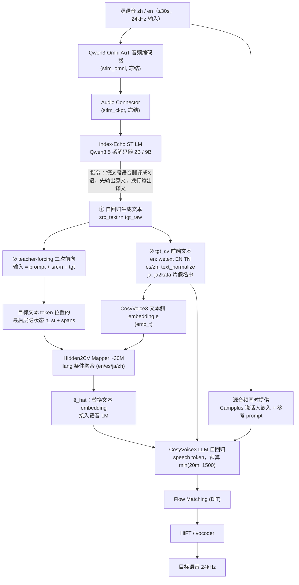

# 索引回声翻译配音

## 🧑‍💻 User

画一下Index-Echo的模型架构，是不是音频端到端中间没有文本的

---
## 🧑‍💻 User

 画一下Index-Echo的模型架构，是不是音频端到端中间没有文本的

---
## 😀 默认助手 (7)

I'll look this up — "Index-Echo" isn't a model I can confirm from memory, so let me search before drawing anything.

Search engines are giving noise. Let me query the structured sources directly.

Found it — Index-Echo is part of Bilibili's **Index-Translate** family. Let me pull the architecture details.

Good — I have the core. Now let me confirm the intermediate-text question against the report and the S2TT/flow details.

Let me read the report's Echo section to ground the text-vs-textless answer.

I skipped the Echo architecture text itself — reading it now.

One nuance I want to verify in code: whether the text still feeds the speech path at inference.

## 先对齐口径

"Index-Echo" 是 B 站 Index LLM Team 的 **Index-Translate** 家族里负责语音的分支，不是独立的端到端语音大模型。它有两条发布线：

| 变体 | 任务 | 尺寸 | 一句话说明 |
|---|---|---|---|
| **Index-Echo S2TT** | 语音 → 文本（原文转写 + 译文 + 句级时间戳） | `2B` / `9B` | 音频编码器 + 连接器 + Index-Translate 解码器 |
| **Index-Echo S2ST** | 语音 → 语音（保留源说话人音色） | `2B` / `9B` | 冻结的 S2TT 主干 + Hidden2CV mapper + CosyVoice3 |

注意 `2B/9B` 指的是**翻译解码器**的规模，不是整包总参数（S2ST 包里还塞了 AuT 编码器、~30M mapper 和整个 CosyVoice3）。

---

## 架构图（S2ST 全路径）



<details>
<summary><b>纯文本版流程图（方便粘贴到笔记/PR 里）</b></summary>

```text
源语音 ──► AuT 音频编码器 ──► Connector ──► Index-Translate 解码器 (2B/9B)
                                              │
                          ┌───────────────────┴────────────────────┐
                          │ ①自回归生成文本                          │
                          │   src_text ⧵n tgt_raw                   │
                          └───────┬─────────────────────┬──────────┘
                                  │                     │
                    ② tgt_cv 文本前端          ②教师强制二次前向
                 (wetext / kata)             取目标token位置隐状态 h_st
                                  │                     │
                                  ├──────────┐          │
                                  ▼          ▼          ▼
                            文本embedding e ──► Hidden2CV Mapper(~30M, lang条件) ◄── h_st
                                                    │
                                                    ▼  ê_hat
          Campplus音色 + 参考prompt ──► CosyVoice3 LLM ──► speech tokens
                                                    │  (预算 min(20m,1500), m=目标文本token数)
                                                    ▼
                                     Flow Matching ──► HiFT ──► 24kHz 波形
```

</details>

---

## 回答你的问题：**不是"中间没有文本"，文本不但存在，而且在回路里被反复用到**

论文把 S2ST 描述为"replaces the CosyVoice3 text-tokenizer interface with a ~30M Hidden2CV mapper"，听起来像去文本化，但落到 `code/tts/pipeline.py` 里，文本至少出现在 4 个位置：

| 环节 | 代码证据 | 文本的作用 |
|---|---|---|
| ① 文本生成 | `hyp = generate_one(...)`；`parse_hyp` 取第一个非空行=原文、最后一行=译文 | **模型自回归生成原文+译文**，`extract()` 直接把 `tgt_raw` 返回给调用方 |
| ② 隐状态来源 | 二次前向 `target = src_text + '\n' + tgt_st`，再取 `hidden_states[-1]` | 隐状态是**在"已经知道译文文本"的教师强制下重算出来的**，不是生成过程的隐状态 |
| ③ 对齐与时长 | `char_pool` / `kata_align` 按文本 token 的 `offset_mapping` 做 overlap mean-pool | 语音 token 预算 `min_len = 2*m`、`max_len = min(20*m, 1500)`，**m = 目标文本 token 数**——语速/时长由文本长度决定 |
| ④ mapper 与语音 LM | `e = emb_t(ids)`；`mapper(h_al, e_dev, ..., lang_id)`；`lm_input = [sos, prompt_emb, ê_hat, task, psp_emb]` | mapper 的输入就**包含文本 embedding**；语音 LM 的 `prompt_emb` 也仍是文本 token 的 embedding |

所以准确的说法是：

- ✅ **没有级联的模块边界**：不需要外部 ASR → 外部 MT → 外部 TTS，AuT 直接吃音频，一个进程、一套权重跑完。
- ✅ **语音的语义条件不再是"文本 token embedding"**，而是被 Hidden2CV 换成"文本对齐位置上的连续隐状态"——这是它相对 `S2TT + CosyVoice3` 级联管的真正差异。
- ❌ **但中间文本没有消失**：翻译文本被真实解码出来、被拿去归一化/转片假名、被重新编码成 embedding 参与 mapper 和语音 LM、并决定语音 token 数。

一句话：**Index-Echo 是"文本锚定 + 隐状态桥接"的 S2ST，不是 textless S2ST。** 真正无文本的是 Translatotron / 离散语音单元那一路（全程只有声学单元，不产生任何文字），Index-Echo 不属于那类。

### 训练侧对应关系

| 阶段 | 谁被训练 | 谁被冻结 |
|---|---|---|
| S2TT | AuT 编码器 + Connector + 文本解码器，端到端（音频 + 语言指令 + 译文放同一序列） | — |
| S2ST 第一段：mapper 蒸馏 | 只有 ~30M Hidden2CV | S2TT 主干 + 语音生成器 |
| S2ST 第二段：DiffRO | 仍只有 mapper（Gumbel-Softmax 采样 speech token，回传 Token2Text 内容一致性奖励） | S2TT 主干全程冻结 |

这也解释了评测里那个"反直觉"的结果：论文自己的匹配对比中，E2E 只在 12 个 size–direction 组合里赢了 8 个，**zh→en 反而级联管更好**，音色相似度差异 ≤0.021。因为主干冻结、只训 30M 桥接层，提升本来就有限。

### 两个工程上的实际后果

- **推理不是一次前向**：`extract()` = 生成文本 + 一次教师强制重算隐状态；`synth()` = 语音 LM 自回归 + flow + HiFT。所以它是"单进程、单模型、两次文本前向"的结构，`chunk=True` 会直接 `NotImplementedError`，本版本**没有流式/低延迟路径**。
- **`h2cv` 是唯一支持的模式**，也就是说这个 release 里你没法绕过文本让它"纯音频对音频"跑。

<details>
<summary><b>我的信息来源与阅读覆盖度</b></summary>

- **已完整阅读**：`IndexTeam/Index-Echo-S2ST-9B` 与 `Index-Echo-S2TT-2B` 的 Hugging Face 模型卡（全文）；`code/tts/pipeline.py`（全文，未截断）；`bilibili/Index-Translate` 仓库 README 与 `inference/echo-s2st/README.md`。
- **部分阅读**：arXiv:2609.40181 的 HTML 版共 1067 行，我读了第 60–504 行（约 42%），覆盖 §3.1 Index-Echo 架构原文、S2TT/S2ST 评测（Table 7、Table 8）以及 §2 训练主体。附录、其他家族（Homura / NativeLong）细节未读。
- **一个我没有 100% 从源码确认的点**：mapper 输出 `ê_hat` 是与文本对齐的**某个中间表示**（作者称接 CosyVoice3 的 semantic layer），但 `pipeline.py` 里 `lm_input` 用的是 `ê_hat` 直接替换文本 embedding 那段，`ê_hat` 究竟等价于"语义 token 序列"还是"文本 embedding 的变换"，从这层封装看不死；我按"替换文本 tokenizer 接口"的官方表述来写。`hidden2cv.py` 本体我没有读。

</details>

需要的话，我可以再画一张**"Index-Echo S2ST vs 级联 S2TT+CosyVoice3 vs 真·textless S2ST" 的三路对照图**，或者把 S2TT 那条路的窗口化（VAD 60s + `--ctx-k 5` 上下文）流程也画出来。

---
## 🧑‍💻 User

也就是说 S2TT 语音转文本是音频进 AuT 编码器接翻译 LLM 出文本，文本是输出不是中间产物。
S2ST 语音转语音则没有显式的中间文本接口，CosyVoice 的文本输入口被替换掉了，但严格说语义还是由翻译 LLM 的隐状态承载，属于隐式文本不是无文本，是这样吗

---
## 🧑‍💻 User

既然 S2TT 语音转文本是音频进 AuT 编码器接翻译 LLM 出文本，文本是输出不是中间产物。S2ST 语音转语音则没有显式的中间文本接口，CosyVoice 的文本输入口被替换掉了，但严格说语义还是由翻译 LLM 的隐状态承载，属于隐式文本不是无文本，是这样吗

---
## 😀 默认助手 (7)

你的框架基本对，但有两处我想用源码钉一下——尤其是"没有显式的中间文本接口"这句。让我确认 mapper 的输入和 CosyVoice3 `tts()` 内部到底还用不用文本。

网络刚才断了（TLS 握手连续失败），`hidden2cv.py` 和 CosyVoice3 的 `model.py` 这两次抓取没成功，所以下面凡是我标"未验证"的，就都是我没读到的部分；其余结论都出自我已经读过的 `code/tts/pipeline.py` 全文、两份模型卡全文、论文 §3.1 与评测段。

## 一句话

你的概括**方向对了八成**，有两处要在"层"上说清：S2TT 那句完全正确；S2ST 那句在 **API/工程层不成立**（中间文本是显式可读的），在 **语音 LM 的内容条件层才成立**（那一路确实被 `ê_hat` 换掉了）。"隐式文本而非无文本"这个判断我同意，而且理由比你说的还要硬一点。

## 逐句核对

| 你的表述 | 判定 | 精确版本 |
|---|---|---|
| S2TT：音频 → AuT → 翻译 LLM → 文本，文本是输出不是中间产物 | ✅ 对 | 独立看，文本就是终点输出（原文 + 译文 + 句级时间戳）。它同时也是 S2ST 那包里的**上游主干**——所以"是不是中间产物"取决于你看的是哪个包 |
| S2ST 没有显式的中间文本接口 | ⚠️ 分层看，API 层不成立 | `extract()` 明确返回 `tgt_raw` / `tgt_cv`，`dub(..., return_info=True)` 的 info 里也有 `zh`(源转写)/`tgt_raw`/`tgt_cv`，官方 `dub.py` 还把两者打到 **stderr**。而且 `extract` / `synth` 是两个**公开的两步 API**，中间产物（文本 + `h_st` + `spans_st`）可以在外面接手 |
| CosyVoice 的文本输入口被替换掉了 | ⚠️ 部分成立，范围比你设想的小 | 被替换的只是**语音 LLM 的内容条件**：`lm_input = [sos, prompt_emb, ê_hat, task, psp_emb]`，原来该放 `tgt_cv` 文本 embedding 的位置换成了 mapper 输出。但 `mi = frontend_zero_shot(tgt_cv, ...)` **依然把文本送进 CosyVoice3 前端**，`prompt_emb = emb_t(mi['prompt_text'])` 也仍是文本 embedding，整个 `mi` 还传给了 `cv.model.tts(**mi)`。文本通路没被摘掉，只是不再直接当内容条件 |
| 语义由翻译 LLM 隐状态承载，属隐式文本不是无文本 | ✅ 判断成立，但要补一句 | **不是纯隐状态**：`e_hat = self.mapper(h_dev, e_dev, None, lang_id)`，其中 `e = self.emb_t(self.tok(tgt_cv).input_ids)`。mapper 的两路输入是 **h_st（隐状态）⊕ e（tgt_cv 文本 embedding）**，`lang_id` 做语言条件 |

## 文本在 S2ST 里的五种身份

| 身份 | 代码位置 | 性质 | 干什么用 |
|---|---|---|---|
| ① 可读输出 | `hyp` / `tgt_raw` | **显式** | API 返回值、CLI stderr、人可检查可干预 |
| ② 文本 embedding | `e = emb_t(tokenize(tgt_cv))` → mapper 第二输入 | **显式** | 与隐状态在桥接层互补，提供文本侧信息 |
| ③ 隐状态 | `h_st`（二次前向、目标 token 位、`char_pool` 按字符 overlap 池化）→ mapper 第一输入 → `ê_hat` | **隐式** | 语音 LM 的内容条件 |
| ④ 时长 / 对齐骨架 | `m = ê_hat.shape[0]`；`min_len = 2m`，`max_len = min(20m, 1500)`；`char_pool` / `kata_align` | **显式**（以整数 `m` 的形式） | 决定语音 token 预算与音-字对齐 |
| ⑤ prompt 文本 | `mi['prompt_text'] = INSTRUCT_CV3 + src_line` → `emb_t` | **显式** | 给语音 LM 的系统提示 + 源转写行 |

所以"无文本"肯定不成立；"隐式文本"成立，但只是 ③ 这一路，①②④⑤ 都还是显式的。

## 为什么"隐式文本"这个判断站得住（甚至更强）

有一个细节把它钉死了：**`h_st` 不是生成时的隐状态，而是教师强制二次前向的隐状态。**

```python
target = src_text + '\n' + tgt_st          # 把译文文本拼回输入
out = model.llm(inputs_embeds=inputs_embeds, output_hidden_states=True)
h_last = out.hidden_states[-1][0]
h_st = h_last[ids_p.shape[1]:][sel].float().cpu()   # 只取目标 token 位置的
```

也就是说：模型先自回归把译文**文本**吐出来，然后再把这段文本拼进输入重新前向一次，取目标 token 位置的最后层隐状态。**隐状态之所以带语义，是因为它在这次前向里"看过"译文文本。** 它不是一条独立的声学语义通道，而是"文本语义的连续化身"。

这带来两个推论：

1. 语义锚点仍然是文本，只是从"字符串"变成了"文本条件下算出的连续向量"——这叫**隐式文本**很准确，但别理解成"模型内部长出了一套脱离文本的语义"。
2. 它天然继承文本的失败模式：模型卡明确写了"translation errors propagate into speech"、9B 约 1% 输入会重复/跑题。因为文本错了，`h_st` 和 `ê_hat` 一定一起错。

## 分类学定位

| 形态 | 中间表示 | 代表 |
|---|---|---|
| 级联 S2ST | 显式字符串，且是**唯一瓶颈**（ASR 文本 → MT 文本 → TTS 文本） | ASR+MT+TTS 拼管 |
| **Index-Echo S2ST** | 文本**存在且显式可见**，但语音侧走隐状态桥 + 文本 embedding 融合 | 本文 |
| 真·textless S2ST | 只有声学单元，**不存在任何文字符号** | Translatotron、离散声学单元一路 |

Index-Echo 消除的其实只是"文本必须先解码成字符串、再由一个**独立**声学模型重新编码"那段模态往返——它把跨模态那一步做成了单模型内部的连续桥接，而不是把文本删掉。叫它 **text-anchored / 隐状态桥接式 S2ST** 比叫 textless 准确得多。

## 我没验证的两点（网络恢复后可以补）

1. **`hidden2cv.py` 内部**：mapper 是怎么融合 `h` 和 `e` 的——concat + MLP，还是 cross-attention？这决定了②③两路谁是主、谁是辅。我只能从调用签名确认"两路都进了"。
2. **`cosyvoice_repo/.../cli/model.py` 的 `tts()` 内部**：它大概率仍会用 `tgt_cv` 算出文本 embedding 喂给 `self.llm.inference`，而这段被 `fake_inference` 猴子补丁绕掉了（`f'..'` 那行 `self.llm.inference = fake_inference`）。如果确实如此，那是"算了但丢弃"，属于实现细节；但也可能 `tgt_cv` 还通过 flow 侧影响韵律——那我的说法就得再收紧一格。

要不要我等网络恢复后把这两个文件拉下来，出一版**逐行标注的管线图**（标出哪一步是文本、哪一步是隐状态、哪一步被补丁绕过）？

---
## 🧑‍💻 User

1. 它和目前主流的全双工audiollm有什么区别
2. 对比走VAD->Whisper->LLM->OutPut这种级联范式有什么优点，e2e延迟怎么样

---
## 😀 默认助手 (7)

先说结论：这两个问题问到了点子上——Index-Echo 和"全双工 audio LLM"不是同一个任务族的模型，所以大部分差异不是"谁更强"，而是"根本不解决同一个问题"；而它相对级联范式的优劣，论文自己的 Table 7/8 已经给出了一个相当诚实的答案（**质量小胜，延迟完败**）。

---

## 先定性：三个东西不是一回事

| | 级联 `VAD→Whisper→LLM→TTS` | **Index-Echo S2ST** | 全双工 audio LLM |
|---|---|---|---|
| 本质 | 管线编排 | **单向翻译/配音模型** | **对话模型** |
| 输出是什么 | 对输入的回答 | **对输入的翻译**（同一内容的另一种语言） | 对输入的回答 |
| 交互 | 半双工请求-响应 | 离线批处理（文件进、文件出） | 全双工、可打断、连续流 |

关键点：**Index-Echo 的"回复"在语义上是"复述同一内容"，不是"生成新内容"。** 它没有用户、轮次、回应意图这些概念。全双工 audio LLM 的核心难题（什么时候该说话、能不能被打断、边听边说）在 Index-Echo 里根本不存在——因为它拿到的一定是**已经切好的单句 ≤30s 音频**。

---

## 1. 与主流全双工 audio LLM 的区别

| 维度 | Index-Echo S2ST | 全双工 audio LLM（Moshi / Qwen-Omni / GPT-4o Realtime / Step-Audio 一类） |
|---|---|---|
| 任务 | 6 方向翻译 + 音色克隆配音，无对话能力 | 通用对话、理解、推理、工具调用 |
| 输入假设 | **必须是已切分的单句**（≤30s，`chunk=True` 直接 `NotImplementedError`） | 连续音频流，无 utterance 边界 |
| 双工性 | 无。串行单向：整句进 → 整句出 | 同时收发，barge-in / 抢话 / 轮次管理 |
| 延迟目标 | 未公布；架构上是"整句走完"量级 | 数百 ms 级首响 |
| 语音生成 | 外挂**冻结的 CosyVoice3**（LLM + flow + HiFT，24kHz） | 内置 codec + 自研 decoder/talker，音色继承但**不以跨语种克隆为目标** |
| 音色 | 源说话人 Campplus 嵌入 + 参考音频 prompt → **跨语种克隆** | 自己的声音 |
| 语言 | 固定 6 方向，源语种靠"转写里有没有 CJK"的启发式判定 | 通用多语言 |
| 文本的角色 | **显式生成、显式返回**（`tgt_raw` / `tgt_cv`） | 通常藏在内部（inner monologue / text token），对外不暴露 |
| 训练成本 | **只训 ~30M mapper**（蒸馏 + DiffRO），主干全程冻结 | 全参数联网训练，数据量级差几个数量级 |

### 三个本质差异

1. **任务族不同**：Index-Echo 是"翻译器 + 配音器"，全双工 audio LLM 是"助手"。前者可以完全没有对话能力，后者可以完全不保证逐字对应。
2. **交互假设不同**：全双工必须自己决定"何时开口"，Index-Echo 把这个问题**外包给外部 VAD**。所以它连"半双工"都算不上，是纯批处理。
3. **语音输出角色不同**：Index-Echo 的语音是"用你的声音说另一种语言"（跨语种克隆），全双工模型说的是它自己的声音。

### 一个反直觉点

上一轮我们确认了 Index-Echo 的中间文本是**显式可读**的（`extract()` 返回 `tgt_raw`/`tgt_cv`，CLI 打到 stderr）。而全双工 audio LLM 恰恰相反——它们的中间文本大多**藏在内部**，对外只有语音 token 流。

所以"谁更 textless"这个问题上，结论有点反直觉：**作为端到端语音输出的系统，Index-Echo 反而比全双工对话模型更"文本显式"**，它只是把文本从"级联的模块接口"变成了"单模型内部的一个中间产物"。

### 一个结构上的相似点（值得注意）

Index-Echo 的 `Hidden2CV` 桥（翻译 LLM 最后层隐状态 → 语音 LM）在思路上和 **Qwen-Omni 系列的 Thinker→Talker 隐状态条件化非常像**——都是"文本侧 Transformer 出隐状态，语音侧吃隐状态"。

> ⚠️ 这一条是我对 Omni 系列设计的记忆，本次没有核实源码，只是给你一个参照系。差别在于：Omni 的 talker 是和 thinker 联合训练的；Index-Echo 是"**冻结的第三方 TTS + 一个 30M 适配器**"，属于低成本外挂式改造。

---

## 2. 对比 `VAD→Whisper→LLM→TTS` 级联范式

### 先说清它到底砍掉了什么（和没砍掉什么）

| 级联的环节 | Index-Echo 里 | |
|---|---|---|
| VAD / 分段 | **依然在**（S2TT 用 Silero VAD 切 60s 窗；`video-dub` 做人声分离 + VAD 分段） | ❌ 没砍掉 |
| 独立 ASR（Whisper） | **砍掉了**，AuT 编码器 + 翻译 LLM 直接吃音频 | ✅ |
| 独立 MT | **合并进翻译 LLM**（和 ASR 共享同一解码器） | ✅ |
| 文本 → TTS 重新编码 | **换成隐状态桥接**（`ê_hat` 替代文本 embedding 当内容条件） | ✅ |
| 时间轴对齐 | **依然在**（`video-dub` 外部做） | ❌ 没砍掉 |

所以准确说法是：**它把级联中间的三段压成了一段，但没有消灭管线。** 官方视频配音方案依然是"抽音频 → 分离人声 → VAD 分段 → 逐句翻译配音 → 对齐时间轴"，也就是说真实部署里 Index-Echo 仍然**套在一个级联框架内部**，"e2e"的边界只在单句之内。

### 优点

| 优点 | 依据强度 |
|---|---|
| **少一次模态往返**：语音侧内容由隐状态承载，不必"ASR 出字符串 → 再被 TTS 重新编码"，避免信息在字符串处的瓶颈 | 结构性论证（已确认代码路径） |
| **单一模型承担感知+翻译**：不需要外挂 ASR 与外挂 MT 各自适配口音/领域，也不会出现"ASR 把专名写错→MT 和 TTS 都救不回"的链式失配 | 结构性 |
| **术语一次注入、文本语音同时生效**：S2TT 的 `--glossary` 影响转写和译文，并会通过 `h_st` 传到语音侧 | 已确认（S2TT 接口）；⚠️ 但 **S2ST 打包接口没暴露 glossary**，`INSTR` 是写死的四条指令 |
| **直接优化"念对了没有"**：DiffRO 用 Token2Text 内容一致性奖励，目标是合成语音与译文一致，而不是级联里每步各自最优（ASR 的 WER 最优 ≠ 翻译最优） | 论文 §3.1 明确 |
| **工程集成度**：一个包、一个进程、一套依赖，不用维持三套服务的版本对齐和粘合 | 模型卡明确（"one self-contained package and Python process"） |

### 缺点 / 代价

| 代价 | 说明 |
|---|---|
| **不能流式、不能 chunk** | `chunk=True` 直接报错；`stream=False`、`load_trt=False`、`load_vllm=False`、`fp16=False`，CosyVoice3 的 LLM 还被补丁强制 fp32。这是"正确性优先"的配置，不是延迟优先 |
| **文本"可读"不等于"可干预"** | 你能看到 `tgt_raw` 并改它，但 `h_st` / `spans_st` 是**绑定在那一串文本上**的，改文本不会自动重算隐状态——要改就得重跑 `extract`。所以级联里"人工修一行译文"的工作流在这里不成立 |
| **错误传播更黑盒** | 模型卡原话："translation errors propagate into speech"；9B 约 1% 输入会重复或跑题。级联里你能定位到是 ASR 错还是 MT 错，这里只能看到一个坏掉的 `h_st` |
| **语言覆盖窄** | 6 方向 vs 级联的"Whisper 99 语言 × 任意 LLM × 多语言 TTS"。repo TODO 里明写着 "Add support for more languages to Index-Echo" |
| **上限被冻结主干锁死** | S2ST 只训 30M mapper，S2TT 主干全程冻结。这直接解释了论文自己那张对比表 |
| **不做时长控制** | 只约束 `min_len=2m, max_len=min(20m,1500)`，不保证配音长度贴合原视频时间轴——那是 `video-dub` 外部对齐干的活。要做时间可控的配音，理论上该配 **Index-Homura**（音节数控制）而不是它 |

### 质量上到底赢了多少？——论文自己的答案

| 对比（匹配实验，共享同一冻结 S2TT 和同一译文） | 结果 |
|---|---|
| 内容误差，12 个 尺寸×方向 组合 | **E2E 赢 8 个** |
| zh→en | **级联更好**（9B：0.0477 vs 0.0615） |
| 音色相似度 | 差异 ≤0.021，基本打平 |

**结论：级联在"翻译配音"这个任务上是极强的对手。** Index-Echo 换来的不是质量碾压，而是"少一层模态往返 + 工程上的单包集成"。

---

## 延迟：没有公开数据，只能做结构性推断

**先说事实边界**：我把能读的都读了（两份模型卡、repo README、`pipeline.py` 全文、论文 §3.1 和 §4.4 的评测表），**里面没有任何 RTF / TTFP / 端到端延迟指标**。Table 7/8 只有 MT judge、ASR error、start-time MAE、content error、speaker similarity。所以下面全是结构性推论，任何具体毫秒数我都不给。

### 代码层面为什么注定慢

<details>
<summary>单次 <code>dub()</code> 的串行阶段（展开看）</summary>

1. **文本自回归生成**：`generate_one` 出整句 `src_text` + `tgt_raw`（greedy，`max_new_tokens=1024`）
2. **教师强制并行前向**：`target = src_text + '\n' + tgt`，一次全长前向取 `h_st`
3. **语音 LM 自回归**：出**全部** speech token，上限 `min(20m, 1500)`，且 `fake_inference` 是**一次性返回完整 list**
4. **Flow matching** 迭代
5. **HiFT vocoder**

关键在第 3→4 步：**必须等整句 speech token 解码完，才交给 flow**——没有任何部分结果能先出声。加上输入被限制在"单句 ≤30s"，所以：

> **首响 ≈ 一整句话的管线走完**，单位是句子，不是帧。

</details>

一个顺带的观察：第 1 步和第 2 步是"同一段文本被生成一遍、再被读一遍"。好在第 2 步是**并行前向**（不是 N 次自回归），所以额外开销是 $O(1/N)$ 量级，不算浪费；真正的代价是**为了拿到隐状态，文本必须先完全定型**，所以文本没法边算边流。

### 量级直觉（**估算，非实测**）

- 一句 30s 中文配音，若译文 m ≈ 30–60 个文本 token，则按 `20m` 上限卡到 1500，实际约数百到上千个 speech token；
- 第 3 步就是几百到上千次自回归解码，之后还要跑 flow + vocoder；
- 所以 **TTFP 结构上至少是"一句话时长"的量级**，跟全双工对话类追求的数百 ms 首响差一到两个数量级。

### 与级联的延迟对比

| | 首响 | 为什么 |
|---|---|---|
| 级联 | **可以做到快** | 流式 ASR 边出字、MT 增量出段、TTS 流式出包——**首段文本确定即可开始出声**（亚秒~1s 级取决于工程投入） |
| Index-Echo | **慢（整句量级）** | 无流式、无 TRT/vLLM、fp32、全量 token 才进 flow |

有意思的是，**论文自己把流式竞品排在 Table 7 里**：

| 模型 | MT judge ↑ | ASR error ↓ | 时间戳 MAE ↓ |
|---|---|---|---|
| Index-Echo-9B | 0.857 | 0.102 | 0.488 |
| **Qwen3.8-LiveTranslate（流式模式）** | 0.833 | 0.186 | **–（不支持）** |
| Index-Echo-2B | 0.825 | 0.088 | 0.395 |

Index-Echo 在质量和时间戳上优于流式对手，**代价正是失去了流式能力**。这基本就是这场取舍的体检报告。

---

## 总结成三句话

1. **vs 全双工 audio LLM**：不是一个任务族。它是离线单向翻译配音器，对方是实时对话助手；它连"何时说话"都外包给了外部 VAD，也没有轮次和打断的概念。
2. **vs `VAD→Whisper→LLM→TTS` 级联**：它砍掉的是"独立 ASR + 文本往返"，**没砍掉 VAD、分段和时间轴对齐**。收益是集成度和少一层模态瓶颈，代价是延迟、可干预性、语言覆盖和错误可定位性。
3. **延迟**：论文没报，但架构上不可能是低延迟方案（不可流式 + fp32 + 全量 token 才进 flow）。这是**离线配音工具**，不是实时系统；质量上也只比同级联小胜（8/12）。

如果你要，我可以把这三者画成一张"**任务族 × 双工性 × 延迟 × 中间表示**"的四维定位图，或者专门算一下第 3 步 speech token 数与目标语速的关系（这决定了配音长短与原视频的错位有多大）。
