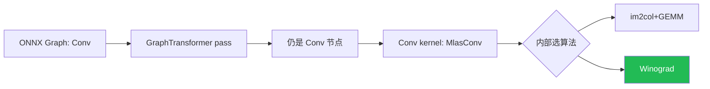

# ONNX Runtime Conv Winograd 实现方案及替代路径

## 🧑‍💻 User

onnxruntime上我发现了ort的conv 没有winograd实现，如何加对应的pass提高性能

---
## 😀 默认助手 (7)

# 先说结论

你的观察是对的，但“加一个 pass”这个方向需要先纠正一下。

**现状（基于 `main` 分支源码实测）**：`onnxruntime/core/mlas/lib/convolve.cpp` 里 `MlasConvPrepare` 只会在这 5 种算法里选：

| 枚举值 | 含义 |
|---|---|
| `MlasConvAlgorithmGemmDirect` | 1×1 / 整行卷积直接 GEMM |
| `MlasConvAlgorithmExpandThenGemm` | 完整 im2col 后一次 GEMM |
| `MlasConvAlgorithmExpandThenGemmSegmented` | 分块 im2col + 分段多线程 GEMM |
| `MlasConvAlgorithmDepthwise` | 3×3 depthwise 专用 |
| `MlasConvAlgorithmDepthwiseMultiplierGreaterThan1` | 7×7 stride2 特例 |

整个 `switch (Algorithm)` 里**没有 Winograd**，`MLAS_CONV_ALGORITHM` 也没有对应枚举。所以 CPU EP 的 float Conv 确实没有 Winograd。

**但关键认知是**：Winograd 在 ORT 里属于 **kernel 级算法选择**，不是 graph pass。



graph pass 改变的是**图结构**；Winograd 改变的是**同一个 Conv 节点的计算方式**。cuDNN、oneDNN、XNNPACK 都是把它放在 kernel 内部做算法选择。所以真正要动的是 MLAS 的 conv 调度（或换后端），而不是写一个 ONNX 图变换。

---

<details>
<summary><b>为什么“图级 Winograd pass”基本不可行（点开看）</b></summary>

Winograd 计算是：

$$
\mathbf{Y} = A^{T}\Big[\big(\mathbf{G}\mathbf{g}\mathbf{G}^{T}\big)\odot\big(\mathbf{B}^{T}\mathbf{d}\mathbf{B}\big)\Big]A
$$

要做图级 pass，你需要：
1. 把 feature map 按 tile 切出来 → ONNX 标准算子没有干净的 tile 切分原语（`Reshape`/`Split` 拼不出来，且会引入大量 copy）；
2. 对每个 tile 做 $B^T d B$ 变换 → 没有对应算子；
3. 逐点乘（16 或 36 个“通道”）→ 只能用 `MatMul` 绕；
4. 逆变换 $A^T m A$ → 同样没有算子。

结果是：中间张量爆炸（$16\times$ 甚至 $36\times$ 内存）、精度下降、算子碎片化导致调度开销吃掉收益。**唯一的“pass 化”可行形态是 Conv→自定义算子（fuse），真正的 Winograd 在自定义算子里实现**，本质仍是 kernel。

</details>

---

# 三条落地路线

<details open>
<summary><b>方案 A：改 MLAS，走 in-tree（推荐，收益最大）</b></summary>

这是和上游贡献一致的路径，改动集中在 3 个文件。

### 1. `onnxruntime/core/mlas/lib/mlasi.h`

在 `MLAS_CONV_ALGORITHM` 枚举加一项，`MLAS_CONV_PARAMETERS` 加字段：

```cpp
enum MLAS_CONV_ALGORITHM {
    MlasConvAlgorithmGemmDirect,
    MlasConvAlgorithmExpandThenGemm,
    MlasConvAlgorithmExpandThenGemmSegmented,
    MlasConvAlgorithmDepthwise,
    MlasConvAlgorithmDepthwiseMultiplierGreaterThan1,
    MlasConvAlgorithmWinograd,   // 新增
};
```

### 2. `convolve.cpp` 的 `MlasConvPrepare`

在 `AllStridesAreOne && AllPaddingIsZero` 之前（padding 也要支持），加选择逻辑：

```cpp
// F(2x2,3x3): stride=1, dilation=1, group=1, kernel 3x3
if (Dimensions == 2 && GroupCount == 1 &&
    AllStridesAreOne && AllDilationsAreOne &&
    Parameters->KernelShape[0] == 3 && Parameters->KernelShape[1] == 3 &&
    InputChannels >= 8 && FilterCount >= 8 &&          // 太小不划算
    InputSize >= 8 * 8 /* 至少几个 tile */) {
    Parameters->Algorithm = MlasConvAlgorithmWinograd;
    Parameters->u.Winograd.Tile = MlasWinogradTile2x2;  // 或 4x4
    // workspace: 输入变换 V + 输出变换 M + 权重变换 U
    *WorkingBufferSize = SafeInt(...);
    return;
}
```

注意 `*WorkingBufferSize` 必须在这里算准，`conv.cc` 会按它 `Alloc`。

### 3. `convolve.cpp` 的 `MlasConv` switch

```cpp
case MlasConvAlgorithmWinograd: {
    MlasConvWinograd(Parameters, Input, filter, bias,
                     WorkingBuffer, Output, ThreadPool);
    break;
}
```

### Winograd 核心实现（新建 `lib/winograd/conv_winograd_f2x3.cpp`）

F(2×2, 3×3) 的标准变换矩阵（Lavin & Gray）：

$$
B^{T}=\begin{bmatrix}1&0&-1&0\\0&1&1&0\\0&-1&1&0\\0&1&0&-1\end{bmatrix},\quad
G=\begin{bmatrix}1&0&0\\ \tfrac12&\tfrac12&\tfrac12\\ \tfrac12&-\tfrac12&\tfrac12\\0&0&1\end{bmatrix},\quad
A^{T}=\begin{bmatrix}1&1&1&0\\0&1&-1&-1\end{bmatrix}
$$

流程：

```cpp
// 1) 权重变换 U = G g G^T  →  [M, C, 4, 4]，权重是 initializer 时可缓存
// 2) 输入分 tile，pad 补零，V = B^T d B  →  [C, 4, 4, N_tiles]
// 3) 逐点乘 = 16 个独立 GEMM: [M,C] x [C,N_tiles]
//    用 MlasGemmBatch(...) 一次发 16 个 batched GEMM，效率最高
// 4) 输出逆变换 Y = A^T M A，写回
```

要点：**把 16（或 36）个变换点当成 batch 维**，每个点是一次 $M\times N_{\text{tiles}}\times C$ 的 GEMM，共享 `NCHWc`/blocked 布局才能跑满 FMA。

### 4. 测试

MLAS 单测在 `onnxruntime/test/mlas/unittest/`（已有 `test_activation.cpp` 等同级文件），加一个 `test_conv_winograd.cpp`：
- 和 im2col+GEMM 结果对比，F(2,3) 容差 ~1e-6、F(4,3) ~1e-4；
- 加一个 microbench 对比 `MlasConv` 两条路径的耗时。

</details>

<details>
<summary><b>方案 B：不动核心 —— 用 MLAS override 钩子 / 自定义 EP（最省事）</b></summary>

这是很多人不知道的点：MLAS 平台结构里**预留了 conv 的 override 函数指针**，KleidiAI 就是这么接进来的（见 `lib/platform.cpp`）：

```cpp
GetMlasPlatform().MlasConvPrepareOverride
GetMlasPlatform().MlasConvOverride
GetMlasPlatform().MlasConvSGemmRouteOverride
```

`MlasConvPrepare` 和 `MlasConv` 开头都会先看它：

```cpp
if (GetMlasPlatform().MlasConvOverride != nullptr &&
    GetMlasPlatform().MlasConvOverride(Parameters, Input, Filter, Bias,
                                       WorkingBuffer, Output, ThreadPool)) {
    return;   // 你完全接管
}
```

所以你有两个“不 fork 核心调度”的选择：

**B1. 设 override 指针** — 在自己的 MLAS 构建里把 `MlasConvPrepareOverride`/`MlasConvOverride` 指向你的 Winograd 实现。`convolve.cpp` 一行不用改。

**B2. 写自定义 Execution Provider** — `GetCapability()` 认领满足条件的 Conv 节点（3×3、stride1、dilation1、fp32、NCHW），内部用 Winograd 算，其余节点交还 CPU EP。这样：
- 不用改 ORT 核心；
- 能按你的硬件/形状精准控制；
- 和现有 EP 共存。

> 如果你的目标是“快速验证 Winograd 在这个模型上能不能提速”，B2 是最快拿到数据的路径，验证收益后再决定要不要进方案 A。

</details>

<details>
<summary><b>方案 C：真要做成 graph pass（只建议做 Conv→自定义 op 的 fuse）</b></summary>

如果你坚持“pass”形态，正确做法是 **fuse 成自定义算子**，而不是用标准算子拼 Winograd：

1. 新建 `onnxruntime/core/optimizer/winograd_conv_fusion.cc`，实现 `GraphTransformer`（参考同目录的 `nchwc_transformer.cc`，它也是把 Conv 换掉，注意它用 `node.GetExecutionProviderType() == kCpuExecutionProvider` 过滤）。
2. 在 `onnxruntime/core/optimizer/graph_transformer_utils.cc` 的 `GenerateTransformers` 里注册，选好 `TransformerLevel::Level1/2`，并注意 `ORT_MINIMAL_BUILD` / `ORT_EXTENDED_MINIMAL_BUILD` 宏和 `FilterTransformers` 的禁用逻辑。
3. 注册 `com.microsoft::WinogradConv` 自定义 op，真正的 Winograd 在 op 的 `Compute` 里做。

⚠️ 顺序坑：
- 必须在 **constant folding 之后**（要拿到 Conv 的权重 initializer 才能预变换）；
- 要抢在 `NchwcTransformer`（会把 Conv 改成 NCHWc 形式）之前，或显式让二者互斥；
- `ConvAddFusion`、`ConvBNFusion` 等也要协调，否则 fuse 会被拆开。

</details>

---

# 什么时候 Winograd 真能提速

<details>
<summary><b>适用条件与精度取舍（点开看）</b></summary>

| 条件 | 说明 |
|---|---|
| 3×3 kernel | 只对 3×3 有成熟变换；5×5 也有但很少用 |
| stride = 1 | stride>1 收益骤降 |
| dilation = 1 | 带膨胀基本不可用 |
| $C$、$M$ 足够大 | 太小则变换开销占比过高 |
| $H \times W$ 足够大 | 至少几个 8×8 tile，否则不值得 |
| 权重是 initializer | 权重变换可缓存，否则每次推理都要重算 $GgG^T$，收益为负 |

**乘法量对比**（每个输出点）：
- 直接卷积：$9$ 次乘
- $F(2\times2,3\times3)$：$16/4 = 4$ 次乘 → **2.25×** 降乘
- $F(4\times4,3\times3)$：$36/16 = 2.25$ 次乘 → **4×** 降乘，但数值误差明显变大

**精度建议**：
- fp32 → 用 $F(2,3)$，误差可控（~1e-6 量级）；
- fp16 / bf16 → 可用 $F(4,3)$；
- 若模型对精度敏感，先只对中间层（不敏感层）启用。

</details>

---

# 更省事的替代方案（先试这个，可能不需要自己写）

如果你的目标只是“让 Conv 更快”而不是“必须自己实现 Winograd”，按成本从低到高：

1. **确认是否已经在走 NCHWc 快路径**
   ORT 有 `NchwcTransformer` 会把 Conv 转成 blocked layout，走 `ConvNchwcFloatKernel`。先 profile 看 Conv 落在哪个 kernel，再决定要不要动。

2. **开 oneDNN EP**：`--use_dnnl`
   oneDNN 自带 Winograd 卷积（`conv_winograd`），x86 上通常直接命中，是最快拿到收益的方式。

3. **开 XNNPACK EP**
   f32 3×3 stride-1 有 Winograd 实现，移动端/ARM 上很划算。

4. **换精度**：fp16/bf16/int8 往往比 Winograd 收益更大、改动更小。

5. **确认瓶颈**：用 `onnxruntime_perf_test -p` 或 ORT profiling 确认 Conv 占比，别优化错算子。

---

# 一句话给你决策

- **想尽快验证收益** → 走方案 B2（自定义 EP 认领 Conv 节点），一周内能出数据。
- **想进上游/长期维护** → 走方案 A（`mlasi.h` 加枚举 + `MlasConvPrepare` 选择 + `MlasConv` 分派 + Winograd kernel），这是和 ORT 架构一致的唯一正路。
- **别把 Winograd 做成 ONNX 图变换** —— 那不是 ORT 的设计，收益也会被 tile 切分和内存开销吃掉。

需要的话，我可以把方案 A 的 `MlasConvWinograd` F(2×2,3×3) 完整可编译骨架（含 $B/G/A$ 变换、tile 循环、`MlasGemmBatch` 调用、workspace 计算）写出来，你直接贴进 `onnxruntime/core/mlas/lib/winograd/` 就能测。
