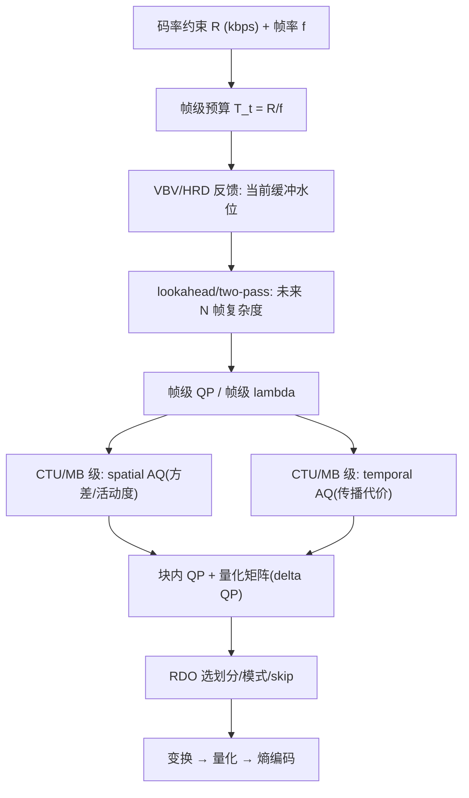
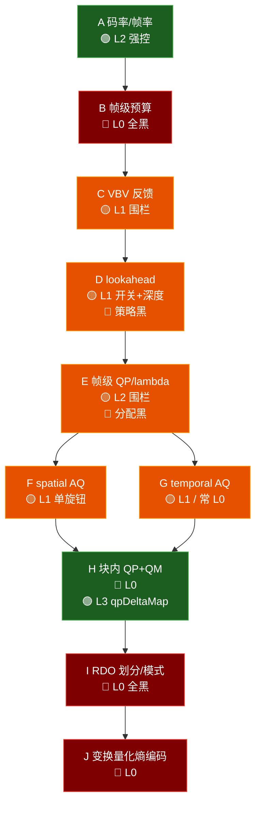

# QP分配与宏块现象

## 🧑‍💻 User

话说在cbr+no bframe+lookahead框架下，编码器是怎么自动分配qp的，量化的宏块是怎么产生的
为什么avc/hevc低码率可以很明显看到宏块 av1则是低频区域模糊
编码器是怎么遵循码率约束的
针对静态/运动场景，qp会怎么分配？

---
## 😀 默认助手 (7)

# 一、先明确三个术语

| 说法 | H.264/AVC | HEVC | AV1 |
|---|---|---|---|
| 最小/最大编码单元 | **MB 16×16**（可再分 8×8 / 4×4 子块） | CTU 64×64，可递归到 CU 8×8 | **Superblock 128×128**，可递归到 4×4 |
| 变换尺寸上限 | 8×8 | 32×32 | **64×64**（含 ADST / 非对称） |
| 量化参数 | QP 0–51 | QP −6–51 | **qindex 0–255**（分 dc_q / ac_q） |
| 环路滤波 | Deblocking | Deblocking + **SAO** | Deblocking + **CDEF** + **Loop Restoration** |

后面“块”是否可见，很大程度上由该表最下面这一行决定，并非由 QP 值直接决定。

---

# 二、CBR + 无 B 帧 + lookahead 下，QP 如何逐层分配

QP 分配被分在 **三个时间尺度** 上，三层相互约束，并不存在单一“全局公式”：

## 2.1 三层结构

```
① GOP / 帧类型层   (lookahead 决定)
      ↓ 每帧目标比特 T_n
② 帧级 QP 层       (RC 模型 + VBV 闭环)
      ↓ 基础 QP_base
③ 块级 QP 层       (AQ / delta-Q，逐 MB/CTU/SB 偏移)
      ↓ 每个块的最终 QP
```

### ① lookahead 层的作用（尤其在无 B 帧时）

无 B 帧意味着**参考链是长单向链** $I \to P_1 \to P_2 \to \cdots$，误差会沿整条链传播。lookahead buffer 里的 N 帧（典型 20–60 帧）主要用于：

- **场景切换检测**：SCD 阈值触发时，强制插入 I 帧，并重新规划后续比特预算；
- **复杂度预分析**：对每个未编码帧做 **低分辨率 SATD / 方差 / 运动估计**，得到 $\text{cost}_n$，这是“未来有多难”的唯一信息来源；
- **比特预分配**：把 GOP 预算按复杂度和“重要性”分给各帧，避免关键帧占用过多比特，导致后面几帧质量大幅下降；
- **传播代价（mbtree / propagation cost）**：x264 的 `--rc-lookahead` 会计算每个宏块被后续帧参考的程度，被大量参考的块“权重”更高——这是块级 QP 的重要输入。

> 硬件编码器（NVENC 等）的 lookahead 通常更弱，只做 SCD 和帧级预分配，没有 mbtree 那种逐块传播分析，因此它的块级 QP 分配明显更粗糙。

### ② 帧级 QP：R-Q 模型 + 缓冲反馈

工程上的做法基本是：

1. 由缓冲区状态算出本帧允许的比特 $T_n$；
2. 用**复杂度归一化**把 $T_n$ 换成“每复杂度单位的比特”；
3. 反解 R-Q 模型得到 QP：

$$T_n = K \cdot \text{cplx}_n \cdot 2^{-\beta \cdot QP_n} \quad\Longrightarrow\quad QP_n = \frac{1}{\beta}\log_2\frac{K\cdot \text{cplx}_n}{T_n}$$

其中 $K,\beta$ 每帧编码后用实际 bits 做反馈修正（这就是“闭环”）。

### ③ 块级 QP：AQ（自适应量化）

这是你实际看到“某些区域清晰、某些区域模糊糊”的直接原因。核心思想：**在固定总比特下，把比特从“人眼不敏感”的块移给“人眼敏感”的块**。

近似形式（各家实现不同，方向一致）：

$$QP_{\text{block}} = QP_{\text{base}} + \alpha \cdot \log_2\!\left(\frac{\overline{\sigma}}{\sigma_{\text{block}}}\right)$$

- $\sigma_{\text{block}}$：块的方差 / 边缘能量 / SATD；
- $\alpha$：`aq-strength`，控制“激进程度”；
- 高方差块（纹理、边缘）→ QP 降低 → 保细节；
- 低方差块（天空、墙面、平坦渐变）→ QP 升高 → 大量细节被丢弃。

各家实现：

- **x264**：`aq-mode 1/2/3` + `aq-strength`，mode 2（auto-variance）会做方差分布的“拉伸”，让偏移量分布更极端；
- **x265/HEVC**：`--aq-mode` + `--qp-adaptation-range`，CU 级以 `cu_qp_delta` 信令；
- **libaom/AV1**：`--aq-mode` + `--deltaq-mode`，qindex 在 **superblock 级** 下发，且 qindex 粒度（0–255）比 QP（0–51）细，**可以做出更极端的偏移**。

---

# 三、“量化的块”是怎么出来的

## 3.1 链路

```
预测 P（帧内/帧间） → 残差 R = S − P → 变换 T（整数 DCT/ADST）
   → 量化 Q（带死区） → 熵编码
                    ↘ 反量化 → 反变换 → 重建帧（进入参考链）
```

## 3.2 为什么高 QP 会得到“常数块”

量化步长：

$$Q_{\text{step}} = 2^{\frac{QP-4}{6}} \quad(\text{H.264 / HEVC})$$

**QP 每 +6，步长翻倍，码率大致减半。** AV1 的 qindex 是分段近似指数映射，效果类似。

高 QP 时步长 $Q_{\text{step}}$ 很大，量化用的还是**死区量化器**（dead-zone）：

$$\hat{c} = \operatorname{sign}(c)\cdot\left\lfloor \frac{|c| + f}{Q_{\text{step}}}\right\rfloor,\qquad f \approx \frac{Q_{\text{step}}}{3}\text{–}\frac{Q_{\text{step}}}{6}$$

后果是：**所有 AC 系数（高频）几乎全部落进死区变成 0，只剩 DC 存活。**

$$ \xrightarrow{\text{反变换}} \text{块内近似常数} = \frac{\hat{c}_{DC}}{\text{N}} $$

于是：

- 每个块内部变成**一块平坦区域**；
- 相邻块各自的 DC 重建值不同（预测不同 + 量化误差不同）→ **块与块之间有台阶**；
- Deblocking 只在边界 ±2~3 像素、以 8×8 网格为界做低通，**改了边缘但改不了整块的 DC 落差** → 于是你看到一格一格的方块。

这就是“低码率看到宏块”的物理来源：**它并不是画错了，而是“高频全被量化到 0”的必然结果。**

## 3.3 视觉伪影的四种形态

| 伪影 | 成因 | 低码率下的主导者 |
|---|---|---|
| **Blocking（方块）** | 块内被压成常数，边界 DC 跳变 | AVC / HEVC 最明显 |
| **Banding（色带）** | 平坦渐变区被量化成若干离散台阶 | 天空、墙面 |
| **Ringing（振铃）** | 强边缘附近的 Gibbs 振荡被截断 | 文字、线条 |
| **Blur / 涂抹** | 强环路滤波 + 大块 skip | AV1 最明显 |

---

# 四、为什么 AVC/HEVC 会看到方块，而 AV1 是“低频区域模糊”

这是**四个机制叠加**的结果，不是一个原因。

<details>
<summary><b>① 环路滤波器的代差（最主要的差别）</b></summary>

- **AVC**：只有 deblocking，作用于 4×4/8×8 边界，3 抽头，对整块 DC 误差无效。
- **HEVC**：deblocking + **SAO**。SAO 能修 banding 和部分 ringing，但对“整块平坦化”无能为力。
- **AV1**：
  - **CDEF**（Constrained Directional Enhancement Filter）：先**检测块边界方向**，然后**沿垂直于边缘的方向做滤波**，把方块边界的台阶滤波成平滑过渡；
  - **Loop Restoration**：以 64×64/128×128 为单位，用 **Wiener 滤波 / self-guided restoration**，系数由编码器 RDO 训练得到。这本质是一个**自适应的强平滑/去噪器**。

结果：AV1 把 blocking 的“硬台阶”处理成 **平滑的渐变**。人眼不再看到方格，而看到一片“奶油状的模糊/糊化”。**方块消失了，但变成了模糊。**

</details>

<details>
<summary><b>② 变换与块尺寸：伪影的“尺度”变了</b></summary>

- AVC 最大 8×8 变换 + 16×16 MB → 伪影尺度 **16 px**，正好落在人眼对“方格”最敏感的空间频率附近；
- HEVC 可到 32×32；
- AV1 可到 **64×64 变换 + 128×128 superblock**，且大量使用 **skip / 大块 inter 预测**（整块复制参考帧）。

**伪影的空间频率被搬到了极低频**——表现出来就不是“一块一块”，而是“一大片区域整体变糊、拖动时拖影”。这与题中“低频区域模糊”的描述完全吻合。

</details>

<details>
<summary><b>③ AQ 更激进：平坦区被“合法地”放弃</b></summary>

AV1 的 qindex 有 0–255 的细粒度，加上 `--deltaq-mode` / `--aq-mode`，**超级块级的 qindex 偏移范围比 x265 的 `qp-adaptation-range` 大得多**。

配合 lookahead 的 variance 分析，平坦区（低频、低纹理）会被判定为“人眼不敏感”，给予**很高的 qindex**。于是：

- 平坦区所有细节被抹除 → 内部**完全没有纹理信息**（真·低频丢失）；
- 因为这是编码器在 RD 意义上“计算过成本收益后做的决策”，它不会留下明显的方块（有 CDEF/LR 兜着），只会留下“一片没有细节的光滑面”。

> 一句话：**AVC/HEVC 的平坦区是“被粗糙量化成方格”，AV1 的平坦区是“被合理地判定为不值得编码”。** 前者是误差，后者是决策。

</details>

<details>
<summary><b>④ RDO 偏向大块 + skip（lambda 效应）</b></summary>

AV1 的 RD 代价是 $J = D + \lambda R$。低码率下 $\lambda$ 变大，**大块 + skip 的 $J$ 更优**：

- 一个 64×64 inter skip 块，只需几个比特，$D$ 是“和参考帧一样”；
- 若参考帧本身在漂移（前面累积的量化误差），这块就**整体复制了错误** → 形成大面积的“冻结 + 拖影 + 糊”。

而无 B 帧时参考链只有单向，误差**不衰减地往下传**，这就是长 GOP 下 AV1 容易出现“运动区整体发糊、细节长期不恢复”的原因。

</details>

## 4.1 结论对比表

| | AVC | HEVC | AV1 |
|---|---|---|---|
| 最主要伪影 | Blocking | Blocking + banding | **Blur / smear** |
| 伪影尺度 | 16 px | 16–32 px | **32–128 px** |
| 修伪影的滤波器 | Deblock（弱） | Deblock + SAO | **Deblock + CDEF + LR（强）** |
| 平坦区策略 | 量化成常数块 | 量化成常数块 | **抬 qindex 直接放弃** |
| 最终观感 | “方格” | “方格 + 色阶” | **“低频糊 / 蜡像感”** |

---

# 五、编码器如何“遵守”码率约束

严格说，编码器求解的是带约束的优化：

$$\min D \quad \text{s.t.}\quad R \le R_{\max}$$

工程上全部用拉格朗日松弛 + **双层闭环**实现。

## 5.1 双层闭环

**外环（缓冲控制，负责“钱够不够花”）**

经典的漏桶 / VBV 模型：

$$F_{n+1} = \text{clip}\big(F_n + \tfrac{R_{\text{target}}}{f} - b_n,\ 0,\ B_{\text{size}}\big)$$

- $F_n$：缓冲区占用率（fullness）；
- 每帧编码后用**实际产生 bits** $b_n$ 更新；
- 由 $F_n$ 与目标占用线 $\bar{F}=B/2$ 的偏差，用 PI / 模糊控制器算出下一帧的目标比特 $T_{n+1}$：
  $$T_{n+1} = \frac{R_{\text{target}}}{f}\cdot\Big(1 + k_p\,(\bar{F} - F_{n+1})/B + k_i \!\sum(\cdot)\Big)$$

**内环（QP 求解，负责“怎么花”）**

用 R-Q 模型把 $T_{n+1}$ 反解成 QP，并在编码后修正模型参数（这就是“模型 + 反馈纠偏”的标准做法）：

$$QP_n = QP_{\text{prev}} + \gamma \cdot \log_2\frac{b_{\text{actual},n}}{T_n}\cdot(\text{修正项})$$

## 5.2 CBR 的三种“硬手段”

当软控制跟不上时，CBR 必须靠强制手段：

1. **QP clip / 上限**：`--qpmin/--qpmax`。CBR 下必须允许 QP 冲到很高（比如 45+），否则做不了 CBR；
2. **强制 skip / 大块决策**：QP 太高时 RD 自然选 skip，变相“省比特”；
3. **Filler data**：真 CBR（广播、SLA 场景）在画面极简时**塞填充比特**，保证输出码率恒定——这解释了“为什么静态画面码率不掉”。

## 5.3 lookahead 在码率约束里的角色

没有 lookahead 时，控制器是**纯反馈**的，必然出现“场景切换后暴跌”的滞后问题。lookahead 把它变成**预测性前馈**：

- 提前知道“3 帧后有爆炸性运动” → 现在这几帧就把 QP 提高、把比特留存下来；
- 提前知道“下一帧是 SCD” → 提前压低当前帧，给 I 帧让路；
- 提前算好整个 mini-GOP 的复杂度曲线，做**全局最优的比特预分配**（x264 的 `--rc-lookahead` + mbtree 就是干这个）。

> 所以你那套 **CBR + 无 B 帧 + lookahead** 的组合，本质是：**用单向长参考链换低延迟，用 lookahead 预分配弥补没有 B 帧的双向参考缺失，用 VBV 硬兜住码率。**

---

# 六、静态场景 vs 运动场景，QP 到底怎么走

必须区分 **帧级** 和 **块级**，因为两者的方向经常**相反**。

## 6.1 静态场景（小残差、低时间复杂度）

| 层级 | 行为 | 原因 |
|---|---|---|
| 帧级 | **QP 偏高**，bits 极少 | 预测残差近 0，RD 上花比特不划算 |
| 块级 | **分裂**：平坦背景 QP 抬高，主体/边缘 QP 压低 | AQ 的方差补偿 |
| I 帧 | 首次给足比特，之后靠 P 帧“维持” | I 帧是整条链的质量基准 |
| 特殊风险 | **mbtree 副作用**：静态背景“传播代价低” → 被判为不重要 → QP 抬高 → **背景细节被持久抹除** | 这就是著名的“静态场景背景糊掉” |

静态场景在 CBR 下还有一个副作用：**码率花不完 → 触发 filler 或 QP 被迫冲到上限 → 出现“呼吸/闪烁”**（时间一致性被破坏）。

## 6.2 运动场景（大残差、高时间复杂度）

| 层级 | 行为 | 原因 |
|---|---|---|
| 帧级 | **QP 降低**（相对静态帧），bits 大幅上升 | 复杂度高，模型给更多预算 |
| 块级 | 高运动区 QP 降低，**平坦天空/墙面 QP 大幅抬高** | 这是“天空出块/发糊”的经典来源 |
| 遮挡区 | 残差大但视觉不敏感 → 可能被 skip | 遮挡内内容人眼看不到，RD 上放弃 |
| CBR 风险 | 突发运动 **打爆 VBV** → QP 被迫冲到 qpmax → 质量大幅下降 | 需要 lookahead 提前处理 |

## 6.3 关键对比

$$ \text{静态帧}: \quad QP_{\text{frame}}\uparrow,\quad \Delta QP_{\text{block}} \text{ 更分散} $$
$$ \text{运动帧}: \quad QP_{\text{frame}}\downarrow,\quad \Delta QP_{\text{block}} \text{ 向“平坦区抬高”倾斜更严重} $$

**常见反直觉现象**：运动帧虽然平均 QP 更低，但**天空/背景的局部 QP 反而比静态帧更高**——因为编码器把比特全给了运动主体。这就是为什么“人一动，背景就糊”。

## 6.4 无 B 帧带来的额外效应

- 参考链单向且长 → **误差传播不可逆**，静态区的量化损失会一直“保留”到帧重新刷新；
- 没有 B 帧的“双向平均”去噪效应 → 噪声不能靠时域平均消掉 → 静态噪声场景的比特消耗显著高于有 B 帧；
- lookahead 因此要承担更重的“比特预分配”职责（原本 B 帧层级结构负责的比特分配职能被迫转移到帧级 RC）。

---

# 七、一句话总结

> **QP 由 lookahead 给出的“复杂度 + 传播重要性”和 VBV 给出的“预算”共同决定，分帧级和块级两层落地；块级 AQ 让“平坦区”系统性地承担更多量化误差。**
>
> **AVC/HEVC 在低码率下把平坦区量化成常数块 + 滤波能力弱 → 你看到方格；AV1 用 CDEF + Loop Restoration 把方格处理成平滑渐变，同时用更激进的 AQ 直接放弃低频纹理 → 你看到“低频区域模糊”。** 后者并非“画质更差”，而是**把误差从“可见的方块”转成了“不可见的细节丢失”**——SSIM/VMAF 更好看，但纹理保真度未必更高。

<details>
<summary><b>给实际调参的方向（如果需要减少低频模糊）</b></summary>

- AV1/libaom：`--aq-mode=0`（关 AQ）或降低 `--deltaq-mode` 强度、`--enable-restoration=0`、`--enable-cdef=0`，对比观察模糊是否来自滤波器；
- HEVC/x265：`--aq-mode 1`、`--qp-adaptation-range` 调小、`--no-sao`；
- AVC/x264：`--aq-mode 2 --aq-strength` 调低、关 `mbtree`（`--no-mbtree`）看静态背景是否恢复；
- 通用：给 CBR 留出 `--vbv-bufsize` 余量（不要贴着 maxrate），否则 QP 会被迫冲到上限。

</details>

---
## 🧑‍💻 User

## 三、为什么 AVC/HEVC 低码率是“块”，AV1 是“糊”

| 因素 | AVC/HEVC | AV1 |
|---|---|---|
| 变换/块尺寸 | 4×4~32×32，块小、边界密 | 最大 64×64，superblock 64/128，平坦区倾向大分区 |
| 残差形态 | 小块 DC-only → 明显台阶 | 大块低频残差 → 整片渐变 |
| 帧内预测 | DC/角度预测为主，边界硬 | 增加 smooth / Paeth / filter-intra，本身产生渐变 |
| 环路滤波 | AVC 去块；HEVC 去块 + SAO | 去块 + **CDEF + loop restoration(Wiener/自引导)**，倾向于**抹平**而不是“重建细节” |
| 编码器倾向 | 高 QP 下大量 skip/DC，块边界保留 | 用 segmentation/adaptive qindex 在平坦区大幅抬 q，边界被 CDEF 抹掉 |

两个关键机制：

- **CDEF + loop restoration 是“过平滑”型滤波器**。它们能消掉块边界（所以你看不到方格），代价是把高频纹理一起抹掉，视觉上就是“低频区域一片糊”。块效应是**结构化**误差，人眼很容易感知成网格；模糊是**非结构化**误差，反而“看起来自然”。
- **在环滤波会进入参考帧**。无 B 帧 + 无限 GOP 下，糊掉的区域被后续 P 帧继续引用，误差沿时间累积，静态/低频区会越来越“蜡像化”。块效应同样会进参考，但台阶是高频，量化时容易被后续帧“修正/覆盖”，而低频偏差很难被后续残差纠正。

另外，同码率下 AV1 的 RD 效率更高，编码器会主动选择“用模糊换结构保真”的工作点（PSNR/SSIM 更高但细节更少）；NVENC 的 AV1 与 H.264 在 AQ 实现和 QP 默认上下限也不同，会放大这种观感差异。
---
解释这些差异

---
## 😀 默认助手 (7)

# 把「块」和「糊」翻译成频域语言

你表里那五个因素，其实都指向同一个物理量：**伪影的空间频率**。先建这个坐标系，后面每一行都能直接对上。

## 0.1 量化误差 = 把图像投影到「分段常数函数」上

一个 $N\times N$ 变换块里，高 QP 把所有 AC 系数打进死区后，重建值就退化为：

$$ \hat{s}(x,y) = \bar{s}_{i,j} = \frac{1}{N^2}\sum_{(x,y)\in \text{block}_{i,j}} s(x,y) $$

也就是说，**重建图像 = 源图像的"分块均值"**。误差 $e = s - \hat{s}$ 在块内零均值，在块边界处产生幅度为 $|\bar{s}_i - \bar{s}_j|$ 的台阶。

这个分段常数函数的频谱，能量集中在基频及其谐波：

$$ f_k = \frac{k}{N}\ \ [\text{cycles/pixel}],\qquad k=1,2,3,\dots $$

换算到人眼坐标系（1080p、3H 观看距离，约 57 px/degree）：

$$ f_k \approx \frac{57k}{N}\ \ [\text{cycles/degree}] $$

## 0.2 关键数字：CSF 峰值在哪

人眼亮度对比敏感度（CSF）在 **4–8 cycles/degree** 附近达到峰值，低于 1 cpd 基本只能感知为"亮度渐变"，看不到"边"。

| 块尺寸 $N$ | 基频 | 谐波 | 人眼解读 |
|---|---|---|---|
| **16** | **3.6 cpd** | 7.1 / 10.7 / … | ⚠️ **正打 CSF 峰值 → 判为"方格"** |
| 32 | 1.8 cpd | 3.6 / 5.4 / … | 大格子 / 马赛克 |
| **64** | **0.89 cpd** | 1.8 / 2.7 / … | **低于峰值 → 判为"渐变 / 糊"** |
| 128 | 0.45 cpd | 0.9 / 1.35 / … | 纯明暗起伏，没有"边"的概念 |

> 💡 顺带解释一个现象：同样 16×16 块，在 **4K** 上（约 203 px/degree）基频变成 12.7 cpd，**跑到 CSF 峰值右侧**，所以 4K 下块效应"凭空消失"——不是编码器变好了，是伪影频率超出了人眼敏感带。**块效应的可见性，是"块尺寸 × 分辨率 × 观看距离"的函数，不只是 QP 的函数。**

## 0.3 于是核心差异一句话说清

$$ \text{AVC/HEVC：伪影基频落在 CSF 峰值附近} \Rightarrow \text{结构化、可命名的"块"} $$
$$ \text{AV1：伪影基频被压到 CSF 峰值以下} \Rightarrow \text{非结构化的"糊 / 蜡像感"} $$

你表里的每一行，都是在解释**为什么 AV1 把伪影频率往下压、并且把台阶抹掉了**。

---

# 一、逐行拆解

## 1.1 变换/块尺寸：不只是"更大"，而是"台阶更小且更稀"

不要只看到"AV1 块更大所以频率更低"，还有第二重效应：

块越大 → $\bar{s}$ 是对更大区域求均值 → **相邻块均值之差反而更小**（均值算子本身是低通）。

$$ \left|\bar{s}_i - \bar{s}_j\right| \ \downarrow \quad\text{as}\ N \uparrow $$

所以 AV1 是**双重下降**：台阶幅度更小 **且** 台阶间距更大 → 台阶的信噪比在 CSF 上被压了两个量级。

再叠一层：AV1 的**矩形变换 + 变换分区（transform partition）** 让边界不再对齐到一个全局网格。AVC 的 16×16 MB 边界是**周期性格点**，人眼对"周期性结构"有专门的检测机制（这也是为什么方格那么刺眼）；AV1 的边界是**不规则的、非周期的**，视觉系统检测不到"网格"，只能感知到"整体软"。

> **HEVC 的位置**：CTU 64×64 但 CU 最小 8×8、变换最大 32×32。它的伪影尺度是**混合**的——大平坦区（32×32）+ 小细节区（8×8），所以 HEVC 的低码率观感介于两者之间：既有格子，又有糊。

## 1.2 残差形态 + 1.3 帧内预测：这两行其实是**同一件事**

你表格里把"残差形态"和"帧内预测"分成两行，但它们耦合得极紧，因为：

$$ \hat{s} = \underbrace{P}_{\text{预测}} + \underbrace{\hat{r}}_{\text{量化后残差}} \xrightarrow{\ \hat{r}\to 0\ } \hat{s} \approx P $$

**残差被量化到 0 时，重建结果就等于预测器。** 所以"零残差长什么样"，完全由预测器的形状决定。

| | 平坦区零残差时的重建 | 观感 |
|---|---|---|
| **AVC** `DC_PRED` | 整块 = 邻居均值 → **分块常数** | 硬台阶 → 方格 |
| **AVC** `Plane_PRED` | 线性平面（仅 16×16 可用） | 略软，但 16px 尺度 |
| **HEVC** `PLANAR` | 双线性渐变 | 软，但仍是 32px 尺度的"分段" |
| **AV1** `SMOOTH` / `SMOOTH_V/H` | 用**双线性权重**混合邻居 → **天生是平滑斜坡** | 完全无台阶 |
| **AV1** `PAETH` | $\text{left}+\text{above}-\text{upper-left}$，线性外推 → **平滑延拓** | 完全无台阶 |
| **AV1** `FILTER_INTRA` | 对预测再套一层递归滤波 | 进一步低通 |

**AV1 的 13 种帧内模式里，`SMOOTH`、`SMOOTH_V/H`、`PAETH` 这四种（外加 56 个方向模式中的细角度）在设计上就是"低通预测器"**——它们的输出天然是连续的渐变面，不存在台阶。加上 `CFL`（chroma from luma，色度从亮度的低频重建推出）和 `filter-intra`，AV1 在"残差为零"这个极端工作点上，输出的是**一个光滑但不正确的曲面**。

**这就是"糊"的微观来源**：不是误差被抹平了，而是**误差本身变成了一个平滑曲面**——它看起来不像错误，像是"镜头没对上焦"。

> AVC 的 DC 预测器则相反：它输出的是一个**常数**。零残差 = 完美平坦的方块。而真实图像在 16×16 内几乎不会真的是常数 → 台阶必然出现。

## 1.4 环路滤波：三个滤波器的"设计目标"根本不同

这是全表最重要的一行。三者的目标函数不一样：

<details>
<summary><b>AVC Deblocking —— 目标是"修边界"，不是"修内容"</b></summary>

- 作用域：**仅 8×8 网格边界**（用 `filterOffsetA/B` 控制），每侧最多 3 个样本；
- 强滤波最多跨 3+3 像素；
- 对 16×16 块，边界台阶被摊平成一条约 6 像素宽的斜坡，**但块内部剩下 10 像素仍是完全平坦的常数**；
- 人眼看到的是"两块平坦区 + 一条软过渡" → 仍然读作"方格"。

**它是外科手术式的局部修补，纹理会原样保留（包括纹理里的量化噪声）。**

</details>

<details>
<summary><b>HEVC SAO —— 目标是"修 tonal artifact"，即 banding/ringing</b></summary>

- 以 **CTB 为单位**，二选一：
  - **EO（Edge Offset）**：把边缘分成 0°/45°/90°/135° 四类，按像素在边缘的"凸/凹/平坦"位置加偏移——本质是**修正振铃和 banding 的过冲/欠冲**；
  - **BO（Band Offset）**：按像素值落在哪个 band 加偏移——**直接针对色带**（平坦渐变区的量化台阶）。
- 关键：SAO **只加偏移量（0 或 ±1..7），不做滤波**。它**不改变空间频率结构**，只是把亮度拉回正确位置。

**所以 HEVC 能修"色带"，但修不了"方格"和"平均化"——恰恰是这两样在低码率下最伤观感。**

</details>

<details>
<summary><b>AV1 CDEF + Loop Restoration —— 目标函数是"对源做最小二乘"</b></summary>

**CDEF**：
- 在**每个 8×8 块**上做**方向搜索**（8 个方向，用方向性方差最小化挑出主导方向）；
- 沿选定方向做 3/5/7/11 抽头的可分离方向滤波；
- 设计上**跨块边界工作**，其首要目标就是消除 blocking；
- 方向约束的作用是**避免把真实边缘一起模糊**——但这个"保护"的分辨率只有 8 个方向，且滤波长度有限。

→ 效果：把块边界的硬台阶 → **有方向性的平滑过渡**；方块消失了，但纹理也一起走了。

**Loop Restoration（两种，按 64×64 / 128×128 / 256×256 为单位选一个）**：
- **Wiener filter**：可分离 7-tap，系数由编码器**对原始源做最小二乘求解**后写进码流；
- **Self-guided restoration**：用"降采样再升采样"得到的图作引导图，做**边缘保持的引导滤波**——名字叫"边缘保持"，但半径参数可达很大，实际上是一个**大尺度平滑器**。

→ 这是**逐帧、逐区域的、对原始源做 MSE 最优的线性/自适应重建**。

</details>

## 1.5 编码器倾向：segmentation 让"狠量化"和"强平滑"可以联合优化

AV1 的 **segmentation** 允许把一帧切成最多 8 段，每段独立控制：

- `SEG_LVL_ALT_Q`：**qindex 偏移**（这是让平坦区 qindex 暴涨的开关）
- `SEG_LVL_ALT_LF_Y_V/H`：**去块滤波强度偏移**
- `SEG_LVL_SKIP`：整段强制 skip

关键点：**"抬 qindex"和"调滤波强度"是在同一个 RD 循环里联合决策的。**

于是形成一条 AVC/HEVC 结构上做不到的路径：

$$ \text{平坦区} \Rightarrow \text{段内 qindex 大幅抬高} + \text{段内去块滤波强度调整} \Rightarrow \text{纹理全丢} + \text{边界被抹} \Rightarrow \text{一片光滑} $$

AVC/HEVC 的 AQ 只能给 CU/MB 级别的小幅 QP 偏移（`qp-adaptation-range` 典型 ±3~6），**既不敢大幅抬，也没有配套的滤波强度调整，更没有 segmentation 这种"整段宣告放弃"的工具**。所以它们的平坦区只能是"粗糙量化成方格"，而 AV1 可以是"合理放弃成光滑面"。

---

# 二、机制 A：为什么"过平滑"不是设计失误，而是**数学最优解**

这条必须讲透，因为它常被误解成"AV1 滤波太狠了"。

## 2.1 Loop Restoration 的目标函数

编码器求解的是：

$$ h^{*} = \arg\min_{h}\ \big\| s - h * \hat{s} \big\|^2 $$

也就是**对原始源做最小二乘**。这里 $s$ 有纹理，$\hat{s}$ 已经把高频量化到 0 了。

- 真实细节在 $\hat{s}$ 里**信息已经不存在**，任何线性滤波器都**无法恢复**；
- 但 $\hat{s}$ 里还有**量化噪声**（宽带）；
- 如果 $h$ 尝试锐化/放大高频（去"恢复"细节），它会把量化噪声一起放大 → SSE 变差；
- 如果 $h$ 是低通，它**牺牲细节但压掉噪声** → SSE 更优。

**结论：当码率低到一定程度，"最优滤波器"必然退化为低通。模糊是这个目标函数的必然解，不是 bug。**

$$ \text{高码率}：h^* \approx \text{identity 或轻微锐化} $$
$$ \text{低码率}：h^* \approx \text{低通（因为高频信噪比 < 1）} $$

## 2.2 更狠的一层：滤波器**改变了 RD 地形**

这是最容易被忽略、但影响最大的耦合：

> **因为 CDEF + LR 会免费抹掉块边界，编码器"变粗"的边际感知代价下降了，于是 RD 最优的 QP 被系统性地推高。**

形式化地，编码器的选择是：

$$ \min_{q}\ J(q) = D_{\text{post-filter}}(q) + \lambda R(q) $$

注意 $D$ 是**滤波后**的失真。AVC 的 $D_{\text{post-deblock}}$ 相对 $D_{\text{pre}}$ 改善有限，AV1 的 $D_{\text{post-CDEF+LR}}$ 改善巨大。于是：

$$ \frac{\partial J}{\partial q}\bigg|_{\text{AV1}} < \frac{\partial J}{\partial q}\bigg|_{\text{AVC}} \Rightarrow q^*_{\text{AV1}} > q^*_{\text{AVC}} $$

**滤波器既是"美颜"，也是"许可证"——它合法化了更粗暴的量化。** 这正是"用模糊换结构保真"的数学本质：把误差从"结构化的、不可掩蔽的"转移到"非结构化的、可被当成自然柔焦的"。

## 2.3 为什么人眼"接受"糊但"不接受"块

| | 块效应 | 模糊 |
|---|---|---|
| 误差结构 | **对齐网格的周期性结构** | 非周期、各向同性 |
| 触发机制 | HVS 有专门的**周期性/直线检测**机制（视觉皮层朝向选择性） | 无专门检测器，被并入"失焦/景深"语义 |
| 语义标签 | "坏了 / 压缩痕迹" | "软 / 不够锐" |
| 掩蔽 | 无（高对比边缘自带掩蔽，但结构本身暴露） | 平坦区**无法掩蔽**，但也没有"错误感" |
| 客观指标 | PSNR/SSIM 惩罚重 | PSNR 惩罚轻，SSIM 反而偏好 |

**同 MSE 下，模糊的"主观不适感"显著低于方块**——所以码率-感知曲线在 RD 优化下会主动滑向模糊。这是"感知调优"的必然，不是 AV1 特有的缺陷。

---

# 三、机制 B：为什么低频偏差会"住下来"

你原文说"块效应是高频，容易被后续帧修正；低频偏差很难被纠正"。**方向对，但机制需要修正**——真正的机制有三层，其中最重要的是第三层。

## 3.1 高频误差：**未预期的**，编码器会主动打

块边界是"意外的"误差。它在下一次编码时表现为**预测里的一条伪边缘**，残差 = 源 −（源 + 伪边缘）= −伪边缘。

- 这个残差是**局部化、高对比、稀疏**的；
- 编码它需要的比特很少（一个 AC 系数、一条 edge 的残差）；
- 而降低的 SSE 很大（对比度高）。

$$ \Rightarrow\ \text{RD 比价极佳} \Rightarrow \text{有比特时优先修掉。} $$

所以方块确实会**随时间"闪"**——它不是被"覆盖"，而是被**主动编码修正**，然后又因为量化重新长出新的。**动态的、闪烁的**。

## 3.2 低频偏差：**已决策的**，编码器不会回头

这是关键的区别。低频模糊不是"编码失误"，而是编码器**在 RD 上明确判定"这个纹理在当前码率下不值得编码"**。

这个判定具有**自洽性**：

1. 帧 N：判定纹理不可编码 → 量化到 0 → 参考帧变成光滑面；
2. 帧 N+1：预测 = 光滑面（且与源的光滑部分吻合），残差 ≈ 纹理本身；
3. 帧 N+1 的 RD 再次判定：**同样的纹理、同样的码率、同样的 λ** → 同样的结论 → 继续不编码。

$$ \text{一旦 } \lambda \text{ 和 } R_{\text{budget}} \text{ 不变，这个决策就稳定复现。} $$

**所以它不是"误差累积"，而是"政策延续"。** 从信息论上说，那块纹理从来没进入过码流，也就没有"可被纠正的误差"——它是**被永久放弃的信息**。这正是"蜡像化"的准确描述：不是糊上加糊，而是**从一个光滑面出发再也不会离开**。

> 你原文说"低频偏差很难被后续残差纠正"——准确说法是：**它不会被当成"偏差"看待**。残差编码的是"源 − 预测"，而这块纹理从来没被认作值得编码的残差，所以永远不会出现在"待纠正"的名单上。

## 3.3 掩蔽不对称：为什么平坦区的低频误差最刺眼

同样的量化误差幅度，在不同区域的**可见度**差几个数量级：

$$ \text{可见度} \approx \frac{|e|}{\text{local masking threshold}} $$

- **纹理区**：局部方差大 → 掩蔽阈值高 → 量化噪声被"藏"在纹理里；
- **平坦区**：局部方差 ≈ 0 → 掩蔽阈值极低 → 同样幅度的误差**完全暴露**。

而 **AQ 恰恰把最大的量化误差推给了最不能掩蔽的平坦区**。这是"设计上的最优点 = 感知上的最痛点"的典型矛盾。

## 3.4 时间累积与刷新周期

- 无 B 帧 + 长 GOP → 参考链单向延伸，光滑面被一路继承；
- 但**累积是有界的**：多数编码器会强制周期性 IDR（如 250 帧 / 10 s），或用 SCD 触发；
- 所以在 I 帧之后你会看到"细节短暂回来一下，然后又被磨平"——这个循环周期就是 GOP 长度。

$$\boxed{\text{观察到的"越来越糊"，是"每 GOP 内单调恶化 + I 帧重置"的锯齿，不是无界漂移。}}$$

---

# 四、补充项：RD 效率、tune、NVENC 三个混淆变量

## 4.1 "AV1 RD 效率更高"究竟怎么变成"更糊"

不是"AV1 更好所以更糊"，而是：

$$ \text{AV1 的可行解集更大（更多分区/变换/预测/滤波模式）} \Rightarrow \text{RD 凸包下移} $$

在**同一码率**下，AV1 能到达 AVC 达不到的 $(D, R)$ 点。而"更好的 $D$"在 **SSE/SSIM 意义下**往往就是"更平滑"——因为 $\ell_2$ 失真天然惩罚高频误差而偏爱平滑。所以：

- 若用 PSNR/SSIM 调优（libaom 默认 `--tune=psnr`），编码器会系统性地**倾向平滑**；
- 若用 `--tune=vmaf` 或 `--tune=ssim`，行为会不同，但仍偏感知指标；
- **`--enable-qm`（量化矩阵）默认关闭**：平坦量化矩阵意味着**所有频率成分被等比例量化**，高频（纹理）和小幅低频（渐变细节）一起死。若开启 QM（低频精细、高频粗糙），观感会明显"更锐"。

> 换句话说：**"细节更少"在 $\ell_2$ 世界里是"失真更小"。** 这就是为什么现代编码器普遍"看起来更软"——指标驱动的必然结果。

## 4.2 NVENC 的混淆

你原文提到 NVENC AV1 vs H.264 的 AQ 和 QP 上下限不同——这点非常重要，因为**很多"AV1 糊"的体感其实来自编码器实现，不是编码标准**：

- **NVENC 没有 mbtree 式的传播代价分析**，AQ 只能基于局部方差，倾向于更粗暴地在平坦区抬 QP；
- `-aq-strength`、`-qp-min/-qp-max` 的默认值在不同 codec 上不一样，**AV1 侧的默认 QP 上限通常更宽松**；
- 硬件 AV1 的 **CDEF/LR 决策可能是简化实现**（例如 LR 单元更大、Wiener 系数搜索范围更窄），"过平滑"倾向更重；
- 反过来，**SVT-AV1 关掉 restoration + aq-mode 0** 时，你会看到非常典型的方块 —— 这就直接证明了"糊"来自**工具组合**，不是 AV1 语法本身。

**结论：做 codec 间的观感对比时，必须固定"tune + aq + qm + restoration + gop + qp 范围"，否则比的是编码器调参，不是编码标准。**

---

# 五、总结与验证

## 5.1 整条因果链

```
大变换块 (64×64) ──┐
低通预测器 (SMOOTH/PAETH) ──┤
                              ├─→ 零残差时 = 光滑曲面（伪影基频 < 1 cpd）
segmentation 抬 qindex ──────┤
CDEF + LR 抹边界 ────────────┘
                                        ↓
                              低频、非结构化、低于 CSF 峰值
                                        ↓
                    HVS 读作「失焦/柔焦」而非「压缩损坏」
                                        ↓
              RD 目标函数（对源做 MSE 最优）主动选择这个工作点
                                        ↓
                         λ 不变 ⇒ 决策稳定复现 ⇒ GOP 内持续「蜡像化」
```

## 5.2 一句话对比

> **AVC/HEVC 在低码率下犯的是"错"——块效应是未预期的、结构化的、编码器会去修的误差，所以它闪烁、可辨识。**
> **AV1 在低码率下做的是"决定"——放弃纹理是 RD 在 MSE 意义下的最优解，被 CDEF/LR 合法化，并被后续帧稳定继承，所以它安静、稳定、像失焦。**

**前者是 artifact，后者是 policy。**

## 5.3 想验证哪一层是主因？做这几个开关实验

<details>
<summary><b>判别实验设计（可逐项做 A/B）</b></summary>

目标内容：**含大面积平坦渐变 + 少量锐利纹理**的合成测试序列（例如天空梯度 + 栏杆/文字），固定 CBR、QP、GOP。

| 实验 | 操作 | 若结果是… | 则主因是… |
|---|---|---|---|
| 1 | SVT-AV1 / libaom：`--enable-restoration 0` | 方块回来 | **LR 过平滑** |
| 2 | `--enable-cdef 0` | 边界台阶变明显 | **CDEF** |
| 3 | `--aq-mode 0 --deltaq-mode 0` | 平坦区细节回来 | **AQ 抬 qindex** |
| 4 | `--enable-qm 1` | 纹理变锐、低频保留 | **平坦量化矩阵** |
| 5 | x265 `--no-sao` | 色带出现、方块不变 | SAO 只影响 banding |
| 6 | x264 `--no-deblock` | 方格显著加重 | deblocking 是 AVC 的唯一防线 |
| 7 | 同 codec 换 `--tune=psnr/ssim/vmaf` | 观感明显变化 | **指标驱动的平滑偏好** |
| 8 | 1080p → 4K 同码率 | 方块"变少" | **CSF 频率偏移（伪影可见性）** |

**辅助指标**：同时看 PSNR / SSIM / VMAF / 以及 **高频能量比**（比如对重建帧做拉普拉斯后的方差 / 原图同量）——AV1 在高频能量比上会显著低于 AVC，即使 VMAF 更高。这是"糊"最客观的量化证据。

</details>

---
## 🧑‍💻 User


哪些是sdk黑盒处理的哪些是用户手动控制的？

---
## 😀 默认助手 (7)

# 先界定：什么是“黑盒”

“黑盒”不是一个二元属性。按**控制力的深度**分成四档，后面每个节点对号入座：

| 档位 | 含义 | 典型形态 |
|---|---|---|
| **L0 全黑** | 算法、决策、中间量全部拿不到，只能从输出码流反推 | RDO 决策、lambda、帧级 QP 分配 |
| **L1 旋钮** | 只有一个开关或 0..N 的强度 | `enableAQ` / `aqStrength` |
| **L2 围栏** | 给范围/初值，本质是“给黑盒加约束” | `minQP` / `maxQP` / `vbvBufferSize` |
| **L3 注入** | 你能喂输入信号，但不知道它怎么用 | `qpDeltaMap` / ROI / `mfxExtMBQP` |
| **L4 可替换** | 能改源码或换算法 | 软编改 `rc.c`、自写外置 RC |

**核心结论先给：你能控制的只有 A（预算）和 E/H 的围栏，B/C/D/F/G/I/J 全在 SDK 内部。中间从“预算”到“分配”的那一步，是整条链上最黑的地方。**

---

# 一、逐节点控制力对照

以 **NVENC / Intel oneVPL** 为主（AMF、VideoToolbox 结构类似，开放度更低）。字段名随 SDK 版本有差异，以官方头文件为准。

| 节点 | 档位 | 你能动的字段 | SDK 内部吃掉的部分 |
|---|---|---|---|
| **A** 码率约束 R，帧率 f | **L2**（最高杠杆） | `rateControlMode`（CBR/VBR/CQP/LA_ICQ/QVBR）、`averageBitRate`、`maxBitRate`、帧率、GOP 结构 | 无。“选哪种 RC 模式”是你唯一能做的高层策略决策 |
| **B** 帧级预算 $T_t = R/f$ | **L0** | ❌ | 预算怎么摊到每帧，完全内部。CBR 下它会被 C 修正 |
| **C** VBV/HRD 反馈 | **L1/L2** | `vbvBufferSize`、`vbvInitialDelay`、oneVPL `BufferSizeInKB` / `InitialDelayInKB` | **PI 控制器、目标水位、fullness→target bits 的映射曲线全黑** |
| **D** lookahead / two-pass | **L1/L2** | `enableLookahead`、`lookaheadDepth`、`multiPass`（1 或 2）、oneVPL `LookAheadDepth` + `LA_*` 模式 | **复杂度度量（SATD？方差？ME？）、预分配策略、SCD 阈值、mini-GOP 决策全黑**；two-pass 的分析结果**你拿不到，也不能干预** |
| **E** 帧级 QP / lambda | **L2**（CQP 模式下 L4） | `minQP`、`maxQP`、`initialRCQP`、`constQP`（分 I/P/B） | **帧级 QP 的实际分配、lambda 完全不暴露**（硬件里 lambda 是编死的） |
| **F** spatial AQ | **L1** | `enableAQ` + `aqStrength` | 方差/活动度度量方式、偏移映射曲线、偏移上下限、是否叠加 psy 优化 |
| **G** temporal AQ | **L1（部分 L0）** | `enableTemporalAQ`（部分 codec / 版本才有） | **代价传播（propagation）算法——硬件基本没有 mbtree 等价物**，oneVPL `ExtBRC` 有一点，但仍黑 |
| **H** 块内 QP + 量化矩阵 | **L0 + L3** | 只能靠 E 的总量 + `enableScalingLists`（H.264）；**唯一真控是 L3：`qpDeltaMap` / `mfxExtMBQP` / `mfxExtROI`** | 内部块级 delta 的取值、QM 是否真生效、**AQ 与你的 delta map 的叠加顺序** |
| **I** RDO 选划分/模式/skip | **L0** | 只有 `tuningInfo`（HQ / LL / ULL / lossless）和 speed preset、oneVPL `TargetUsage 1–7` | RD 代价函数、划分搜索、模式候选、skip 阈值、B 帧层级 |
| **J** 变换→量化→熵编码 | **L0**（但 Qstep 由 E/H 决定） | 无 | 变换尺寸选择、熵编码实现 |



---

# 二、三个“最黑”的黑洞

## 2.1 黑洞一：帧级 QP 分配（B→E）

这是整条链最黑、也是对观感影响最大的一环。

- 你能告诉它“总量是多少”（A）和“每帧 QP 不许超过多少”（E 的围栏）；
- 但**“哪一帧给多少 QP”是内部 RC 的状态机决定的**，中间量一个都不暴露；
- 这就是为什么 CBR 下会出现“这帧清晰、下帧糊”的**帧间质量跳变**，而你没有任何旋钮能直接压制它——**只能在两边选**：

$$ \text{收窄 }(QP_{\max} - QP_{\min}) \Rightarrow \text{质量更均匀，但码率守不住} $$
$$ \text{放宽 }(QP_{\max} - QP_{\min}) \Rightarrow \text{码率守得住，但质量跳变} $$

> **这是“遵循码率约束”的定价：你交出 QP 分配权，换回码率确定性。**

## 2.2 黑洞二：lookahead 的内部策略（D）

`enableLookahead` / `lookaheadDepth` 只给你**“深度”**这一个旋钮，但同一个深度下：

- 它用什么复杂度度量？未知；
- 它怎么把未来 N 帧的复杂度折成当前帧的预算？未知；
- SCD 阈值是多少？未知（触发点不可调，只能事后看码流里有没有 I 帧）；
- 会不会因为 ULL/低延迟 tuning 而**静默禁用** lookahead？**会**。

**对比软件编码器**：x264/x265 的 `--rc-lookahead` + `--pass 1/2` 是**真两遍**，第一遍统计文件（`x264_2pass.log`）可以读、可以改、可以自己写。硬件的 `multiPass=2` 是“它自己在内部看两遍”，**产物不可见、不可注入**。

## 2.3 黑洞三：RDO（I）

你只有 `tuningInfo`（HQ/LL/ULL）和 speed preset。它内部决定：

- 划分深度、模式候选、skip 判定；
- **lambda**——这是连接“码率”和“失真”的唯一系数，硬件里**没有任何接口暴露它**；
- 而 lambda 恰恰是上一轮讨论里“用模糊换结构保真”的那个开关。

**这一层在软编里也只能通过 `--rd`、`--subme`、`--psy-rd`、`--psy-rdoq` 间接影响，源码级才能真正改。**

---

# 三、唯一的逃生舱：L3 外置 QP 注入

如果你真的需要“手动控制块级 QP”，**只有这三条路**：

<details>
<summary><b>① 外置 QP Delta Map（最通用，工程上最常用）</b></summary>

- NVENC：`NV_ENC_PIC_PARAMS::qpDeltaMap` + `qpDeltaMapCount`（`NV_ENC_QP_MAP_DELTA` 模式）
- oneVPL：`mfxExtMBQP` + `mfxExtCodingOption3::EnableMBQP`

**粒度是 per-MB / per-CTU 的 delta**，不是绝对 QP。两个关键工程技巧：

```c
/* 技巧 1：整帧填同一个 delta ≈ 帧级 QP 偏移
   于是你可以在 CQP 模式下自己做帧级 RC，
   绕开 SDK 的 B 实现完全自控帧级 QP 曲线 */
memset(deltaMap, my_frame_qp_offset, mb_count);

/* 技巧 2：填空间变化的 delta ≈ 自己做 AQ
   但注意：它和 SDK 内部 AQ 会叠加，
   叠加顺序不可知 → 结果往往偏离预期 */
```

> ⚠️ **关键坑**：delta map 与内部 AQ **叠加顺序和裁剪规则不公开**。你的 $+4$ 可能被内部 AQ 的 $-6$ 吃掉，净效果是 $-2$。所以外置 AQ 必须**关掉内置 AQ**（`enableAQ=0`）才可预测。

</details>

<details>
<summary><b>② ROI（区域优先级）</b></summary>

- NVENC：同样走 `qpDeltaMap`，约定“ROI 区域给负 delta”
- oneVPL：`mfxExtROI`（带 priority 0–100）

**本质是“粗粒度的 L3”**，适合“人脸/车牌优先”，不适合“精确 QP 曲线”。

</details>

<details>
<summary><b>③ 软件编码器的帧区间强制（真正的手动控制）</b></summary>

- x264 / x265 的 `--zones`：可以按帧区间指定 `b=比特倍数` 或 `q=QP`
  ```
  --zones 120,240,q=22/300,600,b=1.5
  ```
- 这是**唯一能做到“我指定这个区间用什么 QP/码率倍数”的机制**（硬件 SDK 完全没有对应物）。
- 代价：**静态配置**，不能逐帧反馈，无法用于实时。

</details>

---

# 四、软编 vs 硬编：开放度是数量级的差别

| 环节 | 硬件 SDK（NVENC/oneVPL/AMF） | 软件编码器库（x264/x265/SVT-AV1） |
|---|---|---|
| 帧级预算算法 | L0 | 可读源码、可改 `rc.c` |
| lookahead 产物 | L0，内部不可见 | 2-pass 统计文件可读可写 |
| 帧级 QP | L2 围栏 + L3 delta map | `--zones`（区间强制）+ 源码 |
| lambda | **完全不暴露** | `--psy-rd` / `--psy-rdoq` 间接；源码可直接改 |
| 块级 AQ | L1 单旋钮 | 可换 `aq-mode`、调 `aq-strength`、可自己改方差计算 |
| 量化矩阵 | 大多不支持或仅 H.264 开关 | x264/x265 完整支持 `--cqm`、`--deadzone-inter/intra` |
| RDO | L0 + preset | `--rd` / `--subme` / `--trellis` 多维旋钮 |
| 外置复杂度注入 | 仅 QP map | 可以自己重写整个 RC |

**一句话：硬编给你“预算”，软编给你“策略”，改源码给你“算法”。**

---

# 五、实战陷阱：参数被静默忽略

<details>
<summary><b>最常见的 8 个“设了但没生效”</b></summary>

| 现象 | 原因 |
|---|---|
| `maxBitRate` 设了没用 | CBR 模式下被强制等于 `averageBitRate` |
| `vbvBufferSize` 无效 | CQP 模式下 VBV 不参与；或该 mode 的 RC 不走 VBV |
| lookahead 无效 | `tuningInfo = ULL/LL` 低延迟档位下被禁用；或 B 帧=0 时某些实现退化 |
| `aqStrength` 调了观感没变 | 内部有 clip，超过阈值饱和；或 AQ 被 tuning preset 覆盖 |
| `minQP` 没起作用 | 与 `maxQP` 冲突时内部静默修正到合法区间 |
| 结构体字段被忽略 | **`version` 字段没按 `NVENCAPI_STRUCT_VERSION` 宏填**（最常见） |
| temporal AQ 无效 | 该 codec / 该 SDK 版本根本不支持 |
| 外置 delta map 效果不对 | 与内部 AQ 叠加，顺序不公开 |

**验证手段**：不要信“我设了”，要**从码流反推**：

```bash
# 每帧 QP（需要码流带 QP 信息，AVC/HEVC 通常可解）
ffprobe -show_frames -show_entries frame=pict_type,qp \
        -of csv input.h264

# 更完整的分析（VBV 水位、QP 分布、slice 结构）
# Elecard StreamEye / Intel Video Analyzer / codecvisa
```

若发现 `qp` 恒定不变 → RC 没走；若 `qp` 剧烈抖动 → 你的围栏不够紧；若 QP 平滑但码率超标 → VBV 没生效。

</details>

---

# 六、控制力地图（一图收尾）

$$ \underbrace{\text{A 预算}}_{\text{你定}}\ \longrightarrow\ \underbrace{\text{B C D 分配算法}}_{\textbf{SDK 内部}}\ \longrightarrow\ \underbrace{\text{E 帧级 QP}}_{\text{只能围栏}}\ \longrightarrow\ \underbrace{\text{F G 块级偏移}}_{\text{一个强度旋钮}}\ \longrightarrow\ \underbrace{\text{H I J 落地}}_{\textbf{SDK 内部}} $$

**你可以决定“花多少钱”，可以给“每笔支出设上下限”，可以用外置信号“往某个区域塞钱”，但你决定不了“这门生意怎么做”。**

三条可操作结论：

1. **要码率确定性** → 用 CBR + 适中 VBV，接受 QP 分配不可控 → 承担帧间质量跳变；
2. **要质量确定性** → 用 CQP（关掉 RC），自己写帧级 QP 曲线 + `qpDeltaMap` 整帧偏移 → 承担码率失控风险；
3. **要细节保真（对抗“糊”）** → 关内置 AQ（`enableAQ=0` + 自己按方差算 delta map）、开 QM（若支持）、`tuningInfo=HQ`、必要时换软编并调 `--psy-rd` / `--zones`。
