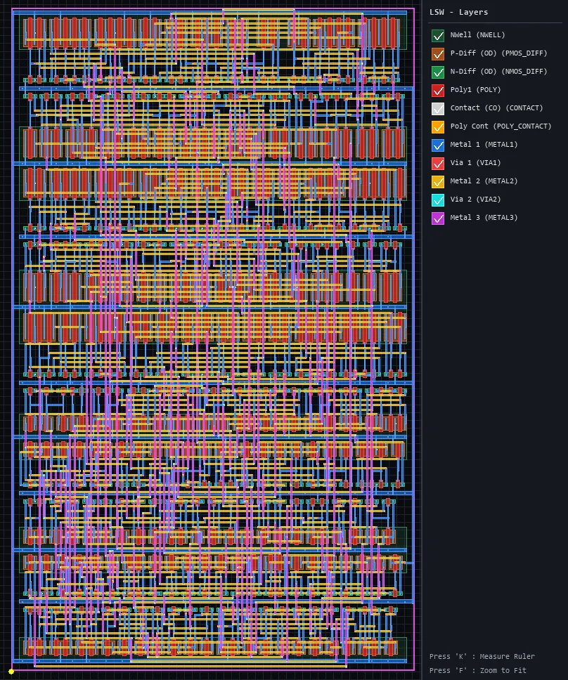

# IC版图解析

## 🧑‍💻 User

2168d2d872dd84c8dd19d727256037e3.png 解释一下图



---
## 😀 默认助手 (7)

# 图片解释：集成电路版图（IC Layout）

这是一张**集成电路物理版图（IC Layout / Physical Layout）**的截图，很可能来自版图查看/编辑工具（如 **KLayout**、**Cadence Virtuoso** 等）。图中展示的是芯片制造时各层掩膜（mask）叠加在一起的俯视图。

## 一、右侧图层面板（LSW - Layers）

右侧的 `LSW` 是 **Layer Selection Window（图层选择窗口）**，列出了版图中用到的所有工艺层，每一层用不同颜色区分：

| 颜色 | 图层名称 | 含义 |
|------|----------|------|
| 🟩 绿色 | `Nwell (NWELL)` | N 型阱区，用于制造 PMOS 衬底 |
| 🟫 棕色 | `P-Diff (OD) (PMOS_DIFF)` | P 型有源区（扩散区），PMOS 的源/漏/沟道 |
| 🟩 绿色 | `N-Diff (OD) (NMOS_DIFF)` | N 型有源区，NMOS 的源/漏/沟道 |
| 🟥 红色 | `Poly1 (POLY)` | 多晶硅层，主要作 MOSFET 栅极和局部连线 |
| ⬜ 白色 | `Contact (CO)` | 接触孔，连接多晶硅/有源区与金属层 |
| 🟨 黄色 | `Poly Cont (POLY_CONTACT)` | 多晶硅接触孔 |
| 🟦 蓝色 | `Metal 1 (METAL1)` | 第一层金属互连线 |
| 🟥 红色 | `Via 1 (VIA1)` | 金属 1 与金属 2 之间的通孔 |
| 🟨 黄色 | `Metal 2 (METAL2)` | 第二层金属互连线 |
| 🟩 青色 | `Via 2 (VIA2)` | 金属 2 与金属 3 之间的通孔 |
| 🟪 紫色 | `Metal 3 (METAL3)` | 第三层金属互连线 |

## 二、主视区（版图本身）

### 1. 整体结构
- 画面呈**规则重复的阵列**，这是典型的 **标准单元（Standard Cell）** 布局。
- 每一行（row）代表一排标准单元，行与行之间由粗的蓝色/青色线条（**电源/地轨道，Power/GND Rail**，一般在 Metal1 上）分隔开。
- 从下到上大致可见多排单元（约 6~7 行），每排高度一致。

### 2. 各层视觉特征
- **密集的红色竖条纹（Poly1）**：每排内大量重复的红色竖线，是晶体管的**多晶硅栅极**，说明这里有很多逻辑门（反相器、NAND、NOR、触发器等等）。
- **棕/绿色块（P-Diff / N-Diff）**：与红色 poly 交叉形成 PMOS 和 NMOS 晶体管，通常每排上下分别是 PMOS 和 NMOS（CMOS 结构）。
- **白色小方点（Contact）**：分布在有源区和多晶硅上，是器件到 Metal1 的连接点。
- **蓝色横向/纵向线（Metal1）**：单元内部的局部互连，以及横贯整行的电源地轨道。
- **黄色（Metal2）+ 紫色（Metal3）**：更高层的走线，通常用于单元之间的信号布线（routing），图中可见大量纵向长线贯穿多行，形成布线通道。
- **红/青色小方块（Via1 / Via2）**：层与层之间的连接孔。

### 3. 层次叠放关系（从下到上）
```
衬底/阱  →  Diff(有源区) + Poly(栅)
         →  Contact  →  Metal1
         →  Via1     →  Metal2
         →  Via2     →  Metal3
```
这也正是面板中图层的排列顺序，颜色叠加后形成你看到的复杂图案。

## 三、底部提示信息

- `Press 'K' : Measure Ruler` —— 按 **K** 使用测量尺工具（量尺寸/间距）。
- `Press 'F' : Zoom to Fit` —— 按 **F** 缩放至全图。

这两条说明这是**交互式版图编辑器**的界面截图。

---

## 总结

这张图展示的是**基于标准单元库的数字电路版图**：大量标准单元（CMOS 逻辑门）排列成行，通过多层金属（Metal1/2/3）和通孔（Via）完成互连。它体现了从**晶体管（Diff + Poly）→ 接触孔 → 多层金属布线**的完整芯片物理实现结构，是数字芯片（如 ASIC、SoC）后端设计中的典型视图。

如果你想深入了解某一部分（比如如何识别具体的逻辑门、DRC 规则、或电源网络），可以告诉我，我再展开讲。
