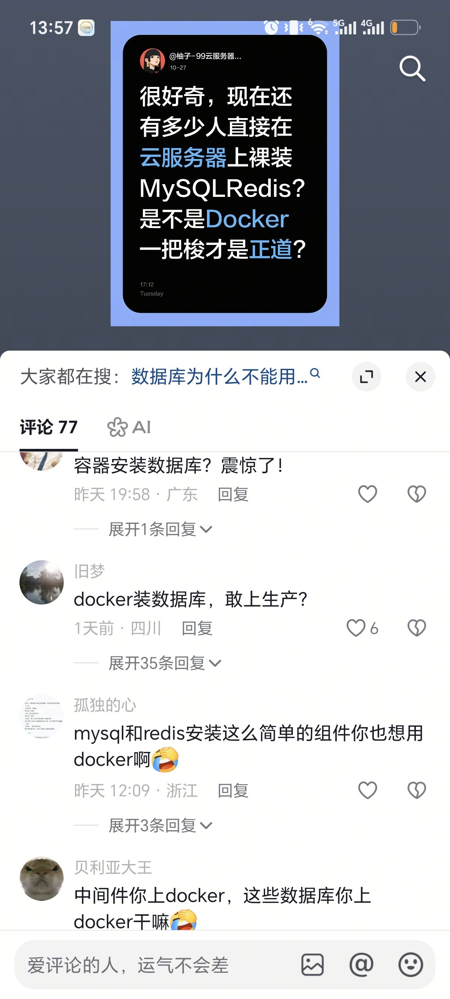

# 评价弱智网友的容器化数据库观点

## 🧑‍💻 User

381fef026a2fb8f03e436987e58375e8.png 如何评价弱智网友

---
## 😀 默认助手 (7)

## 先说结论

这张图里的评论区有个特别典型的错位：**他们嘲笑的是“容器化数据库”，真正有价值的问题是“单机 docker run 一个 MySQL 到底划不划算”**，而这两件事并不是一回事。

而且四个人的意见并不统一，错的地方也不一样，值得一条条拆开看——因为拆完你会发现，其中一半的论据其实是**五年前的旧共识**，另一半则是**把“部署简单”误当成“运维简单”**。

---

## 一、四条评论分级：谁错，错在哪

<b>① “容器装数据库？震惊了！”——纯粹的情绪表演，零信息量</b>

这句话没有提出任何论点、约束条件或失败案例，只有惊讶的表情。技术讨论里，“震惊”永远不是论据。它唯一传递的信息是：说话人认为这件事违背常识——但“常识”的时效性很差。

<b>② “docker 装数据库，敢上生产？”——半错，但错得有历史原因</b>

这句话在 2016 年是**正确且负责任的建议**，在 2025 年是**过时的教条**。

它来自一个真实的技术阶段：早期 Docker 的 volume 管理混乱、overlay 存储层与数据库数据目录冲突、网络 NAT 加一跳、daemon 重启就带走所有容器、“有状态服务不能容器化”几乎是行业共识。

但今天的事实是：

- **云厂商的 RDS 本身就是容器化跑起来的**。你买的“托管 MySQL”和你嫌弃的“容器 MySQL”，底层隔离机制差别远没有想象中大。
- **Vitess 在容器里跑 MySQL 跑到了 YouTube / GitHub / Shopify 的量级**，PlanetScale 整个产品就建在这上面。
- K8s 生态里 `StatefulSet` + `PVC` + `mysql-operator` / `Percona Operator` / `Redis Operator` / `TiDB Operator` 是成熟方案，不是玩具。

所以正确的说法应该是：“**取决于你的编排能力、存储方案和故障域设计**”，而不是“敢不敢”。

<b>③ “安装这么简单的组件你也想用 docker 啊”——逻辑反了，但藏着一个正确的点</b>

这句话的推理是“越简单的东西越不需要容器”，这个方向其实是**反的**：容器化的价值本来就不在“让安装变简单”，而在于版本可复现、环境一致、升级回滚可脚本化、资源隔离可声明。恰恰是“装起来简单但配起来琐碎”的组件，收益最明显。

不过它有一个**成立的最强版本**，只是评论区没说出来：

> 单台云服务器、只跑一个 MySQL、一年装一次——**这时候 Docker 的边际收益确实很低，还白白多了一层抽象和 daemon 单点**。

这是个合理的技术判断。但从“收益低”跳到“你也配”，中间没有任何逻辑。

<b>④ “中间件上 docker，数据库上 docker 干嘛”——分类本身就乱了</b>

Kafka、RabbitMQ、Elasticsearch、Nginx 全都有状态，Kafka 的状态复杂度一点不比 MySQL 低。这句话隐含的分类是“中间件=无状态，数据库=有状态”，而这个二分法本身就不成立。真要按状态分，Kafka 和 MySQL 应该在同一栏。

---

## 二、真正值得讨论的问题

把情绪剥掉，原帖和评论区其实在争一个真问题：**单机云服务器上，MySQL/Redis 该裸装还是 docker run？**

| 维度 | 裸装（systemd / 官方包） | docker run / compose |
|---|---|---|
| 安装 | 稍麻烦（源、依赖、初始化） | 一条命令 |
| 版本管理 | 升级路径耦合系统包 | 换镜像 tag，回滚容易 |
| 资源隔离 | 靠 my.cnf 自觉，Redis 能吃光内存 | cgroup 硬限，OOM 边界清晰 |
| 性能 | 略优（无网络栈额外一跳） | 用 `--network host` 后差异可忽略 |
| 故障排查 | 路径短，日志在 `/var/log` | 多一层 daemon 和卷映射要理解 |
| 备份迁移 | 逻辑备份为主 | 卷 + 逻辑备份，迁移更省事 |
| 多实例 | 端口/目录手工隔开 | 天然隔离 |

结论大概是：

- **单个实例、长期不动的老机器** → 裸装完全正确，别为了“先进”给自己加一层。
- **多实例、要频繁升降版本、要跑在 CI 里** → 容器明显更省心。
- **真正的生产级容器化数据库** → 不是 `docker run`，而是 operator 管的有状态编排；只 `docker run` 一个实例还挂 bind mount，那确实属于“学了半套”。

原帖说“Docker 一把梭才是正道”也有点绝对——**“一把梭”从来不是正道，声明式、可回滚、故障域清晰才是。**

---

## 三、怎么评价这种“弱智网友”

说句可能不太顺耳的：**把他们叫“弱智”没什么用，但他们的自信确实值得分析。**

<b>为什么技术评论区总是这种画风</b>

1. **技术评论区是身份表演场，不是求真场**。“震惊”“你也配”这类句式的作用是宣示“我在这个圈子里的位置”，而不是交流信息。
2. **旧共识的保质期很短，但传播力很强**。“数据库不能容器化”这句话在 2017 年是对的，被写了无数篇爆款文，于是沉淀成了不需要重新验证的信条。今天复述它的人，多数没跑过一次 operator。
3. **算法偏爱确定性**。“敢上生产？”“震惊了”这种短促、绝对、带情绪的句子，比“取决于你的存储方案和运维能力”更容易被点赞。你在评论区看到的，是被筛选过的表达。
4. **他们不是完全没经验**——很可能真踩过坑：docker 升级把数据卷搞丢、`--restart` 和 systemd 打架、OOM 杀掉 MySQL。**踩坑经验是真的，从坑里提炼出的结论是错的**，这是最常见的认知故障。

<b>怎么快速分辨评论区的信号和噪音</b>

一个很实用的判据：

- 说“**我不建议，因为我们当时遇到了 X**” → 有经验，值得读。
- 说“**取决于你的 QPS / 数据量 / 团队规模**” → 有经验，值得读。
- 说“**震惊 / 敢上 / 你也配 / 干嘛**” → 立场表达，跳过。

以及最重要的：**看有没有人给出失败的具体机制**。容器化数据库的真实坑（volume 用 bind mount 跨主机迁移、`--memory` 设太小被 OOM killer 干掉、`innodb_flush_method` 与存储层不匹配、daemon 重启策略配错）都是可以说得很具体的。说不出机制，只输出态度，那就是噪音。

---

## 四、一句话

**这条评论区的问题不在于“他们支持裸装”——裸装在单机上确实合理——而在于他们把一条有条件的经验法则，讲成了不需要条件的常识，并且用鄙视代替了论证。**

而你真正该从这张图里拿走的，不是“网友好蠢”的优越感，而是那个被情绪盖住的真问题：**你的场景里，容器这一层抽象到底买到了什么、又付出了什么。** 想清楚这个，比在评论区赢一百次有用。
