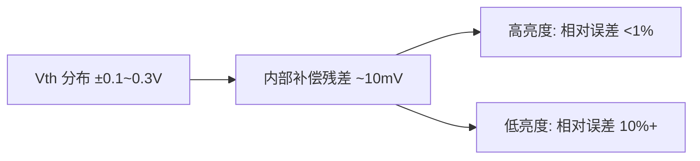

# OLED真DC调光难兼顾屏幕素质

## 🧑‍💻 User

为什么常规OLED屏是极难走真DC调光的同时保证其他屏幕素质的

---
## 😀 默认助手 (7)

## 一句话结论

LCD 把“亮度”和“灰阶”分成两个控制维度：背光决定绝对亮度，液晶透射率决定灰阶。OLED 只有**一个**控制维度——流过每个子像素的**电流**。真 DC 调光要求把这个电流连续、精确地压到 nA 量级，而 OLED 的电光特性、TFT 的阈值漂移、人眼对色偏和均匀性的敏感度，**恰恰在低电流区同时变得最差**。这就是矛盾的根源，问题主要出在高端，而不在低端。

---

## 一、先厘清“调光”的三种含义

| 方式 | 原理 | 特点 |
|---|---|---|
| **真 DC** | 连续改变电流幅值 $I$，$L \propto I$ | 无频闪，但低亮度精度、色偏、均匀性极难保证 |
| **PWM** | 电流幅值固定，改变占空比 $D$，$L = D \cdot L_{\text{peak}}$ | 工作点恒定，颜色、灰阶线性度好，但有频闪 |
| **类 DC / 高频 PWM** | 高亮度用真 DC，低亮度切 PWM（如 <30%），或把 PWM 提到 1920/2160/3840 Hz | 目前量产机的主流折中 |

所谓“极难”，指的是**用真 DC 覆盖全亮度范围（尤其 1–10 nit 段）**，而不是“做不出 DC”。

---

## 二、结构性差异：单旋钮与双旋钮

LCD 显示暗画面时，液晶仍在正常电压工作点，只是背光调暗——**调光与灰阶相互独立**。因此背光 DC 调光容易实现，灰阶的 0.1%–100% 动态范围也容易覆盖。

OLED 则必须靠降低像素电流本身来实现暗画面。于是：**调光精度 = 灰阶精度 = 电流精度**，三者绑定，任何一个环节的误差都会直接变成可见缺陷。

---

## 三、六个关键限制

### 3.1 低电流区的精度限制（最核心）

驱动 TFT 处于饱和区时：

$$I_{D}=\frac{1}{2}\mu C_{ox}\frac{W}{L}(V_{GS}-V_{th})^2 \quad\Rightarrow\quad \frac{\Delta I}{I}=\frac{2\Delta V_{GS}}{V_{GS}-V_{th}}$$

举个量级：8 bit 源极驱动、5 V 摆幅 → 约 $19.5\ \text{mV/LSB}$。若低灰阶过驱动电压只有 $0.1\ \text{V}$，一个 LSB 就带来 **约 40% 的亮度跳变**。若 TFT 进入亚阈值区，则更糟：

$$I_D \propto \exp\!\left(\frac{V_{GS}-V_{th}}{nV_T}\right),\qquad S=\frac{dV_{GS}}{d\log_{10}I_D}\approx 60\text{–}100\ \text{mV/dec}$$

$19.5\ \text{mV}$ 对应 **0.2–0.3 个数量级，即 1.6–2 倍电流变化**。要做到 1% 级平滑过渡，需要 **≤1–2 mV 的电压分辨率**，也就是 12–14 bit DAC——面积、功耗、成本全面上升，且仍受噪声限制。

另一方面，绝对电流小得惊人：6.7 吋、2K、全白 500 nit 时整屏约 1 A；**1 nit 时每个子像素只有亚 nA 量级**。用 TFT 去稳定控制 0.3 nA，本身就是很困难的工作。

### 3.2 $V_{th}$ 失配与补偿精度

LTPS/LTPO 的 $V_{th}$ 在板内、板间存在 $0.1\!-\!0.3\ \text{V}$ 级分布，并随电应力、温度漂移。7T1C 内部补偿能把残差压到 10 mV 量级——但由 3.1 可知，**低电流下同样的残差造成的相对误差被放大若干倍**。补偿电路本身也工作在“小过驱动”状态，其增益、电荷注入误差同步放大。

### 3.3 色坐标随电流密度漂移（低亮度偏色、发绿的主要原因）

OLED 的发光光谱和色坐标**不是与电流无关的常数**：

- 复合区位置随电流密度移动，改变发射光谱；
- R/G/B 三色的开启电压、效率-电流曲线不同，低电流下相对比例失衡；
- 效率滚降（efficiency roll-off）在两端都存在。

结果就是低亮度下白点漂移、**低亮度发绿**——这在 OLED 手机上是常见问题。

**PWM 的优势正在此处**：它让像素始终工作在“标称电流密度”这一个点上，颜色、效率、光谱全部恒定，只改变占空比。人眼低通滤波后会看到平均亮度变化，但**色度不变**。这是 PWM 显示素质反而“更好”的核心原因。

### 3.4 均匀性与 De-mura 的非线性

De-mura 系数通常在高亮度下标定。而 $I\!-\!V$ 关系在低端强非线性，加上 $V_{th}$ 漂移、温度差异，**同一组补偿系数无法线性外推到低亮度**。于是低亮度会出现 mura、脏屏、暗部块状不均。

此外，数据线对像素的容性耦合、ELVDD/ELVSS 的 IR drop，在低电流下绝对值虽小，但**相对占比**并不下降（串扰、暗场水波纹）。

### 3.5 帧内纹波与漏电（决定“真 DC 也会闪”）

即便用 DC 电流，像素每帧仍要被重新写入。开关 TFT 的时钟馈通、电荷注入、存储电容漏电，会产生**与刷新率同频的电流纹波** $\Delta I_{\text{ripple}}$。这个纹波绝对值近似固定，于是：

$$\frac{\Delta I}{I}\ \propto\ \frac{1}{I}$$

亮度越低，相对纹波越大。算个量级：存储电容 1 pF、漏电 1 pA、帧周期 16.7 ms → $\Delta V \approx 16.7\ \text{mV}$，已与一个低灰阶步长同量级。LTPO 把漏电降低约两个数量级，正是为了在低频/低亮度下“撑住”这个电荷——这也是 LTPO 成为全亮度 DC 前提的原因。

### 3.6 效率—寿命—电源的三角约束

- 若靠**降低 ELVDD** 调暗，驱动 TFT 会退出饱和区进入线性区，电流对 $V_{ds}$ 敏感 → 对 IR drop 极度敏感，均匀性崩溃；
- 若靠 **$V_{GS}$** 调暗，如 3.1 所述在亚阈值区精度崩溃；
- PWM 低占空比时峰值电流密度高，**老化更快**；真 DC 电流低、老化慢，但要付出色偏与均匀性代价。

---

## 四、为什么厂家最终都走向“类 DC”

<b>展开：主流工程折中方案一览</b>

1. **高亮度真 DC + 低亮度高频 PWM**（最常见）：把矛盾集中到人眼最不敏感、且低亮度本身对比度需求低的区间。
2. **提高 PWM 频率**：2160 Hz / 3840 Hz / 4320 Hz，把频闪推到人眼时间滤波截止频率以上，同时保留恒定点工作的色彩优势。
3. **12 bit 源极驱动 + 更精细的 gamma**：把低灰阶电压步长压到 mV 级。
4. **LTPO**：漏电低两个数量级，支持低频保持，为低亮度维持电荷、降低帧频纹波。
5. **Tandem 双栈 OLED**：同亮度下电流密度更低、寿命更长，等价于把工作点往“安全区”挪，给 DC 留余量。
6. **按亮度分段标定的 De-mura + 温度补偿**：缓解 3.4，但成本与产线时间上升。
7. **Micro-OLED / Micro-LED**：驱动方式不同（如电流源驱动、脉冲驱动），是另一个体系，不属“常规 OLED”。

---

## 五、总结对照表

| 约束维度 | LCD（背光 DC） | 常规 OLED（真 DC） |
|---|---|---|
| 调光与灰阶 | 分离，互不干扰 | 同一旋钮，耦合 |
| 低端精度 | 液晶电压驱动，mV 级易得 | nA 级电流 + 亚阈值，需 12–14 bit |
| 色度稳定性 | 背光光谱恒定 | 随电流密度漂移，低亮度偏色 |
| 均匀性 | 背光均匀性易控 | $V_{th}$ 失配 + De-mura 非线性 |
| 帧内稳定性 | 与亮度无关 | 漏电/馈通相对占比随亮度升高 |
| 结论 | DC 容易 | **全亮度真 DC 需同时突破以上全部约束** |

所以，说“极难”并不夸张——OLED 真 DC 面临的不是一项技术没做好，而是**电流精度、阈值补偿、色度稳定、均匀性、漏电保持、寿命**这六项要求在低电流点同时逼近极限，而且彼此还互相制约（降 ELVDD 保不住饱和区，提精度要加位数加成本，恒定点工作又必须回到 PWM）。这也是为什么行业内普遍认为：**“全亮度真 DC”在常规 OLED 上更多是工程极限的挑战，而不是一个可以随意打开的开关。**
